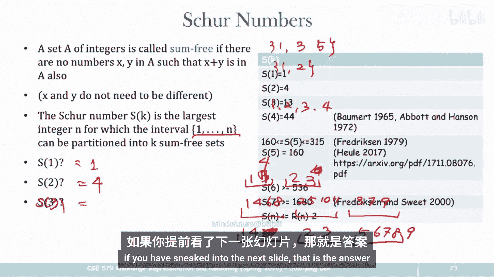
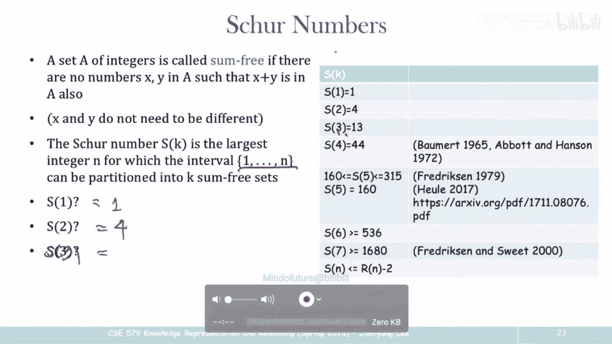

# 009：ASP编程中的构造

在本节课中，我们将学习答案集编程中的两个核心构造：选择规则和约束。我们将通过具体示例来理解它们的工作原理，并学习如何运用这些构造来解决问题。

## 概述

本节课我们将探讨答案集编程中的两种重要语法结构：选择规则和约束。选择规则允许我们生成一组可能的候选解，而约束则用于在这些候选解中筛选出满足特定条件的解。我们将通过实例学习如何编写和组合这些规则，并了解它们在解决组合问题（如N皇后问题）中的应用。

## 选择规则

选择规则是ASP中用于生成可能性的核心工具。其基本形式是使用花括号 `{}` 将一组原子括起来。

### 基本选择规则

一个简单的选择规则 `{p}` 是 `p or not p` 的简写形式。它的稳定模型是空集 `{}` 和单元素集 `{p}`。这体现了“选择”的含义：我们可以选择是否将原子 `p` 包含在答案集中。

当选择规则包含多个原子时，例如 `{p(a); q(b)}`，它等价于 `(p(a) or not p(a)) ∧ (q(b) or not q(b))`。这个程序的稳定模型是集合 `{p(a), q(b)}` 的所有子集，共有4个。

我们可以使用以下命令运行程序：
```bash
clingo choice.lp 0
```
输出将显示所有稳定模型（在clingo输出中标记为“Answer”）。

### 简化写法

为了编写更简洁的代码，ASP提供了一些简写方式。

1.  **区间表示法**：对于连续的整数参数，可以使用区间。例如，`{p(1..3)}` 等价于 `{p(1); p(2); p(3)}`。它生成了3个原子，因此有 `2^3 = 8` 个稳定模型。
2.  **聚合表示法**：对于符号常量，可以使用聚合。例如，`{p(a, b, c)}` 等价于 `{p(a); p(b); p(c)}`。这只是一种更整洁的书写方式。

上一节我们介绍了基本的选择规则，本节中我们来看看如何为选择规则添加基数约束。

### 带基数约束的选择规则

我们可以在选择规则的花括号后添加基数约束，以限制所选子集的大小。格式为 `{...} = k`、`{...} >= l` 或 `{...} <= u`。

例如，规则 `{p(1); p(2); p(3)} = 1..2` 表示从集合 `{p(1), p(2), p(3)}` 中选择一个基数（元素个数）为1或2的子集。这排除了空集（基数为0）和全集 `{p(1), p(2), p(3)}`（基数为3），因此稳定模型的数量为 `8 - 2 = 6`。

考虑以下规则：
*   `{p(1..6)} >= 1`：从6个原子中选择至少包含1个元素的子集。这排除了空集，因此有 `2^6 - 1 = 63` 个稳定模型。
*   `{p(1..6)} = 3`：从6个原子中选择恰好包含3个元素的子集。这是组合数 `C(6,3) = 20`，因此有20个稳定模型。

### 基数约束的简化

某些带基数约束的选择规则可以简化为更简单的形式。
*   `{p(a)} >= 0` 等价于 `{p(a)}`，因为下界0没有提供额外限制。
*   `{p(a)} = 1` 等价于 `p(a)`，因为从单元素集中必须选且只能选一个，即 `p(a)` 必须为真。
*   `{p(a)} <= 1` 也等价于 `{p(a)}`，因为从单元素集中最多选一个，没有额外限制。

这些简化形式在输入给clingo时，会产生相同的稳定模型。

## 变量在规则中的使用

为了避免编写冗长的代码，我们可以使用变量。变量分为全局变量和局部变量。

### 全局变量

出现在规则体（或头部）中，且不在某个特定集合（如选择规则的花括号）范围内的变量称为全局变量。在实例化（接地）时，规则会根据变量的所有可能取值生成多条接地规则。

例如，规则 `{p(X); q(X)} = 1 :- index(X).`，其中 `X` 是全局变量。如果 `index(1)` 和 `index(2)` 为真，则该规则会生成两条接地规则：
1.  `{p(1); q(1)} = 1.`
2.  `{p(2); q(2)} = 1.`

每条规则要求从两个原子中恰好选择一个，组合起来共有 `2 * 2 = 4` 个稳定模型。

### 局部变量

所有出现都局限于某个集合（如选择规则的花括号）范围内的变量称为局部变量。其实例化发生在集合内部，不会导致规则数量增加，而是扩展了集合的内容。

考虑以下规则：
```
index(1..7).
{p(I) : index(I)}.
```
这里，`I` 是局部变量，因为它只出现在花括号 `{}` 和条件 `index(I)` 中。这条规则可以理解为：选择所有满足 `index(I)` 为真的 `p(I)` 构成的集合的子集。当 `index(1..7)` 给定时，集合是 `{p(1), p(2), ..., p(7)}`。因此，这条规则等价于 `{p(1); p(2); ...; p(7)}.`，它生成该集合的所有子集作为候选。

使用局部变量可以让我们用简洁的意图性描述来定义一个大集合，这是ASP编程成功的关键之一。

## 约束

约束是一种头部为空的规则，形式为 `:- Body.`。逻辑上，它等价于 `⊥ :- Body.`，或 `¬ Body`。约束的作用是“消除”那些使规则体为真的候选稳定模型。

### 约束的作用

考虑一个简单程序 `p | q.`，它有两个稳定模型：`{p}` 和 `{q}`。如果我们添加一条约束 `:- p.`，其含义是“如果 `p` 为真，则导致矛盾”。因此，包含 `p` 的稳定模型 `{p}` 被消除，只剩下 `{q}`。

这种添加公式导致模型数量减少的性质，在经典逻辑中称为单调性。虽然稳定模型语义本身是非单调的，但通过添加约束，我们可以模拟单调推理行为：先通过选择规则生成所有候选解，再用约束剔除不满足条件的解。

### 使用约束进行筛选

我们可以分步推理带有约束的程序：
1.  首先，忽略所有约束，找出剩余部分的稳定模型。
2.  然后，检查这些稳定模型是否满足每一个约束。
3.  剔除所有违反至少一个约束的稳定模型，剩下的就是整个程序的稳定模型。

例如，对于程序 `{p(1); p(2); p(3)}. :- p(1).`：
*   忽略约束部分 `{p(1); p(2); p(3)}.` 有8个稳定模型（`{p(1), p(2), p(3)}` 的所有子集）。
*   约束 `:- p(1).` 要求不能包含 `p(1)`。
*   因此，在8个稳定模型中，剔除所有包含 `p(1)` 的集合（共4个），剩下4个不包含 `p(1)` 的稳定模型。

### 约束与基数约束的关系

带基数约束的选择规则和“选择规则+约束”的方式有时可以相互转换。

*   `{p(a); q(b)} <= 1` 等价于 `{p(a); q(b)}. :- p(a), q(b).`
*   `{p(a); q(b)} >= 1` 等价于 `{p(a); q(b)}. :- not p(a), not q(b).`

其核心思想是：基数约束直接限制了生成集合的大小，而约束则是在生成所有集合后，剔除不符合大小要求的集合。

## ASP编程方法论

综合运用选择规则和约束，形成了ASP编程的通用方法论，通常包含两个部分：

1.  **生成（Generate）**：使用选择规则（可能带有变量）定义并生成所有可能的候选解空间。
2.  **测试（Test）**：使用约束来排除那些不满足问题要求的候选解。

有时还会有一个第三部分“定义（Define）”，用于定义辅助谓词来简化规则编写。我们将通过一个经典问题来演示这种方法。

### 示例：N皇后问题

N皇后问题要求在一个N×N的棋盘上放置N个皇后，使得它们互不攻击（即任意两个皇后不在同一行、同一列或同一对角线上）。

以下是该问题的ASP编码：

```prolog
% 生成部分：为每一列j，在1..N行中恰好选择一个位置放置皇后。
{ q(I, J) : I = 1..N } = 1 :- J = 1..N.

% 测试部分：定义约束，排除非法放置。
% 1. 同一行不能有两个皇后。
:- q(I, J), q(I, J1), J != J1.
% 2. 同一对角线不能有两个皇后。
:- q(I, J), q(I1, J1), I != I1, J != J1, |I - I1| == |J - J1|.
```

**程序解释**：
*   **生成**：第一条规则是核心。对于每一列 `J`（从1到N），从集合 `{q(1,J), q(2,J), ..., q(N,J)}` 中恰好选择一个原子为真。这确保了每列恰好有一个皇后，并生成了所有可能的放置方式（共 `N^N` 种候选）。
*   **测试**：
    *   第一条约束规定，如果存在两个皇后在同一行 `I` 但不同列 `J` 和 `J1`，则该候选无效。
    *   第二条约束规定，如果存在两个皇后，它们的行差绝对值 `|I-I1|` 等于列差绝对值 `|J-J1|`（即在同一对角线上），则该候选无效。

通过 `clingo -c n=4 queens.lp 0` 等命令，clingo可以快速计算出所有解（例如，n=4时有2个解，n=8时有92个解）。

## 命题逻辑的可满足性问题

有趣的是，ASP可以用于求解命题逻辑公式的可满足性问题。思路正是“生成与测试”：
1.  **生成**：使用选择规则为所有命题原子生成所有可能的赋值（即所有可能的解释）。例如，对于原子p和q，规则 `{p; q}.` 生成4个候选：`{}, {p}, {q}, {p,q}`。
2.  **测试**：对于待求解的命题公式F，将其转换为约束 `:- not F.` 或等价的 `:- Body.` 形式。这个约束会剔除所有不满足F的候选赋值。




例如，求公式 `F = p ∨ q` 的模型。我们可以编写ASP程序：
```prolog
{p; q}.          % 生成所有对p和q的赋值
:- not (p; q).   % 测试：剔除不满足 p ∨ q 的赋值
% 等价于：:- not p, not q.
```
这个程序的稳定模型是 `{p}, {q}, {p,q}`，它们正好是公式 `p ∨ q` 的所有模型。这展示了如何将命题可满足性问题归约到寻找稳定模型的问题，从而可以利用clingo等ASP求解器来解决。

## 总结

本节课我们一起学习了答案集编程中的两个核心构造：选择规则和约束。
*   **选择规则** `{...}` 用于生成候选解空间，可以通过基数约束 `=`, `>=`, `<=` 进行限制，并可以使用全局变量和局部变量来简洁地描述大型集合。
*   **约束** `:- Body.` 用于剔除不满足特定条件的候选解，是实现问题要求的关键。
*   **ASP编程方法论**通常遵循“生成与测试”的模式，首先生成所有可能性，然后通过约束进行筛选。我们通过N皇后问题和命题可满足性问题的编码，具体实践了这种方法。
*   我们还了解到，ASP具有强大的表达能力，能够编码并解决复杂的组合数学问题，例如尚待完全解决的肖尔数问题。



掌握这些构造和方法，是运用答案集编程解决实际知识表征与推理问题的重要基础。