# 010：使用ASP解决图问题与优化 🧩

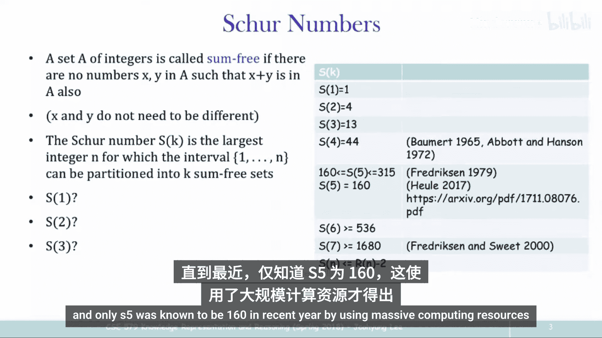

在本节课中，我们将继续讨论绍尔数问题，并学习如何使用答案集编程（ASP）来解决图论问题，以及如何在ASP中进行优化。

上一节我们介绍了绍尔数问题的基本概念。本节中，我们来看看如何将其形式化为ASP程序，并扩展到解决图着色、团、哈密顿回路和数独等问题。

## 绍尔数问题回顾与ASP编码

绍尔数 `S(K)` 是最大的整数 `n`，使得区间 `[1, n]` 可以划分为 `K` 个无和集。这意味着，我们需要将数字 `1` 到 `n` 放入 `K` 个不同的“桶”中，每个桶都是一个无和集。无和集的定义是：集合中任意两个（可以是相同的）数字之和，不在同一个集合中。

这是一个组合难题。例如，`S(5)` 直到近年才被确定为160，这需要大量的计算资源。

以下是解决该问题的ASP核心编码。我们使用 `in(I, S)` 表示数字 `I` 被放入桶 `S`。

```prolog
% 生成部分：将每个数字分配到K个桶中的一个
{in(I, S) : S = 1..K} = 1 :- I = 1..N.

% 测试部分：确保每个桶都是无和集
:- in(I, S), in(J, S), in(I+J, S).
```

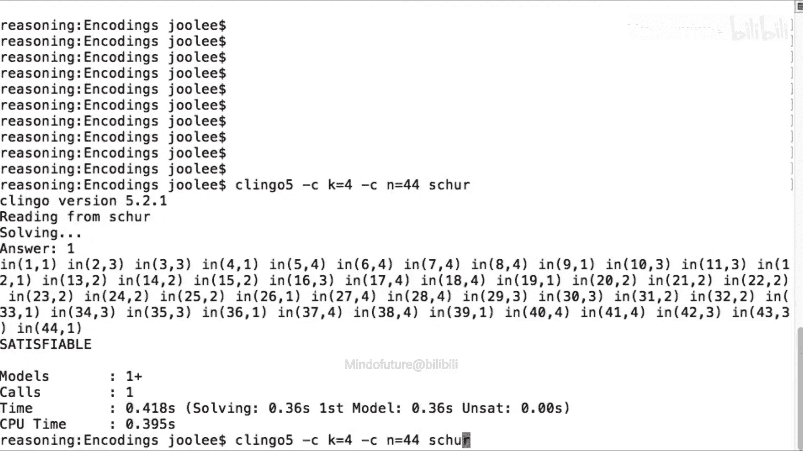

**代码解释**：
1.  **生成规则**：对于区间 `[1, N]` 中的每个数字 `I`，我们恰好选择 `1` 个桶 `S`（`S` 在 `1` 到 `K` 之间）。这生成了所有可能的分配方案。
2.  **约束规则**：如果数字 `I` 和 `J` 在同一个桶 `S` 中，并且它们的和 `I+J` 也在同一个桶 `S` 中，则此分配违反规则，将被排除。

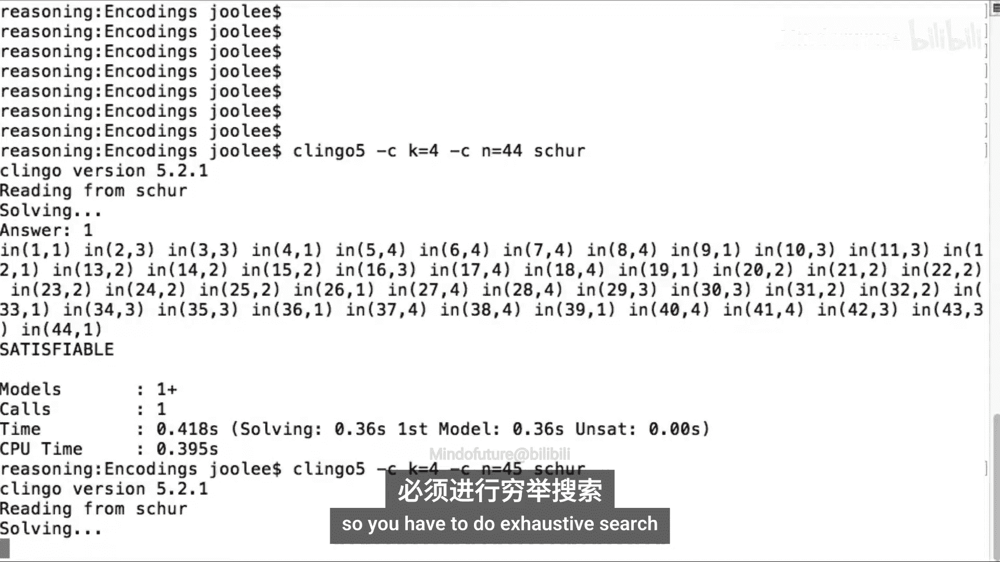

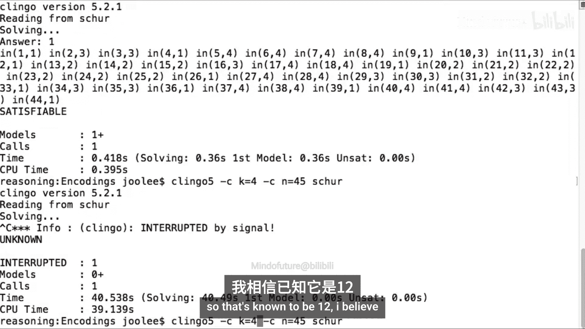

通过迭代增加 `N` 并检查程序是否可满足（即有解），我们可以找到最大的 `N`，即绍尔数 `S(K)`。

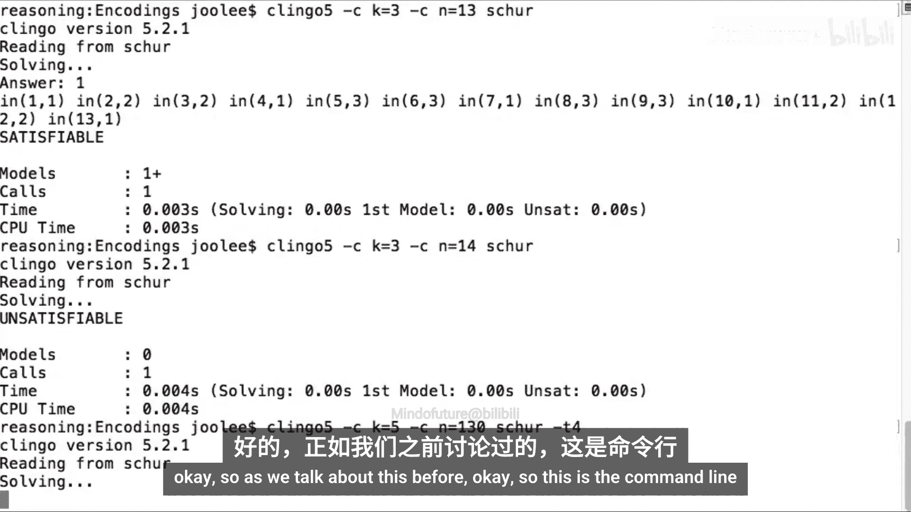

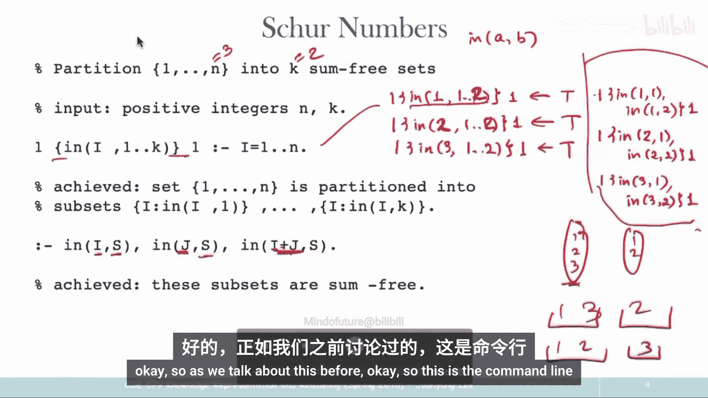

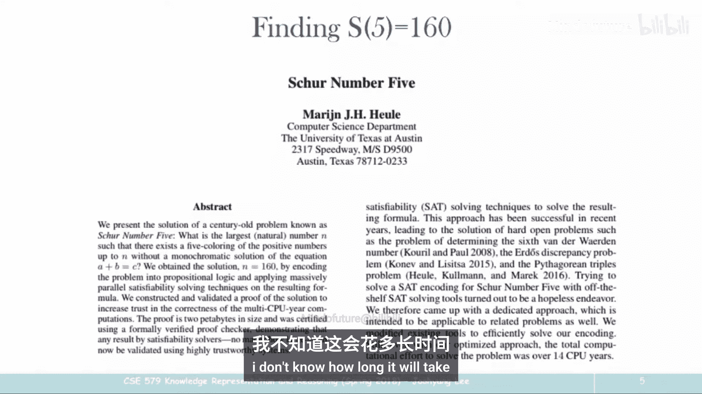

## 图着色问题 🎨

接下来，我们看看如何使用ASP解决经典的图着色问题。给定一个图，我们需要为每个顶点分配一种颜色，使得任何两个相邻的顶点颜色不同。

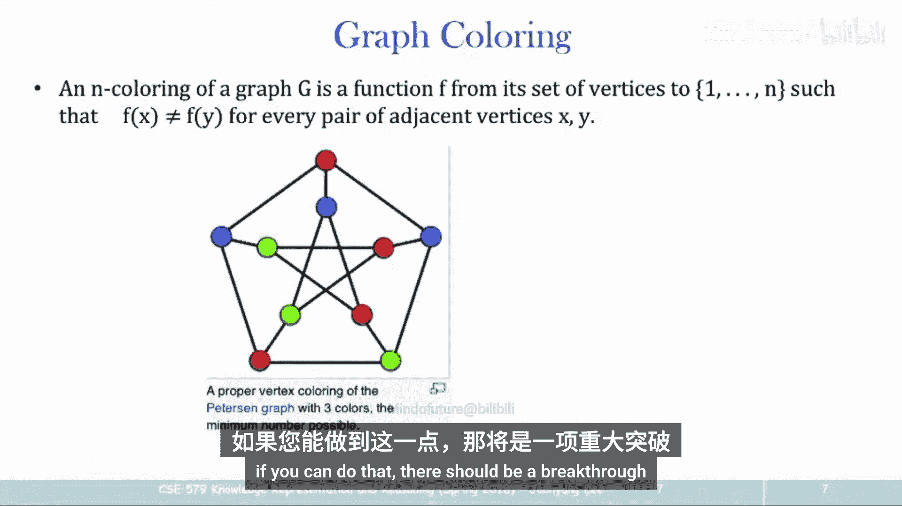

以下是图着色问题的ASP编码。假设图通过谓词 `vertex(V)` 和 `edge(V1, V2)` 给出。

```prolog
% 定义可用颜色（例如3种颜色）
color(1..3).

% 生成部分：为每个顶点分配恰好一种颜色
{color(V, C) : color(C)} = 1 :- vertex(V).

% 测试部分：相邻顶点不能同色
:- edge(V1, V2), color(V1, C), color(V2, C).
```

**代码解释**：
1.  **事实**：`color(1..3)` 定义了三种颜色。
2.  **生成规则**：对于每个顶点 `V`，从颜色集合中恰好选择一种颜色 `C` 分配给该顶点。
3.  **约束规则**：如果存在一条边连接顶点 `V1` 和 `V2`，并且它们被分配了相同的颜色 `C`，则此着色方案无效。

通过改变颜色数量并运行程序，我们可以判断图是否可用指定数量的颜色着色，并找出所有可能的着色方案。

## 寻找团问题 🔗

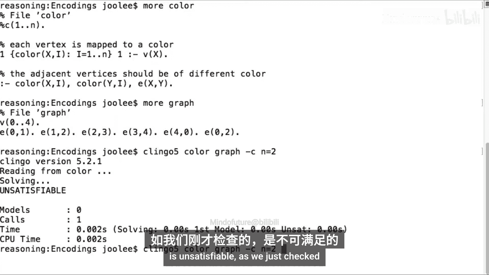

团是图中的一个顶点子集，其中任意两个顶点都相邻（即该子集构成的子图是完全图）。寻找大小至少为 `N` 的团是一个NP完全问题。

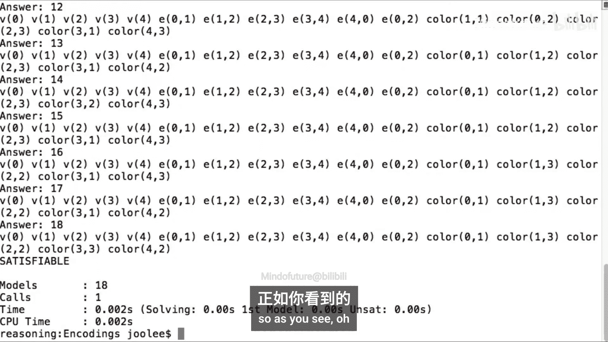

以下是寻找团的ASP编码：

```prolog
% 生成部分：从顶点集合中选择一个子集，其大小至少为N
{in(V) : vertex(V)} >= N.

% 测试部分：被选入子集的任意两个不同顶点之间必须有边连接
:- in(V1), in(V2), V1 != V2, not edge(V1, V2).
```

**代码解释**：
1.  **生成规则**：从所有顶点中，选择一个至少包含 `N` 个顶点的子集（用谓词 `in(V)` 表示顶点 `V` 在子集中）。
2.  **约束规则**：如果两个不同的顶点 `V1` 和 `V2` 都在选中的子集 `in` 中，但它们之间没有边相连，则此子集不构成团，该候选解被排除。

通过递增 `N` 并检查程序是否可满足，我们可以找到图中最大团的大小。

## 哈密顿回路问题 🚗

哈密顿回路是访问图中每个顶点恰好一次并返回起点的环路。这是一个经典的NP完全问题。

其ASP编码稍复杂，包含生成、定义和测试三部分：

```prolog
% 生成部分：为每个顶点选择唯一的一条出边和一条入边，构成候选边集（cycle）
{cycle(V, U) : edge(V, U)} = 1 :- vertex(V). % 每个顶点恰好一条出边
{cycle(V, U) : edge(V, U)} = 1 :- vertex(U). % 每个顶点恰好一条入边

% 定义部分：定义从固定起点（如顶点1）的可达性
reachable(U) :- cycle(1, U). % 与起点直接相连的顶点是可达的
reachable(V) :- reachable(U), cycle(U, V). % 递归定义可达性

% 测试部分：所有顶点都必须从起点可达
:- vertex(V), not reachable(V).
```

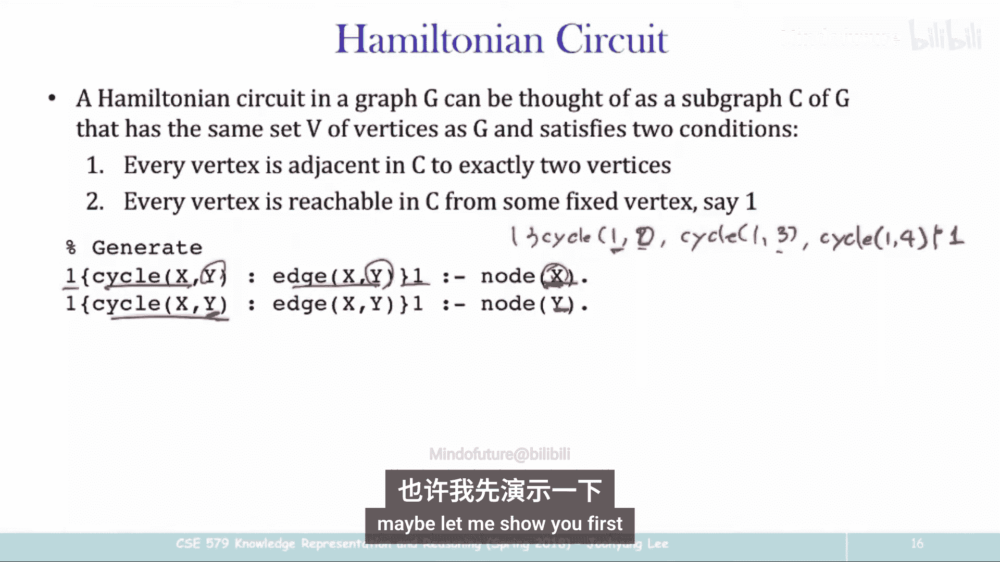

**代码解释**：
1.  **生成规则**：这两条规则确保选中的边集 `cycle` 构成一组回路，其中每个顶点都恰好有一条入边和一条出边。但这可能产生多个不相交的小环。
2.  **定义规则**：定义谓词 `reachable(V)`，表示顶点 `V` 可以从固定的起点（这里设为顶点1）通过选中的 `cycle` 边到达。
3.  **约束规则**：如果存在任何一个顶点不可达，则意味着候选边集没有形成单一的、包含所有顶点的回路，该解被排除。

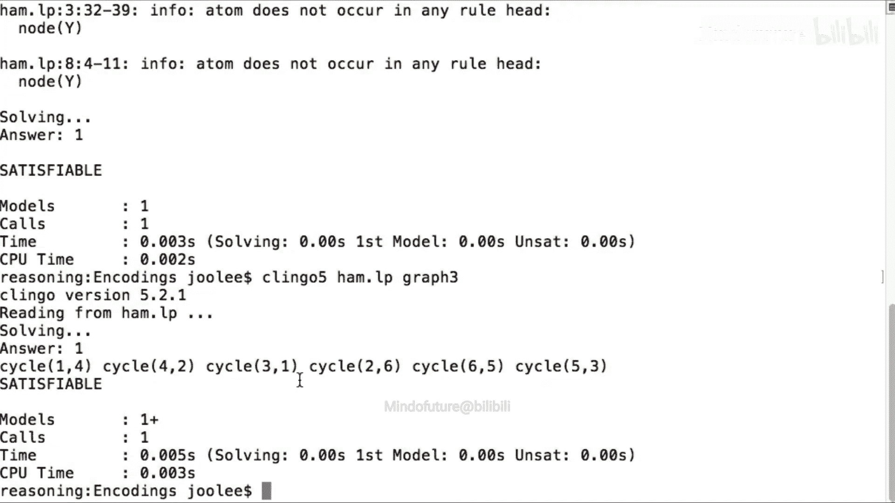

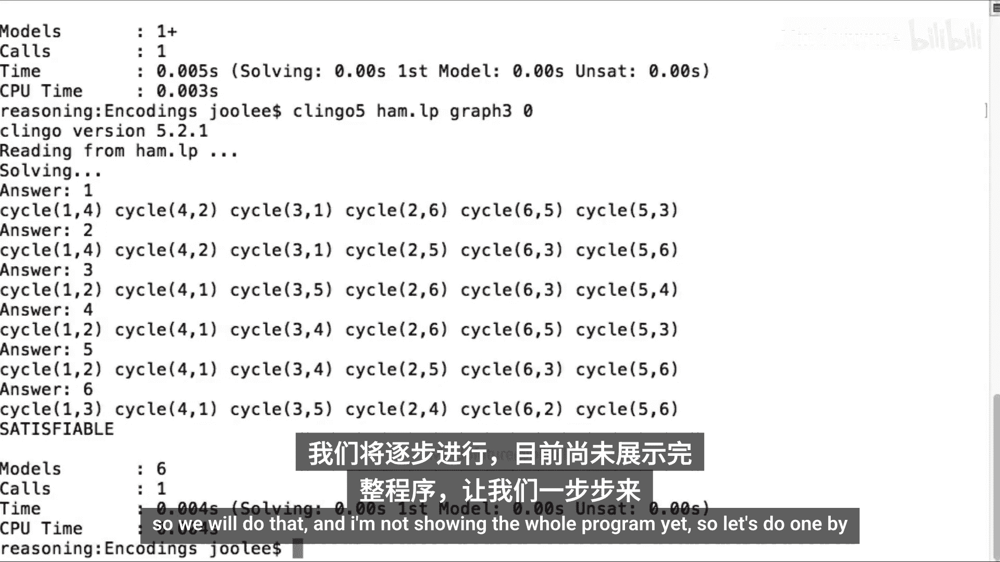

## 旅行商问题（带优化的哈密顿回路）✈️

在哈密顿回路问题的基础上，如果每条边都有成本，寻找总成本最低的哈密顿回路，就变成了旅行商问题（TSP）。在ASP中，我们可以轻松地通过优化语句来实现。

假设我们通过 `cost(V1, V2, C)` 给出了边的成本。

```prolog
% 包含上述哈密顿回路的所有编码...

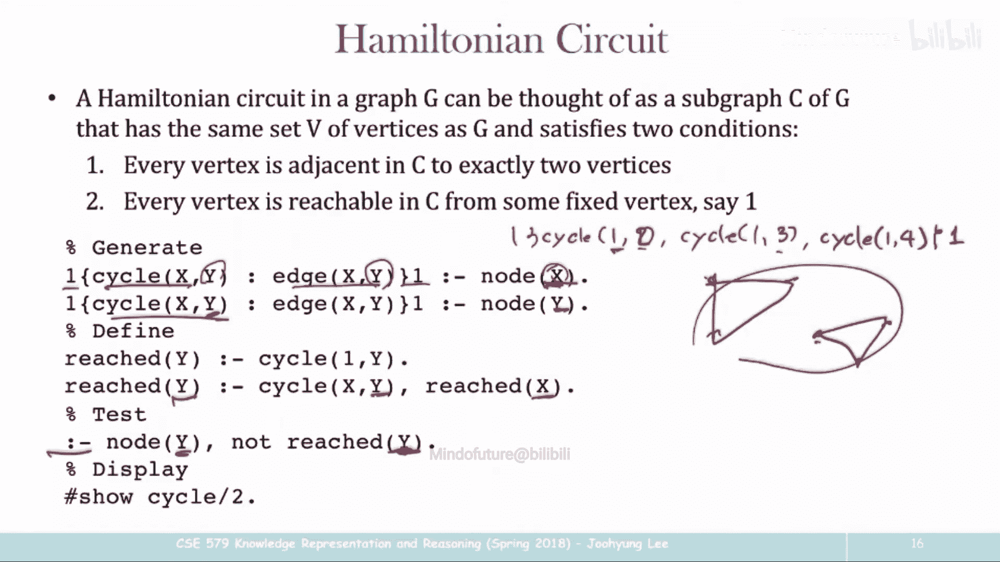

% 优化：最小化回路的总成本
#minimize { C, V, U : cycle(V, U), cost(V, U, C) }.
```

**代码解释**：
*   `#minimize` 语句告诉求解器，在所有稳定的哈密顿回路模型（即解）中，寻找使花括号内求和值最小的那个。这里是对回路中所有边 `cycle(V, U)` 的成本 `C` 进行求和并最小化。

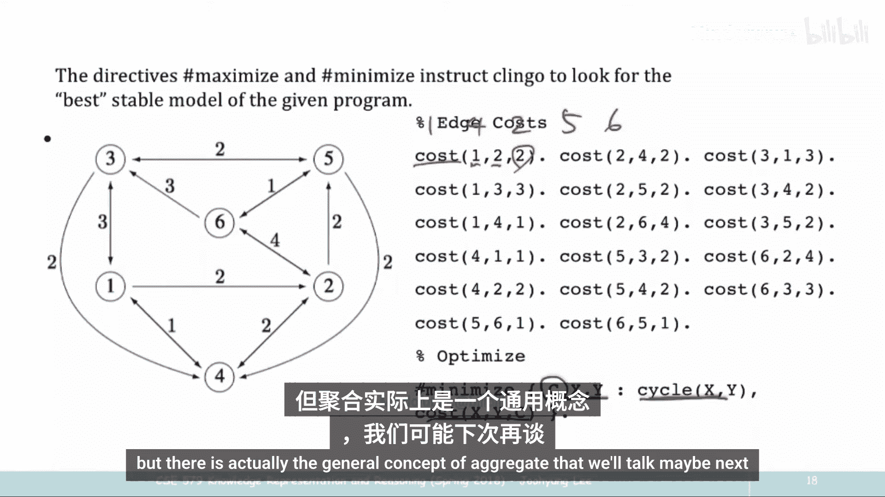

求解器会首先找到一个解，然后不断寻找成本更低的解，直到找到成本最低的解（最优解）并证明没有更优解为止。

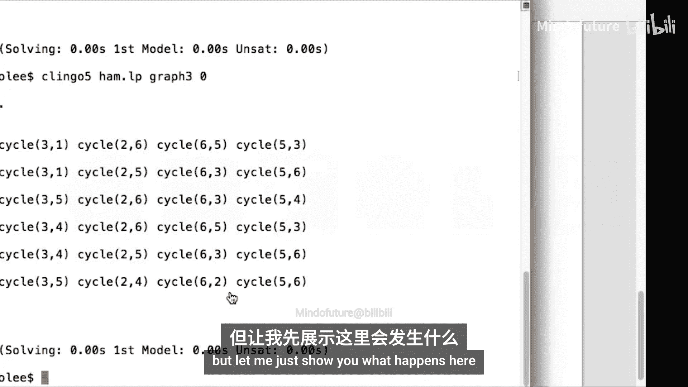

## 数独问题 🔢

数独是一个经典的约束满足问题。我们需要在9x9网格中填入数字1-9，满足每行、每列和每个3x3宫格内数字不重复。

以下是数独问题的ASP编码。使用 `cell(R, C, N)` 表示第 `R` 行、第 `C` 列的数字是 `N`。

```prolog
% 定义数字
number(1..9).

% 生成部分：每个格子必须填一个数字
{cell(R, C, N) : number(N)} = 1 :- number(R), number(C).

% 测试部分1：行和列约束
:- number(R), number(C1), number(C2), C1 < C2, cell(R, C1, N), cell(R, C2, N). % 行内无重复
:- number(C), number(R1), number(R2), R1 < R2, cell(R1, C, N), cell(R2, C, N). % 列内无重复

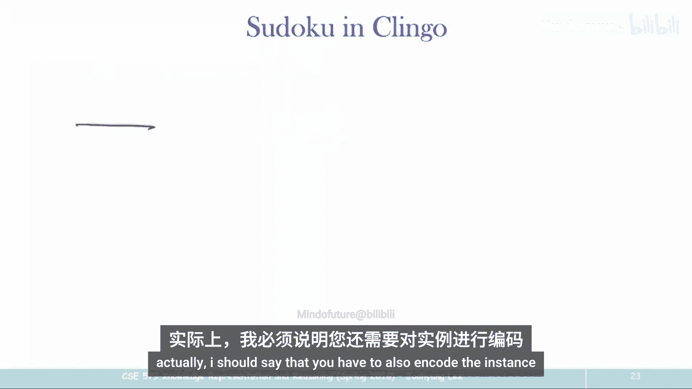

% 测试部分2：3x3宫格约束（一种编码方式）
:- number(R1), number(R2), number(C1), number(C2), number(N),
    R1 != R2, C1 != C2,
    (R1-1)/3 == (R2-1)/3, % 判断是否在同一宫格行
    (C1-1)/3 == (C2-1)/3, % 判断是否在同一宫格列
    cell(R1, C1, N), cell(R2, C2, N). % 同一宫格内数字N重复
```

**代码解释**：
1.  **生成规则**：为网格中的每个位置 `(R, C)` 恰好分配一个数字 `N`。
2.  **约束规则1**：前两条约束确保同一行或同一列中没有重复的数字。
3.  **约束规则2**：第三条约束确保每个3x3宫格内没有重复的数字。这里通过计算行索引和列索引除以3的整数商来判断两个格子是否属于同一个宫格。

ASP的** elaboration tolerance**（ elaboration 容忍性）在此得到体现。如果需要解决数独的变体（如杀手数独、奇偶数独等），通常只需在现有程序的基础上添加少数几条新约束即可，而无需重写整个逻辑。

## 总结

本节课中我们一起学习了如何使用答案集编程（ASP）解决一系列复杂的组合与图论问题：
1.  我们回顾了**绍尔数问题**，并看到了其简洁的ASP编码。
2.  我们探讨了**图着色问题**，其编码核心是为每个顶点分配颜色并约束相邻顶点。
3.  我们分析了**寻找团问题**，其思路是选择顶点子集并确保子集内全连接。
4.  我们深入研究了**哈密顿回路问题**，其编码需要生成候选边集、定义可达性并施加连通性约束。
5.  我们介绍了**旅行商问题**，展示了如何在ASP中通过 `#minimize` 语句轻松实现优化。
6.  最后，我们查看了**数独问题**的ASP解法，并提到了ASP在应对问题变体时的灵活性和强大性。


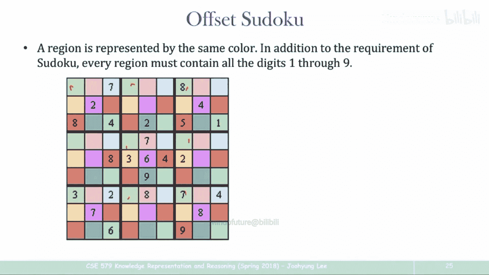

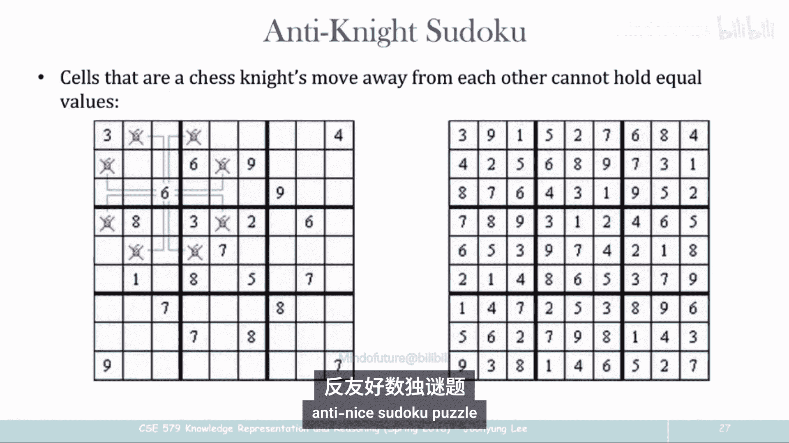

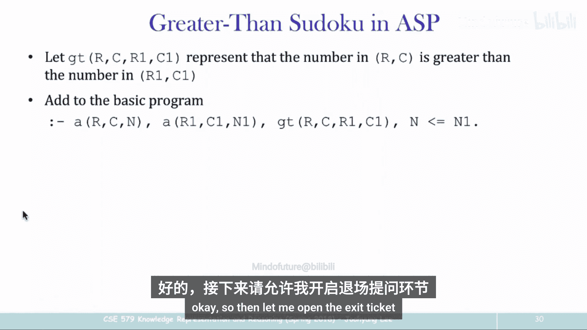

通过这些例子，我们可以看到ASP如何将复杂的组合搜索和约束满足问题，转化为清晰、简洁且易于修改的逻辑程序，从而高效地求得答案。