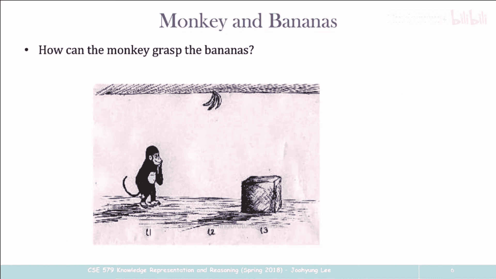
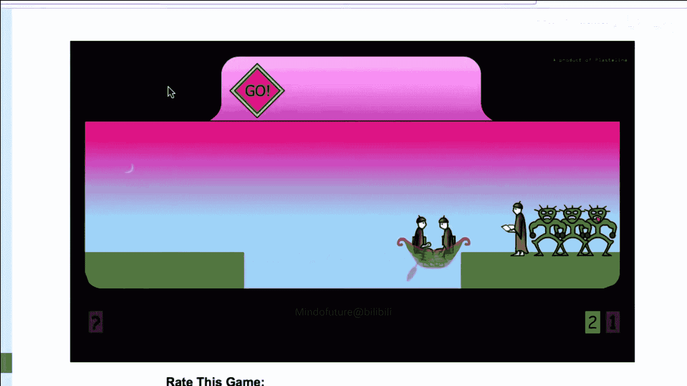
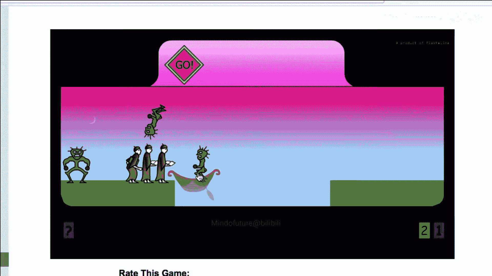
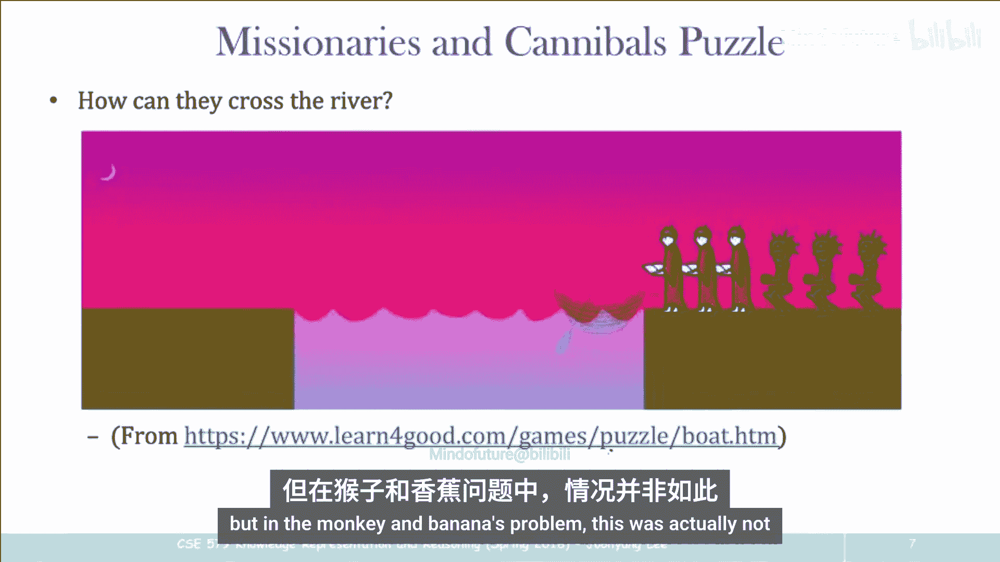
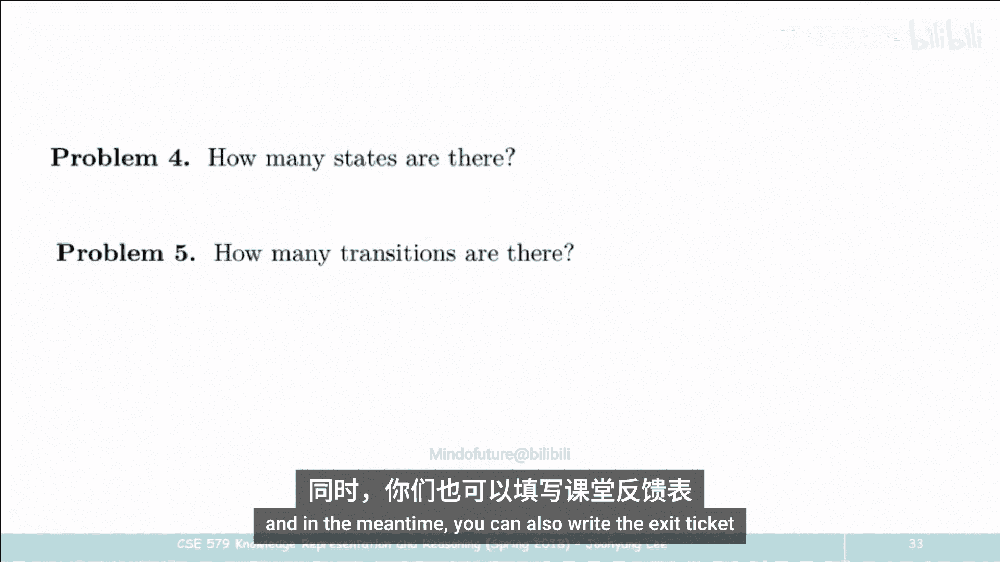

# 011：动作推理入门 🧠

在本节课中，我们将学习如何使用答案集编程（ASP）来形式化地描述和推理关于动作及其对世界状态影响的知识。我们将从简单的过渡系统开始，逐步深入到经典的“猴子和香蕉”问题，并理解如何解决AI领域长期存在的“框架问题”。

---

## 过渡系统与动作描述

上一节我们介绍了ASP的基本概念，本节中我们来看看如何用它来描述一个简单的动态系统。



一个过渡系统可以看作是一个有向图，其中顶点代表状态，边代表由动作引发的状态转换。我们的目标是使用逻辑规则来描述这个系统。





### 核心概念与术语

*   **流（Fluent）**：指其真值取决于世界状态的属性。例如，`p` 可以是一个流，表示“灯是亮着的”。流可以是布尔值（真/假），也可以是多值的（例如，位置 `L1`, `L2`, `L3`）。
*   **动作（Action）**：可以执行并可能改变流值的事件。例如，动作 `a` 表示“按下开关”。
*   **常识惯性定律**：这是对牛顿惯性定律的类比。其含义是，默认情况下，如果没有动作影响某个流，则该流的值在动作执行前后保持不变。这是解决“框架问题”的关键。





### 一个简单的布尔流示例

考虑一个只有一个布尔流 `p` 和一个动作 `a` 的系统。动作 `a` 的执行会将 `p` 的值变为真。我们关注从时间 `0` 到时间 `1` 的单步转换。

以下是描述该系统的ASP程序核心部分：

```prolog
% 1. 动作的直接影响：如果执行动作a，则下一时刻p为真。
p(t,1) :- a(0).

% 2. 初始状态是外生的：p在时间0可以为真或为假。
{p(t,0); p(f,0)} = 1.

% 3. 动作执行是外生的：动作a可以执行或不执行。
{a(0)}.

% 4. 常识惯性定律（框架公理）及值的存在唯一性。
{p(t,1)} :- p(t,0). % 若p在时间0为真，则默认它在时间1也为真。
{p(f,1)} :- p(f,0). % 若p在时间0为假，则默认它在时间1也为假。
:- not p(t,1), not p(f,1). % 在时间1，p必须有一个真值（真或假）。
```

### 程序解析

*   规则1描述了动作 `a` 的**直接效果**。
*   规则2和3使用**选择规则**来声明初始状态和动作执行不是由系统逻辑决定的，而是有多种可能性。
*   规则4解决了**框架问题**。它通过默认规则（惯性）来设定：如果一个流在上一时刻为真（或假），且没有理由改变它，那么它在下一时刻将保持原值。最后的约束确保在每个时间点，每个流都必须有明确的真值。

**关键理解**：惯性默认规则可以被更强的信息**覆盖**。例如，如果动作 `a(0)` 为真（即执行了动作），那么规则1会推导出 `p(t,1)`。此时，即使 `p(f,0)` 为真，默认规则 `{p(f,1)} :- p(f,0).` 也不会生效，因为同时断言 `p(t,1)` 和 `p(f,1)` 会违反“p必须有唯一真值”的约束。ASP的稳定模型语义会自动处理这种默认推理与例外。

---

## 从单步扩展到多步路径

理解了单步转换后，我们可以轻松地将模型扩展到任意长度（`M`步）的路径。

我们需要为每个时间步（`0` 到 `M`）声明流的真值，并为每个时间间隔（`0` 到 `M-1`）声明动作是否发生。以下是通用模板：

```prolog
% 时间步范围
time(0..m).

% 1. 直接影响（对所有时间步t）
p(t, T+1) :- a(T), time(T), T < m.

% 2. 初始状态外生
{p(t,0); p(f,0)} = 1.

% 3. 动作执行外生（对所有时间步t）
{a(T)} :- time(T), T < m.

% 4. 惯性定律及值的存在唯一性（对所有时间步t>0）
{p(t,T+1)} :- p(t,T), time(T), T < m.
{p(f,T+1)} :- p(f,T), time(T), T < m.
:- time(T), T > 0, not p(t,T), not p(f,T).

% 5. 隐藏辅助谓词，仅显示流p和动作a（可选）
#show p/2.
#show a/1.
```

通过设置不同的 `m` 值，我们可以让ASP求解器找出：
*   当 `m=0` 时：所有可能的状态（即 `p` 的真值组合）。
*   当 `m=1` 时：所有可能的状态转换（动作执行与否导致的 `p` 值变化）。
*   当 `m=k` 时：所有长度为 `k` 的状态转换路径。

---

## 实例分析：耶鲁射击问题 🦃

为了理解框架问题的重要性，我们回顾一下历史上著名的“耶鲁射击问题”。

**问题描述**：
1.  火鸡弗雷德最初是活的（`alive(0)`）。
2.  枪最初是未上膛的（`-loaded(0)`）。
3.  执行动作`load`（装弹）。
4.  等待（不执行动作）。
5.  执行动作`shoot`（射击）。

**预期结论**：弗雷德在最后是死的（`-alive(3)`）。

**早期形式化的困难**：如果只用经典逻辑描述动作效果（例如 `shoot` 导致 `-alive`），而不描述**未受影响**的流（如`loaded`在等待期间应保持不变，`alive`在装弹后、射击前应保持不变），则会产生许多不符合常识的模型。例如，一个模型可能认为在等待期间枪“自动”退膛了，或者火鸡“无缘无故”死了，从而避免了被射杀。

**ASP的解决方案**：正如我们在简单示例中看到的，ASP通过**常识惯性定律**（默认规则）自然地处理了这些问题。它为每个流（`alive`, `loaded`）都添加上面第4类的规则，从而确保只要没有动作明确改变它们，它们的值就保持不变。这使得符合常识的预期结论成为唯一或主要的稳定模型。

---

## 综合应用：猴子和香蕉问题 🐒🍌

现在我们将这些原理应用到一个更复杂的领域——经典的“猴子和香蕉”问题。

### 问题描述
一只猴子、一串香蕉和一个箱子位于房间的不同位置。猴子想要拿到香蕉，但香蕉挂在天花板上。猴子需要将箱子推到香蕉下方，爬上箱子，然后才能抓住香蕉。

### 使用ASP进行形式化

我们需要定义更多的流和动作。

**1. 定义对象与类型**
```prolog
% 布尔值
boolean(t; f).
% 对象
object(monkey; bananas; box).
% 位置
location(l1; l2; l3).
% 流：对象的位置，猴子是否在箱子上，猴子是否拥有香蕉
fluent_loc(Object, Loc) :- object(Object), location(Loc).
fluent(on_box, B) :- boolean(B).
fluent(has_bananas, B) :- boolean(B).
```

**2. 状态约束（哪些状态是合理的）**
以下是描述有效状态必须满足的条件：
```prolog
% 如果猴子拥有香蕉，并且猴子在位置L，那么香蕉也必须在位置L。
:- has_bananas(t, T), fluent_loc(monkey, L, T), not fluent_loc(bananas, L, T).
% 如果猴子在箱子上，并且箱子在位置L，那么猴子也必须在位置L。
:- on_box(t, T), fluent_loc(box, L, T), not fluent_loc(monkey, L, T).
```

**3. 动作的效应与前提条件**
以下是描述动作的规则示例：
```prolog
% 动作：走到位置L
% 效应：猴子的位置变为L
fluent_loc(monkey, L, T+1) :- walk(L, T), time(T), T < m.
% 前提：不能走到当前已经所在的位置
:- walk(L, T), fluent_loc(monkey, L, T).
% 前提：在箱子上时不能走
:- walk(L, T), on_box(t, T).

% 动作：推箱子到位置L
% 效应：箱子和猴子的位置都变为L
fluent_loc(box, L, T+1) :- push(L, T), time(T), T < m.
fluent_loc(monkey, L, T+1) :- push(L, T), time(T), T < m.
% 前提：猴子和箱子必须在同一位置才能推
:- push(L, T), fluent_loc(monkey, L1, T), fluent_loc(box, L2, T), L1 != L2.

% 动作：爬上箱子
% 效应：猴子在箱子上
on_box(t, T+1) :- climb_on(T), time(T), T < m.
% 前提：猴子不在箱子上，且猴子和箱子在同一位置
:- climb_on(T), on_box(t, T).
:- climb_on(T), fluent_loc(monkey, L1, T), fluent_loc(box, L2, T), L1 != L2.

% 动作：抓住香蕉
% 效应：猴子拥有香蕉
has_bananas(t, T+1) :- grasp(T), time(T), T < m.
% 前提：猴子在箱子上，猴子没有香蕉，猴子和香蕉在同一位置
:- grasp(T), not on_box(t, T).
:- grasp(T), has_bananas(t, T).
:- grasp(T), fluent_loc(monkey, L1, T), fluent_loc(bananas, L2, T), L1 != L2.
```

**4. 领域独立公理（与简单示例类似）**
这部分包括初始状态外生性、动作执行外生性、惯性定律以及每个流在每个时间点的值存在唯一性约束。其结构与之前简单布尔流的例子完全类似，只是应用到了所有定义好的流（`fluent_loc`, `on_box`, `has_bananas`）和所有动作（`walk`, `push`, `climb_on`, `grasp`）上。

**5. 规划求解**
通过给定初始状态和目标状态（例如 `has_bananas(t, m)`），并设置一个足够大的路径长度 `m`，我们可以要求ASP求解器找出一个动作序列（规划），使得从初始状态出发，执行这些动作后能达到目标状态。ASP会利用惯性定律和动作规则，自动探索状态空间并找到有效的计划。

---

## 总结

本节课中我们一起学习了如何使用ASP进行关于动作的推理。

1.  **核心思想**：我们使用逻辑规则来描述动作的**直接效应**和**执行前提**，并利用**常识惯性定律**（以默认规则的形式）来解决框架问题，即描述未被动作影响的流如何保持不变。
2.  **方法步骤**：
    *   定义流（描述状态的属性）和动作。
    *   编写规则描述动作的效应和前提条件（领域相关知识）。
    *   编写领域独立公理，包括初始状态设定、动作选择、惯性定律以及状态一致性约束。
3.  **从简单到复杂**：我们从只有一个布尔流的简单过渡系统开始，逐步扩展到像“猴子和香蕉”这样具有多个对象、多值流和多个动作的复杂领域。
4.  **历史意义**：我们回顾了“耶鲁射击问题”，它揭示了在形式化动态世界时处理惯性知识的困难，而ASP提供了一种优雅而强大的解决方案。



通过将动作推理编码为ASP程序，我们可以利用现有的ASP求解器（如Clingo）自动进行规划生成、状态预测和合法性验证，这是知识表征与推理在实际AI应用中的一个强大工具。