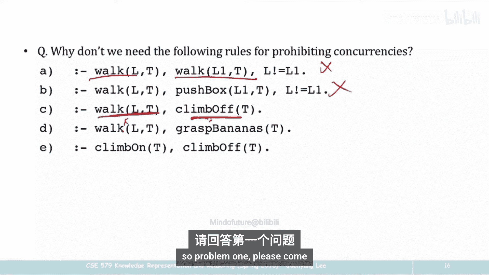
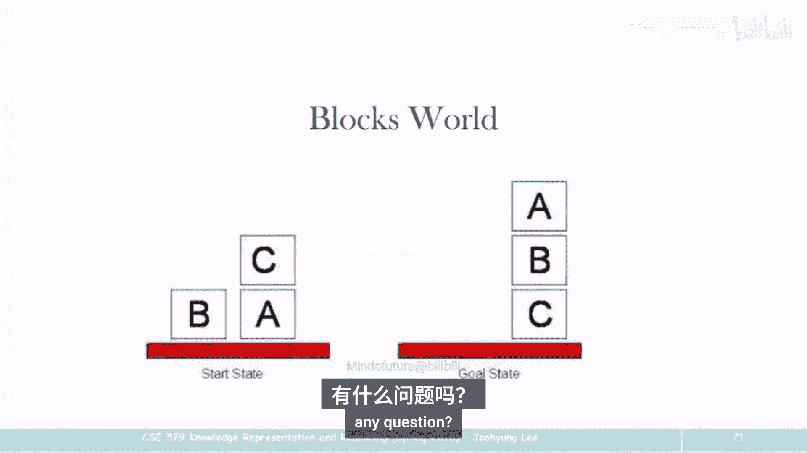

# 012：猴子与香蕉问题详解 🍌

在本节课中，我们将详细学习如何用逻辑程序对经典的“猴子与香蕉”问题进行形式化建模。我们将定义问题的领域、状态约束、动作及其效果，并学习如何利用这些模型进行规划、预测和溯因推理。

---

## 领域形式化

首先，我们需要定义问题的基本元素，包括类型（Sorts）和对象（Objects）。

*   **类型定义**：我们定义了两种类型。
    *   `boolean` 类型：包含对象 `T`（真）和 `F`（假）。
    *   `object` 类型：包含对象 `monkey`（猴子）、`bananas`（香蕉）和 `box`（箱子）。
*   **位置定义**：存在三个位置 `l1`, `l2`, `l3`。

以上定义构成了问题世界的基本元素和类型。

---

## 状态约束

接下来，我们定义状态约束，它描述了不同状态变量之间的依赖关系。

*   **猴子与香蕉的位置关系**：如果猴子拿到了香蕉（`has_bananas` 为真），那么香蕉的位置就由猴子的位置决定。公式表示为：`has_bananas(T) -> location(bananas, L, T) == location(monkey, L, T)`。
*   **猴子与箱子的位置关系**：如果猴子在箱子上（`on_box` 为真），那么猴子的位置就由箱子的位置决定。公式表示为：`on_box(T) -> location(monkey, L, T) == location(box, L, T)`。

我们稍后会探讨为什么这些约束很重要。

---

## 动作与前提条件

现在，我们来定义猴子可以执行的动作及其效果。动作的效果通常表述为：如果在时间 `t` 执行了某个动作，那么在时间 `t+1` 某些事实会变为真。

*   **行走（Walk）**：如果猴子在时间 `t` 走到位置 `L`，那么在 `t+1` 时刻，猴子的位置就是 `L`。其前提条件是猴子不在箱子上，且不能走到它当前已经所在的位置。代码描述如下：
    ```prolog
    % 行走动作的效果
    location(monkey, L, T+1) :- walk(L, T).
    % 行走动作的前提条件：猴子不在箱子上
    :- walk(L, T), on_box(T).
    % 不能走到当前位置
    :- walk(L, T), location(monkey, L, T).
    ```
*   **推箱子（Push）**：如果猴子在时间 `t` 将箱子推到位置 `L`，那么在 `t+1` 时刻，猴子和箱子的位置都是 `L`。前提是猴子与箱子在同一位置，且猴子不在箱子上。
*   **爬上箱子（ClimbOn）**：使 `on_box` 在下一时刻为真。前提是猴子与箱子在同一位置，且猴子不在箱子上。
*   **爬下箱子（ClimbOff）**：使 `on_box` 在下一时刻为假。前提是猴子在箱子上。
*   **抓取香蕉（Grasp）**：使 `has_bananas` 在下一时刻为真。前提是猴子在箱子上，且猴子、箱子、香蕉三者位于同一位置。

动作的定义结构大致相同：在规则体（body）中写入动作名，在规则头（head）中描述其效果。

---

## 动作互斥约束

某些动作不能同时执行，我们通过约束规则来禁止这些组合。

*   **禁止同时行走和推箱子到同一位置**：`:- walk(L, T), push(L, T).`
*   **禁止同时行走和爬上箱子**：`:- walk(L, T), climb_on(T).`
*   **禁止同时推箱子和爬上箱子**：`:- push(L, T), climb_on(T).`
*   **禁止同时爬下箱子和抓取香蕉**：`:- climb_off(T), grasp(T).`

这些是领域相关的公理，你可以根据需要对允许或禁止的动作组合进行调整。

---

## 领域独立公理

上一节我们介绍了领域相关的约束，本节中我们来看看适用于不同领域的通用规则，即领域独立公理。

*   **流的外生性（Exogeneity of Fluents）**：对于每个流（如 `has_bananas`, `on_box`），在初始时刻必须恰好选择一个值（真或假）。这通过选择规则实现。
    ```prolog
    % 初始时刻，has_bananas 必须为真或假，且只能选一个
    {has_bananas(0)}.
    :- not has_bananas(0).
    :- not not has_bananas(0). % 另一种等价写法，确保恰好一个
    ```
*   **位置流的多值性**：对于对象的位置 `loc(O, L, T)`，它是一个多值流，但在任一时刻，每个对象必须恰好位于一个位置。
    ```prolog
    % 对于每个对象 O，在时间 0 必须恰好有一个位置 L
    1 {loc(O, L, 0) : location(L)} 1 :- object(O).
    ```
    这里 `O` 是全局变量（遍历所有对象），`L` 是局部变量（在花括号内遍历所有位置）。这种命名约定有助于区分变量作用域。
*   **惯性定律（Law of Inertia）**：这是处理框架问题的核心。它表示，如果一个流在时间 `t` 为真，并且没有发生改变它的动作，那么它在 `t+1` 时刻默认保持为真。反之亦然。这通过带有否定的规则实现。
    ```prolog
    % 惯性定律示例：has_bananas 默认保持不变
    has_bananas(T+1) :- has_bananas(T), not not has_bananas(T+1).
    not has_bananas(T+1) :- not has_bananas(T), not has_bananas(T+1).
    ```
    注意，这里使用 `not not F` 而非简单的 `F`，在稳定模型语义下，这种区别有时是必要的。



---


## 衍生问题与冗余约束

现在，我们利用已定义的状态约束来理解一个关键概念：衍生问题（Ramification Problem）。

*   **间接效果**：考虑猴子行走的间接效果。如果猴子拿着香蕉并走到新位置 `L`，根据状态约束，香蕉的位置也会变为 `L`。我们不需要为“行走”动作单独添加一条规则来描述对香蕉位置的影响，状态约束会自动处理这种间接效果。
*   **问题本质**：衍生问题是指如何简洁地描述动作的间接效果。如果没有状态约束这种机制，就需要为每个可能受影响的属性（如猴子携带的所有物品）单独编写效果规则，这将非常繁琐。
*   **冗余性检查**：基于已有的状态约束和互斥条件，许多动作并发约束是冗余的。例如：
    *   `:- walk(L, T), walk(L1, T).` （走到两个不同位置）是冗余的，因为位置流公理要求猴子只能在一个位置。
    *   `:- walk(L, T), climb_off(T).` 是冗余的，因为“行走”要求 `not on_box`，而“爬下”要求 `on_box`，它们的先决条件互斥，不可能同时为真。

---

## 问题求解：规划、预测与溯因

掌握了领域建模后，我们可以利用逻辑程序回答不同类型的问题。

### 规划问题

规划问题是：给定初始状态和目标状态，找到一系列动作序列。

*   **编码方法**：在程序中添加初始状态事实和目标状态约束。然后询问是否存在一个长度为 `m` 的动作序列能达到目标。
*   **示例**：初始状态：猴子在 `l1`，香蕉在 `l2`，箱子在 `l3`，猴子没有香蕉。目标：猴子拿到香蕉（`has_bananas(m)` 为真）。
*   **求解**：使用 `clingo` 求解器，逐步增加 `m`（最大步数）进行求解。例如，当 `m=4` 时，可能找到一个解：`walk(l3,0), push(l2,1), climb_on(2), grasp(3)`。

### 预测问题

预测问题是：给定初始状态和一系列已执行的动作，推断结果状态是什么。

*   **编码方法**：将已知的初始状态和动作序列作为事实加入程序。然后查询在最终时刻某些事实是否成立。
*   **验证方法**：要验证“如果执行动作 A 和 B，则结论 C 必然成立”，可以构造一个程序，包含领域描述、已知事实以及 **结论 C 的否定**。如果该程序 **没有稳定模型**，则原结论被领域知识所蕴含（必然成立）。
*   **示例**：已知猴子走到 `l3` 然后推箱子到 `l2`，验证在时间 2 香蕉和箱子是否在同一位置。通过添加其否定的查询并调用 `clingo` 得到“无解”，即可验证该预测成立。

### 溯因问题

溯因问题是：观察到一些动作和最终状态，推断初始状态可能是什么。

*   **编码方法**：将观察到的动作序列和最终状态作为事实。然后查询初始状态的某些属性是否必须为真。
*   **验证方法**：与预测类似，通过检查“否定结论的程序无稳定模型”来验证溯因推断的必然性。
*   **示例**：观察到猴子走到 `l3` 然后推了箱子（到某处），推断箱子初始时必须在 `l3`。因为“推箱子”动作的前提是猴子与箱子在同一位置。

---

## 练习与总结

以下是两个需要你完成的练习，用于巩固对动作效果推理的理解：

*   **问题五（效果验证）**：形式化并验证命题“行走动作总是改变猴子的位置，但从不改变箱子的位置”。
*   **问题六（原因推断）**：形式化并验证命题“如果猴子的位置改变了，那么它一定是执行了行走或推箱子动作”。

解决这些问题的通用方法是：将领域知识、已知条件和 **待验证命题的否定** 组合成一个逻辑程序。然后使用 `clingo` 求解。如果程序 **没有稳定模型**，则说明原命题在领域知识下是成立的。



本节课中，我们一起学习了如何对“猴子与香蕉”问题进行完整的形式化建模，涵盖了领域定义、状态约束、动作效果、惯性定律以及衍生问题。我们还实践了如何利用这些模型进行规划、预测和溯因推理。掌握这些基础后，你将能够为更复杂的动作推理问题构建逻辑模型。