# 013：动作推理进阶示例与作业解析 🧩

在本节课中，我们将深入探讨动作推理领域的更多示例，特别是经典的“积木世界”问题。本次课程内容将直接帮助你完成相关作业。我们将讨论动作推理的其他方面，包括如何表示具有非确定性效果的动作、并发执行的动作，以及如何处理非惯性影响。我们将学习如何在ASEP的统一框架下对这些方面进行建模。

## 积木世界问题 🧱

积木世界是一个非常著名的问题。典型的设定是：给定一个初始状态（例如左侧的配置），你需要将其重新排列成特定的塔状结构（即目标状态）。问题在于如何移动积木以达到目标状态。

通常的限制是：你只能拿起最顶层的积木，并且一次只能移动一个积木。桌子通常被假设为无限大，因此上面可以放置任意数量的塔。不过，你的作业可能会引入更多限制条件。

我们将从基础版本开始形式化，就像解决数独谜题一样，然后通过添加更多规则来应对不同版本的问题。

### 形式化积木世界

首先，我们定义场景。假设有6个积木（编号1到6）。初始状态和目标状态我们以约束形式书写。

**初始状态（时间0）**:
*   `on(1,2,0)`：积木1在积木2上。
*   `on(2,table,0)`：积木2在桌子上。
*   `on(3,4,0)`：积木3在积木4上。
*   `on(4,table,0)`：积木4在桌子上。
*   `on(5,6,0)`：积木5在积木6上。
*   `on(6,table,0)`：积木6在桌子上。

这表示初始时有三个塔：(1,2), (3,4), (5,6)。

**目标状态（时间M）**:
*   `on(3,2,M)`, `on(2,1,M)`, `on(1,table,M)`：形成塔(3,2,1)。
*   `on(6,5,M)`, `on(5,4,M)`, `on(4,table,M)`：形成塔(6,5,4)。

我们的任务是找到一系列移动动作，将初始状态转换为目标状态。一个可能的3步解决方案（假设机器人有多个机械臂可以并发移动）是：
1.  同时移动积木1到桌子和积木3到积木6上。
2.  同时移动积木2到积木1上和积木5到积木4上。
3.  同时移动积木3到积木2上和积木6到积木5上。

### 在ASP中建模

现在，我们来看看如何在ASP（Answer Set Programming）中形式化这个领域。程序的组织结构与之前看到的“猴子与香蕉”问题类似：首先声明对象和谓词，然后是领域特定的描述，最后是领域独立的公理。

**1. 声明与基本事实**
我们声明积木、位置（包括积木和桌子）以及动作。
```prolog
block(1..6).                     % 定义6个积木
location(table).                 % 桌子是一个位置
location(B) :- block(B).         % 每个积木也是一个位置
```
流（状态）表示为 `on(B, L, T)`，表示在时间T，积木B位于位置L上。动作表示为 `move(B, L, T)`，表示在时间T，将积木B移动到位置L上。

**2. 状态约束**
我们需要禁止不合法的状态，例如两个积木同时位于同一个积木之上。
```prolog
% 一个积木上最多只能有一个积木
:- #count{BB: on(BB, B, T)} > 1, block(B), time(T).
```
这条规则规定，对于任何积木B和时间T，位于B之上的积木数量不能超过1。

**3. 动作效果与前提条件**
动作的效果是改变积木的位置。
```prolog
% 移动动作的效果
on(B, L, T+1) :- move(B, L, T), time(T).
```
动作的前提条件是只能移动顶层的积木（即积木上方没有其他积木）。
```prolog
% 只能移动“clear”的积木（即上方无积木）
:- move(B, L, T), on(B1, B, T), block(B1), B1 != B.
```

**4. 并发动作限制**
我们通过机械臂（夹爪）的数量来限制并发移动动作的数量。
```prolog
% 并发移动动作受限于夹爪数量
grippers(5). % 例如，有5个夹爪
:- #count{B, L: move(B, L, T)} > G, grippers(G), time(T).
```
这条规则规定，在每个时间点T，发生的 `move` 动作数量不能超过夹爪数量G。

**5. 领域独立公理**
这些公理确保状态的连贯性。
```prolog
% 每个积木在初始时刻必须恰好在一个位置上
:- #count{L: on(B, L, 0)} != 1, block(B).
% 在每个后续状态，每个积木也必须恰好在一个位置上
:- #count{L: on(B, L, T)} != 1, block(B), time(T), T > 0.
% 惯性规则：默认情况下，位置保持不变
{on(B, L, T+1)} :- on(B, L, T), block(B), location(L), time(T).
% 动作选择规则：任何移动动作都可能发生（或不发生）
{move(B, L, T)} :- block(B), location(L), time(T), T < M.
```

### 运行与验证

使用上述ASP程序，我们可以调用求解器（如clingo）来寻找规划。通过调整时间步长M和夹爪数量G，我们可以研究不同约束下的解决方案空间，例如：
*   找到达到目标所需的最少时间步。
*   找到所需的最少夹爪数量。
*   验证在给定夹爪数量下，是否存在可行规划。

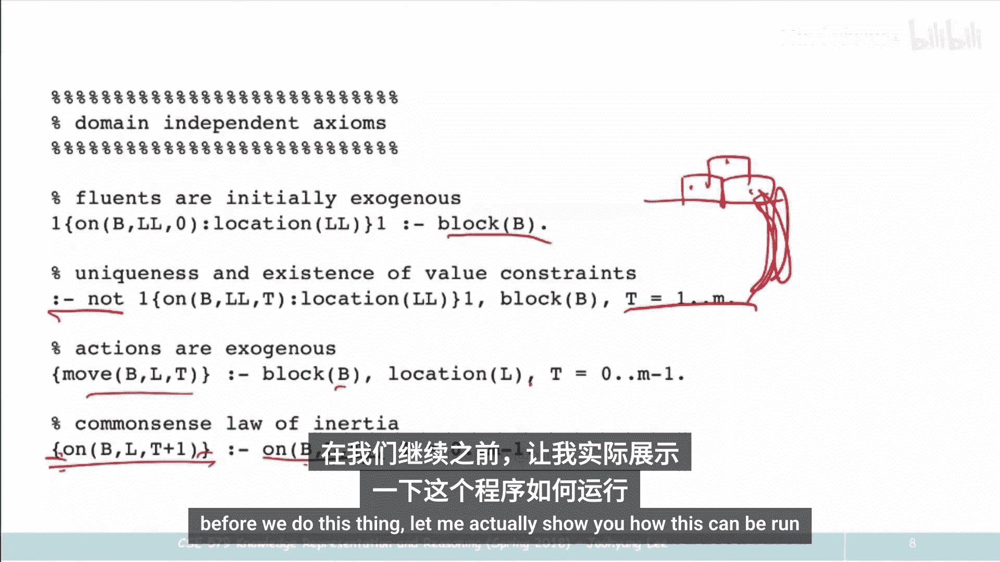

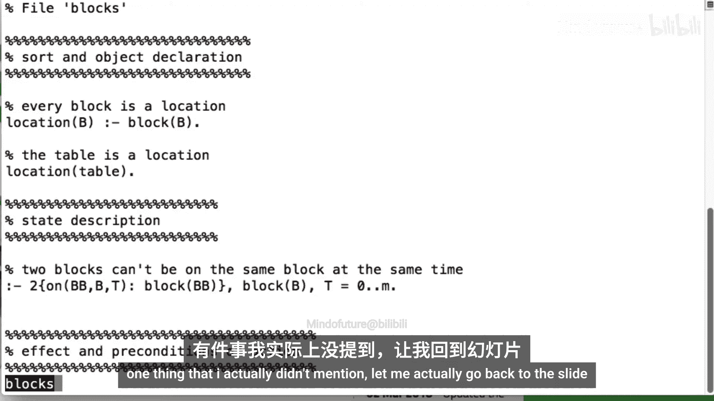

例如，当设置 `M=3`（3个时间步）和 `grippers=2`（2个夹爪）时，求解器可能会找到我们之前描述的那个6个动作的规划。如果增加夹爪数量，可能会找到更多（可能更优或不同的）规划。

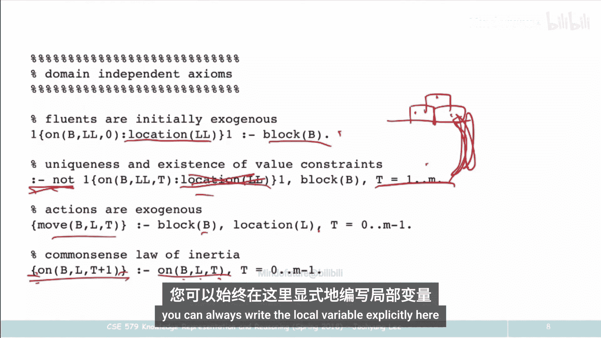

## 作业问题解析 📝

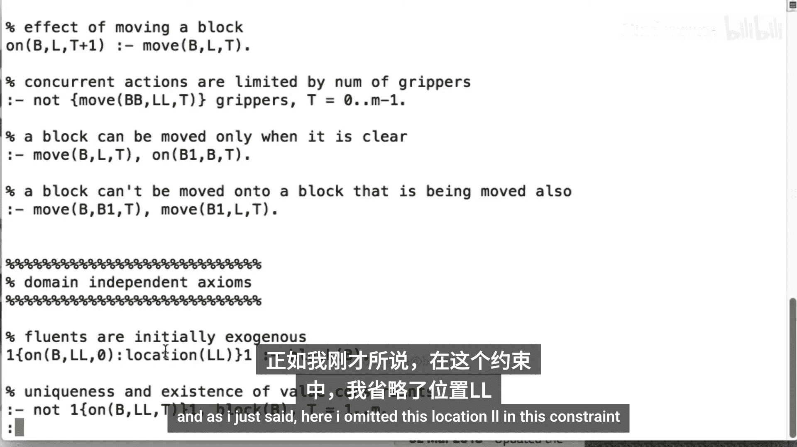

上一节我们介绍了积木世界的基本ASP模型，本节中我们来看看如何修改和扩展这个模型来解决作业中的具体问题。

### 问题1：有限的桌子空间

**要求**：修改模型，以反映桌子空间有限，即同时放置在桌子上的塔（积木堆）数量不能超过一个给定值（例如4个）。

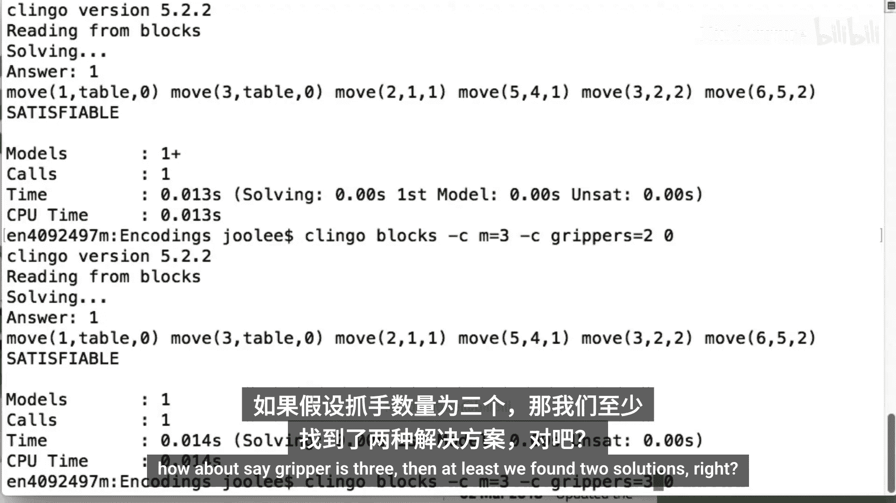

**提示**：这需要添加一个状态约束。关键在于计算在特定时间点，有多少个积木是直接放在桌子上的（即构成了一个塔的基座）。一个简洁的约束可能如下：
```prolog
% 假设 max_towers_on_table(4).
:- #count{B: on(B, table, T)} > N, max_towers_on_table(N), time(T).
```
这条规则计算每个时间T直接放在桌子上的积木数量，如果超过限制N，则排除该状态。

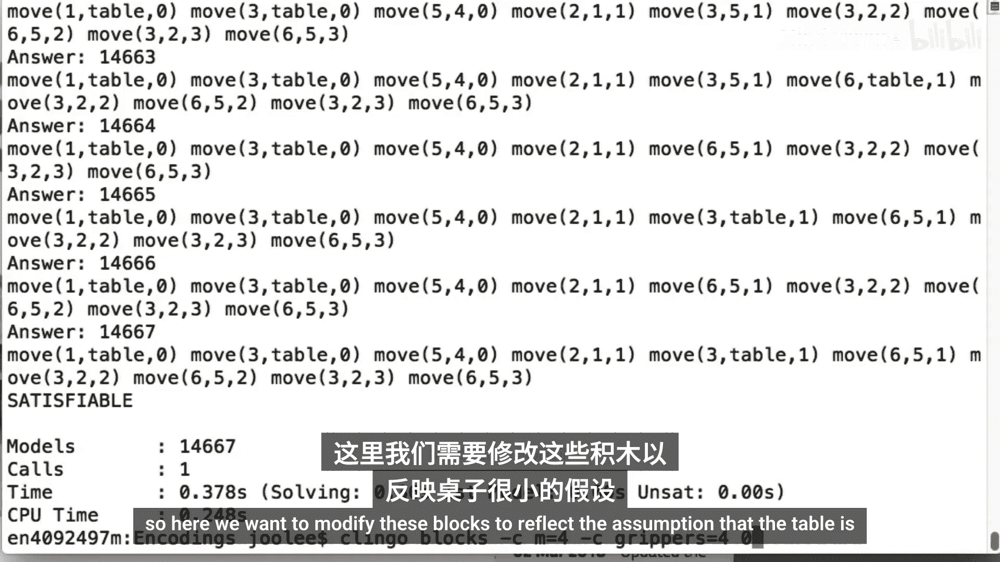

### 问题2：禁止非法初始状态

**要求**：修改模型，禁止物理上不可能的初始配置，例如积木1在积木2上同时积木2又在积木1上（循环依赖），或者积木3在“空”（`nul`）上。

**提示**：这需要添加约束来排除这些非法输入。可能需要多条规则，例如：
```prolog
% 禁止循环：一个积木不能（直接或间接）在自己之上（简化处理直接循环）
:- on(B1, B2, _), on(B2, B1, _), block(B1), block(B2), B1 != B2.
% 禁止位置‘nul’（如果它被定义为一个无效位置）
:- on(_, nul, _).
% 确保所有位置都是已定义的位置（积木或桌子）
:- on(B, L, _), not location(L), block(B).
```
当输入包含非法配置时，这些约束将使整个程序无解（unsatisfiable）。

### 问题3：可序列化规划

**要求**：修改模型，要求规划必须是“可序列化的”。即，计划在同一时间步执行的并发动作，在实际以任意顺序执行时，都应产生相同的最终效果。这禁止了“移动走积木A的同时将积木B移动到A原先位置”这类需要精确时序配合的并发动作。

**提示**：这与基本形式化中已经存在的一条规则非常相似。我们需要禁止两个特定的动作同时发生：
```prolog
% 禁止：在时间T，同时移动积木B1，并将另一个积木B2移动到B1当前所在的位置L
:- move(B1, L1, T), move(B2, L2, T), on(B1, L2, T), block(B1), block(B2), B1 != B2, time(T).
```
这条规则确保了不会发生“抢占位置”的并发动作。

### 问题4：最小化动作数量

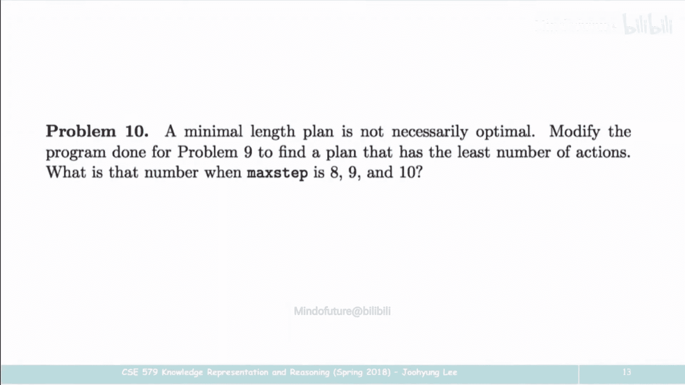

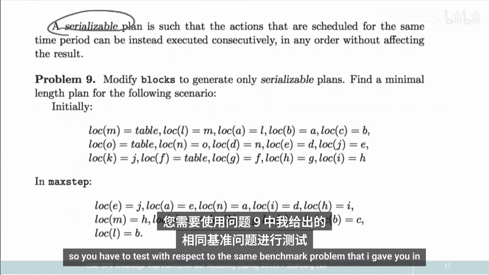

**要求**：修改模型，在给定时间步长M内，寻找动作数量最少的规划（而不仅仅是时间步最少的规划）。

**提示**：这需要优化目标。我们可以使用ASP的优化语句来最小化发生的动作总数。在基础事实和规则之后，添加：
```prolog
% 最小化动作总数
#minimize{1, T, B, L: move(B, L, T)}.
```
这样，求解器将优先返回动作数量更少的稳定模型。测试时，你可能会发现，增加时间步长M有时反而能得到动作数更少的规划，因为机器人有更多空闲步骤来避免移动冲突。

## 非确定性动作建模 🎲

到目前为止，我们讨论的动作效果都是确定性的。现在，我们来看看如何建模非确定性动作，即执行同一个动作可能导致不同的结果状态。

考虑一个简单例子：Jack去上班。他可以选择步行或开车。动作都是“去上班”（`goWork`），但对汽车位置的影响是非确定的：如果步行，汽车留在家；如果开车，汽车也到公司。

**ASP建模关键**：使用选择规则（choice rule）来描述非确定性效果。
```prolog
% 确定性效果：Jack的位置会改变
at(jack, work, T+1) :- goWork(T).
% 非确定性效果：汽车的位置可能变也可能不变
{at(car, work, T+1)} :- goWork(T), at(car, home, T).
% 惯性规则（默认不变）仍然适用于汽车
{at(car, Loc, T+1)} :- at(car, Loc, T), location(Loc), time(T).
% 前提条件：Jack和汽车必须在同一地点才能开车（隐含在非确定性效果的选择中，也可显式写出）
:- goWork(T), at(jack, Loc, T), at(car, Loc1, T), Loc != Loc1.
% 状态约束：每个对象在每个时刻必须在一个位置
:- #count{Loc: at(O, Loc, T)} != 1, object(O), time(T).
```
在这个模型中，当 `goWork` 动作执行时，关于 `at(car, work, T+1)` 的选择规则允许求解器生成两个稳定模型：一个包含这个原子（开车），另一个不包含（步行）。惯性规则确保了汽车位置在未被改变时保持不变。

## 并发动作的交互与必要性 🤝

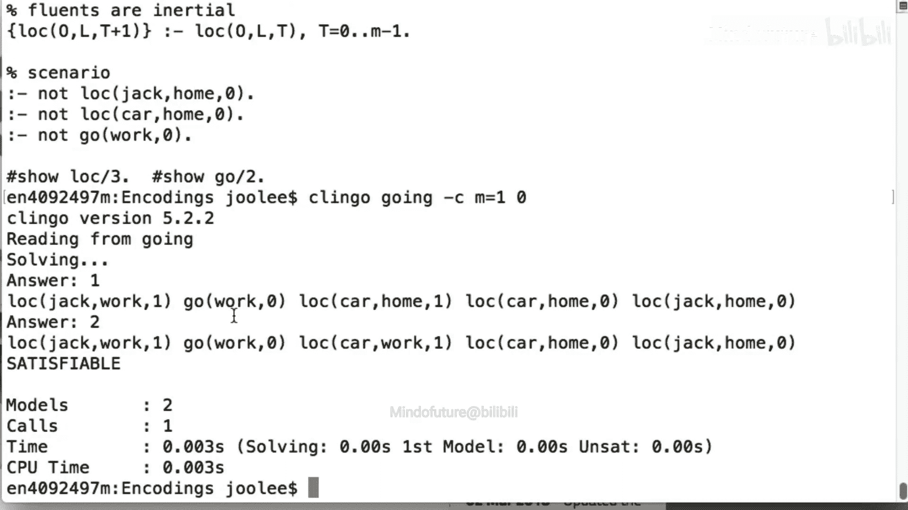

有些领域，并发动作不能简单地分解为任意顺序的序列动作，它们必须同时发生才能达到预期效果。经典的“抬桌子”问题就是例子。

**问题描述**：一张桌子两边各有一个机器人。桌子上有一个物体。如果只抬起一边，物体会滑落。只有两边同时抬起，物体才能保持在桌上。

**建模要点**：我们需要描述，当两边高度不一致时，物体不在桌上。
```prolog
% 动作效果：抬起一边，其高度变为高（high）
height(End, high, T+1) :- lift(End, T), end(End).
% 状态约束：如果两边高度不同，则物体不在桌上
:- on_table(T), height(left, H1, T), height(right, H2, T), H1 != H2.
% 物体在桌上的定义（简化）：当两边高度相同时
on_table(T) :- height(left, H, T), height(right, H, T).
```
在这个模型中，规划必须包含在同一个时间步执行 `lift(left)` 和 `lift(right)`，才能使得 `on_table` 在动作后保持为真。任何将其拆分为两个顺序时间步的规划都会导致中间状态违反约束。

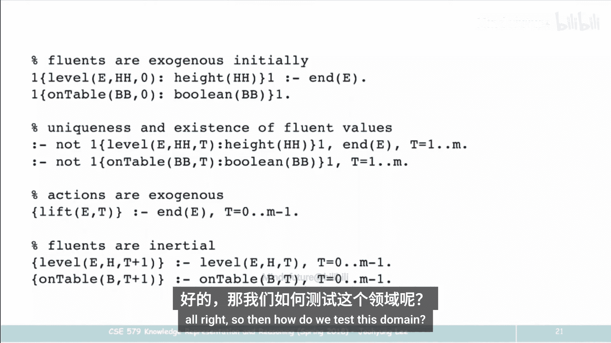

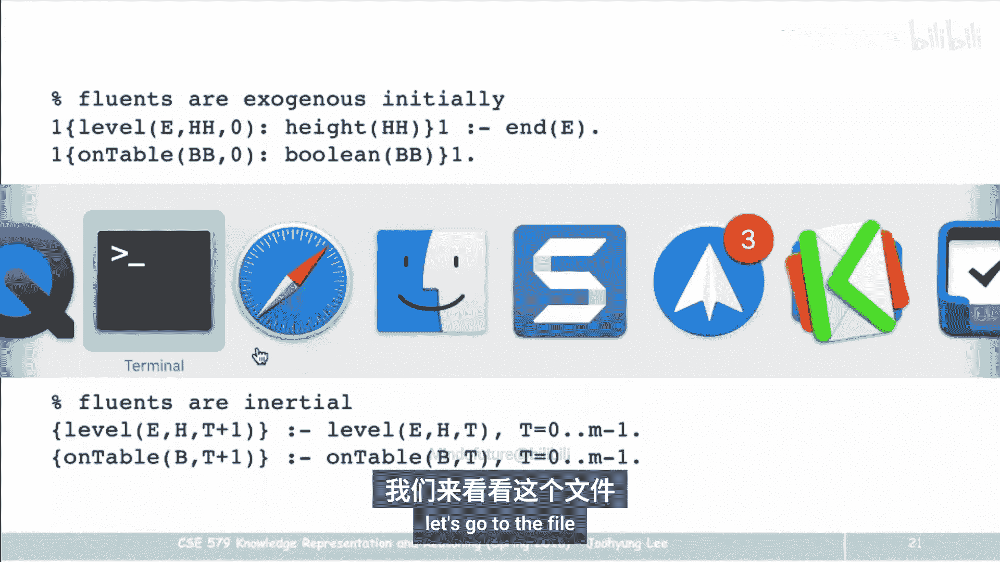

## 非惯性流建模 ⏳

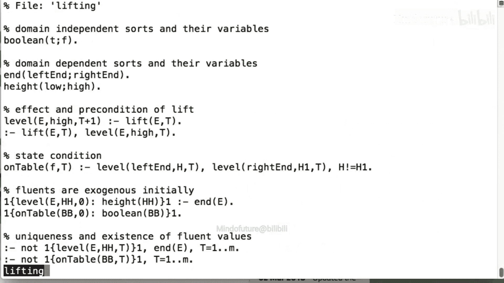

惯性是默认假设：流（状态）在动作未提及时会保持不变。但有些领域，流会自发变化，除非有动作阻止它。钟摆就是一个例子：如果不施加“握住”动作，钟摆会从左摆到右或从右摆到左。

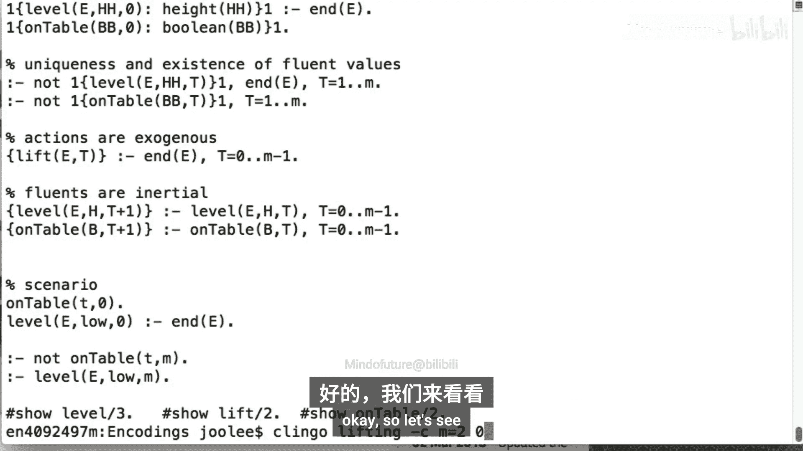

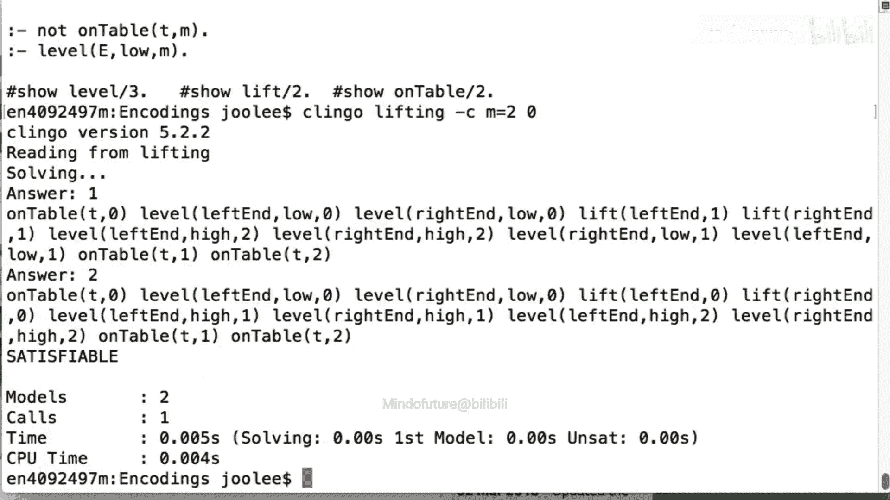

**建模要点**：我们使用选择规则和约束来定义这种“默认变化”。
```prolog
% 动作效果：如果握住，则保持当前位置
position(right, T+1) :- hold(T), position(right, T).
position(left, T+1) :- hold(T), position(left, T).
% 默认规则：如果没有握住，则位置会改变到另一边
{position(left, T+1)} :- position(right, T), time(T), not hold(T).
{position(right, T+1)} :- position(left, T), time(T), not hold(T).
% 状态约束：每个时刻钟摆必须在左或右
:- #count{P: position(P, T)} != 1, time(T).
```
在这里，当 `hold` 动作未执行时（`not hold(T)` 为真），选择规则 `{position(left, T+1)}` 等成为“必须被满足”的规则（因为ASP中，选择规则在无外部约束时，必须至少选择一项以满足其存在性，结合约束“恰好一个位置”，就迫使它选择另一个位置），从而模拟了默认变化。

## 总结 📚

本节课中，我们一起深入学习了动作推理的多个高级主题。

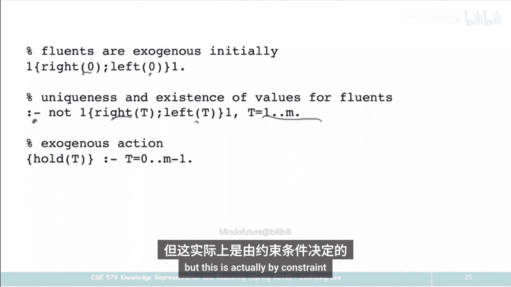

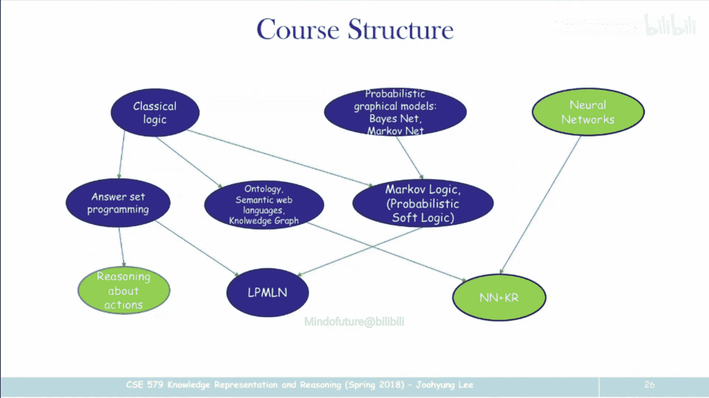

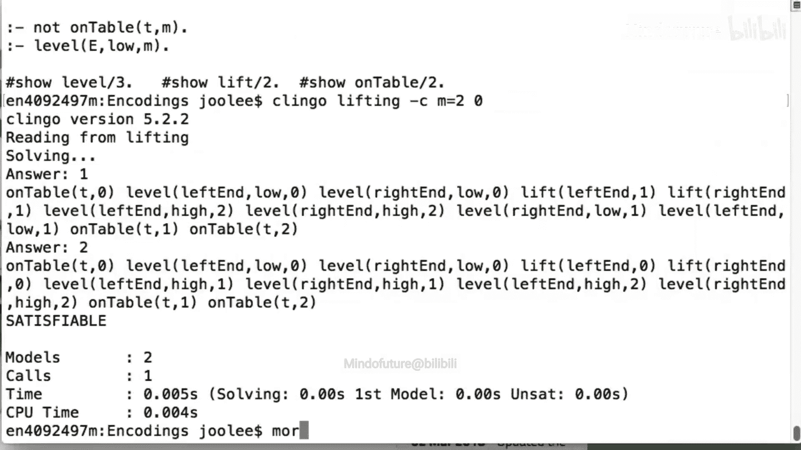

1.  **复杂领域建模**：我们以“积木世界”为例，详细演示了如何用ASP对包含并发、资源限制的规划问题进行完整的形式化，并展示了如何使用求解器进行验证和探索。
2.  **作业实践**：我们解析了如何通过添加约束来修改基础模型，以解决桌子空间限制、输入验证、可序列化规划、动作数量优化等具体问题。
3.  **非确定性动作**：我们学习了如何使用选择规则来建模效果不确定的动作，扩展了ASP的动作表示能力。
4.  **必要并发**：通过“抬桌子”例子，我们理解了某些领域并发动作的必要性，以及如何用状态约束来刻画这种并发交互。
5.  **非惯性流**：通过“钟摆”例子，我们掌握了如何建模那些默认状态下会自动变化的属性，这突破了传统动作语言的内置惯性假设。

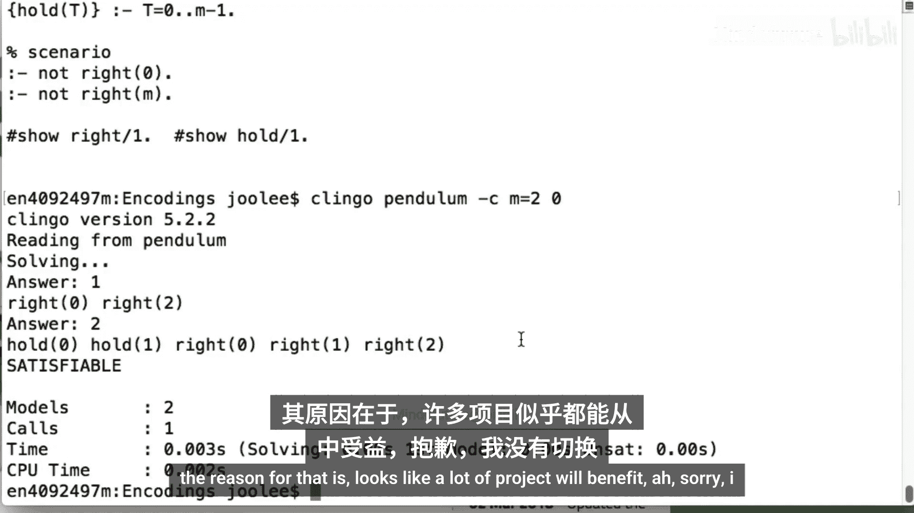

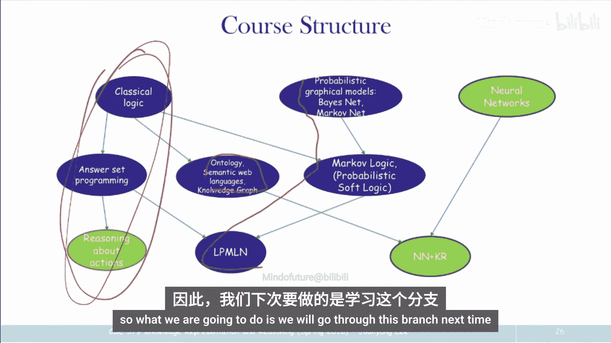

通过这些内容，我们看到了ASP在知识表征与推理，特别是动作与变化推理方面的强大灵活性和表现力。从确定性到非确定性，从惯性到非惯性，从顺序动作到必要并发，ASP提供了一个统一的框架来捕捉现实世界中丰富的动态特性。