# 014：概率论与图模型基础 🎲

在本节课中，我们将学习概率论的基础知识，并了解如何利用贝叶斯网络和马尔可夫网络等图模型来紧凑地表示和处理不确定性知识。我们将从概率的基本概念开始，逐步深入到条件独立性和图模型的核心思想。

## 概率论基础

上一节我们介绍了逻辑推理，本节中我们来看看处理不确定性的数学工具——概率论。概率论为智能体在不确定环境下进行推理提供了基础框架。

### 概率公理

我们首先从概率的三个基本公理开始理解。这些公理是所有概率性质的基础。

*   **公理1**：任何命题 `A` 的概率 `P(A)` 是一个介于0和1之间的实数。`0 ≤ P(A) ≤ 1`。
*   **公理2**：永真式（必然为真的命题）的概率为1。`P(True) = 1`。
*   **公理3**：如果两个命题 `A` 和 `B` 互斥（即不可能同时为真），那么 `A` 或 `B` 为真的概率等于它们各自概率之和。`P(A ∨ B) = P(A) + P(B)`。

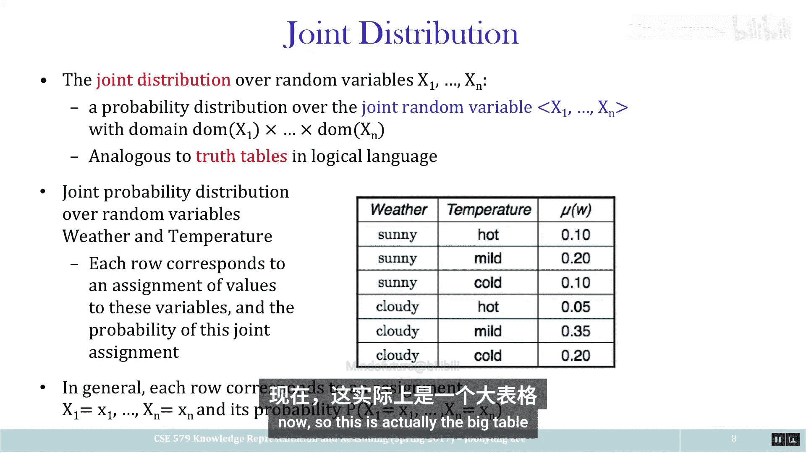

### 随机变量与可能世界

在概率论中，我们使用随机变量来描述不确定的实体。这与逻辑中的原子命题概念相似。

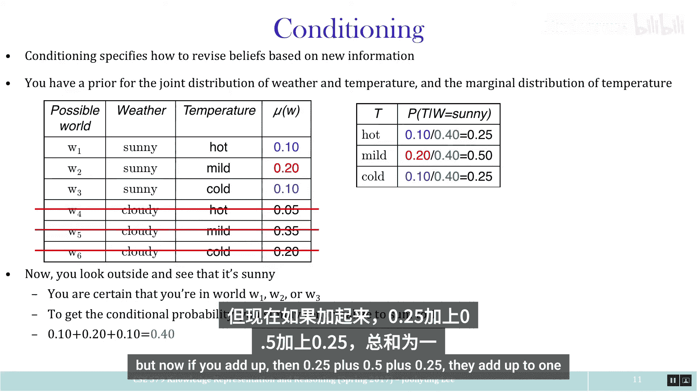

*   **随机变量**：可以将其理解为多值原子。它有一个定义域，表示其可能取值的集合。例如，`天气` 是一个随机变量，其定义域为 `{晴天， 多云}`。`天气 = 晴天` 则是一个命题。
*   **可能世界**：可以将其理解为逻辑中的解释。它是一个为所有随机变量赋予具体值的完整赋值。例如，对于布尔变量 `吸烟` 和 `癌症`，存在四个可能世界：`(吸烟=T, 癌症=T)`, `(吸烟=T, 癌症=F)`, `(吸烟=F, 癌症=T)`, `(吸烟=F, 癌症=F)`。

概率论的新颖之处在于，我们为每个可能世界分配一个概率值，且所有可能世界的概率之和为1。任何命题的概率，等于所有满足该命题的可能世界的概率之和。

### 联合分布与边缘化

为了描述多个随机变量之间的关系，我们引入联合概率分布。

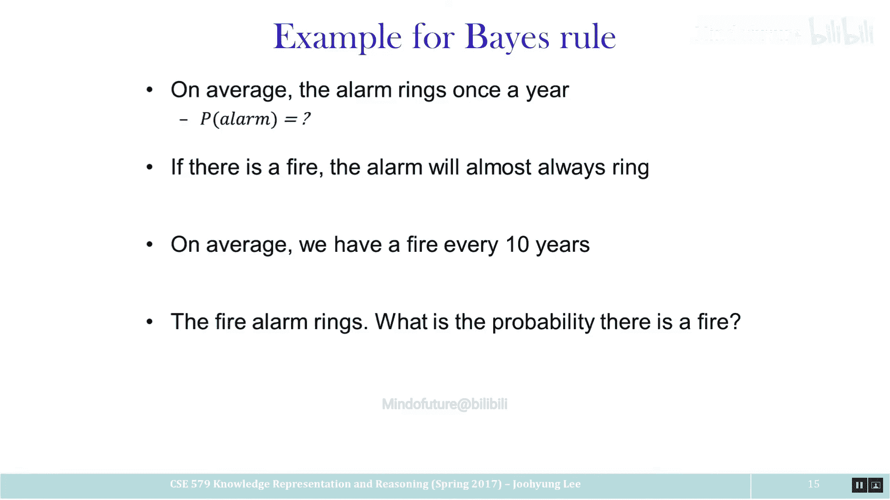

*   **联合分布**：类似于真值表，它列出了所有随机变量每一种可能取值组合的概率。例如，对于 `天气`（晴/阴）和 `温度`（热/温/冷），联合分布表有 `2 × 3 = 6` 行，每行的概率之和为1。
*   **边缘化**：当我们只关心部分变量时，可以通过对不关心的变量求和（即边缘化）来获得其概率分布。公式如下：
    `P(X=x) = Σ_{y} P(X=x, Y=y)`
    例如，从 `天气-温度` 的联合分布表中，将 `天气` 为晴天和阴天且 `温度=热` 的两行概率相加，就得到了 `温度=热` 的边缘概率。

### 条件概率与贝叶斯规则

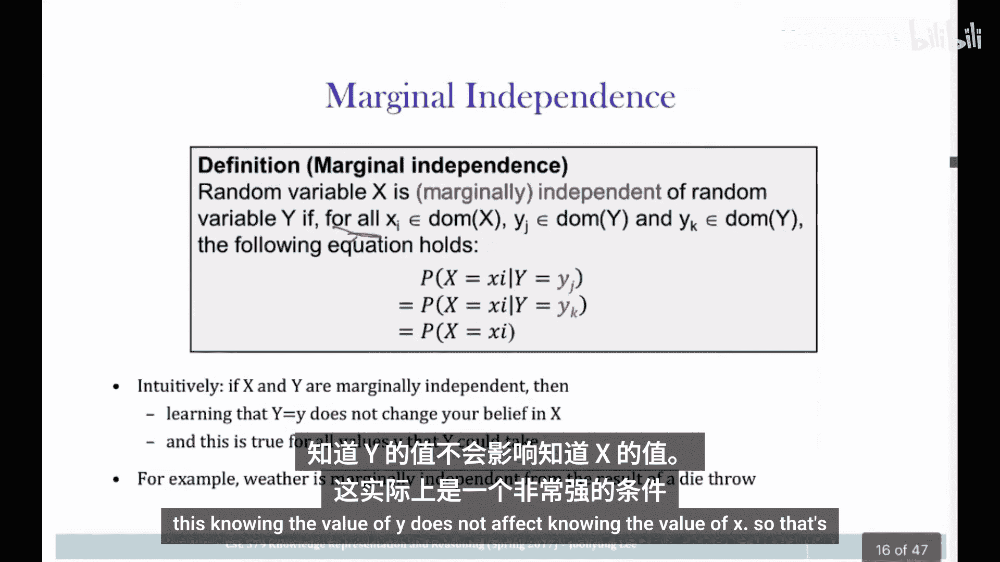

当我们获得新证据时，需要更新对事件的信念，这通过条件概率来实现。

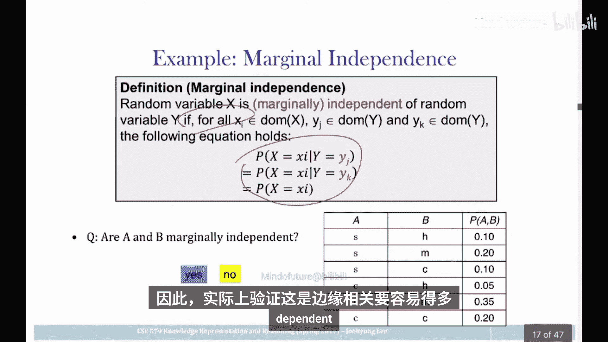

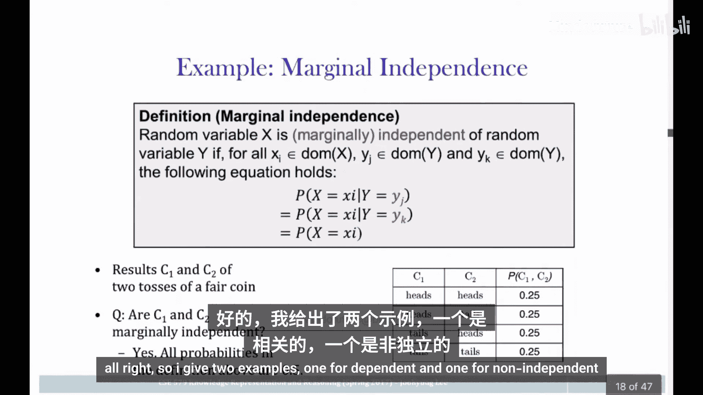

*   **条件概率**：在已知事件 `E` 发生的条件下，事件 `H` 发生的概率记为 `P(H|E)`。其计算公式为：
    `P(H|E) = P(H ∧ E) / P(E)`
    直观上，我们将可能世界限制在满足证据 `E` 的那些，然后重新归一化概率（使其总和为1）。
*   **贝叶斯规则**：由条件概率定义直接推导得出，它允许我们根据因果关系的知识，从观察到的结果反推原因。公式如下：
    `P(H|E) = P(E|H) * P(H) / P(E)`
    其中，`P(H)` 是先验概率，`P(E|H)` 是似然度，`P(H|E)` 是后验概率。

**示例**：假设火灾发生概率 `P(火灾) = 1/(365*10)`，火灾发生时警报响的概率 `P(警报|火灾) = 0.999`，警报误响的概率 `P(警报|¬火灾) = 1/365`。若听到警报，则实际发生火灾的后验概率 `P(火灾|警报)` 经计算仅为约 0.01。这展示了贝叶斯推理在更新信念时的作用。

### 独立性

独立性是简化概率模型的关键概念。

*   **边缘独立**：如果知道 `Y` 的值不影响 `X` 的概率，则称 `X` 和 `Y` 边缘独立。即对所有 `x, y`，有 `P(X=x|Y=y) = P(X=x)`。这等价于 `P(X, Y) = P(X)P(Y)`。
*   **条件独立**：在给定第三个变量 `Z` 的条件下，如果知道 `Y` 的值不影响 `X` 的概率，则称 `X` 和 `Y` 在给定 `Z` 时条件独立。即 `P(X|Y, Z) = P(X|Z)`。条件独立和边缘独立互不蕴含。

## 贝叶斯网络 🕸️

上一节我们学习了概率论的基本规则，本节中我们来看看如何利用条件独立性来构建紧凑的概率模型——贝叶斯网络。

### 动机与定义

直接存储所有变量的联合分布表会非常庞大（`n` 个二值变量需要 `2^n - 1` 个参数）。条件独立性允许我们大幅减少所需参数。贝叶斯网络正是利用有向无环图来编码变量间的条件独立性假设。

一个贝叶斯网络包含两部分：
1.  **有向无环图**：节点代表随机变量，边代表直接的依赖关系。
2.  **条件概率表**：每个节点 `X_i` 附带一个 CPT，存储其概率 `P(X_i | Parents(X_i))`。

**网络编码的独立性假设**：每个变量在给定其父节点的条件下，独立于它的所有非后代节点。

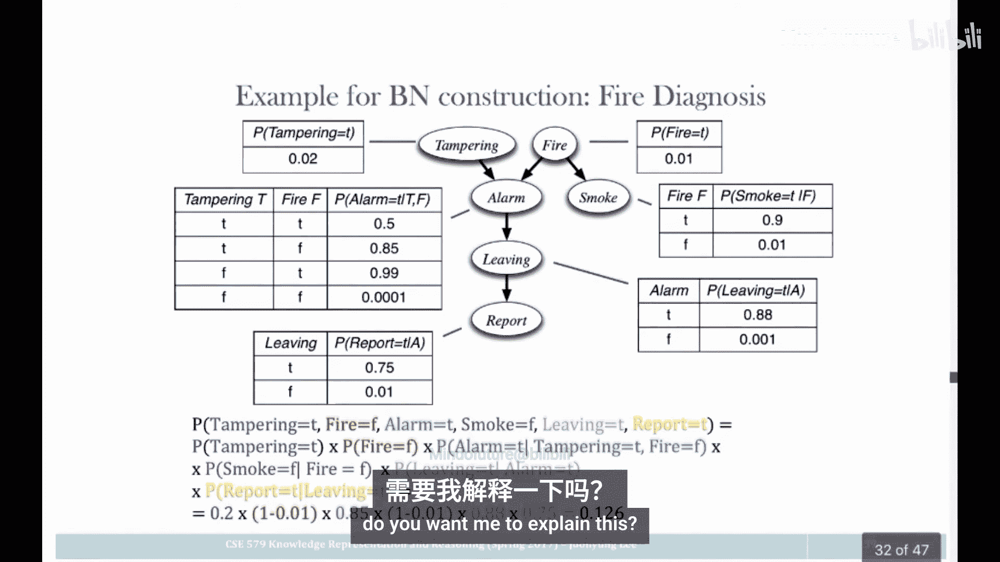

### 示例与计算

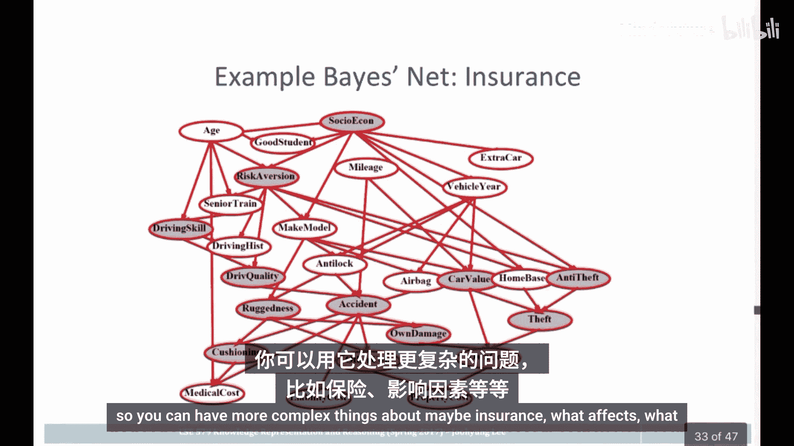

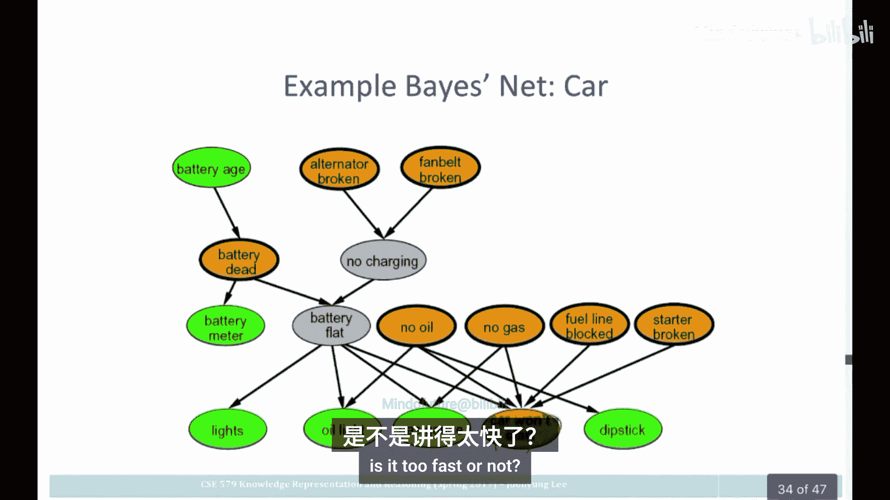

考虑一个经典例子：盗窃(`B`)、地震(`E`)都能触发警报(`A`)，警报会导致约翰(`J`)和玛丽(`M`)打电话。其贝叶斯网络如下图所示（此处为描述，实际应有图），CPT 包括 `P(B)`, `P(E)`, `P(A|B,E)`, `P(J|A)`, `P(M|A)`。

根据网络结构蕴含的条件独立性，联合概率可分解为：
`P(B,E,A,J,M) = P(B) * P(E) * P(A|B,E) * P(J|A) * P(M|A)`
这只需要 `1+1+4+2+2 = 10` 个参数，而完整联合分布需要 `2^5 -1 = 31` 个参数，实现了显著的紧凑性。

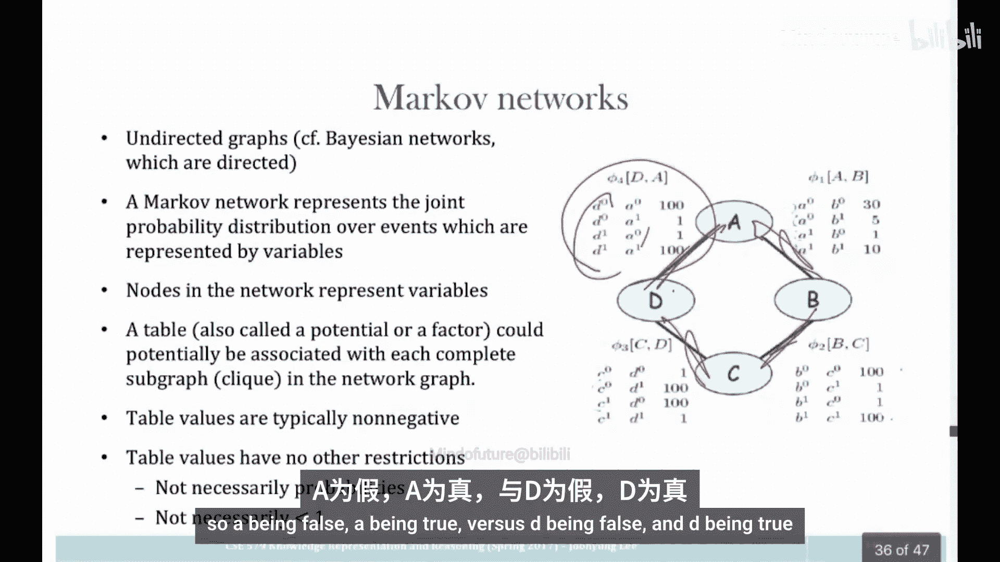

## 马尔可夫网络 🔗

贝叶斯网络使用有向图，而另一种重要的图模型是使用无向图的马尔可夫网络。

### 定义与表示

马尔可夫网络也包含两部分：
1.  **无向图**：节点代表随机变量，边代表变量间的相互影响。
2.  **势函数**：为图中的极大团（完全子图） `C` 分配一个非负的势函数 `φ_C`。势函数的值表示该团中变量取某种联合状态时的“亲和度”或“相容性”，其值不必归一化。

**概率分布的定义**：整个网络的联合概率分布由所有团势函数的乘积归一化后得到：
`P(X=x) = (1/Z) * Π_{C} φ_C (x_C)`
其中，`Z = Σ_{x} [Π_{C} φ_C (x_C)]` 称为配分函数，用于归一化。

### 示例与独立性

考虑一个学生误解概念的例子：四个学生 `A, B, C, D` 两两讨论。用无向边连接有讨论的学生。为每条边定义一个势函数表，数值高低表示两人观点一致（高值）或不一致（低值）的倾向。

在马尔可夫网络中，独立性非常直观：如果从节点集 `X` 到节点集 `Y` 的所有路径都被节点集 `Z` 中的节点阻塞，那么在给定 `Z` 的条件下，`X` 与 `Y` 条件独立。特别地，一个节点的马尔可夫毯（其所有邻居节点）屏蔽了该节点与网络中其余部分的影响。

## 总结

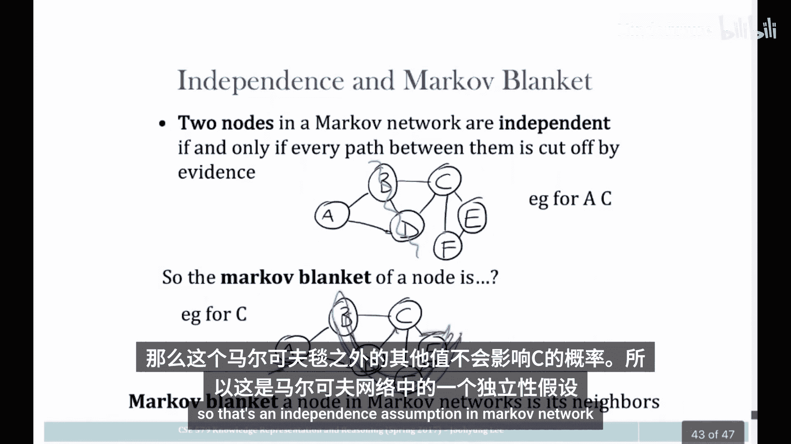

本节课中我们一起学习了不确定性推理的数学基础。我们从概率论的公理、随机变量、条件概率和贝叶斯规则开始，理解了如何量化不确定性。接着，我们探讨了如何利用条件独立性来构建更紧凑的概率模型。贝叶斯网络通过有向图编码因果关系和条件独立性，使得联合概率分布可以分解为局部条件概率表的乘积。马尔可夫网络则通过无向图和势函数来建模变量间的对称关联，其概率分布定义为团势函数乘积的归一化结果。这两种图模型为在复杂领域中进行高效的概率推理提供了强大的框架。