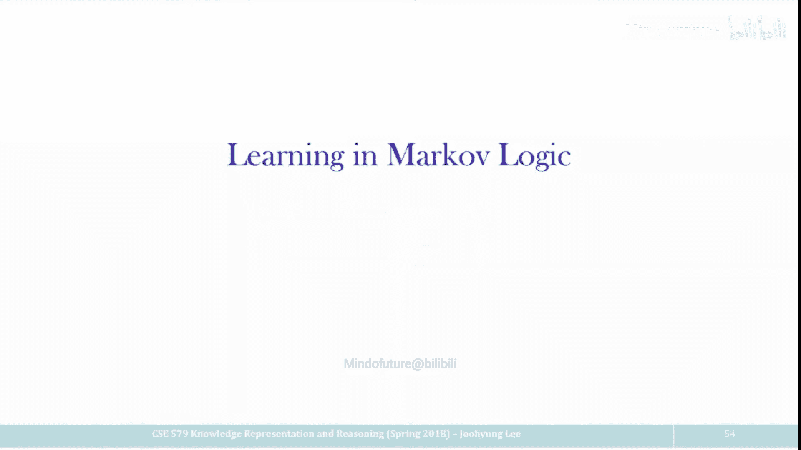

# 016：马尔可夫逻辑中的推理方法


在本节课中，我们将学习马尔可夫逻辑中的第二种推理类型，并了解如何使用Alchemy系统进行马尔可夫逻辑推理。

## 概述

马尔可夫逻辑结合了逻辑与概率。我们将利用其与概率的联系，将其视为指定马尔可夫网络的模板。构建马尔可夫网络后，我们可以使用标准方法进行推理计算。虽然典型的马尔可夫网络方法不能直接使用，但该领域已取得许多进展，以找到更好的推理方法。由于时间有限，我们仅介绍一些核心思想。

上一节我们介绍了寻找最可能状态（MAP状态）的方法，本节我们将重点讨论如何计算条件概率。

## 条件概率计算

在马尔可夫逻辑中，给定一个公式，我们想要计算该公式为真的概率。用 `P(F | MLN)` 表示在特定马尔可夫逻辑网络下公式 `F` 为真的概率。

我们知道每个解释（interpretation）为真的概率。利用这个知识计算公式概率的方法是：将所有使公式为真的解释的概率相加。即，公式的概率等于所有满足该公式的解释的概率之和。

这种方法的问题是，存储所有解释需要一个指数级大小的表，这在实践中不可行。

## 采样方法

在推理设置中，由于大多数情况下无法进行精确推理，因此大量工作集中在采样方法上。其核心思想是：不计算精确概率，而是通过生成的样本来推导概率。

具体做法是：生成一组样本 `S`，其中满足公式 `F` 的样本子集记为 `S_F`。那么，公式 `F` 为真的概率近似等于 `|S_F| / |S|`。当然，这个近似值的质量取决于样本的质量。

采样方法的基本思路是：从某个采样分布中抽取样本，然后基于这些样本计算近似的后验概率。这意味着，在已知某些证据为真的条件下，我们只关注那些满足证据的样本，并从中计算条件概率。随着样本量增加，这个近似值会收敛到真实概率。

采样可用于两种目的：一是用于推理（本节课内容），二是用于学习（下节课内容）。当不知道底层分布时，学习也可以使用采样。

## 如何进行采样

采样的第一步是生成随机数。例如，从0到1之间均匀抽取一个随机数 `U`。然后，需要将这个随机数映射到目标采样分布。

以下是一个示例来说明这个过程。假设已知一个概率分布：抽到红球的概率是0.6，绿球是0.1，蓝球是0.3。如何从这个分布生成样本？

思路是将第一步得到的随机数 `U` 映射到这个分布上。如果 `U` 在 `[0, 0.6)` 区间，则样本为红球；如果在 `[0.6, 0.7)` 区间，则为绿球；如果在 `[0.7, 1.0]` 区间，则为蓝球。例如，如果随机数生成器给出0.83，那么将抽取蓝球作为样本。

如果进行多次采样，我们可以得到一系列样本。之后，我们可以忽略先前的概率分布表，只关注这些样本来计算后验概率。例如，已知球是蓝色或绿色，那么球是蓝色的概率是多少？

查看样本，满足“蓝色或绿色”条件的样本有3个，其中蓝色样本有2个，因此概率为2/3。根据实际概率分布计算，概率应为 `0.3 / (0.1+0.3) = 0.75`，即75%，与66%略有不同。关键在于，当样本量足够大时，从样本中获得的概率将逼近实际概率。

## MCMC采样方法

存在多种采样方法，我们只关注其中一类：马尔可夫链蒙特卡洛（MCMC）方法。这类方法中包含多种算法，我们仅看其中之一。

MCMC方法的独特之处在于，它并非每次独立生成随机样本。它从一个随机样本开始，然后基于前一个样本来生成下一个样本。因此，连续样本之间是相关的，它们通常只在一个变量上有所不同。这个序列被称为马尔可夫链，因为下一个样本的状态仅依赖于前一个状态。

尽管这看起来不符合独立随机采样的精神，但在MCMC的某些假设下，当样本量足够大时，用这种方法生成的样本分布会收敛到目标概率分布。

让我们通过一个简单例子看看它是如何工作的。

## 吉布斯采样示例

我们有一个简单的图模型，包含三个布尔变量：`B`、`A`、`C`。我们想计算条件概率 `P(B | C=true)`。

采样不是独立的。我们基于前一个样本来生成下一个样本，并且每次只改变一个变量的值。

首先，我们从一个初始样本开始：`B=true`, `A=true`, `C=true`。注意，`C` 是观测到的证据变量，其值固定为 `true`。非证据变量是 `B` 和 `A`。

过程将在 `B` 和 `A` 之间交替进行：先采样 `B`，再采样 `A`，如此循环。在采样 `B` 时，固定 `A` 和 `C` 的当前值；采样 `A` 时，固定 `B` 和 `C` 的当前值。为简化，假设每个变量被采样为正或负的概率各为50%。

1.  **初始样本**: `B+`, `A+`, `C+`
2.  **采样 B**: 固定 `A+`, `C+`。假设硬币反面，`B` 采样为负。新样本: `B-`, `A+`, `C+`
3.  **采样 A**: 固定 `B-`, `C+`。假设硬币反面，`A` 采样为负。新样本: `B-`, `A-`, `C+`
4.  **采样 B**: 固定 `A-`, `C+`。假设 `B` 仍为负。新样本: `B-`, `A-`, `C+`
5.  **采样 A**: 固定 `B-`, `C+`。假设 `A` 仍为负。新样本: `B-`, `A-`, `C+`
6.  **采样 B**: 固定 `A-`, `C+`。假设 `B` 为正。新样本: `B+`, `A-`, `C+`

我们得到了6个样本。现在计算 `P(B=true | C=true)`。在6个样本中，`B` 为真的样本有2个（第1个和第6个），因此概率为 `1/3`。在本例中，由于 `B` 和 `C` 独立，理论值应为 `1/2`。`1/3` 的差异是由于样本量太小造成的。

## 吉布斯采样算法

以下是吉布斯采样算法的概要：

1.  随机初始化所有变量的赋值，得到初始状态 `x^0`。
2.  设定要生成的样本总数 `N`。
3.  对于 `t` 从 1 到 `N`：
    *   对于每个非证据变量 `X_i`：
        *   根据条件分布 `P(X_i | x_{-i}^t)` 采样 `X_i` 的新值 `x_i^{t+1}`，其中 `x_{-i}^t` 表示除 `X_i` 外所有变量在时刻 `t` 的值（证据变量保持固定）。
        *   用新值更新当前状态。

该算法易于实现，前提是能够高效地计算单变量条件概率 `P(X_i | neighbors(X_i))`。幸运的是，在马尔可夫网络中，一个变量的条件概率只依赖于其马尔可夫毯（Markov Blanket）中的变量，通常规模很小，这使得计算变得高效。

## 条件概率计算简化

计算 `P(A | B, C, D)` 时，可以利用图结构进行简化。推导表明，该条件概率正比于与变量 `A` 直接相关的势函数（因子）的乘积。具体来说：

`P(A | B, C, D) ∝ φ1(A, B) * φ4(A, D)`

这意味着，要采样变量 `A`，我们只需要知道其邻居 `B` 和 `D` 的当前值，而不需要关心网络中更远的变量（如 `C` 及其连接的大量节点）。这大大降低了计算复杂度。在大多数情况下，马尔可夫毯的规模是局部有限的。

## 面向查询的推理优化

在实际的概率推理中，查询通常形式为：给定一些证据（通常是基原子或基文字的合取），求某个单一变量（基文字）的概率。例如，已知某人吸烟且两人是朋友，求另一人患癌症的概率。

这种简单形式的优点是，我们可以精确知道查询相关的马尔可夫毯。因此，我们可以只构建与查询相关的部分网络，而不必考虑整个接地网络。

算法思想是：从查询变量开始，通过广度优先搜索扩展网络，但遇到证据变量时则停止扩展。最终，我们得到一个只包含非证据变量和“边界”证据变量的子网络。在这个子网络上进行吉布斯采样即可回答查询，从而避免了对整个大规模网络的迭代。

## Alchemy 系统简介

最后，我们简要介绍用于马尔可夫逻辑推理和权重学习的开源软件——Alchemy 系统。它由马尔可夫逻辑的发明团队维护。

Alchemy 主要使用两个程序：`infer` 用于推理，`learnwts` 用于权重学习。使用时需要提供两个文件：马尔可夫逻辑网络文件（`.mln`）和数据库文件（`.db`）。

以下是一个简单的 `.mln` 文件示例，声明了三个谓词和带权公式：

```
number = {1, 2, 3}
P(number)

3 P(1)
1 P(2)
-1 P(3)
```

在这个例子中，权重最高的状态是 `P(1)` 和 `P(2)` 都为真。Alchemy 使用一种名为 MC-SAT 的算法进行推理，它结合了 MCMC 和 WalkSAT 算法的思想，能更好地处理包含硬规则的马尔可夫逻辑网络。

使用 Alchemy 进行推理的命令行示例如下：

```
infer -i example.mln -r output.result -e empty.db -q P
```

这将输出每个基原子 `P(1)`、`P(2)`、`P(3)` 的边际概率。

## 总结



本节课我们一起学习了马尔可夫逻辑中的近似推理方法。我们首先回顾了精确计算概率的困难，进而引入了采样方法，特别是马尔可夫链蒙特卡洛（MCMC）方法。我们详细讲解了吉布斯采样算法的原理和步骤，并通过示例说明了如何通过采样来近似计算条件概率。我们还探讨了如何利用图结构的局部性来优化采样计算，以及如何构建面向查询的子网络以提升推理效率。最后，我们简要介绍了用于实现马尔可夫逻辑推理的 Alchemy 系统及其基本使用方法。下节课我们将学习如何利用数据和采样来进行马尔可夫逻辑网络的权重学习。