# 018：马尔可夫逻辑应用与LPMN简介 🧠

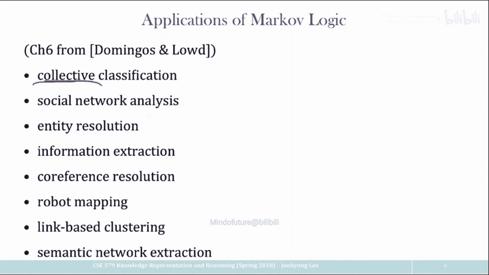

在本节课中，我们将结束对马尔可夫逻辑的讨论，并介绍一种新的形式化方法——LPMN。我们将看到，尽管我们学习了许多不同的形式化方法，但它们之间实际上是相互关联的。特别是，LPMN 将结合 ASP 和马尔可夫逻辑的优点，构建一个更强大的框架。

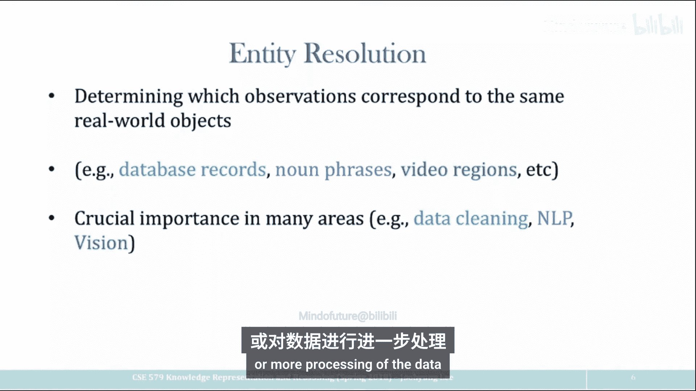

## 马尔可夫逻辑的应用 📊

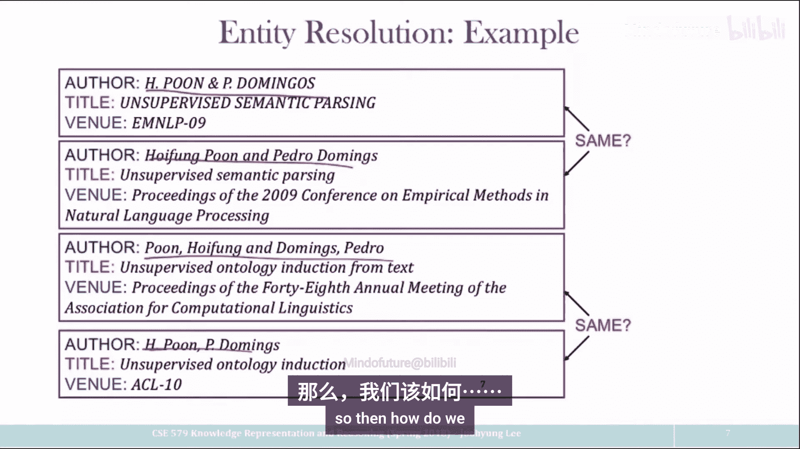

上一节我们介绍了马尔可夫逻辑的推理和学习机制。本节中，我们来看看马尔可夫逻辑在实际问题中的应用。

以下是马尔可夫逻辑的一些典型应用领域：
*   **集体分类**：这是马尔可夫逻辑的独特优势所在，能够同时推断多个相关实体的类别。
*   **社交网络分析**：例如，分析朋友关系对个人行为（如吸烟）的影响。
*   **实体解析**：判断不同数据源中的实体是否指向现实世界中的同一对象。
*   **信息检索**：根据关键词和页面链接关系，检索相关网页。
*   **共指消解**：在自然语言处理中，判断不同名词短语是否指向同一实体。
*   **机器人地图构建**、**基于链接的聚类**和**语义网络提取**等。

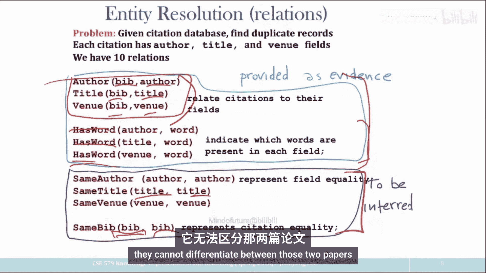

### 应用示例：实体解析

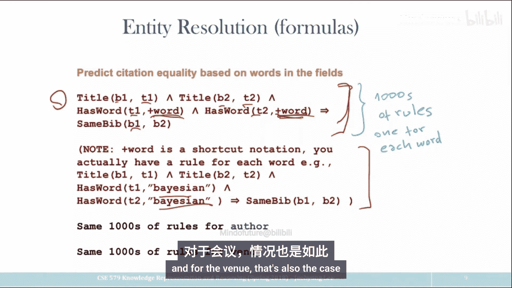

实体解析是一个基础且重要的问题。例如，在学术数据库中，同一篇论文可能因作者书写习惯不同而有多种引用格式。机器需要判断这些不同的条目是否指向同一篇论文。

考虑以下四个书目条目，实际上它们只对应两篇不同的论文：
1.  `Title: Unsupervised Semantic Parsing | Venue: EMNLP`
2.  `Title: unsupervised semantic parsing | Venue: Proceedings of 2009 Conference on Empirical Methods in Natural Language Processing`
3.  `Title: Supervised Ontology Induction from Text | Authors: P. | Venue: ACL`
4.  `Title: Supervised Ontology Induction | Authors: P. | Venue: ACL`

人类可以轻易看出条目1和2是同一篇论文，条目3和4是另一篇同一论文。但对于机器而言，由于标题大小写、作者名缩写、会议名称全称与缩写等差异，这是一个挑战。

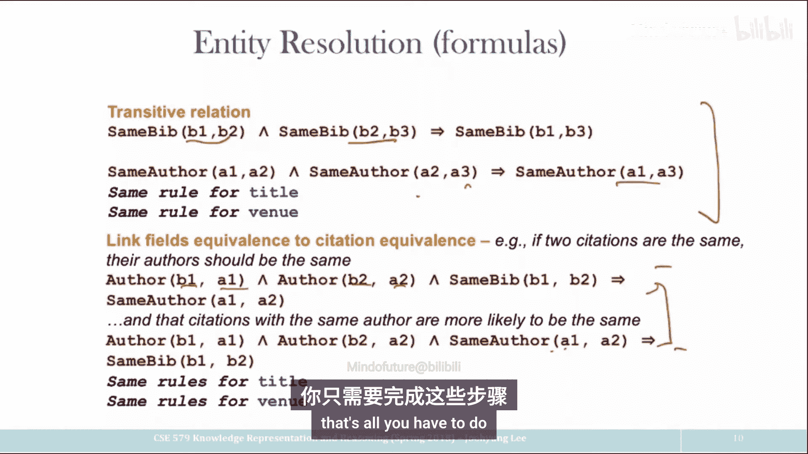

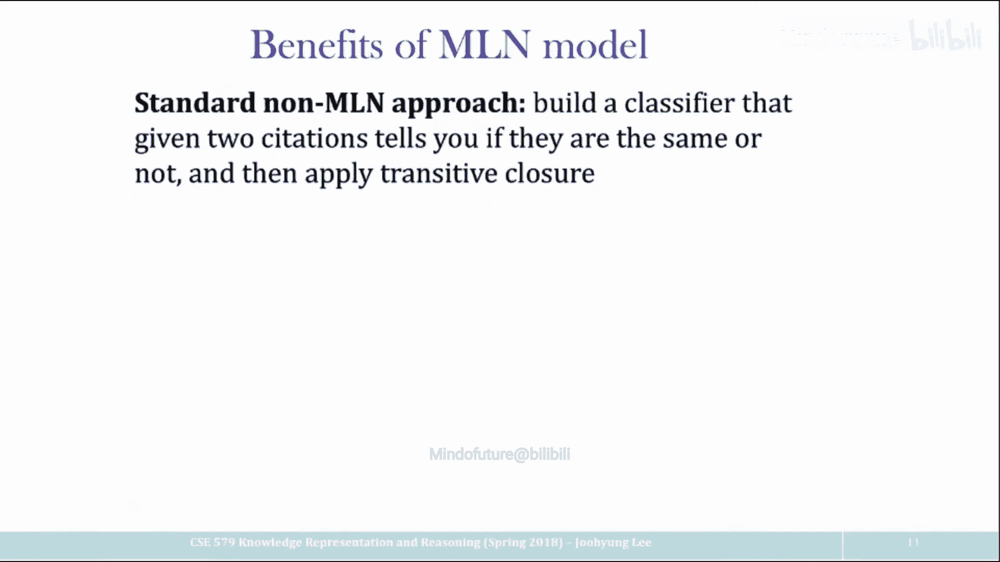

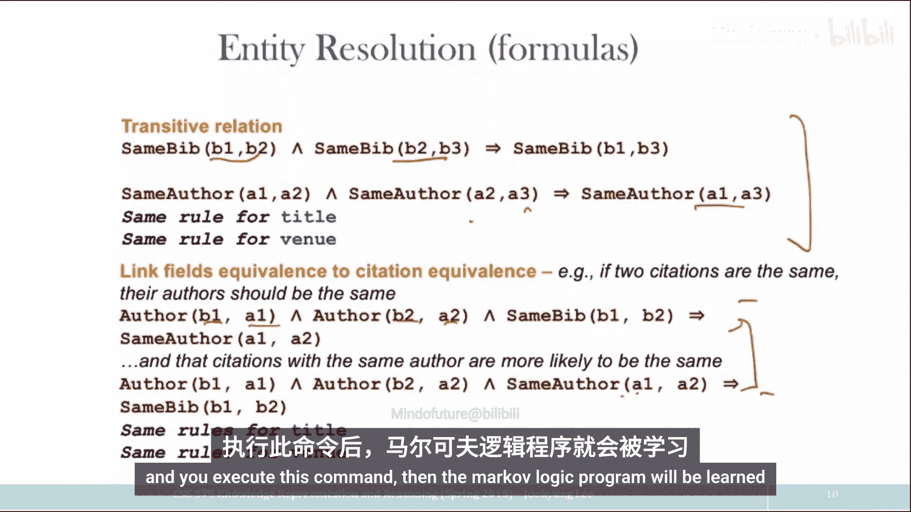

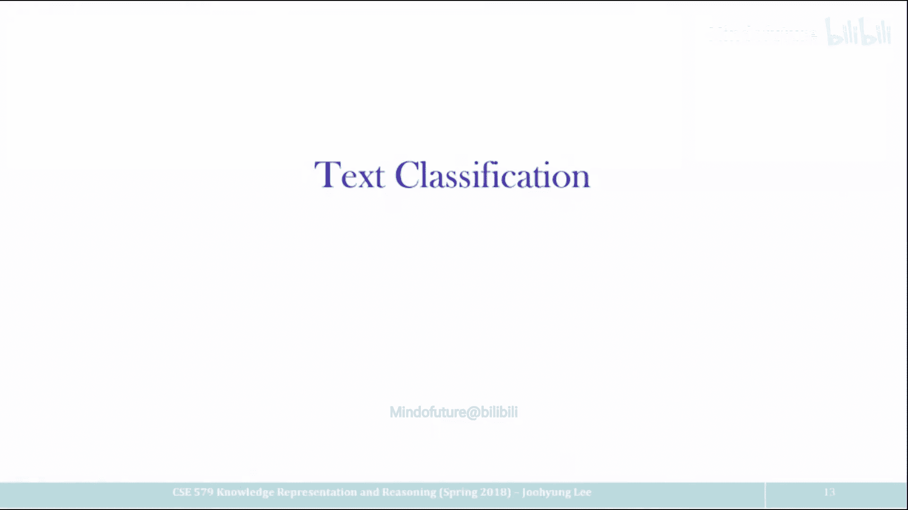

#### 马尔可夫逻辑解决方案

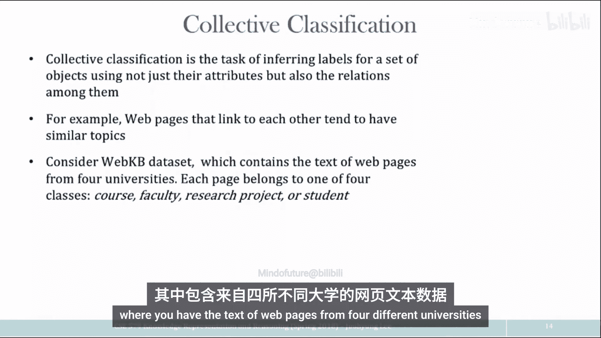

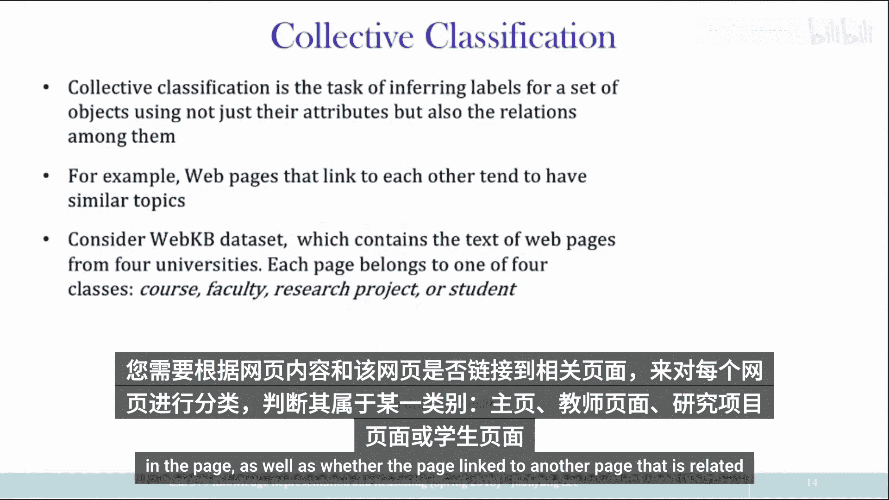

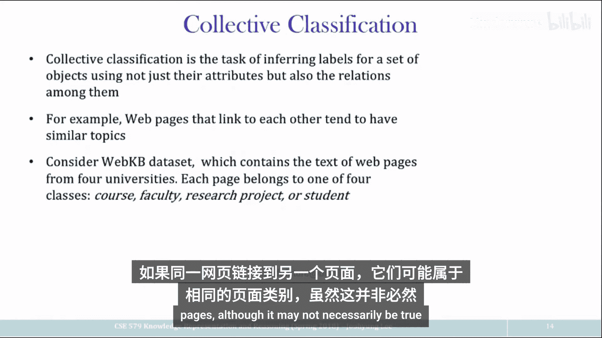

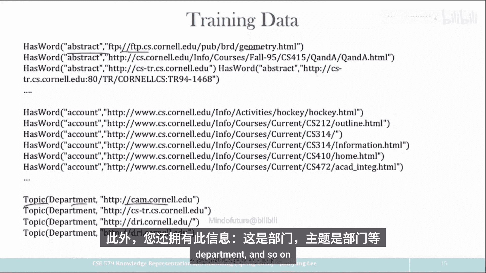

在马尔可夫逻辑中，我们可以通过编写一组带权重的逻辑公式来解决这个问题。

首先，定义谓词来表示数据：
*   `author(Bib, Author)`：书目条目 `Bib` 的作者是 `Author`。
*   `title(Bib, Title)`：书目条目 `Bib` 的标题是 `Title`。
*   `hasWordTitle(Bib, Word)`：书目条目 `Bib` 的标题包含单词 `Word`。
*   `sameAuthor(Author1, Author2)`：作者 `Author1` 和 `Author2` 是同一个人。
*   `sameBib(Bib1, Bib2)`：书目条目 `Bib1` 和 `Bib2` 指向同一篇论文。

然后，编写软规则来捕捉启发式知识：
*   如果两篇论文的标题包含相同的单词，它们可能是同一篇论文。
    *   `title(B1, T1) ∧ title(B2, T2) ∧ hasWordTitle(T1, +W) ∧ hasWordTitle(T2, +W) => sameBib(B1, B2)`
*   如果两位作者的名字包含相同的字符串，他们可能是同一个人。
    *   `author(B1, A1) ∧ author(B2, A2) ∧ hasWordAuthor(A1, +W) ∧ hasWordAuthor(A2, +W) => sameAuthor(A1, A2)`
*   增加传递性规则（如等价关系）：
    *   `sameBib(B1, B2) ∧ sameBib(B2, B3) => sameBib(B1, B3)`
*   建立书目与作者之间的相互推理：
    *   `author(B1, A1) ∧ author(B2, A2) ∧ sameBib(B1, B2) => sameAuthor(A1, A2)`
    *   `sameAuthor(A1, A2) ∧ author(B1, A1) ∧ author(B2, A2) => sameBib(B1, B2)`

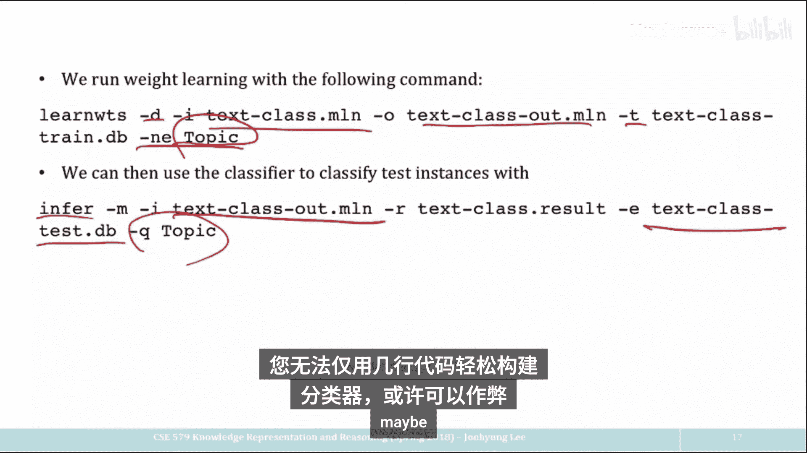

这些规则的权重将从数据中学习得到。这种方法的优势在于**集体分类**：解决一个实体对（如判断两篇论文是否相同）有助于解决与之相关的其他实体对（如判断两位作者是否相同），反之亦然。这是传统独立分类器难以做到的。

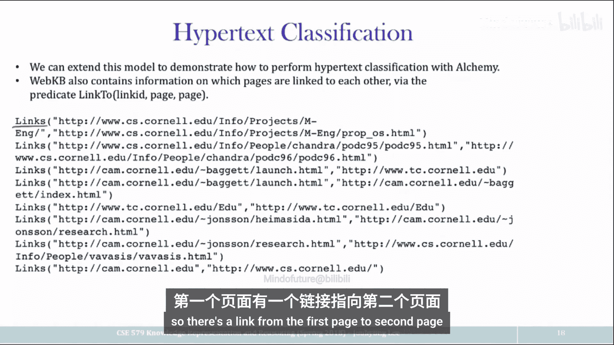

### 应用示例：网页分类

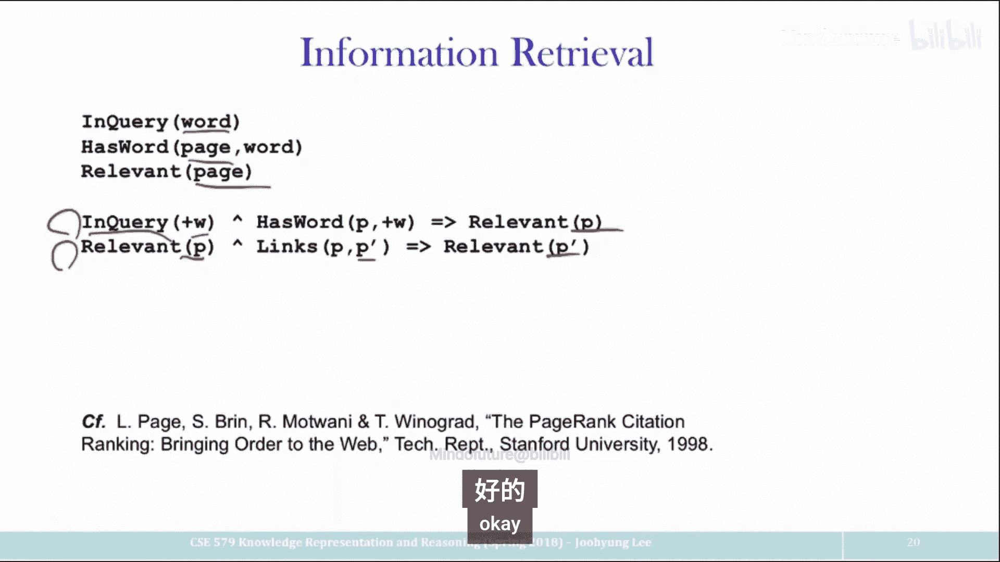

任务是对来自大学网站的网页进行分类（如课程页、教师页、项目页、学生页）。除了页面内容，页面间的链接关系也提供了重要信息。

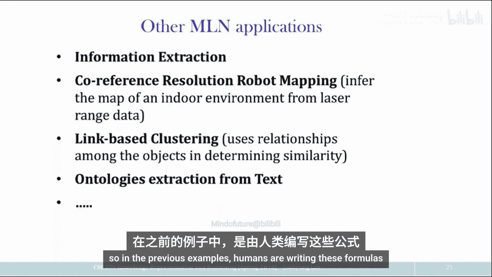

我们可以定义以下谓词：
*   `hasWord(Page, Word)`：页面 `Page` 包含单词 `Word`。
*   `topic(Page, Topic)`：页面 `Page` 属于主题 `Topic`。
*   `link(Page1, Page2)`：页面 `Page1` 链接到页面 `Page2`。

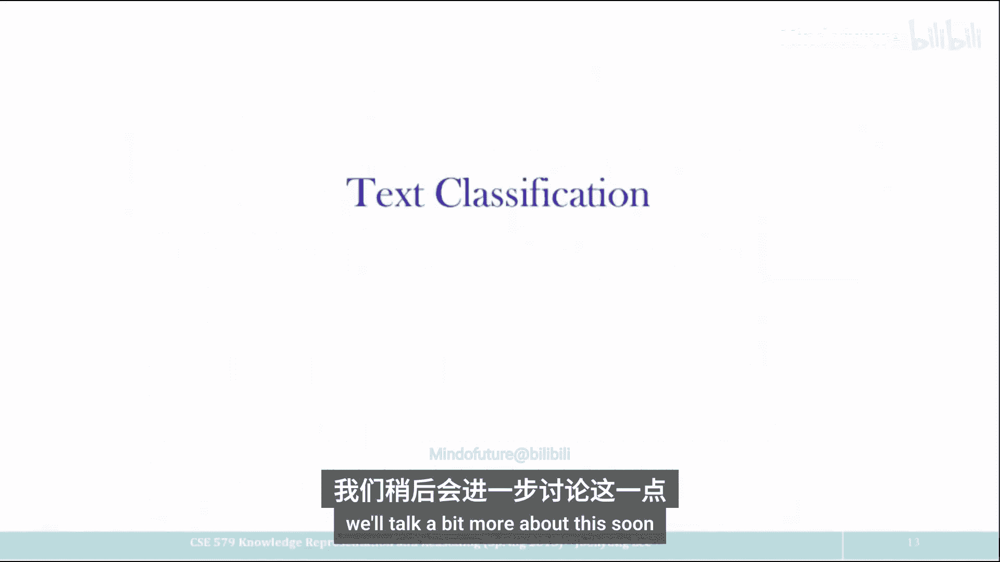

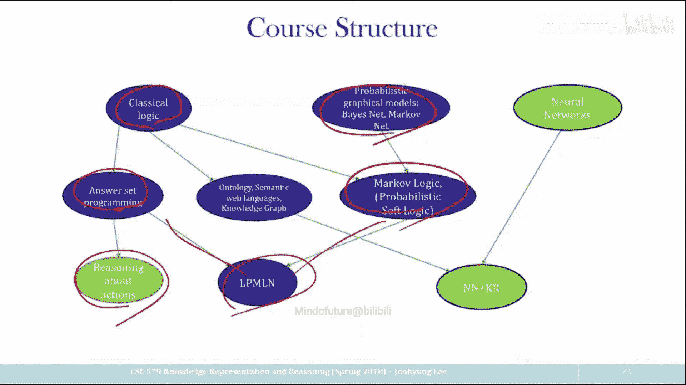

编写马尔可夫逻辑规则：
*   基于内容的规则：如果页面包含某个单词，它可能属于某个主题。
    *   `hasWord(P, +W) => topic(P, +C)`
*   基于链接的规则（超文本分类）：如果页面P1属于主题C，并且P1链接到P2，那么P2也可能属于主题C。
    *   `topic(P1, C) ∧ link(P1, P2) => topic(P2, C)`

同样，规则的权重通过数据学习获得。在推理时，系统会综合考虑页面内容和链接结构，计算出页面属于各个主题的概率。

## 从马尔可夫逻辑到LPMN 🔗

前面我们探讨了马尔可夫逻辑的强大应用能力。然而，马尔可夫逻辑也存在一些弱点，特别是在表达复杂的逻辑关系和因果关系方面。本节中，我们将引入LPMN，它旨在结合ASP和马尔可夫逻辑的优势。

### 现有方法的局限性

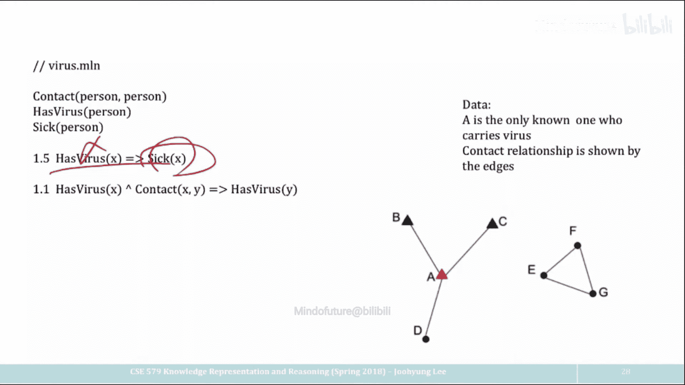

*   **ASP的优点与不足**：
    *   **优点**：具有强大的知识表示能力，支持聚合、选择、约束、生成-测试范式、因果性和归纳定义。规则（`A :- B.`）对人类来说非常直观。
    *   **不足**：无法很好地处理**概率不确定性**。它是确定性的。
*   **马尔可夫逻辑的优点与不足**：
    *   **优点**：通过带权重的规则自然地处理不确定性。权重可以从数据中自动学习，无需人工指定。
    *   **不足**：缺乏ASP的许多知识表示结构。其语义有时不符合直觉（尤其是涉及因果或推导方向时）。例如，在“病毒传播”例子中，已知A携带病毒，与A无接触的E/F/G被推断出有非零的患病概率，这不太合理。此外，`sick(X)` 为真并不能强力推导出 `virus(X)` 为真，这削弱了逻辑推导能力。

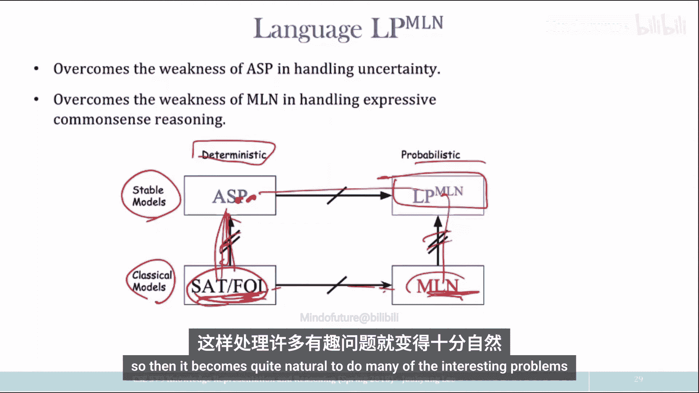

### LPMN的基本思想

LPMN 的核心思想很简单：为ASP的规则加上权重。

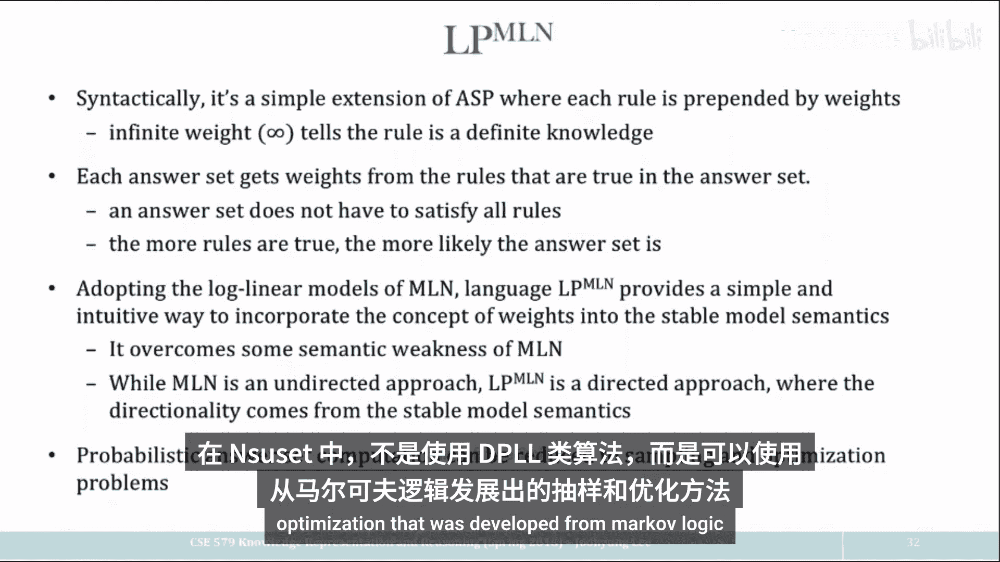

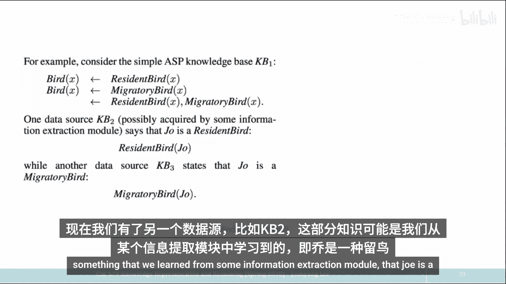

**语法**：`Weight : Rule.`
其中 `Rule` 是一个ASP规则，`Weight` 是一个实数权重。无限大的权重表示确定性知识。

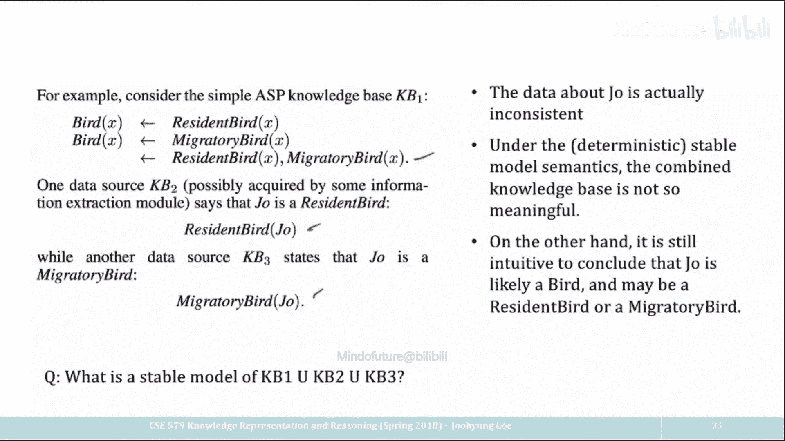

**语义思想**：
对于一个给定的候选解释（可能世界）`I`：
1.  找出所有在 `I` 下为真的规则，构成一个子程序 `P_I`。
2.  检查 `I` 是否是 `P_I` 的一个**稳定模型**。
    *   如果是，则该解释的未归一化权重为 `exp(所有在I下为真的规则的权重之和)`。
    *   如果不是，则该解释的权重为 0。
3.  所有可能解释的概率由其归一化后的权重决定。

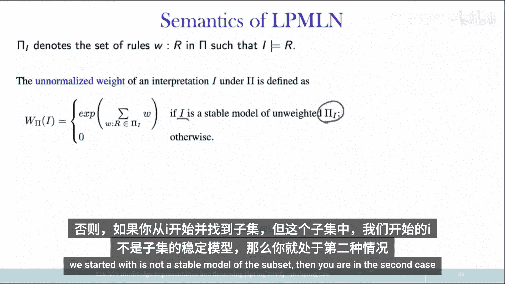

这种语义克服了马尔可夫逻辑的一个关键问题：一个解释只有当它能被其中为真的规则集**合理推导**出来时，才会获得高概率。这更符合逻辑推理的直觉。

### 示例：不一致信息的处理

考虑一个知识库：
1.  `residentBird(X) :- bird(X).` (权重 α)
2.  `migratoryBird(X) :- bird(X).` (权重 α)
3.  `:- residentBird(X), migratoryBird(X).` (权重 α，约束不能同时是留鸟和候鸟)
4.  `residentBird(joe).` (权重 α，证据1：Joe是留鸟)
5.  `migratoryBird(joe).` (权重 α，证据2：Joe是候鸟)

在纯ASP中，这组规则是矛盾的，没有稳定模型。但在LPMN中，我们可以计算各种解释的概率。

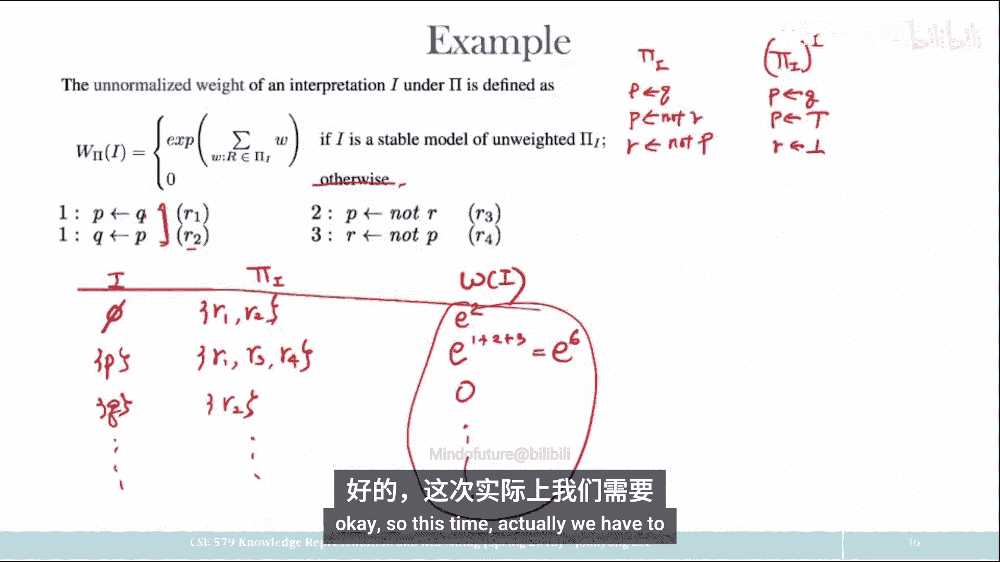

**关键洞察**：人类在面对矛盾证据（Joe既是留鸟又是候鸟）时，并不会让整个推理系统崩溃。我们可能会忽略其中一个矛盾证据，但仍能确信“Joe是一只鸟”。LPMN的语义模拟了这一点。

计算表明（当权重α趋于无穷大时）：
*   `P(bird(joe)) = 1.0`。尽管证据矛盾，我们仍能确信Joe是鸟。
*   `P(residentBird(joe) | bird(joe)) = 0.5`。在Joe是鸟的前提下，它是留鸟的概率是0.5（对候鸟亦然）。
*   `P(bird(joe) | residentBird(joe)) = 1.0`。如果已知Joe是留鸟，那么它能推出Joe是鸟。

如果我们将证据4和5的权重设为不同值（例如，`residentBird(joe)` 权重较高，`migratoryBird(joe)` 权重较低），则最终概率会反映我们对不同证据的信任程度。

## 总结 🎯

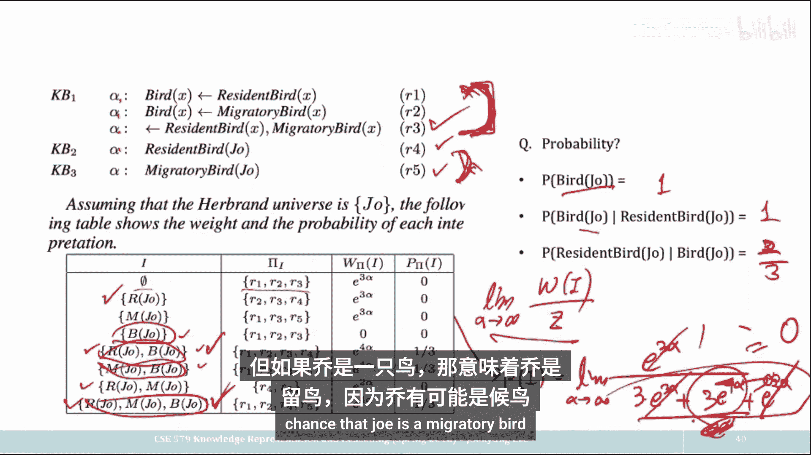

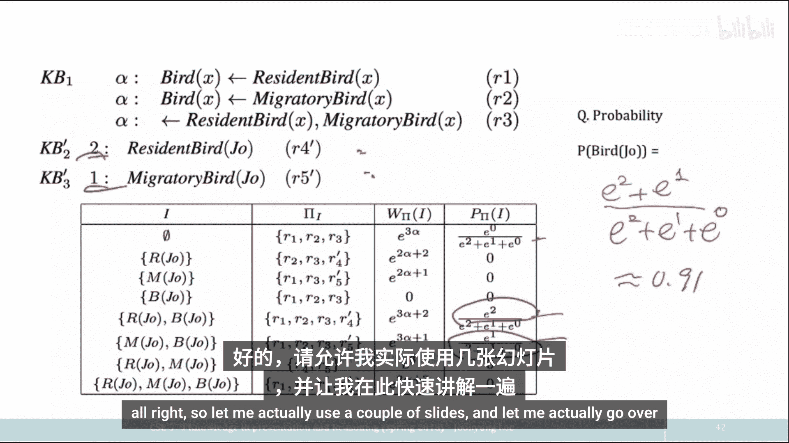

本节课中我们一起学习了：
1.  **马尔可夫逻辑的应用**：我们深入了解了马尔可夫逻辑在实体解析、网页分类等实际问题中的应用。其核心优势在于**集体分类**，能够利用实体间的相互关系进行联合推理。
2.  **LPMN的引入**：我们探讨了ASP和马尔可夫逻辑各自的优缺点，并介绍了LPMN如何作为桥梁将两者结合。LPMN通过为ASP规则添加权重，并定义基于稳定模型概念的语义，从而既能处理概率不确定性，又能保留丰富的逻辑表示能力和直观的推理方向。

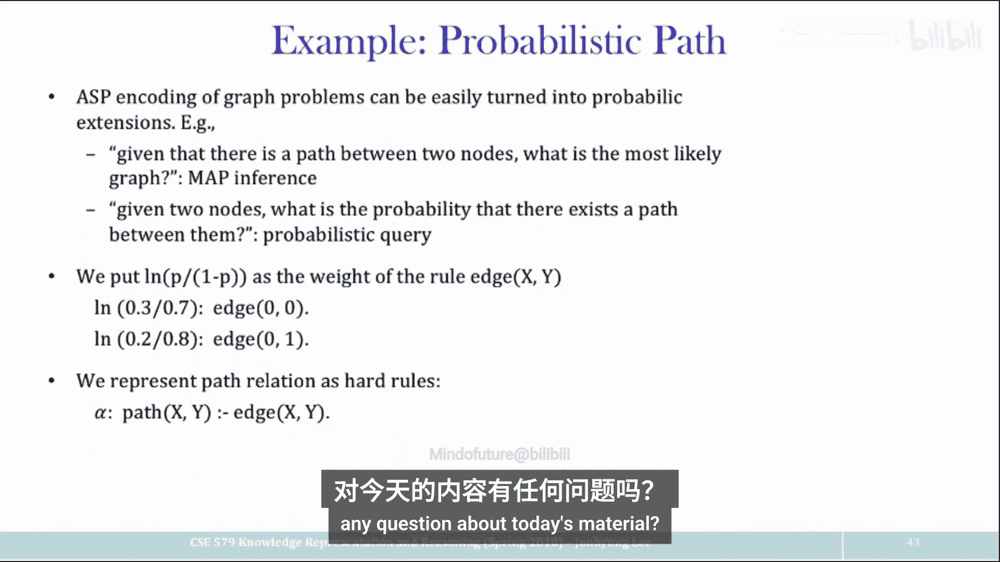

LPMN继承了ASP的表达力和马尔可夫逻辑对不确定性的处理能力，为解决需要复杂逻辑关系和概率推理的问题提供了一个有力的框架。在接下来的课程中，我们将更详细地探讨LPMN的语义和推理算法。