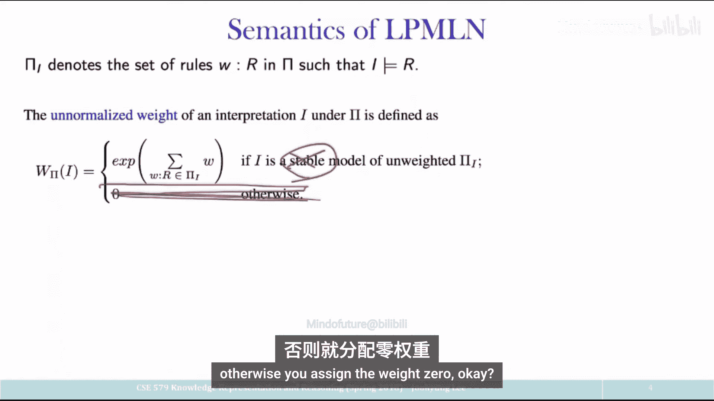
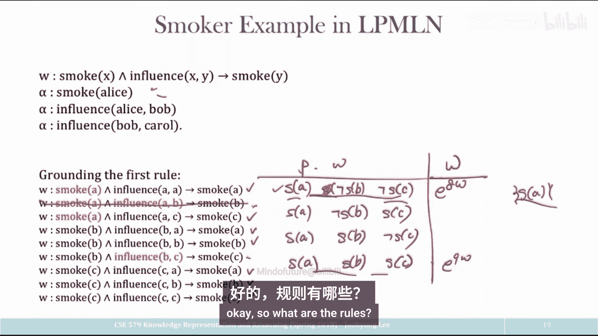
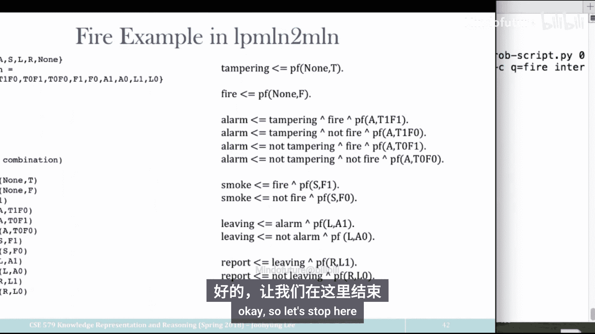

# 019：LPMN语言详解与应用




在本节课中，我们将继续深入探讨LPMN语言。我们将通过具体示例来理解其工作原理，并介绍用于计算该语言的系统。LPMN旨在结合答案集编程和马尔可夫逻辑的优点，为概率性知识表示提供强大的工具。

## 语法与语义回顾

上一节我们介绍了LPMN的基本概念，本节中我们来看看其形式化定义。LPMN的语法很简单，由带权重的子集规则构成。

其语义定义涉及一个辅助概念 **H_I**。给定一个解释 **I**，我们收集所有在该解释下为真的规则，形成一个子集。这与归约不同，它更简单，只需找出为真的规则。

接下来，我们检查解释 **I** 是否是该规则子集的稳定模型。如果是，我们就像在马尔可夫逻辑中一样，将所有满足规则的权重相加，得到一个非归一化的权重。公式如下：

**weight(I) = exp( sum_{r ∈ H_I} weight(r) )**

如果 **I** 不是该子集的稳定模型，则其权重被赋值为0。这正是LPMN与马尔可夫逻辑在语义上的关键区别。如果我们忽略“稳定模型”这个要求，LPMN的语义就退化成了马尔可夫逻辑的语义。

一旦计算出所有解释的非归一化权重，概率（即归一化权重）可通过以下公式计算：

**P(I) = weight(I) / (sum_{J} weight(J))**

这里的分母是所有可能解释的权重之和，作为归一化因子。

## 概率查询示例

现在，我们通过一个例子来看看如何进行概率查询。假设我们有以下规则和事实，并想计算“bird(joe)”为真的概率。

首先，我们列出所有可能的解释。对于每个解释，我们找出为真的规则子集，检查该解释是否为该子集的稳定模型，然后计算其权重。最后，将所有使查询为真的解释的概率相加，即得到查询的概率。

对于条件概率，例如 **P(bird(joe) | resident\_bird(joe))**，其计算方式与基础概率论一致：

**P(A|B) = P(A ∧ B) / P(B)**

我们只需收集所有同时满足 **A** 和 **B** 的解释的概率，再除以所有满足 **B** 的解释的概率。

关于权重 **α**，我们的直觉是将其设为无穷大，以使规则成为“硬”规则，表示确定性知识。如果使用不同的有限权重（如2和1），则代表具有不同确定度的置信因子，这会得到不同的概率分布。但在计算概率时，归一化的核心思想是相同的。

当 **α** 趋向无穷大时，满足更多 **α** 权重的解释将主导其他解释，使得其他解释的概率趋近于零。

## LPMN在图问题中的应用

我们曾在ASP中解决过许多图问题，如哈密顿回路、着色或团问题。现在，我们可以轻松地将这些问题扩展到概率性设置中。

例如，假设我们有一个图，但我们不确定某些边是否存在。我们知道节点间以某种概率相连，但不知道具体的路径。使用LPMN，我们可以提出这样的查询：给定节点间边的存在概率，两点间存在路径的概率是多少？

以下是如何在LPMN中表示不确定图的方法：
1.  将确定的边关系（如 `edge(0,0).`）替换为带权重的原子，以表示其存在的概率。
2.  路径关系 `path(X,Y)` 的递归定义则使用与ASP中相同的规则。

具体编码时，对于一条有30%概率存在的边，我们使用权重 **log(0.3/0.7)**。路径规则可以写为：
```prolog
path(X,Y) :- edge(X,Y).
path(X,Y) :- path(X,Z), edge(Z,Y), Y != Z.
```
这样，我们就将ASP的图编码与概率信息结合了起来。类似地，旅行商问题也可以转化为概率版本，只需将边关系变为概率性的，其他优化规则保持不变。我们甚至可以结合成本函数，寻找在给定存在概率下的最优路径，形成决策理论版本的问题。

## 具体案例分析：网络连通性

让我们看一个具体的例子来阐明这个想法。假设有四个节点1、2、3、4，连接关系如图所示。节点1总是成功的（不故障）。节点2有80%的故障率，节点3有50%，节点4有20%。

连通性规则如下：如果两个节点间有边，且两个节点都未故障，则它们是连通的。此外，连通性具有传递性。

根据描述，节点1和2直接相连，只要节点2不故障即可，因此连通概率是20%。节点2和4需要两者都不故障，概率是0.2 * 0.8 = 0.16，即16%。




现在，核心问题是：节点1和4连通的概率是多少？我们需要考虑所有可能的世界（即各节点的故障状态组合），并计算那些能使节点1到4连通的世界的总概率。通过枚举和计算（考虑节点2故障与否，以及节点3、4的状态），最终可得出正确概率。

这个例子表明，即使是简单问题，也需要考虑多种情况。ASP的优势在于可以枚举所有可能性，但LPMN允许我们区分这些可能性的不同概率。

## LPMN与马尔可夫逻辑的对比：吸烟者例子

考虑一个经典的“影响”例子。规则是：如果X吸烟且X影响Y，那么Y吸烟。这是一个软规则，权重为 **w**。已知事实：Alice吸烟是硬规则；Alice影响Bob，Bob影响Carol是硬事实；其他影响关系均为假。

在马尔可夫逻辑语义下，尽管直觉上Bob比Carol更可能吸烟（因离Alice更近），但计算出的 **P(smokes(bob))** 和 **P(smokes(carol))** 是相等的。这是因为一阶逻辑的语义（蕴含的真值表）导致了一些反直觉的结果。

然而，在LPMN语义下，情况发生了变化。LPMN要求解释必须是所考虑规则子集的稳定模型。在“Alice吸烟，Bob不吸烟，Carol吸烟”这个世界中，Carol吸烟无法从剩余规则中推导出来（因为Bob不吸烟），因此该世界不是稳定模型，其权重为0。这使得 **P(smokes(bob))** 大于 **P(smokes(carol))**，更符合因果链的直觉：Carol不可能在Bob不吸烟的情况下自己成为吸烟者。

这个对比凸显了基于稳定模型语义的LPMN在捕捉递归和因果结构方面的优势，而基于一阶逻辑的马尔可夫逻辑在此类问题上存在局限。

## 实用系统介绍

有两种主要的LPMN系统实现：
1.  **LPM2ASP**：使用Clingo作为底层推理引擎。
2.  **LPM2MLN**：使用马尔可夫逻辑网络系统（如Alchemy、Tuffy、RockIt）作为引擎。

**LPM2ASP** 的输入语言非常接近Clingo。主要区别在于可以在规则前添加权重。软规则是带权重的Clingo规则，每条规则必须以句点结束。未指定权重的规则被视为具有无穷大权重 **α** 的硬规则。

运行系统时，命令类似于Alchemy。你需要指定输入文件、证据文件（可选）和查询谓词。证据文件中的事实必须以约束形式给出（如 `:- not resident_bird(joe).` 表示“joe是留鸟”必须为真）。

此外，LPM2ASP还可用于调试ASP程序。通过 `-hr` 选项，系统可以找出哪些硬规则被“忽略”（违反）以恢复一致性，并显示各种修复方式的概率。

## 用LPMN编码贝叶斯网络

贝叶斯网络可以方便地用LPMN编码。核心是将条件概率表转化为概率事实和逻辑规则。

例如，对于一个简单的报警网络，节点有：Tampering (T), Fire (F), Alarm (A), Smoke (S), Leaving (L)。编码步骤如下：
1.  为每个节点的每个父节点状态组合，创建一个概率事实，表示该节点为真的概率。例如，`0.02::t1.` 表示T为真的先验概率是0.02。
2.  使用逻辑规则将节点状态与概率事实联系起来。例如，Alarm为真的规则是：
    ```prolog
    alarm :- t1, f1, a1_t1_f1.
    alarm :- t1, f0, a1_t1_f0.
    alarm :- t0, f1, a1_t0_f1.
    alarm :- t0, f0, a1_t0_f0.
    ```
    其中 `a1_t1_f1` 等是对应于CPT中条目的概率事实。

在LPM2ASP中，我们可以直接使用概率值，系统会自动处理对数转换，这比在Alchemy中手动计算更方便。

我们可以利用这个编码进行各种推理：
*   **诊断推理**：给定观察到人们正在离开（L为真），求火灾（F）的概率。将 `leaving` 作为证据，查询 `fire`。
*   **预测推理**：给定发生火灾（F为真），求人们离开（L）的概率。将 `fire` 作为证据，查询 `leaving`。
*   **混合推理**：同时知道火灾（F为真）和人们离开（L为真），求警报（A）响的概率。
*   **因果间推理**：观察到警报（A为真）时，火灾（F）的概率；再额外得知篡改（T为真）时，火灾的概率会下降（解释消除效应）；如果得知篡改（T为假）而警报（A为真），则火灾的概率会极高。

## 总结



本节课中，我们一起深入学习了LPMN语言。我们回顾了其结合ASP和马尔可夫逻辑优势的语义，并通过图连通性问题和吸烟者例子，对比了LPMN与马尔可夫逻辑的差异。我们还介绍了两种实用的LPMN系统（LPM2ASP和LPM2MLN），并演示了如何用LPMN编码贝叶斯网络以进行各类概率推理。LPMN为处理需要结合逻辑约束与不确定性的复杂问题提供了一个强大的框架。