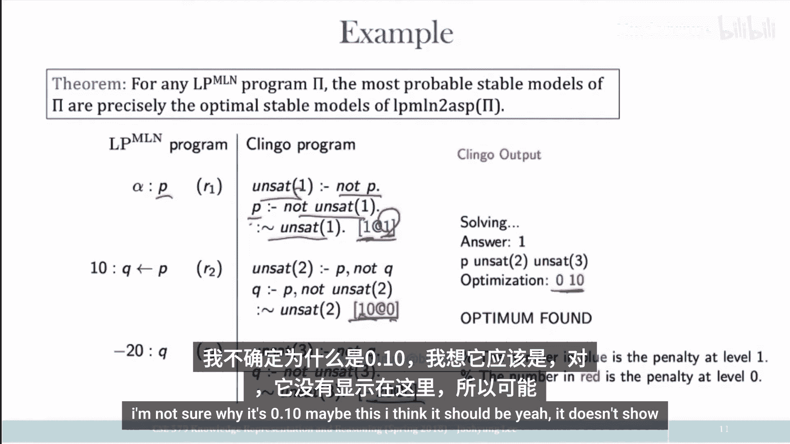
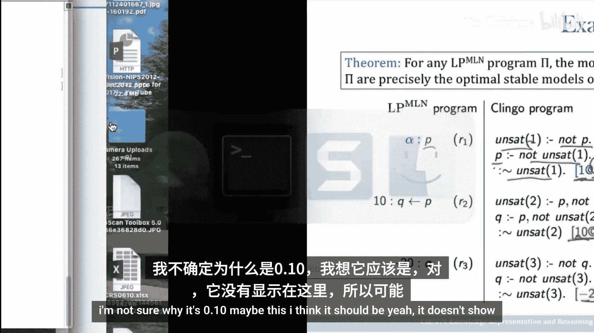
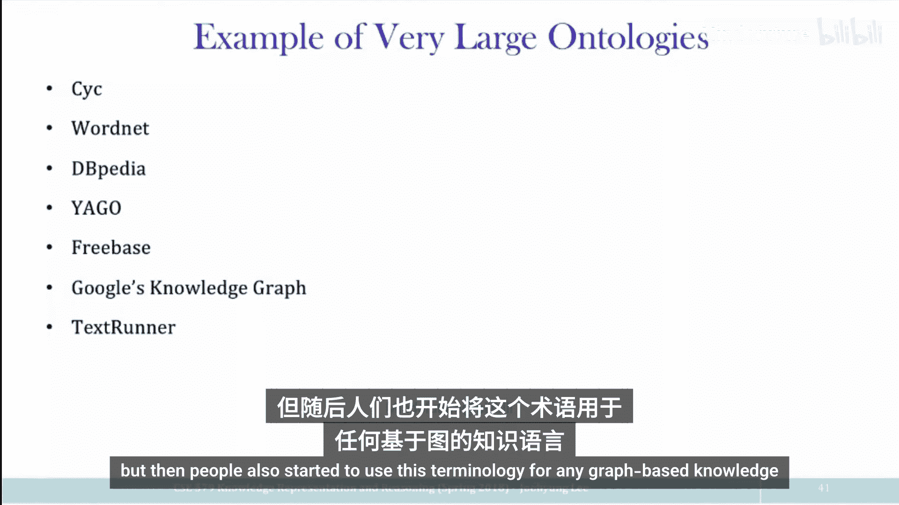

# 021：从LPM到ASP的翻译及本体论介绍

在本节课中，我们将完成从逻辑概率模型（LPM）到答案集编程（ASP）的翻译，并开始介绍下一个主题：本体论和描述逻辑。

## 从LPM到ASP的翻译

上一节我们介绍了逻辑概率模型（LPM）的基本概念。本节中，我们来看看如何将LPM翻译成ASP语言，这需要使用一种称为“弱约束”的结构。

### 弱约束简介

弱约束是ASP核心语言（如ASP-Core-2）中的内置结构。它与之前见过的“硬约束”不同。硬约束会直接排除违反约束的稳定模型，而弱约束不会消除违反约束的稳定模型，而是会给它们施加一个“惩罚”。这样，我们就可以区分哪些稳定模型更优。

弱约束的语法如下：
```
:~ F. [W@L]
```
其中：
*   **F** 是一个文字（原子或其否定）的合取式。
*   **W** 是一个整数（可以是负数），代表权重。
*   **L** 是一个非负整数（如0, 1, 2...），代表优先级等级。

当稳定模型满足合取式 **F** 时，我们说该弱约束被违反，并给该模型在等级 **L** 上施加权重为 **W** 的惩罚。等级越高，优先级越高。我们首先比较最高等级的惩罚，如果相同，则依次比较更低等级的惩罚。惩罚总和最小的稳定模型被认为是最优的。

以下是弱约束语义的形式化定义。假设程序 **Π** 由标准ASP程序 **Π₁** 和仅包含弱约束的集合 **Π₂** 组成。对于一个稳定模型 **I** 和等级 **L**，其惩罚 `penalty(I, L)` 定义为所有在等级 **L** 上被 **I** 违反的弱约束的权重 **W** 之和。

我们通过一个例子来理解。考虑以下程序：
```
{p; q}.
:~ p. [10@0]
:~ q. [5@1]
```
标准部分 `{p; q}.` 有四个稳定模型：`{}`, `{p}`, `{q}`, `{p,q}`。下表计算了每个模型在不同等级上的惩罚：

| 稳定模型 (I) | penalty(I, 0) | penalty(I, 1) |
| :--- | :--- | :--- |
| `{}` | 0 | 0 |
| `{p}` | 10 | 0 |
| `{q}` | 0 | 5 |
| `{p,q}` | 10 | 5 |

接下来定义支配关系。我们说稳定模型 **I** 被 **I‘** 支配，如果存在一个等级 **k**，使得：
1.  `penalty(I, k) > penalty(I', k)`
2.  对于所有等级 `L > k`，有 `penalty(I, L) = penalty(I', L)`

这意味着我们从最高等级开始比较惩罚，如果 **I** 在某个等级的惩罚更大，且更高等级的惩罚都相同，则 **I** 被支配。一个稳定模型被称为**最优的**，如果没有其他稳定模型能支配它。

### LPM到ASP的翻译规则

了解了弱约束后，我们现在可以展示从LPM到ASP的翻译。这个翻译非常简单：LPM中的每条规则被替换为ASP中的三条规则。

给定一条LPM规则：
```
W_i: H_i :- B_i.
```
我们将其翻译为以下三条ASP规则：
```
on_i :- B_i, not H_i.
H_i :- B_i, not on_i.
:~ on_i. [W_i@0]
```
让我们分析其工作原理：
1.  第一条规则定义了一个辅助原子 `on_i`。当规则体 `B_i` 为真而规则头 `H_i` 为假时（即规则未被满足），`on_i` 为真。
2.  第二条规则是修改后的原始规则。它将 `not on_i` 加入到规则体中。这意味着，只有当 `on_i` 不为真（即规则未被“击败”）时，这条规则才会生效。
3.  第三条是一个弱约束。当 `on_i` 为真（即规则被击败）时，该弱约束被违反，并施加权重为 `W_i`（在等级0）的惩罚。

这样，翻译就模拟了LPM的语义：规则可以被“击败”（忽略），但如果被击败，则需要付出相应的概率代价（通过惩罚来体现）。

对于LPM中的硬约束（权重为无穷大 `α` 的规则），翻译略有不同，需要引入更高的优先级等级以确保其优先被满足：
```
on_i :- B_i, not H_i.
H_i :- B_i, not on_i.
:~ on_i. [1@1]
```





### 翻译示例

考虑以下LPM程序：
```
α: p.
10: q :- p.
-1: q.
```
使用翻译规则，我们得到ASP程序：
```
on1 :- not p.
p :- not on1.
:~ on1. [1@1]

on2 :- p, not q.
q :- p, not on2.
:~ on2. [10@0]

on3 :- not q.
q :- not on3.
:~ on3. [-1@0]
```
计算后，可以找到最优稳定模型是 `{p}`。通过检查 `on_i` 原子并汇总惩罚权重，我们可以计算出各个稳定模型的概率。

这个翻译方法非常高效，每条LPM规则仅对应三条ASP规则。基于此实现的系统可以用于计算最可能稳定模型、枚举所有稳定模型及其概率，或进行概率抽样近似。

## 本体论与描述逻辑导论

完成了LPM到ASP的翻译后，我们转向知识表征中的另一个核心主题：本体论。

### 什么是本体论？

本体论源于哲学，在计算机科学中，它指对某个领域内概念化的、明确的、形式化的、可共享的规格说明。所谓“概念化”，包括该领域内存在的对象、概念、实体以及它们之间的关系。

这听起来类似于我们之前学过的基于逻辑的知识表征。的确，本体论语言通常基于一阶逻辑，用个体（对象）和谓词（关系）来描述世界。但一阶逻辑在一般情况下是不可判定的，因此本体论的研究主要关注那些**可判定**且**表达能力足够强**的一阶逻辑片段。

本体论的关键要素类似于面向对象编程：包含**个体**（实例）、**类**（类别）以及**关系**（属性）。类的成员可以继承类的属性，个体之间通过关系相互关联。许多人将本体论视为一种**分类法**（Taxonomy），例如生物学的门、纲、目、科、属、种。

### 语义网与RDF

语义网（Semantic Web）的构想便建立在本体论之上。其核心思想是使用一种通用的、机器可读的方式来描述网络上的信息。其中，**RDF**（Resource Description Framework，资源描述框架）是基础数据模型。

RDF的基本思想是使用三元组来描述知识：
```
(主体 Subject, 谓词 Predicate, 客体 Object)
```
这可以理解为“主体-关系-客体”。例如：
```
(pen7, color, red)
```
这种结构非常通用，可以表示任何二元关系。所有三元组连接起来，就形成了一个巨大的知识图（Knowledge Graph）。

但RDF本身只定义了结构，并没有给词汇（如 `color`, `red`）赋予任何含义。这就是 **RDF Schema (RDFS)** 的作用。

### RDF Schema (RDFS)

RDFS不是一种新的语言，而是在RDF基础上预定义了一些具有特殊含义的词汇（谓词），用于表达本体的基本结构。

以下是RDFS中的一些核心谓词及其含义：
*   **`rdfs:domain`** 和 **`rdfs:range`**：定义属性的定义域和值域。
    *   例如：`(rent, domain, Person)` 表示 `rent` 这个属性的主体必须是 `Person` 类的实例。
*   **`rdfs:subClassOf`**：定义类之间的子类关系。
    *   例如：`(Apartment, subClassOf, ResidentialUnit)`。
*   **`rdfs:subPropertyOf`**：定义属性之间的子属性关系。
    *   例如：`(rent, subPropertyOf, resideIn)`。

这些预定义谓词的含义可以通过逻辑规则来形式化定义。例如，子类关系的语义可以用以下ASP规则表示：
```
type(X, T) :- type(X, S), subClassOf(S, T).
```
这条规则表示：如果X是S类的一个实例，并且S是T的子类，那么X也是T类的一个实例。

类似地，类属性的继承可以表示为：
```
hasProperty(X, P, N) :- type(X, C), hasProperty(C, P, N).
```
这条规则表示：如果一个类C具有属性P且值为N，那么C的每一个实例X也具有属性P且值为N。

通过这种方式，RDFS为RDF数据赋予了简单的语义，支持基本的推理。

### 知识图谱

近年来，利用本体论技术构建大规模知识库成为一个重要方向，例如WordNet、DBpedia、Yago、Freebase以及谷歌的知识图谱（Knowledge Graph）。知识图谱本质上是一个大规模的知识网络，它整合了来自不同来源的信息，并通过本体论进行组织，利用推理来发现新的知识。虽然“知识图谱”这个术语有时被宽泛地使用，但其核心离不开形式化的本体和推理机制。

## 课程总结



本节课中我们一起学习了两个主要内容。
首先，我们完成了从逻辑概率模型（LPM）到答案集编程（ASP）的翻译，关键点是利用ASP的**弱约束**结构来模拟规则的权重和概率惩罚，从而找到最优的（最可能的）稳定模型。
其次，我们开始了对**本体论**的介绍，了解了其作为形式化共享概念模型的目标，并介绍了语义网的基础——**RDF**数据模型和**RDFS**模式语言。RDFS通过预定义的语义关系（如子类、定义域、值域）为简单的知识图提供了推理能力。