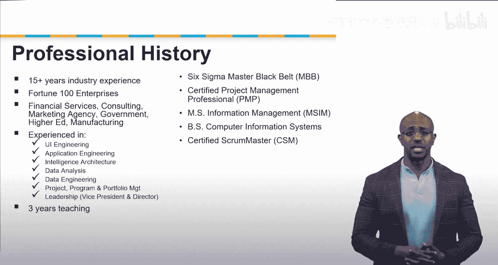
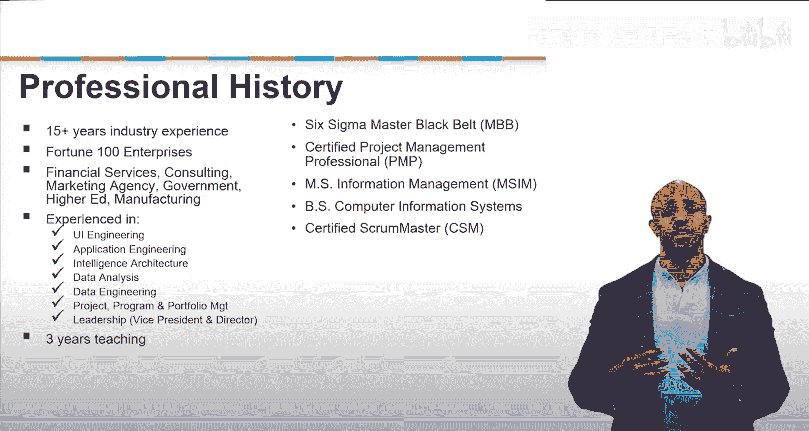
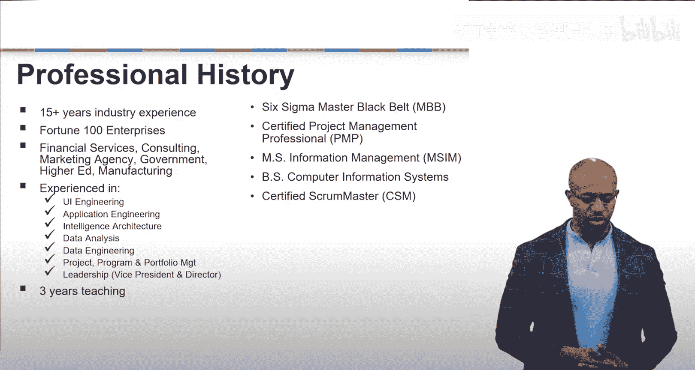
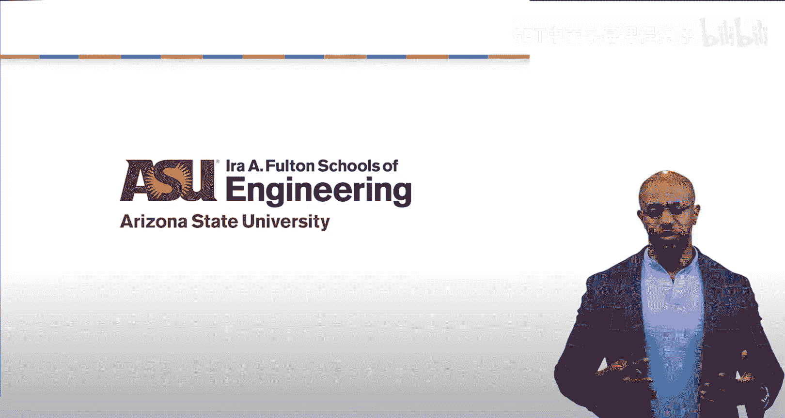
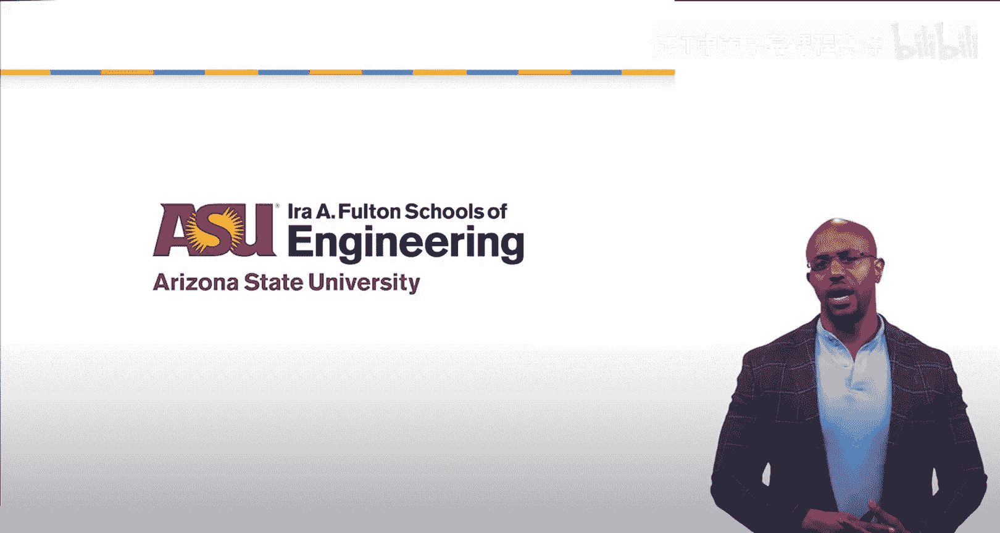
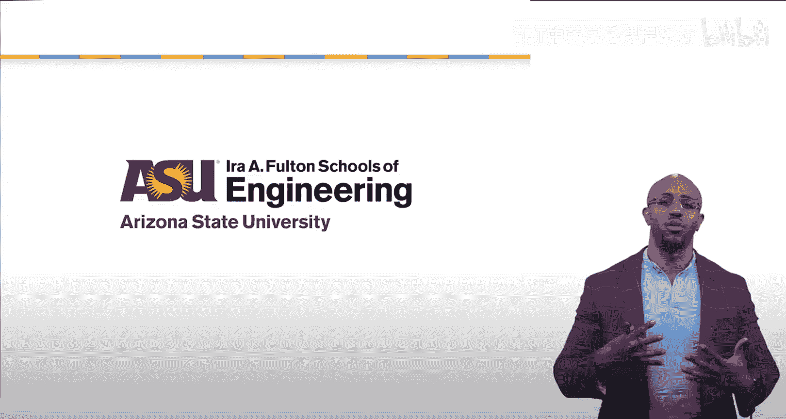
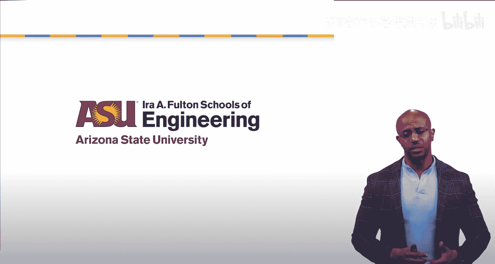

# 02：讲师介绍 🧑‍🏫

在本节课中，我们将了解本课程讲师的背景，包括其专业经历、个人兴趣，以及这些因素如何塑造了他对“黑暗数据”领域的见解。

## 专业背景

上一节我们介绍了课程主题，本节中我们来看看讲师的职业发展路径。讲师拥有超过15年的行业经验，涉足领域广泛。

以下是其主要的职业经历与技能：

*   **行业经验**：曾在美国企业界、咨询、市场营销、政府、高等教育及创业领域工作。
*   **任职公司**：主要服务于《财富》500强及100强公司。
*   **专业角色**：担任过多种职位，包括：
    *   用户界面（UI）工程师
    *   应用工程师
*   **核心技能**：其专业背景涵盖多个学科，包括计算机信息系统和信息管理。
*   **教育背景**：本科毕业于阿拉巴马州立大学，硕士毕业于亚利桑那州立大学。
*   **专业认证**：持有项目管理专业人士（PMP）和六西格玛黑带大师认证，这些认证均在亚利桑那州立大学完成。

讲师在其职业生涯中持续学习与成长。他认为，在执行项目时，总会发现需要改进的领域，无论是项目管理、UI工程还是应用工程。只要专注于发现问题、解决问题并帮助他人成长，就能积累经验，在原本不熟悉的领域变得更有能力。

## 个人兴趣

了解了他的专业面之后，我们再来看看他的个人生活与兴趣，这同样影响了他的职业视角。

以下是讲师的一些个人爱好与经历：

*   **运动经历**：曾是大学田径运动员，在阿拉巴马州立大学时期是一名短跑运动员，主攻100米、200米和400米项目。
*   **旅行爱好**：享受环球旅行，到访过许多地方，例如葡萄牙的里斯本、法国的巴黎、西班牙的马德里和阿利坎特，以及南美洲的巴西、秘鲁、巴拿马和墨西哥等地的城市，还去过亚洲的巴厘岛等地。
*   **旅行感悟**：对他而言，旅行的意义在于接触不同的人和文化，理解人们如何以不同的方式思考和行事，从而跳出自己固有的思维框架。
*   **新兴领域兴趣**：近年来对NFT（非同质化代币）和加密货币产生了浓厚兴趣。他创作过一些侧重于艺术性的NFT，并计划在未来探索更具实用性的NFT。在加密货币方面，他投资了包括Solana、Cardano、以太坊和比特币在内的多种项目。
*   **健康倡导**：始终倡导健康与 wellness，相信健康的身体能带来更清晰的思维。

幻灯片顶部的图片是讲师在旅行中拍摄的照片：左上角是哥伦比亚的瓜塔佩；其右侧是西班牙阿利坎特港的圣巴巴拉城堡，由摩尔人建造，可俯瞰海湾，景色绝美；旁边是巴西里约热内卢的日落，糖面包山的日落景象十分壮观；最后一张是葡萄牙里斯本一个著名公园里的大型商场。

## 核心驱动力

在深入本课程后，你会发现探索精神对讲师至关重要。他极度热衷于**探索、创新和创造力**。他认为，这三者是推动世界发展、解决问题的关键，也是提升自我、职业生涯、所在企业及周围人的核心与支柱，正是它们构建了我们所生活的世界。

本节课中，我们一起学习了讲师的职业背景、个人兴趣及其核心驱动力。这些经历共同塑造了他对数据，特别是“黑暗数据”的独特理解和应用方式。感谢你的时间，祝你在本课程中学习顺利。