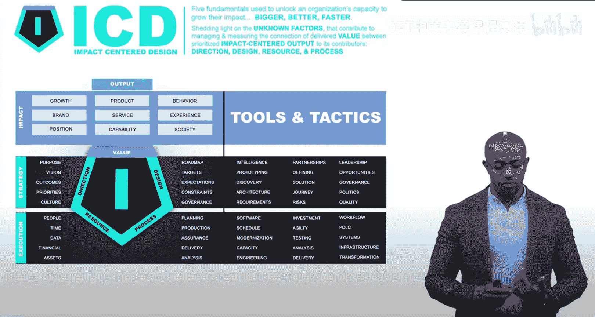
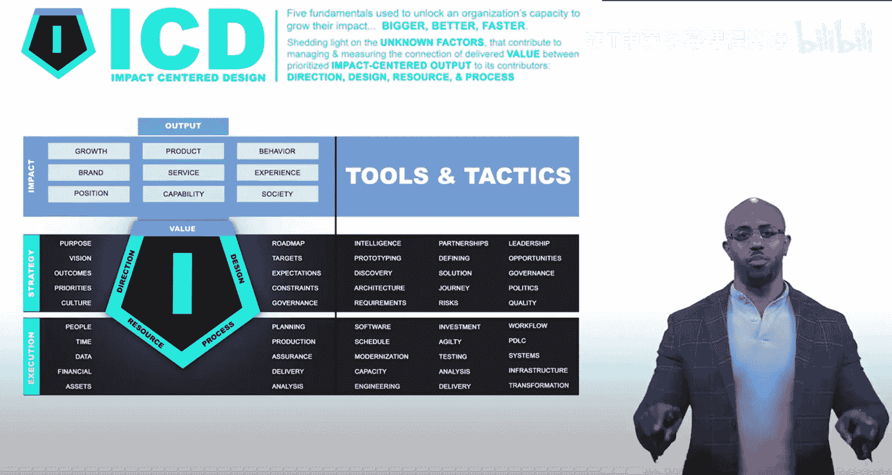
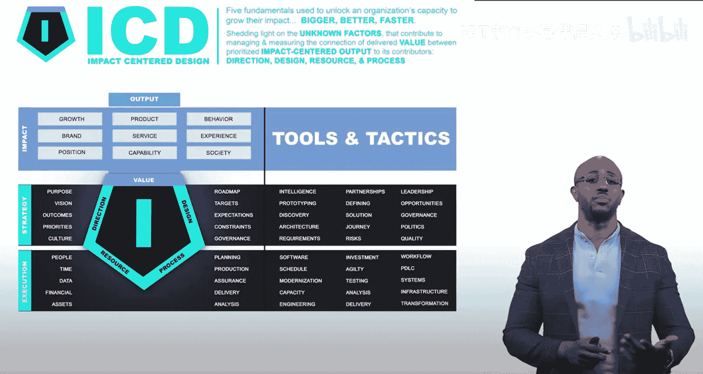
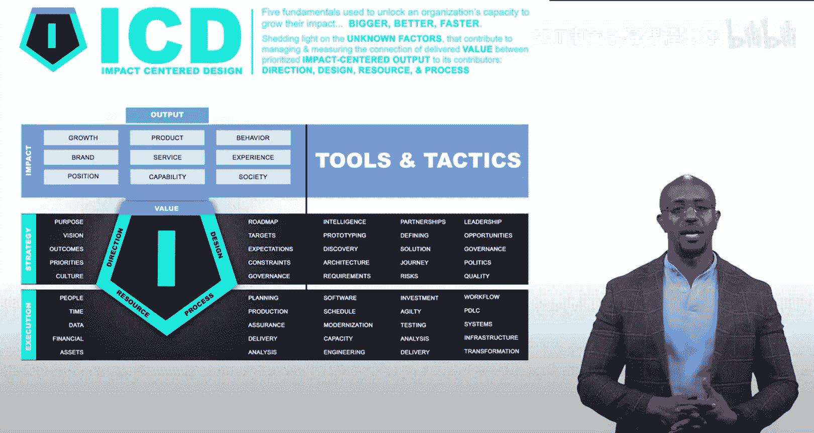
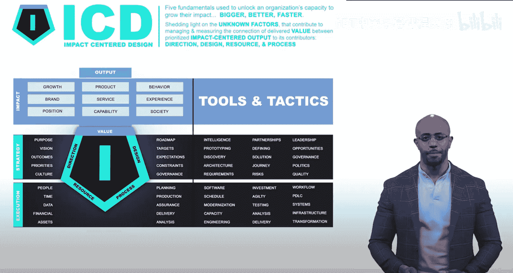

# 暗数据迁移与架构：01：暗数据基础

在本课程中，我们将聚焦于定义暗数据与数据产品。我们将深入探讨其定义，核心围绕**价值**、**价值获取**以及**减少失败**展开。课程将从**以影响为中心的设计**开始，并在此基础上定义所有能够产生影响的开发方式，同时审视那些通常未被捕获、或虽被捕获但未被充分利用的周边数据。

## 什么是暗数据？

上一节我们介绍了课程的整体目标，本节中我们来看看暗数据的核心定义。

从字面上看，暗数据就是“未知的数据”。然而，从价值的角度出发，它的内涵要丰富得多。我们将探讨如何定义暗数据，以及如何从中获取价值并减少失败。

简单来说，暗数据可以理解为：
*   **未被捕获的数据**：在业务流程中产生，但从未被系统记录的信息。
*   **未被充分利用的数据**：虽然已被收集和存储，但由于各种原因（如格式问题、未被关联分析、缺乏处理工具）而未被挖掘出潜在价值的信息。

## 以影响为中心的设计

理解了暗数据的基本概念后，我们需要一个框架来系统地处理它，这就是“以影响为中心的设计”。

这种方法要求我们在开始任何数据项目时，首先明确我们想要实现的**业务影响**或**价值目标**，而不是仅仅关注技术或数据本身。所有的数据收集、处理和分析工作都应围绕这个核心目标展开。

以下是实施以影响为中心设计的几个关键步骤：

1.  **定义核心目标**：明确项目要解决的具体业务问题或要创造的价值。
2.  **识别所需数据**：反向推导出为实现目标所必需的数据类型和来源。
3.  **评估数据现状**：盘点现有数据，识别哪些是“明数据”（已被利用），哪些是“暗数据”（未被利用或未被捕获）。
4.  **设计数据产品**：将数据组织成能够持续产生价值的“产品”，而不仅仅是一次性的分析报告。

## 从暗数据中获取价值

现在，我们知道了要以目标为导向。那么，具体如何从暗数据中挖掘价值呢？关键在于系统地审视所有周边数据。

我们需要观察所有通常未被捕获，或者已被捕获但未被充分利用的周边数据。这些数据可能隐藏在日志文件、电子邮件通信、客户反馈、传感器原始读数或失败的业务流程记录中。

价值获取通常通过以下两种主要途径实现：

*   **创造新价值**：通过分析暗数据发现新的业务洞察、优化流程、创造新产品或服务。
    *   *示例*：分析客服通话的录音文本（暗数据），发现产品常见使用问题，从而改进说明书或产品设计。
*   **减少失败与损失**：利用暗数据预测和防范风险、减少运营错误、避免成本浪费。
    *   *示例*：分析服务器日志中的错误模式（暗数据），提前预测系统故障，避免服务中断。

其核心关系可以用一个简单的公式表达：
**数据价值 = 创造的新机会 - 避免的损失与失败**

## 总结

本节课中，我们一起学习了暗数据的基础知识。我们首先定义了暗数据不仅是未知的数据，更是未被挖掘的价值载体。接着，我们引入了“以影响为中心的设计”作为处理暗数据的核心方法论，强调从业务目标出发。最后，我们探讨了如何通过系统性地审视周边数据，从暗数据中实现**价值获取**和**失败减少**两大目标。理解这些基础概念，是后续进行有效暗数据迁移与架构设计的关键第一步。