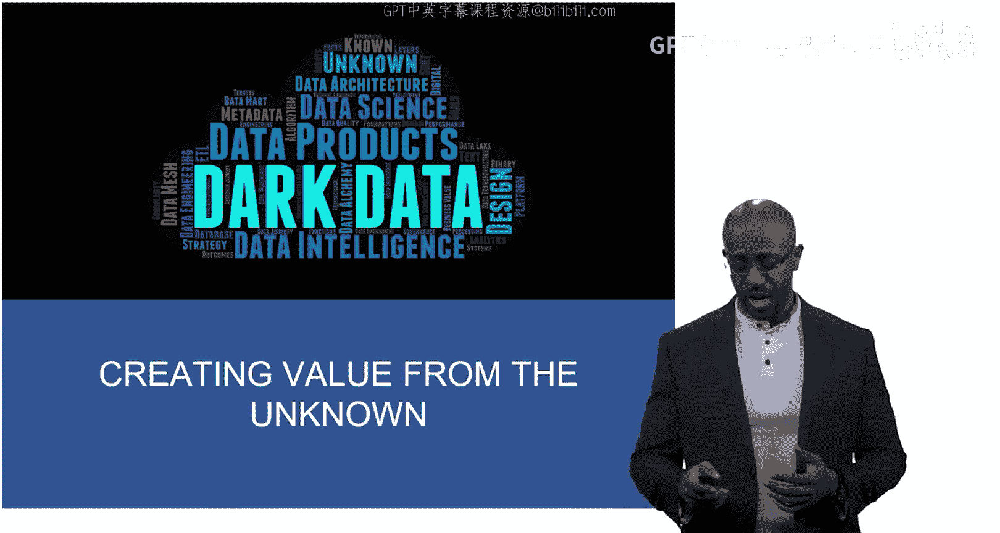
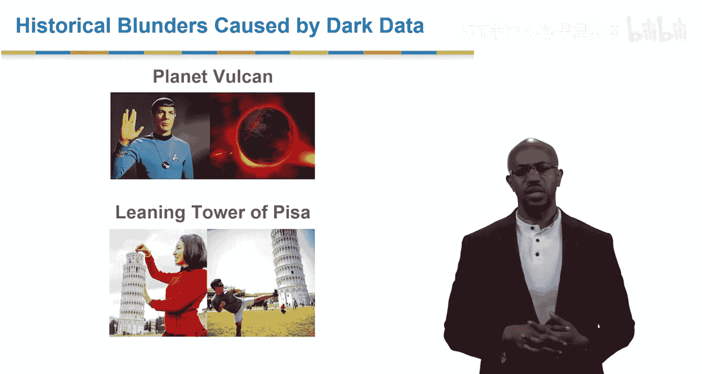

# 04：暗数据定义 🕵️

在本节课中，我们将学习如何从“未知”中创造价值，核心是深入理解“暗数据”。我们将首先审视暗数据被普遍接受的定义，然后为了价值创造的目的，重新定义它。

## 概述

我们将从一则寓言故事开始，引出暗数据的普遍概念。接着，我们会分析Gartner的经典定义，并指出其局限性。最后，我们将提出一个以价值创造为核心的新定义，并引入“数据产品”和“数据产品化”等关键概念，为后续课程打下基础。

## 从盲人摸象说起

大多数人都曾在网络上见过这张图片。它常被用作一个梗图或寓言。图中，六位蒙着眼睛的科学家触摸着同一个物体，却无人能看清全貌。有人称它为扇子、长矛、墙壁、绳子、大树或蛇。他们互不倾听，各自坚持己见。

这个场景生动地展示了当我们不去探索周围的暗数据时会发生什么。虽然这只是一个有趣的图片，但类似情况在现实生活中屡见不鲜，无论是人际交往还是公司互动中产生的误解，很多时候都源于“未知”——那些我们大多数时候可以接触到，却没有利用和消化的数据。本课程的重点，正是获取这些信息并用于创造价值。

## 普遍接受的暗数据定义

首先，我们从暗数据被普遍接受的定义开始。这个定义来自Gartner，它主要关注组织内部的数据。

> **暗数据**是组织在常规业务活动中收集、处理和存储的信息资产，但通常不用于其他目的（例如，分析、业务关系和直接获利）。类似“暗物质”，暗数据构成了组织内的大部分宇宙，但通常未被探索和利用。

根据这个定义，暗数据被视为**价值极低**的信息，并且尝试从中获取价值的**成本更高、风险更大**。

然而，世界上一些大型公司和组织已经找到了利用我们身边普遍存在的“未知”的方法。例如，电影《点球成金》中的案例，以及其他公司和体育领域，它们能够利用身边现成的、未被充分利用的数据做出更好的决策，获得更理想的结果，更快地发展并实现目标。

对我们而言，这正是我们希望定义暗数据的方向：**更侧重于价值的获取**。

## 引入数据产品的概念

在提出新定义前，我们需要先定义“数据产品”。这是一个被普遍接受的定义：

> **数据产品**是一种使用数据来帮助企业改进决策和流程的应用程序或工具。

这是一个非常清晰、扎实的定义。我们将以此为基础，因为我们的新定义将聚焦于**使用数据产品作为管道，将暗数据转化为价值和影响力**。

## 我们的价值导向型定义

现在，让我们重新定义暗数据。我们关注的是如何将其产品化：发现它、改变它、丰富它、增强它，将其带到前台，用于我们的日常决策支持、决策制定，寻找确定性决策和随机性决策。

因此，当我们谈论暗数据并创造影响力时，部分工作就是通过数据产品实现数据的**产品化**。

为了提供价值并产生更大影响，我们需要关注**影响力中心设计**。这意味着，我们使用暗数据和已知数据设计的任何最终工具（数据产品），都应聚焦于通过文化定位、社会赋能、财务赋能等多种方式驱动影响力，从而在这个复杂的世界中，通过了解更多、理解更深来获取价值。

以下是我们将在整个课程中使用的、以价值为中心的定义：

> **暗数据**是指**任何形式**的、**已获取或未获取**的、**被需要**的，但由于**定位不当、能力不足、认知缺乏、疏忽大意**或任何其他**非故意**的影响因素，而**未能创造或提供价值或影响力**的数据。

定义中高亮的关键词对我们理解至关重要：
*   **任何形式**：通常，处理我们系统和数据库中的数据（无论是结构化、非结构化、JSON对象还是标准SQL）更容易。但同样重要的是理解我们周围未被捕获的数据，或者系统中需要人类智慧来使其更完整、更充实的数据。我们将在课程中进一步讨论。
*   **定位不当等**：当你的公司或个人处于无法从数据中获取价值的糟糕位置时，可能是认知缺乏阻止了你，也可能是疏忽大意——没有意识到数据就在那里并随时可用。
*   **其他影响因素**：例如，竞争对手故意发布虚假数据或信息，这也是需要考虑的。
*   **非故意**：有时，数据是故意保持“黑暗”的，比如在进行盲测、抽样时，你不想知道个体信息。这种暗数据是好的，你应该让它保持黑暗，因为你不是要从它那里寻找价值——实际上，**数据的缺失**反而增强了你从中获得的价值。

## 数据产品：价值的管道

再次强调，数据产品是我们从暗数据中获取价值的**管道**。

因此，数据产品被定义为一种**工具或资产**，其最终用户效用将基于对**持续变化和演进的数据**的应用，将其转化为更有用的信息，从而**创造或提供可实现的的影响力或价值**。公司可以用这些信息做出新决策、实时快速调整。

一个数据产品必须**为最终用户做某事**，或者**使最终用户能更好地做某事**。

以下是数据产品可以实现的几个例子：
*   **自动化决策**
*   **决策支持**
*   **衍生数据和信息**
*   **算法**

这些只是数据产品应用的四个方面，我们将在后续课程中深入探讨。

## 关键术语：数据产品化

在本课中，我想确保我们讨论的一个关键词汇是**数据产品化**。

这是通过多种流程实际将数据产品投入生产的过程，例如：
*   **数据转换**
*   **ETL（提取、转换、加载）**
*   **通过API发送数据**
*   **数据丰富**

这些都是从数据中获取价值的不同方式，然后将其置于最终用户可以可视化的场景中。

同样，核心理念是为组织提供影响力和价值。下图底部的三个示例图表只是通用的信息展示：

这并非你能从数据产品或从丰富数据变体和衍生物的产品化中获得的**智能**。随着课程深入，我们将展示一些示例仪表板，并区分**信息**、**洞察**、**智能**以及你能从暗数据和数据产品化中获得的**可操作的智能**之间的差异。

## 更多关键术语

以下是一些额外的关键术语，虽然不逐一详读，但你需要确保理解它们：
*   数据捕获点
*   预测建模
*   统计
*   分类
*   数据清洗
*   数据丰富

从暗数据中获取价值的过程涉及很多内容。回到最初Gartner定义的幻灯片，如果我们沿用那个定义，我们看到的可能只是系统中大量可能提供价值、也可能不提供价值的陈旧数据和日志数据。而通过我们以价值为中心的扩展定义，你关注的是在**数据捕获点**获取数据的方法，是利用周围信息进行转换和使用以从中获取价值、促进数据增长的方法，是实现预测建模、统计、分类、数据清洗和丰富等所有我们能用来帮助自己的不同方法。

最后，我务必想强调**数据质量**，这是整个等式中至关重要的一部分。如果你的数据集和数据转换过程中的质量不佳，就可能导致糟糕的分析和错误的决策。

## 下节预告

最后，给大家一个下节课的小剧透。下节课我们将聚焦于一些暗数据的实例，并将使用**火神星**和**比萨斜塔**作为例子。下节课见，感谢你的时间。

## 总结

本节课我们一起学习了暗数据的核心概念。我们从“盲人摸象”的寓言入手，理解了忽视暗数据的后果。接着，我们分析了Gartner对暗数据的传统定义，并指出了其侧重于低价值和风险的局限性。为了更积极地创造价值，我们提出了一个新的、以价值为中心的定义，强调暗数据是**因各种非故意因素而未能发挥价值的数据**。同时，我们引入了**数据产品**作为将暗数据转化为价值的管道，并解释了**数据产品化**的过程。最后，我们强调了数据质量的重要性，并预告了下节课将通过具体实例深入探讨暗数据。