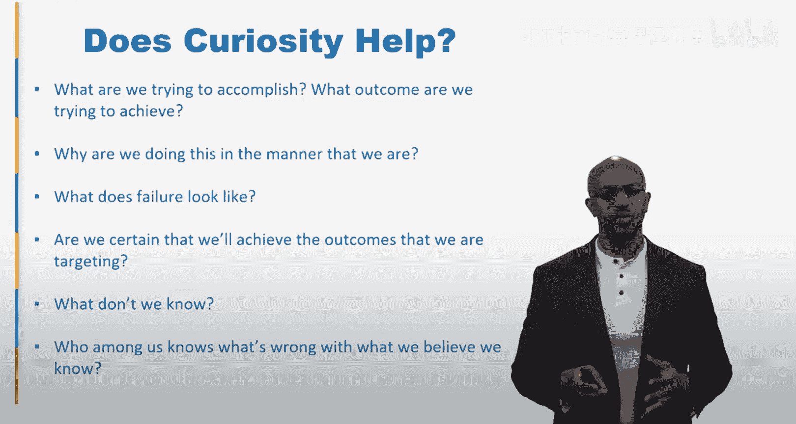

# 05：暗数据的高层实例 🕵️

在本节课中，我们将通过两个历史上的著名案例，来探索暗数据在现实世界中的高层实例。我们将看到，当人们未能识别或处理未知信息时，会如何导致错误的结论和工程上的重大挑战。

---

## 案例一：不存在的“祝融星” 🔭

上一节我们介绍了暗数据的基本概念，本节中我们来看看一个天文学史上的经典案例。

在19世纪末到20世纪初，许多科学家声称在我们的太阳系中发现了一颗名为“祝融星”的行星。这颗假想的行星被认为位于水星与太阳之间。法国科学家**Urbain Le Verrier**相信，正是这颗行星导致了当时所有科学家都能观测到的水星轨道异常，即其绕日运行轨迹不符合牛顿的万有引力定律。

在他宣布这一发现后，许多其他科学家也声称在寻找过程中看到了这颗行星。于是，出现了一大批声称在水星与太阳之间观测到该行星的人。

他的发现基于**视觉观测**，以及该行星是水星轨道异常的原因这一假设。这一观点在当时的科学界被广泛接受，直到爱因斯坦在1915年提出**广义相对论**，才终结了对“祝融星”的搜寻。

广义相对论表明，**引力**本身是渗透于时空的相对现象，并且引力也会影响时间。这解释了水星因其相对于太阳、金星及其他周围天体的位置所受到的引力影响，从而产生的非标准轨道。

这是一个绝佳的暗数据案例，展示了人们如何坚信自己知道某些实际上未知的事情。许多商业冒险和个人失败，正是源于在缺乏正确数据、未能识别未知信息的情况下贸然前进，并错误地认为自己已经掌握了全部情况。

---

## 案例二：比萨斜塔的教训 🗼

接下来，我们将目光转向一个工程领域的著名案例——比萨斜塔。这个例子展示了人们相信自己知道已知和未知，但实际上仍有巨大信息缺口的情况。

以下是关于比萨斜塔的一些关键事实：
*   **建筑类型**：独立式钟楼。
*   **建造时长**：历时**199年**，分三个阶段建成。
*   **地基问题**：建造在**松软潮湿的地面**上。
*   **尺寸与倾斜**：塔高**183英尺**，当前倾斜角度为**3.9度**，历史上曾达到约**5.5度**。
*   **重量与结构**：总重超过**14,000公吨**，共有**296级台阶**。

在20世纪90年代至21世纪初，进行了一次重大的修复工程以稳定塔身，因为当时斜塔已接近倒塌的边缘。

### 建造时的暗数据缺口

那么，让我们通过这个案例研究来了解暗数据缺口在哪里。

塔基的设计对于标准建筑而言是典型的，但存在根本问题：在松软地面上建造一座非常高的塔楼，其**地基深度和宽度**（仅约6英尺深）根本不足以支撑塔身的规模。此外，在长达199年的三个建造阶段中，为了补偿塔身的倾斜，上层建筑被建成了**弯曲的形状**。

当时的人们并不知道，或者说没有足够的知识来处理以下关键的地质工程问题：
1.  **地基承载力**
2.  **土壤的抗剪强度**
3.  **土壤的粘聚力**（例如，粘土颗粒如何使土壤粘结在一起）

在1272年，他们缺乏相应的专业知识来调整方案并理解错误所在。这是第一个失败点，也是他们错过的四个主要的暗数据缺口。

### 现代修复中的尝试与成功

到了20世纪90年代，修复团队最初尝试在倾斜侧挖洞，使用**液氮冻结地面**，然后灌入金属以加固地基。然而，由于土壤中含有水分，冻结会导致地面**膨胀**，解冻后反而会使建筑**下沉更多**。这次尝试实际上导致塔身倾斜得比预期更严重。

然而，在21世纪初，地质工程师们取得了成功。他们在塔的**另一侧（较高侧）** 下方缓慢地移除土壤。这使得**重力**发挥作用，建筑开始缓慢地向另一侧回正。目前，斜塔已更加稳定，工程师们判定其至少还能稳定**200年以上**。

---

## 总结与启示 🤔

本节课中，我们一起学习了两个关于暗数据的经典高层实例。

从“祝融星”的案例中，我们看到了**未经证实的假设**如何被整个社群接受为事实，直到新的理论（广义相对论）出现才纠正了认知。从比萨斜塔的案例中，我们看到了**工程知识的局限**和**对地基条件的无知**如何导致一个持续数百年的问题，而现代科学才最终提供了解决方案。

我们或许想问：**好奇心有帮助吗？** 从我的角度来看，答案是100%肯定的。我们应该不断追问：
*   我们试图实现什么目标？
*   即使目标看似明显，失败会是什么样子？
*   基于我们所知和未知的信息，我们是否确定自己的行动能达到目标？

最后，在像建造比萨斜塔这样的工程时，保持好奇心意味着要思考一些基本问题：**建筑质量**、**结构完整性**（我们不希望建筑倒塌）等。这能引导你回溯，去确定为确保项目成功所需要采取的预备步骤。

感谢你的时间。