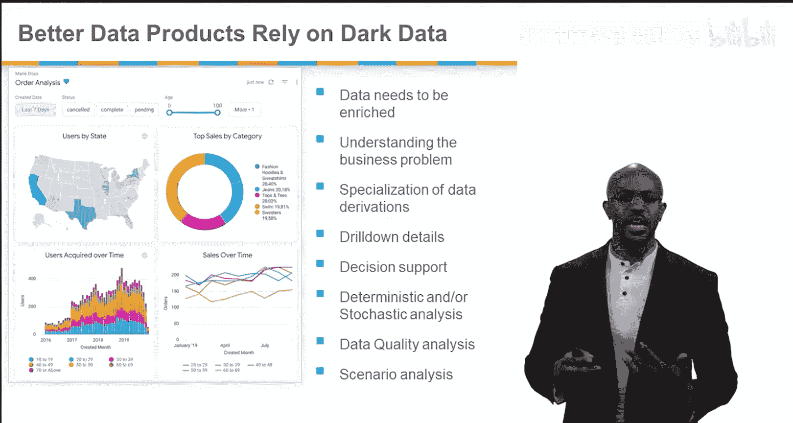

# 黑暗数据迁移与架构：06：数据产品化价值第一部分 💡

在本节课中，我们将探讨如何从数据产品化中获取价值。我们将通过分析一个具体的仪表板示例，来识别其中可能缺失的数据或“黑暗数据”，并讨论如何通过丰富和转化这些数据来提升决策支持能力，从而创造更大的业务价值。

---

## 数据产品的价值定义回顾

上一节我们介绍了数据产品的概念，现在我们来回顾一下其以价值为中心的定义。

数据产品是能够帮助我们**产生影响和价值**的工具或资产。它们能够使用户**完成某项任务**，或者**更好地完成某项任务**，而这一切都基于我们以某种方式演进、转换或改变后的数据。

---

## 仪表板分析：识别价值缺口

大多数智能中心应用都依赖某种形式的可视化来呈现信息、洞察和情报。数据产品是决策的**管道**，它们能让这些可视化效果更好，并为我们提供确定性和随机性的洞察，帮助我们前进。它们也为我们提供了**发现机会**的能力。

你会发现，在不同公司和商业领域中，大多数仪表板只是提供事物当前状态的指标。很少有人能深入挖掘“黑暗数据”，并基于这些信息采取确定或随机的行动。

接下来，我们将一起分析一个通用仪表板，识别其中可能缺失的数据或黑暗数据，并找出将黑暗数据转化并提升至可视化层面以支持更好智能分析的机会。

以下是仪表板的四个象限，请思考每个部分可能缺失的信息：

1.  **美国各州订单热力图**：显示各州的订单数量。
2.  **按类别划分的顶级销售额**：显示不同产品类别的销售占比。
3.  **随时间推移获取的用户数**：按年份和月份显示用户增长，并按年龄组细分。
4.  **总销售额随时间变化趋势**：显示销售额的总体变化趋势。

---

## 深入挖掘：缺失的数据维度

现在，让我们逐一审视这些可视化部分，探讨如何通过丰富数据来提供更多价值。

### 1. 美国各州订单热力图

这个视图显示了加州和德州的订单量很大。但为了获得更深层的洞察，我们需要提出更多问题并引入相关数据。

*   **相对表现**：订单量是相对于人口、主要都市区而言的吗？某些地区的表现是否比其他地区更成功？
*   **市场渗透**：在那些销售额很少的州，是我们没有用同类型的营销策略去开拓市场，还是我们需要不同的营销方式？销售额与可购买人口的比例是多少？
*   **核心公式**：一个关键的衡量指标是 **`销售渗透率 = 销售额 / 目标市场可购买人口`**。这比单纯的订单总数更有意义。

**价值提升**：如果数据产品构建得当，集成了正确的人口统计等黑暗数据，你应该能在仪表板中直接进行这类分析，快速得出可行动的结论，甚至自动化响应（例如，自动调整低渗透率地区的营销策略）。

### 2. 按类别划分的顶级销售额

这个视图显示了不同类别的销售体积。但我们可以进一步深化。

*   **用户细分**：哪些客户群体对哪些类别贡献最大？他们是重复购买者吗？
*   **交叉分析**：能否将类别数据与地域、年龄等维度结合，发现更具体的模式？

### 3. 随时间推移获取的用户数（按年龄组）

这个视图显示20-29岁（浅蓝）和30-39岁（粉色）年龄组的用户增长最快。

*   **行为动因**：是因为针对他们的营销更有效，还是他们本身就更喜欢你的产品？
*   **生命周期阶段**：对于增长缓慢的10-19岁组，需要考虑他们处于不同的人生阶段。系统需要存储**独立于销售数据的、参考性的人口统计数据**。
*   **数据整合**：通过将销售数据与外部或内部的人口统计数据库（如RDBMS中的参考表）合并，可以创建新的、更丰富的分析维度。

### 4. 总销售额随时间变化趋势

这个视图显示了总体趋势线。

*   **归因分析**：销售额的增长或下降可以归因于哪些具体的营销活动、产品发布或外部事件？
*   **预测能力**：在丰富的历史数据和外部因素数据基础上，是否可以引入预测模型，为未来趋势提供洞察？

---

## 总结：从状态报告到行动洞察

本节课中，我们一起学习了如何从一个标准仪表板中识别价值缺口。关键在于不满足于呈现**状态指标**，而要深入思考背后的**业务问题**（例如，如何获得更多销售和用户），并利用数据产品化的思想，整合与丰富相关的黑暗数据（如人口统计、市场渗透率计算、用户细分属性）。

通过这样做，我们可以将仪表板从一个被动的“报告工具”，转变为一个主动的“决策支持系统”，从而能够更快地得出确定性和随机性的答案，并采取后续行动。在更成熟的组织中，甚至可以基于这些洞察实现营销、销售等流程的自动化响应。