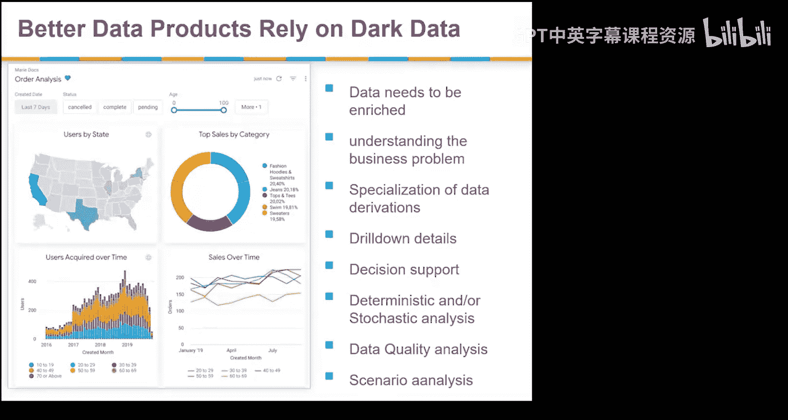
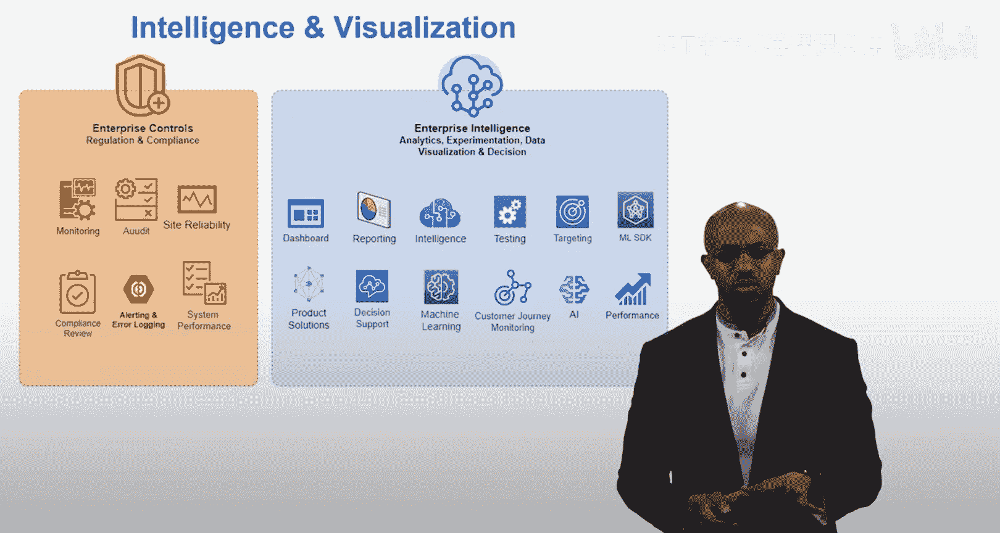

# 黑暗数据迁移与架构：07：数据产品化价值第二部分

在本节课中，我们将深入探讨如何从数据产品中获取更多价值。我们将通过分析一个典型的企业架构图，来理解数据从捕获到最终实现商业价值的完整流程，并重点关注数据产品化、合规与智能可视化等关键环节。

## 企业数据架构概览

上一节我们讨论了数据产品化的基础概念，本节中我们来看看数据在企业中流动的完整路径。下图展示了一个现代化大型企业（尤其是财富500强公司）的典型数据架构。它主要分为两大板块：左侧较宽的部分是**业务运营侧**，负责实时业务处理；右侧较窄的整个部分是**数据分析侧**，负责数据洞察与决策支持。

整个架构的核心流程可以概括为：**数据捕获 -> 数据转换与存储 -> 数据丰富与产品化 -> 智能分析与可视化**。数据治理则像一条紫色的纽带，贯穿并监管着所有环节。

## 架构核心环节详解

接下来，我们将逐一拆解架构图中的关键部分，从最终的价值实现环节开始，逆向剖析数据流动的过程。

### 分析侧：价值实现与合规控制

我们首先关注架构图右侧的分析侧，这是数据价值最终显现的地方。它主要包含两个部分：顶部的橙色区域（企业控制与合规）和下方的大蓝色区域（分析与智能）。

**企业控制、法规与合规（橙色区域）**
这个部分的核心目标是**维持企业已有价值**，确保系统合法、合规、可控地运行。其价值体现在风险规避和稳定运营上。

以下是该部分的关键职能：
*   **合规审查**：确保所有操作符合法律法规。
*   **系统监控**：持续监控系统性能与状态。
*   **站点可靠性工程**：虽然不是直接的合规职能，但它是保障系统持续、稳定、合规运行的基础。
*   **服务保障**：确保客户能获得正确、可靠的服务。

**分析、智能与决策支持（蓝色区域）**
这个部分的核心目标是**创造新价值**和**深化市场理解**。它利用数据驱动业务增长和优化。

以下是该部分包含的关键能力：
*   **仪表盘与报告**：提供业务状态的可视化视图。
*   **可执行情报**：从数据中衍生出可直接指导行动的分析结果。
*   **测试与学习**：包括市场发布前/后的测试、收购前测试等，确保目标正确。
*   **目标与关键成果管理**：对齐组织的OKR和业务目标。
*   **机器学习软件开发工具包**：为算法工程师和数据科学家提供AI开发环境。
*   **性能指标监控**：监控系统及市场营销活动、产品在市场上的表现。
*   **客户旅程监控**：追踪和分析客户与产品/服务互动的全过程。

**黑暗数据在其中的作用**
对于大多数公司，其仪表盘可能只展示标准的状态指标和基础洞察。而更先进的组织，则能通过有效利用黑暗数据来增强这些能力。黑暗数据可以：
*   更好地对信息进行分类和丰富。
*   使公司能够快速调整策略、做出决策。
*   实现部分决策的自动化。

这正是将黑暗数据转化为实际价值的关键环节。

### 运营侧：数据源头与流动

理解了价值终点后，我们回溯到左侧的运营侧，看看数据是如何产生和进入系统的。

**数据捕获点与内部运营（顶部绿色与黑色区域）**
架构图最顶部的绿色部分代表**数据捕获点**，这是所有数据的源头，也是第一道错误可能发生的地方，因此至关重要。其下的整个黑色区域是**内部运营系统**，负责实时业务处理，如生成销售、处理交易等。

**企业缓存（绿色长条）**
在数据捕获点和内部系统之间，有一个**企业缓存**层。这是一个为了提高系统性能、可靠性和可用性而设计的缓存机制。
*   **目标**：确保系统接近100%正常运行，并满足客户对页面加载速度（通常期望低于1秒）的体验要求。
*   **数据流向**：数据可以从此缓存直接流向分析侧进行实时可视化，也可以向下进入正式的数据捕获流程。

**数据捕获处理（底部黑色区域）**
这是将数据正式捕获到内部系统的环节，包括各种内部数据库、系统数据库，甚至一些遗留的大型机系统（在金融等行业仍广泛用于处理大规模交易）。

### 数据分析侧：数据处理与产品化

数据从运营侧流入后，在分析侧经历转换、存储和产品化，为最终的分析做准备。

**数据转换与存储（红色区域）**
从这里开始，我们进入**大数据**领域。这个环节主要涉及数据湖和数据仓库。
*   **常见形态**：公司可能只建数据湖或数据仓库，也可能采用混合或分离的架构。
*   **支持技术**：
    *   结构化数据：`MySQL`, `PostgreSQL`
    *   半结构化/非结构化数据：`JSON`, `XML`
    *   NoSQL数据库：`MongoDB`, `Cassandra` 等。这些尤其适用于从数据捕获点进行事件监听和采集。
*   **实时处理**：对于需要实时仪表盘的场景，可以使用如`Kafka`等技术将信息流直接推送到缓存，并进而送达可视化层。

**数据丰富与产品化（蓝色区域）**
这是数据产品化的核心阶段。在这里，数据被进一步加工。
*   **数据存储**：可能包含多个数据市场或数据层。
*   **专用数据层**：一个关键但并非所有公司都具备的组件是**专用数据产品化数据层**。它可能是单个大型层，也可能是多个可快速部署的小型层，专门为满足特定的用例（如上述的合规控制或智能分析）而设计。

### 贯穿全局：数据治理

位于架构图中心的紫色方框代表**数据治理**。它像中央控制机制一样，触及并监管每一个环节。
*   **作用**：确保交易系统以恰当方式运行，同时确保分析侧的数据存储、处理及情报提取过程符合法规和合规要求。

## 总结

本节课我们一起学习了企业数据价值的完整实现路径。我们从最终的价值呈现（智能可视化与合规控制）出发，逆向追溯了数据流经的各个环节：数据产品化、大数据存储与转换、企业缓存，直至数据源头——捕获点。我们特别强调了黑暗数据在丰富分析、支持快速决策和自动化方面所能发挥的关键作用，以及数据治理作为贯穿始终的保障体系的重要性。理解这个端到端的流程，是设计高效数据产品、最大化数据价值的基础。