# 08：数据产品化价值（第三部分）

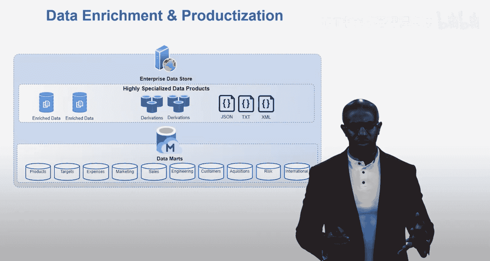

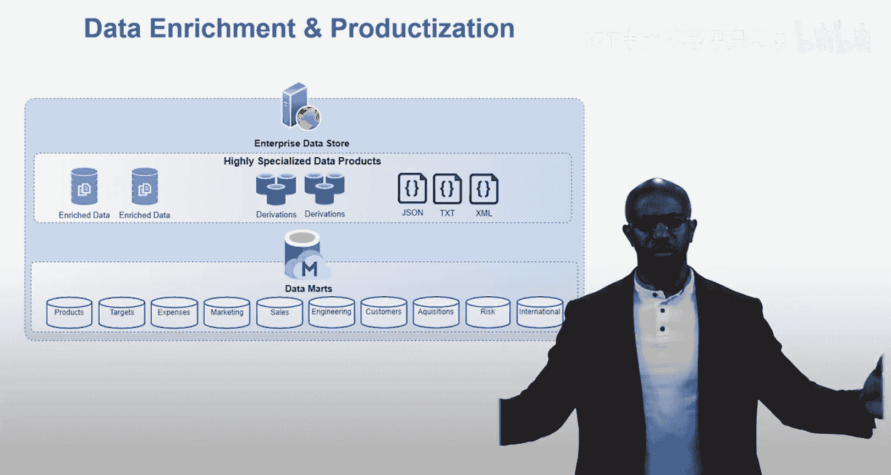

在本节课中，我们将深入探讨数据产品化的具体过程，包括如何对数据进行丰富与转换，以及数据在不同层级（从高度专业化的数据产品到原始数据存储）的流动与处理。我们还将审视现代混合云架构中的数据捕获点，并理解如何有效捕获和利用“黑暗数据”来创造商业价值。

## 数据产品化过程 🛠️

上一节我们讨论了数据产品化的价值，本节中我们来看看具体的产品化过程。这个过程的核心在于**丰富数据**和**转换数据**。这里的转换并非传统意义上的工程转换，而是指在需要时，将数据转化为全新形态的过程。

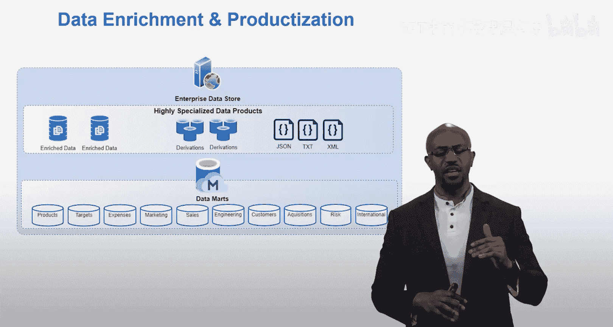

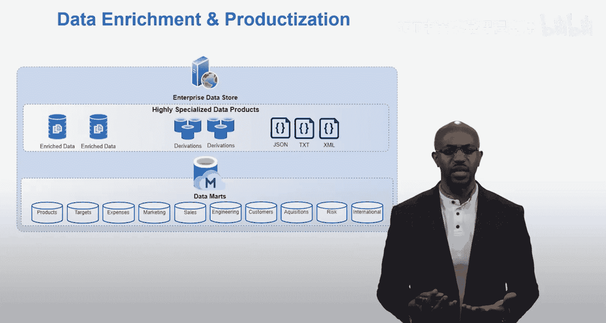

## 数据架构层级 📊

以下是数据从原始状态到最终产品所经历的典型架构层级。

### 专业化数据产品层

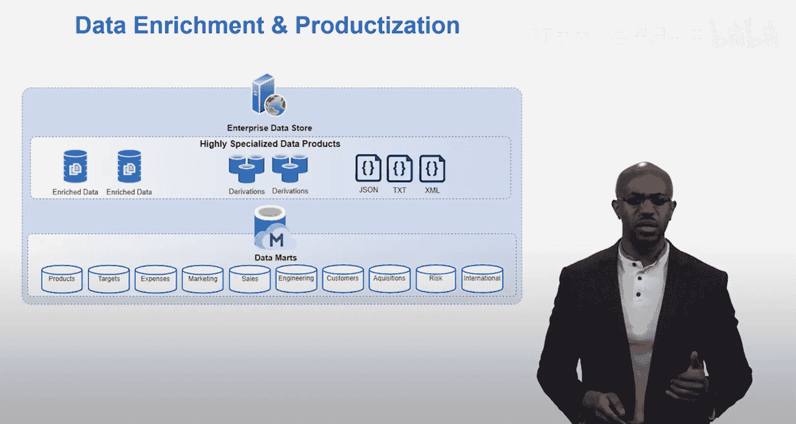

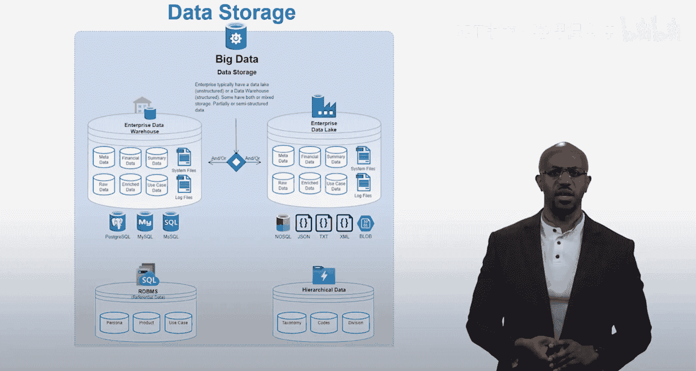

位于架构顶端的是高度专业化的数据产品和数据层。它们为特定的用例、目标和业务监控、规划及预期而设计。

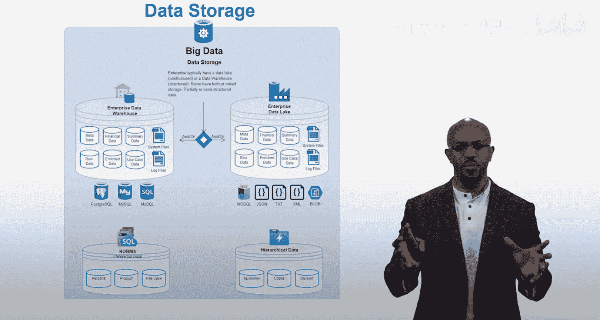

*   **数据格式**：可以是 **JSON** 对象、文本文件、**XML**，或标准的 **SQL** 数据库（如 **PostgreSQL**、**MySQL**）。
*   **核心目标**：确保丰富后的数据能够被近源（near source）快速获取，以便仪表板等应用能够实时响应。设计时必须始终考虑**人的因素**以及所创建的衍生数据。

### 数据集市层

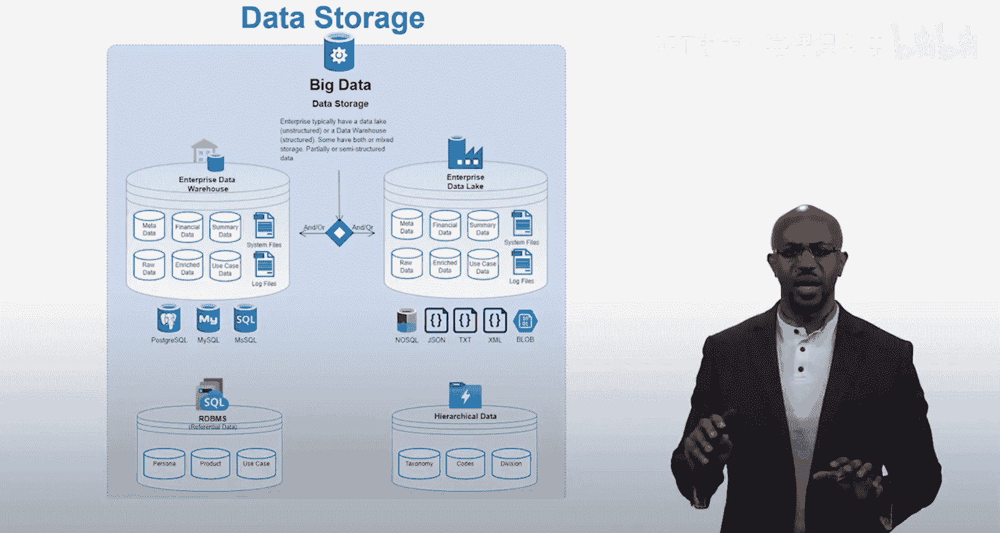

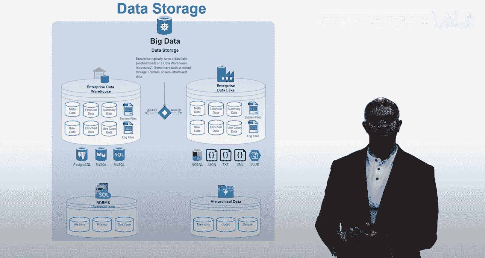

专业化数据层之下是位于数据存储中的数据集市。这些集市是从大数据中衍生出来的，围绕特定主题创建。

*   **设计原则**：应尽可能保持数据的**细粒度**和**特定类别**，以便向上传递到专业化的数据集市并生成信息。
*   **示例**：产品运营数据层、产品目标、支出、市场营销、销售数据等。

### 大数据存储层

继续向后追溯，我们进入大数据存储区域，这里通常包含数据湖和数据仓库。

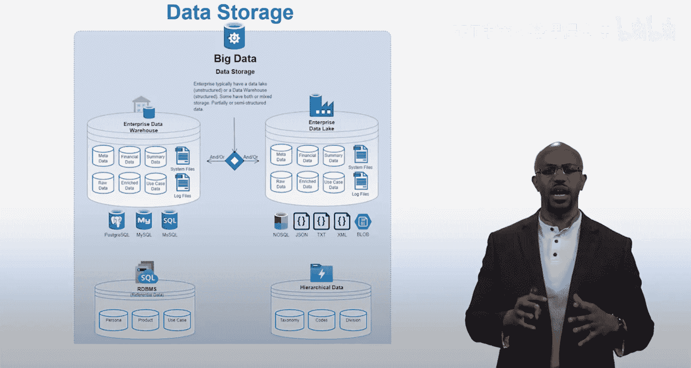

*   **数据湖**：主要存储**非结构化数据**，如 **NoSQL**、**JSON**、文本文件、**CSV** 等。
*   **数据仓库**：主要存储**结构化数据**，如 **MySQL**、**MSSQL**、**PostgreSQL** 等。

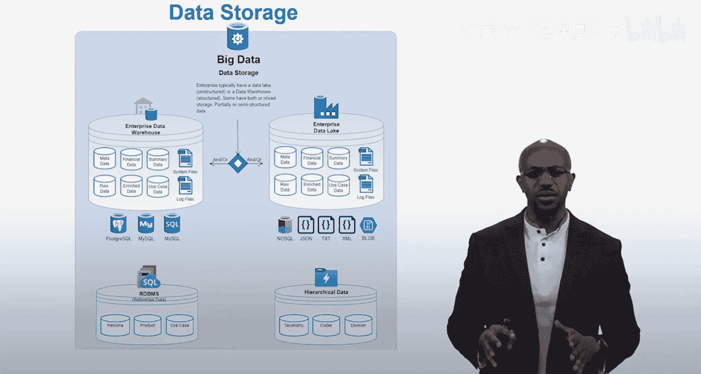

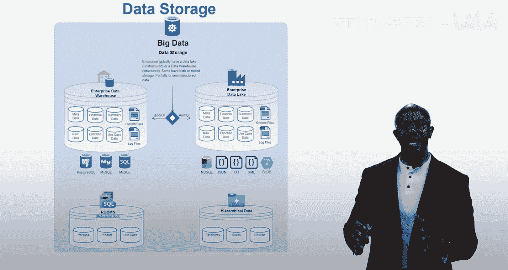

此外，在产品化层，我们还可以接收**事件监听信息**（例如通过 **Kafka**），关注实时市场动态，并将这些信息与存储的经典数据相结合。

### 基础数据管理层

在大数据存储层之下，是关系型数据库管理系统和层次型数据。

*   **RDBMS**：允许使用参照信息，存储来自管理源的数据，并支持将数据转换到下一层级。这是大多数组织有机会改进的关键环节：一是在捕获点，二是在利用公司外部与产品非直接相关的数据来创造更多数据，从而更好地理解产品和消费者行为。
*   **层次型数据**：涉及分类法和事物结构，使事物具有顺序性，类似于计算思维中的一步一步执行。理解事物应如何以层次化格式构建，对于审视大数据全景至关重要。

整个大数据图景由数据库管理系统进行管理，为公司提供数据服务。

## 混合云与数据缓存 ⚡

现在，让我们看看数据捕获点的视图。这是一个混合云架构，是目前多数公司采用的更高效的服务管理方式。

视图中央是弹性负载均衡器，具备网络负载均衡、应用负载均衡等功能。两侧的云（公有云和私有云）可能根据需求设置冗余。一些系统是垂直堆叠的，另一些则是水平扩展的。

*   **云上能力**：可以将数据存储在云 **SQL** 中，或使用 **EC2** 实例等开发环境，这能使面向消费者的应用运行更快。
*   **数据缓存层**：这一层使公司更加敏捷，能够快速将数据分发到不同地方，而不会降低内部系统的交易操作速度。
*   **企业数据缓存**：它充当控制器，快速将数据导向所需之处；作为一个已知节点，可以接收实时数据并迅速传递到下一个通道；还能从大数据中提取信息到近源，加速前端（Web或移动应用）的运行。

从黑暗数据的角度来看，这里正是组织外部数据捕获常常失败的地方。

## 数据捕获点 🎯

了解了架构及其用途后，我们来讨论捕获点。常见的捕获点包括移动设备和Web设备。

大多数公司会对页面和事件进行标记，跟踪用户点击等行为。他们通过浏览器中的Cookie来识别会话，从而理解用户如何使用页面。这至关重要，能让他们做出更好的决策，并跟踪用户在整个转化漏斗中的路径。

然而，许多公司难以捕获的是用户未完成表单填写时的数据。他们知道用户何时停止，并能根据现有数据推测原因，但需要更深入地理解阻碍用户完成操作的因素。

社交媒体公司在捕获黑暗数据方面通常做得很好，它们分析一切并据此做出调整。更多传统公司正在这个领域迎头赶上。

在审视捕获点时，需要关注应用服务器、Web服务器、事件监听和虚拟专用网络。考虑到SaaS（软件即服务）和PaaS（平台即服务），关键问题在于：**如何捕获来自消费者的未知数据？** 目标是尽可能简化表单，并持续引导用户提供更多信息。因此，设置捕获点的策略必须非常周密。

## 数据产品生命周期 🔄

最后，我们简要看一下数据产品的通用生命周期。

它涵盖监控、数据使用、环境与模型逻辑的测试部署、以及模型构建。需要注意的是，这里缺少了**数据建模**环节，以及如何在生命周期中**实现智能化**。所有这些都基于业务目标、成果和预期。如果不理解这些，就无法进行恰当的建模、测试，也无法创建新的数据产品并利用黑暗数据来提供价值。

---

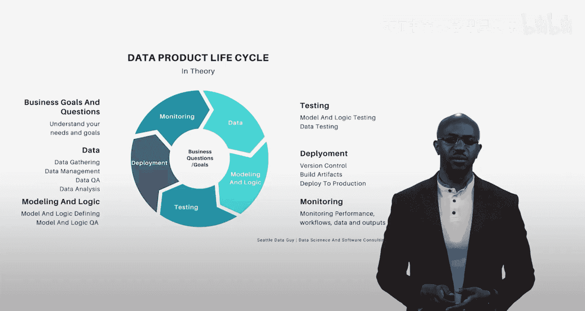

本节课中，我们一起学习了数据产品化的具体流程和架构层级，从专业化的数据产品到基础的数据存储。我们还探讨了混合云环境下的数据缓存策略以及有效捕获数据的关键点。理解这些层次和捕获机制，是释放黑暗数据价值、将其成功转化为驱动业务的数据产品的基石。