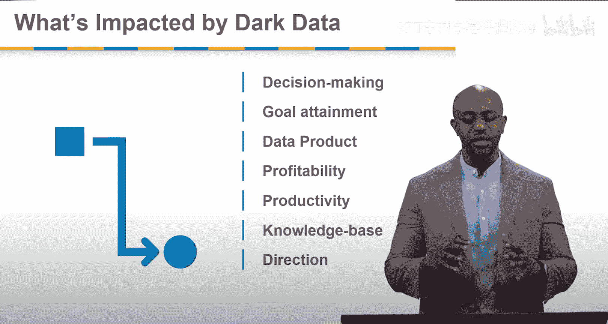
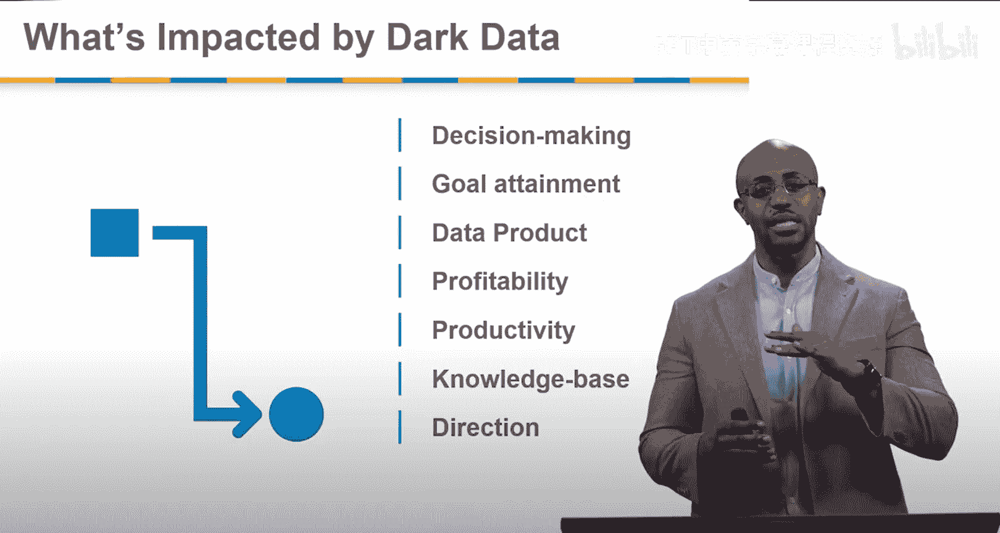
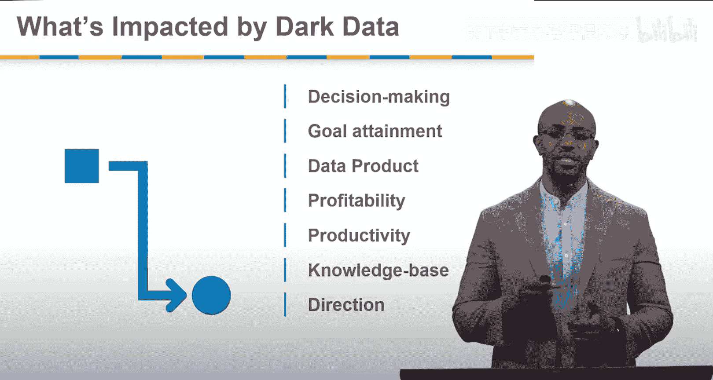
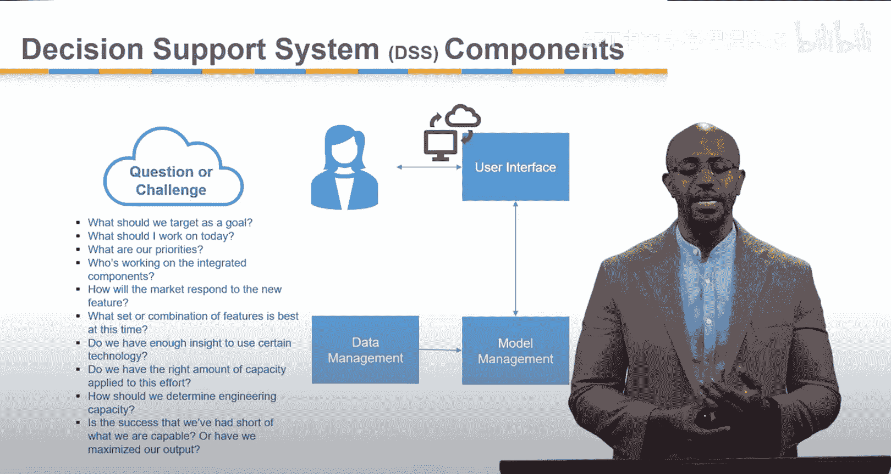
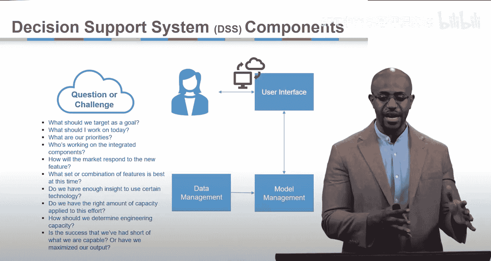
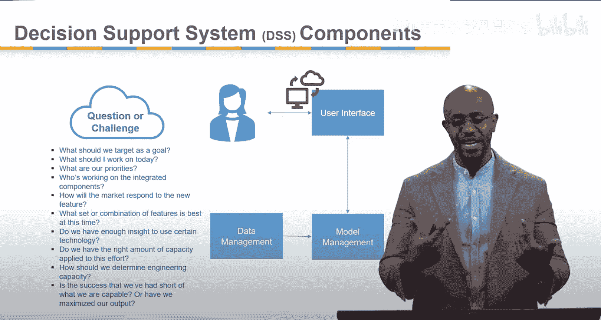
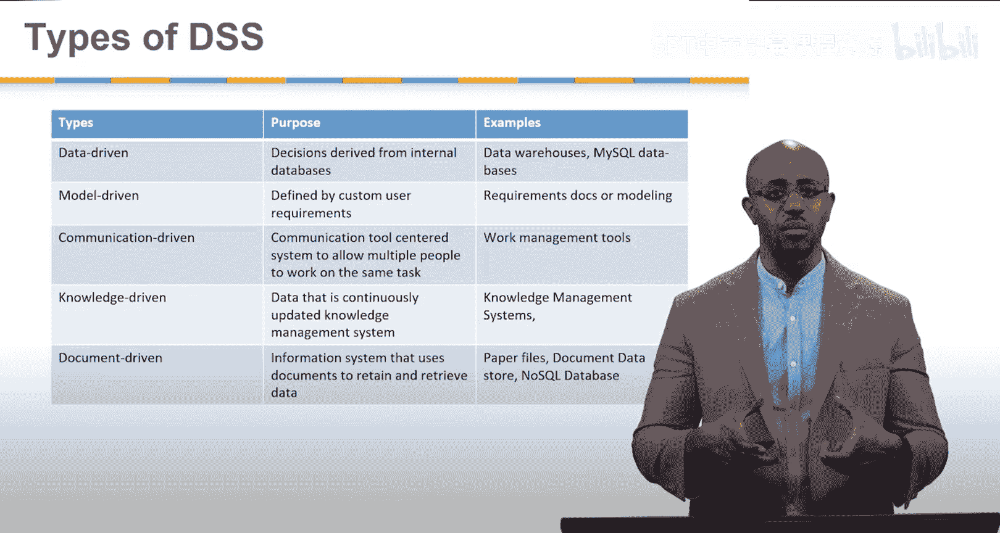
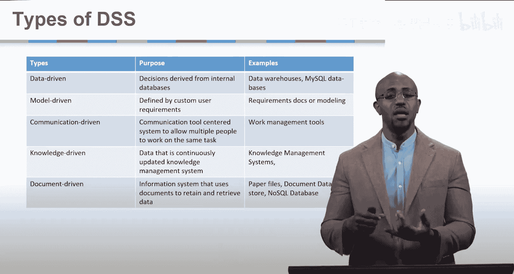
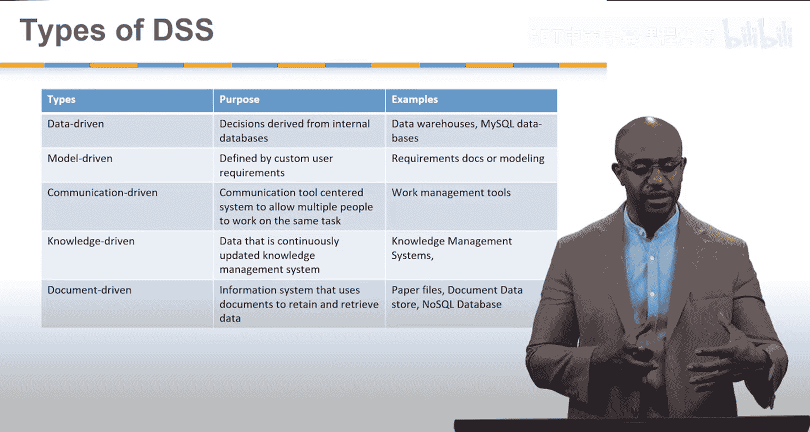
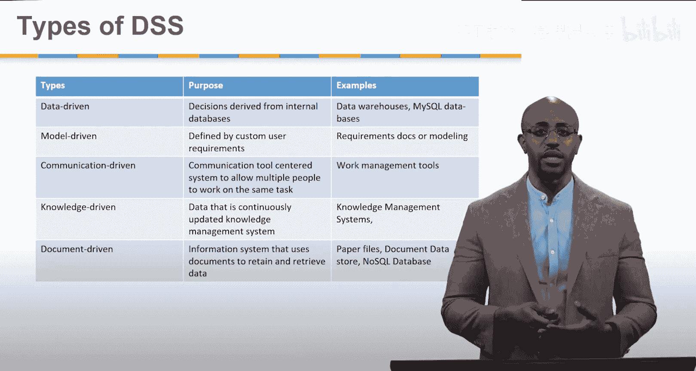

# 09：8_受暗数据影响的领域 🔍

在本节课中，我们将聚焦于受暗数据影响的领域，并深入探讨暗数据在我们所处环境及项目中所造成的具体影响。

## 概述 📋

暗数据的存在会对组织的多个核心方面产生深远影响。从决策制定到知识积累，暗数据都可能成为阻碍目标达成的隐形障碍。本节我们将逐一审视这些受影响的领域。

## 受暗数据影响的核心领域

以下是暗数据主要影响的几个关键业务领域：

*   **决策制定**：暗数据可能导致数据集存在缺陷，进而产生有缺陷的见解和信息。有时，数据本身是真实的，但在特定情境下却无关紧要。这可能导致我们做出短视的决策，或无法达成最终目标和真正的靶心。
*   **目标达成**：基于有缺陷或不完整数据的决策，自然难以有效支持战略和项目目标的实现。
*   **数据产品**：数据产品旨在增强我们获取利润或提升生产力的能力。暗数据会污染数据产品的质量，削弱其价值。
*   **盈利能力**：不准确的洞察会影响市场研究、定价策略、资源分配等，最终损害组织的盈利能力。
*   **生产力**：团队基于低质量数据工作，可能导致重复劳动、错误方向和效率低下。
*   **知识库**：组织积累的知识如果建立在暗数据之上，其可靠性和可用性将大打折扣。

所有这些领域都依赖于一个核心过程：从**数据**到**信息**，再到**见解**，最终形成可指导行动的**智能**，使我们能够做出正确决策并朝着正确方向前进。

---

上一节我们列出了受影响的领域，本节中我们来看看支撑这些领域运作的核心系统——决策支持系统。

## 决策支持系统的构成 🧩

我们整合数据、创建智能数据产品的基础，是决策支持系统及其组件。一个典型的决策支持系统包含三个主要部分：

1.  **用户界面**：这是人类与之交互的部分，通常是在显示器上展示数据、图表和图形，并配有过滤器，允许我们深入挖掘信息以获得所需见解。
2.  **模型管理**：无论处于何种系统，通常都有某种模型管理组件。
3.  **数据管理**：这正是数据产品化的发生地。模型管理部分可以是关系型数据库管理系统，或是任何用于构建关系表的结构（即使我们处理的是非SQL或非结构化数据）。在处理非结构化数据时，通常仍需要某种关系关联来为数据添加上下文。

当您尝试使用决策支持系统来做出更好决策、更快推进产品和项目时，可能会面临以下挑战或问题：

*   我们的优先级是什么？
*   我们如何存储信息并允许调整变更？
*   项目中，谁负责哪些集成组件？
*   我们是否达到了目标和指标？（包括当年及过往）
*   这些目标是否有意义？
*   我们看到的增长是否与我们的行动相关？

---

理解了决策支持系统的作用后，我们再来回顾数据价值层级，并看看一个常见问题。

## 从数据到智能的挑战 ⚠️

再看一次这个层级：**数据**是基础块。我经常看到分析师或数据科学家提供见解时的一个挑战是，他们有时会停留在**信息**层面。您获得了数据，将其转化为信息，得到一些图表，可以做出一些非常基本的评估和决策，但这通常无法让您立即采取行动，也无法让您清晰了解事情进展是否正确、目标是否正在达成。

因此，我们必须思考如何以某种方式将数据产品化，以便我们能够利用决策支持系统中的模型控制器，来获取所需的知识、智慧和见解，从而生成用于决策的智能。关键在于：**应用上下文**、**赋予意义**、**提炼见解**，最后**紧扣我们行动的目的**。

---

最后，我们来了解几种不同类型的决策支持系统，它们都是受暗数据影响的基础设施。

## 决策支持系统的类型 🗂️

决策支持系统主要有以下几种类型：

*   **数据驱动型**：大多数情况下，我们使用的系统都基于数据。
*   **模型驱动型**：一些系统具有特定的分析或预测模型。
*   **沟通驱动型**：一些系统旨在以更无缝、自助服务的方式更好地沟通信息，例如劳动力管理、工作管理或敏捷管理工具。
*   **知识驱动型**：许多系统会集成到上述工作或敏捷管理工具中，允许您同时利用沟通驱动和知识驱动的见解与信息来完成工作。
*   **文档驱动型**：这类系统关注如何存储信息对象等，例如数字资产管理系统。

这些系统和组件是支撑业务运作的底层基础，也因此成为暗数据产生影响的关键环节。当我们在这些系统中考虑暗数据时，需要反思：我们是否正确分类了元数据？是否正确应用了它？我们创建的关系表和模型是否准确、贴合上下文，并且与我们的目标和目的相关？

## 总结 🎯

本节课中，我们一起学习了暗数据影响的多个核心业务领域，包括决策制定、目标达成和盈利能力等。我们探讨了支撑这些领域的决策支持系统的构成与类型，并分析了从原始数据到可行动智能的转化过程中，暗数据所带来的挑战。理解这些影响是有效管理和利用数据、避免暗数据陷阱的第一步。