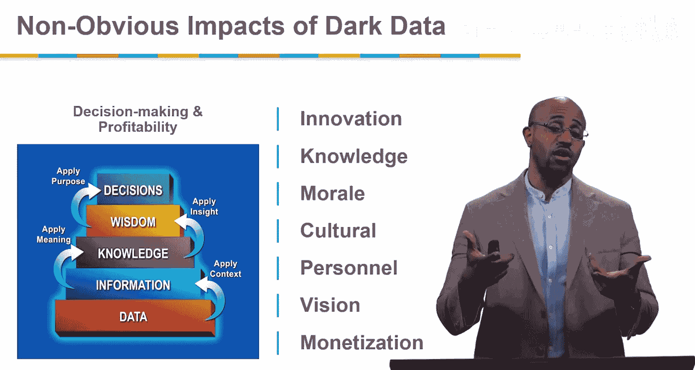
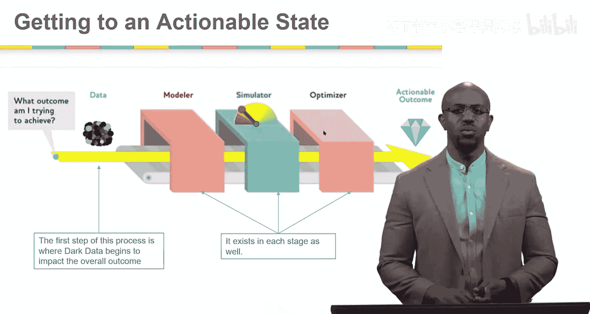
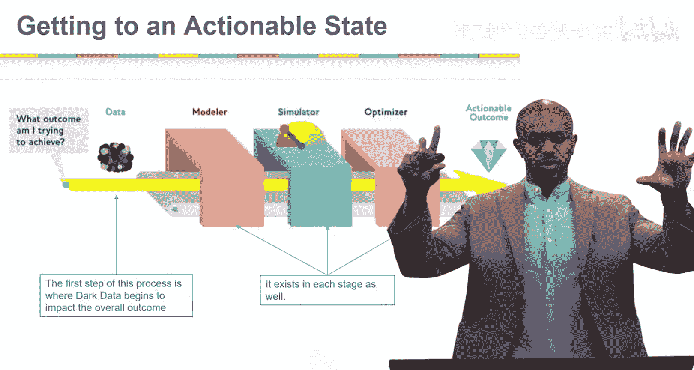
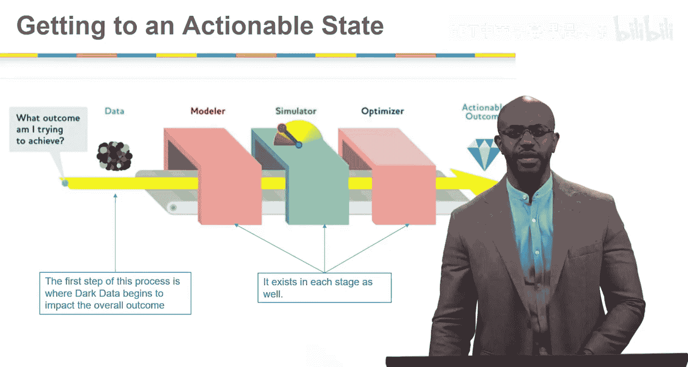
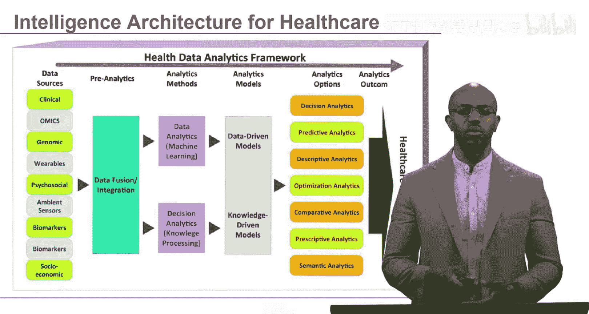
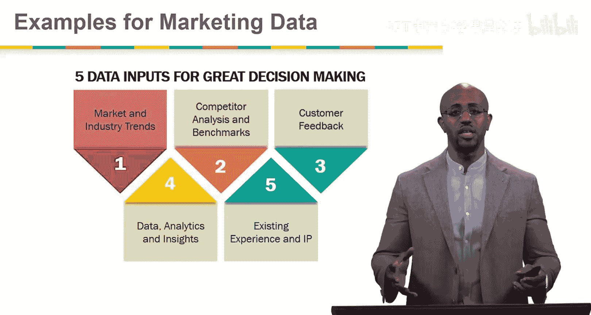
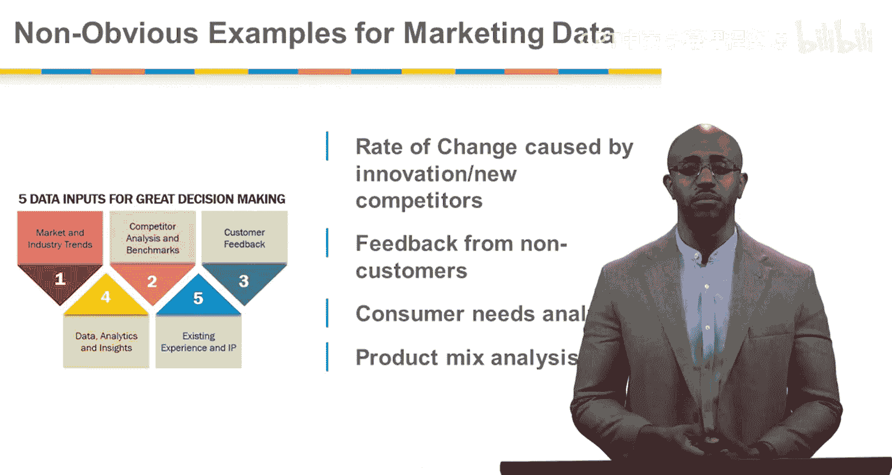

# 暗数据迁移与架构：1.9：暗数据的隐性影响 🔍

在本节课中，我们将探讨暗数据可能带来的、不那么显而易见的影响。这些影响通常潜藏在数据处理流程的各个环节，不易被察觉，却可能最终导致决策失误。

上一节我们介绍了暗数据的基本概念，本节中我们来看看它在实际业务架构中可能引发的具体问题。

## 概述：从数据到智慧的链条

回顾数据-信息-知识-智慧-决策的金字塔模型，暗数据的隐性影响主要围绕以下几个方面：
*   **创新**：未知数据可能阻碍新想法的产生。
*   **知识创造与管理**：不完整的数据导致知识体系存在缺口。
*   **士气与文化**：数据问题可能影响团队对数据驱动文化的信心。
*   **人员与愿景**：基于不准确数据的战略可能误导团队方向。
*   **货币化**：错失利用完整数据创造价值的机会。
*   **数据创建过程**：流程本身可能引入或掩盖数据问题。

有时，数据可能已丢失或在未知情况下被更改，这会导致在生成顶层智慧时面临挑战或形成错误的观点。

## 架构流程中的潜在断点

让我们通过一个典型的企业数据架构图来分析这些隐性影响可能发生的位置。

上图左侧代表公司的交易或运营系统，右侧则是分析系统。中间橙色的“数据治理”框，负责管理数据从左侧流向右侧仓库、数据湖，并最终进入分析系统的流程与控制。

这个过渡环节存在许多可能在不经意间出现问题的地方。例如，在蓝色区域底部的 **ETL（提取、转换、加载）** 过程和 **API网关** 处，数据从Pega等决策引擎或其它定制系统中流出，进入数据仓库，并利用参考表生成新的数据片段。

**问题可能在此产生**：系统有时会根据输入信息创建默认值或衍生值。如果此处的任何信息不正确，就可能导致最终数据错误或丢失。由于这些数据在流入系统时“看起来”是干净的，并且在上游已经过扫描和验证，它们会顺利通过后续的质量检查。

于是，有缺陷的数据会进入数据产品化的阶段，最终被推送到顶层的可视化分析中。此时，你甚至不会意识到数据存在问题。这种情况在许多组织中屡见不鲜。因此，需要考虑的不仅是缺失了什么数据，还包括你**推导信息的方式**，因为在创建最终数据产品的过程中，可能已经丢失了关键组件。

## 高层流程视角

上一张图我们深入到了技术细节，接下来从一个更高层的流程视角来看。

观察“识别数据”这一环节，这是暗数据开始产生影响的起点。你需要思考：
1.  **初始数据集是否完整**？是否包含了所需的一切？
2.  **建模过程是否正确**？是否以正确的方式创建了默认值和衍生值，从而构建出能够产出正确数据产品的数据结构？
3.  随后，才能利用这些数据产品来生成洞察与智慧。

此外，流程中还可以加入模拟器、预测机制等可选步骤来创造更多价值，并通过从摘要视图下钻到细节的方式进行优化。所有这些步骤都是为了从智慧中创造可行动的成果。

## 行业示例：医疗系统

以下是医疗系统的一个高层架构示例：

左侧“数据源”部分展示了医疗运营中的传统数据来源。数据从左侧的运营系统（嫩绿色和浅蓝色框）流出，进入“数据融合与集成”阶段，即与分析空间整合，随后进行数据驱动建模等分析工作。

虽然此图未明确显示数据仓库和湖，但其核心流程与之前的业务架构图一致。架构中的每一个阶段关卡，都可能成为暗数据产生隐性影响、导致信息或智慧丢失的环节。

## 实践思考：营销数据示例

最后，我们以营销领域为例，看看如何思考暗数据的影响。以下是用于更好决策的五个常见输入因素：

*   市场/行业趋势
*   竞争对手分析与基准
*   客户反馈
*   数据与分析洞察
*   现有与潜在客户体验及知识产权

然而，即便考虑了这些因素，暗数据依然可能存在。以下是一些针对这些因素的非显而易见的具体思考点：

*   **关于竞争对手分析与创新**：
    *   创新引发的变革速度。
    *   对创新本身的变革速度（例如，技术迭代周期）。
    *   新进入市场的竞争者所扮演的角色。
*   **关于客户反馈**：
    *   **非客户的反馈**：这是一个关键点。获取现有客户的反馈已属不易，且其中已有暗数据（并非所有客户都会反馈）。更重要的是，如何获取那些**还不是你客户**的人群的反馈？理解他们为何不选择你、如何能成为你的客户，这中间存在大量未知数据。
*   **关于客户体验**：
    *   需求分析：如何更好地满足客户现有需求，并鼓励他们成为品牌倡导者？
    *   产品组合分析：有些产品客户可能并不知晓或未充分使用，如何获取相关数据来揭示这些机会？

核心在于，如何围绕这些以及更多主题获取数据，使你能够从未知中做出更好决策、创造更优信息。

## 总结

本节课中我们一起学习了暗数据隐性影响的多个方面。我们了解到，这种影响不仅存在于数据的“缺失”本身，更嵌入在从数据收集、转换到分析的全流程之中。通过审视架构断点、高层流程以及具体的行业示例（如医疗和营销），我们认识到，必须对数据流转的每一个环节保持警惕，主动思考和探寻那些“未知的未知”，才能确保最终用于决策的智慧是建立在坚实、完整的数据基础之上。