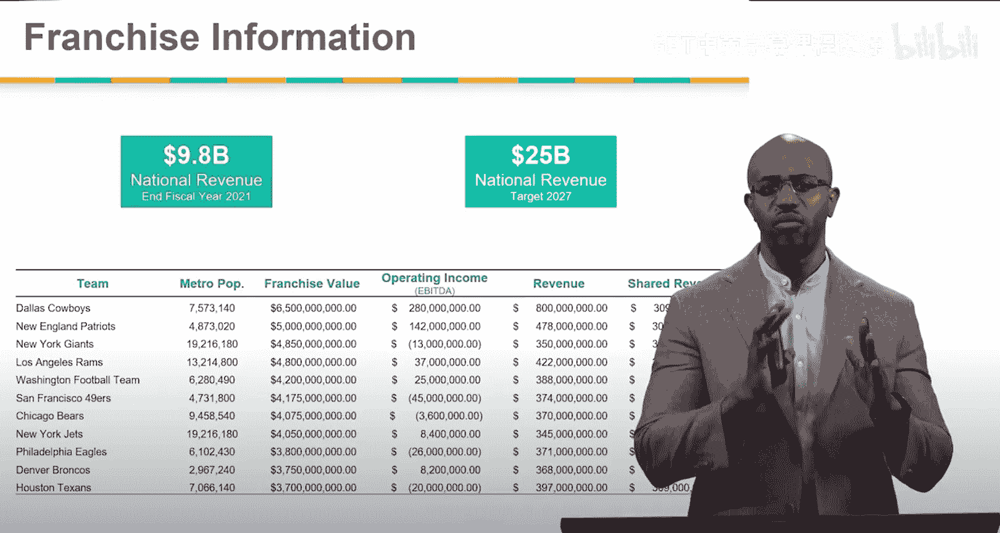
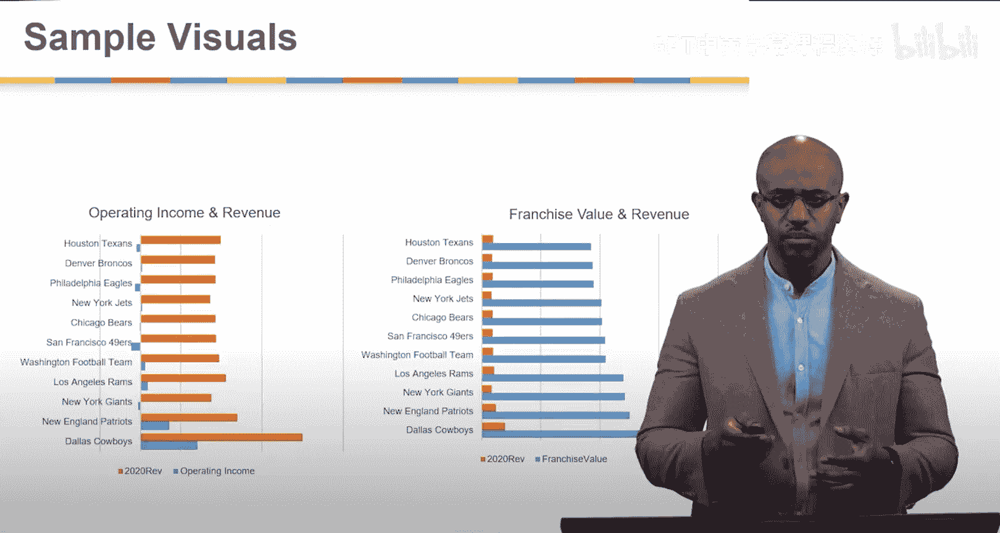
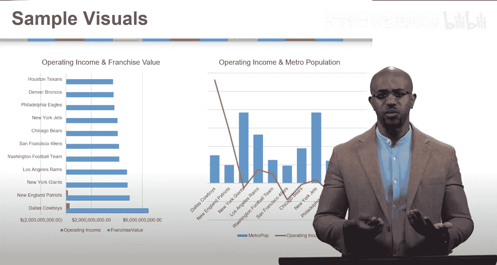
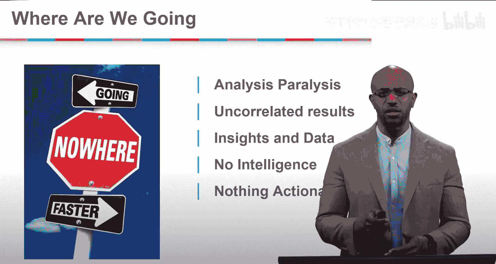
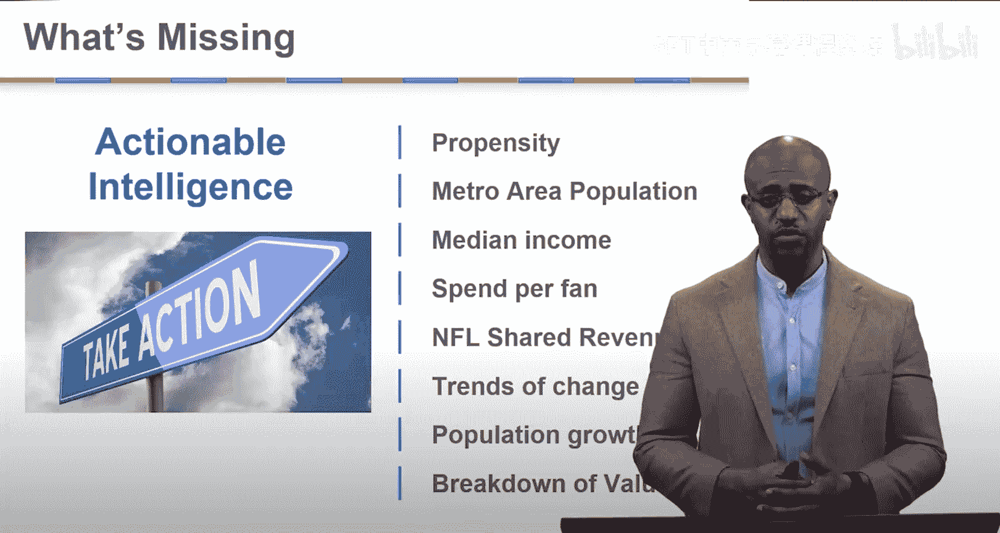

**黑暗数据迁移与架构：11：暗数据应用案例解析 🏈**

在本节课中，我们将通过一个有趣的案例——分析美国国家橄榄球联盟的球队——来学习如何识别暗数据。我们将探讨，如果要从投资角度分析这些球队，可以从哪些信息中挖掘出潜在的、未被充分利用的数据价值。

上一节我们介绍了暗数据的概念，本节中我们来看看如何在实际场景中应用这些概念。

---

### **案例背景：NFL球队投资分析**

美国国家橄榄球联盟是世界上最大的体育联盟之一。我们将聚焦于联盟中价值最高的12支球队，深入探讨如何通过分析现有信息来寻找投资机会，并识别其中可能隐藏的暗数据。

以下是这12支球队的名单：达拉斯牛仔队、新英格兰爱国者队、纽约巨人队、洛杉矶公羊队、华盛顿橄榄球队、旧金山49人队、芝加哥熊队、纽约喷气机队、费城老鹰队、丹佛野马队和休斯顿德州人队。

---

### **核心数据指标解析**

在深入分析之前，我们需要理解几个关键财务指标的含义：

*   **球队价值**：球队的整体估值，不仅基于收入，还包含**体育场馆、品牌价值、本地市场及广告收入**等因素。
*   **营业收入**：指在计算**税费、摊销、债务**等之前的收入。它包含了所有运营开支，如球员薪资、差旅、食宿等。括号内的数字表示该球队处于亏损状态。
*   **球队收入**：球队自身产生的收入。
*   **共享收入**：指NFL联盟与**媒体合作伙伴、赞助商**等签订的合同所产生的收入，这笔收入会在所有球队间平均分配。对于许多球队而言，这是维持运营的关键。

从初步数据看，达拉斯牛仔队以65亿美元的估值和8亿美元的收入位居榜首，而排名末位的休斯顿德州人队收入为3.97亿美元。仅从“肉眼”观察，各球队的市场人口基数差异巨大，这为我们提供了初步的分析方向。

---

### **多维度数据可视化分析**

如果我们孤立地看数据，很容易得出“投资牛仔队是最佳选择”的结论。然而，通过交叉对比不同维度的数据，我们可以发现更深入的洞察。

以下是几个关键的数据对比视图：

1.  **营业收入 vs. 球队收入**
    *   此视图能反映球队自身盈利能力的健康程度。牛仔队表现突出，但德州人队虽然营业收入为负，球队收入却依然强劲，这可能成为谈判时的切入点。

2.  **球队价值 vs. 球队收入**
    *   除了牛仔队和爱国者队，大部分球队在收入层面相差不大。但像洛杉矶公羊队、华盛顿队、纽约巨人队这些身处大市场的球队，其估值明显更高。这引出了一个关键问题：投资时，是更看重**大城市/大市场**，还是其他因素？

3.  **营业收入 vs. 球队价值**
    *   此图显示，相比高昂的球队价值，各队的营业收入普遍较低。

4.  **营业收入 vs. 大都会区人口**
    *   这个视图揭示了市场人口规模对运营利润的影响。牛仔队再次脱颖而出，其高利润与相对较低的人口基数形成对比，表明其品牌运营效率极高。而像49人队这样利润较低但市场稳定的球队，也可能因其成本控制能力而成为稳健的投资选择。

---

### **避免分析瘫痪与识别数据缺口**

如果继续深入挖掘，例如分析**共享收入与球队收入的分成比例**，或**大都会区人口与利润的详细关联**，我们很容易陷入“分析瘫痪”——即面对无数可能性却得不出任何具有关联性、可执行的结论。

在探索数据时，进行一定程度的试错是合理的，但必须时刻谨记分析目标，寻找正确的关联性，避免在黑暗中盲目射击。

那么，我们当前的分析缺失了哪些关键信息？以下是一些未被考虑但至关重要的暗数据维度：

*   **增长倾向**：球队持续增长的潜力有多大？球迷的消费倾向如何？
*   **人均球迷消费**：如何获取并验证此类数据？
*   **人口收入中位数**：当地居民的实际消费能力。
*   **球员薪资与胜率关联**：支付高额薪资是否与比赛胜率提升直接相关？球队表现的波动性如何影响其价值？
*   **估值与开支细目**：需要仔细剖析估值构成和各项开支，例如体育场馆的其他用途收入。
*   **城市人口增长**：城市的人口增长趋势与球队价值是否存在关联？
*   **新球队准入概率**：未来是否有新球队加入联盟的可能？其所在的市场是哪里？

---

### **总结与展望**

本节课中，我们一起学习了如何通过一个具体的NFL球队投资案例来实践暗数据识别。我们分析了现有的财务与市场数据，并通过多维度交叉对比获得了初步洞察。更重要的是，我们识别出了当前分析中缺失的关键数据维度，如**增长倾向、球迷消费行为、薪资绩效关联**等，这些正是需要进一步挖掘的暗数据领域。

在后续课程中，我们将更深入地探索这个案例，分析更多球队的数据，并学习如何将这些零散的信息转化为可执行的商业智能。

---
> 注：本教程基于课程视频内容整理，专注于方法论演示，所有球队名称及数据仅为教学案例。