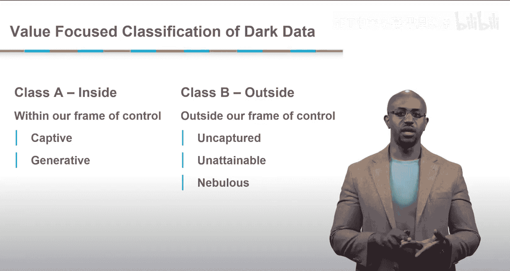
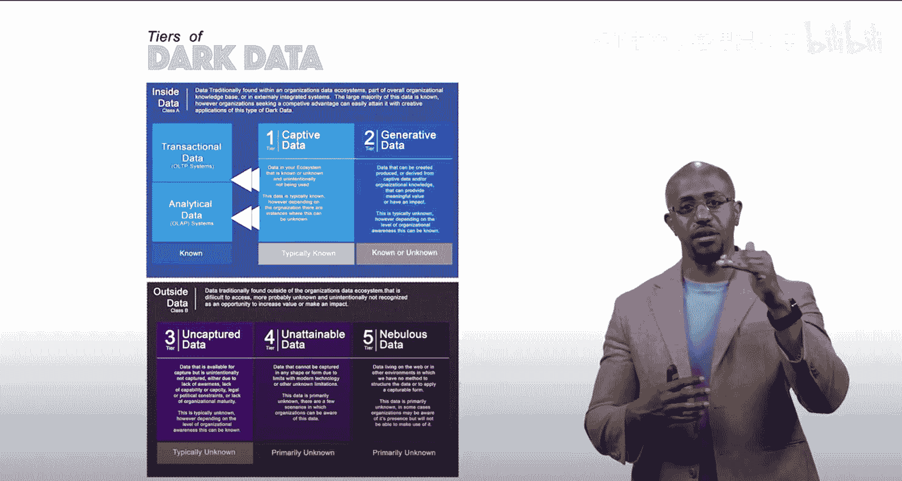

# 暗数据迁移与架构：P12：内外暗数据分类概览 🗂️

在本节课中，我们将要学习暗数据的基本分类。我们将从“内部”与“外部”这两个核心视角出发，深入探讨五种具体的暗数据类型，并了解它们与组织系统的关系。

## 课程概述

我们首先聚焦于暗数据的分类。为了简化理解，我们从“内部”和“外部”这两个基本分类开始。“内部”数据指的是处于你所在企业或组织影响范围内的数据。“外部”数据则是指组织之外、需要主动获取且未被组织内部系统捕获的任何数据。在这两大分类之下，我们总共有五种不同的层级：**已捕获数据**、**衍生数据**、**未捕获数据**、**不可获取数据**和**模糊数据**。

## 内部数据详解

上一节我们介绍了内外分类的基本概念，本节中我们来看看具体的内部数据类型。内部数据主要包含“已捕获数据”和“衍生数据”。

**已捕获数据**主要存在于你的交易系统和/或分析系统中。“已捕获”意味着你正在使用它。这类数据流经你的系统，通常提供交易或运营价值，根据使用方式的不同，也可能提供分析价值。已捕获数据中的暗数据可以是多种多样的，但其中大部分通常已被利用。

**衍生数据**则与数据丰富化、数据推导、创造新价值等行为相关。在这里，你利用参考数据、已有的知识或其他数据元素来创造新的东西，而在创造之前，这些新东西是未知的。

以下是内部数据的两种类型：
*   **已捕获数据**：指已存在于组织交易或分析系统中的数据，正在被使用。
*   **衍生数据**：指通过组合、推导或丰富现有数据而新创造出的数据。

## 外部数据详解

了解了内部数据后，我们转向外部数据。外部数据包括**未捕获数据**、**不可获取数据**和**模糊数据**。

**未捕获数据**指的是那些本可以被记录但未被捕获的信息。例如，你的网站有一个注册表单，你记录了新客户的信息，但你没有捕获那些访问了网站却未注册的潜在客户的数据。你可能捕获了他们的一些点击信息，但对他们没有深入的了解。因此，你可以分析现有客户漏斗，但对那些未注册的人一无所知。

**不可获取数据**指的是在当下你无法获得的数据。沿用上一个例子，对于那些未被系统捕获的人，如果他们已离开你的网站一两个月，你再试图追溯并获取这些潜在客户的信息时，这些数据可能已在网络中“丢失”，变得不可获取。

**模糊数据**是最后一种，也是最为隐蔽的类型。它基本上指任何完全未知、你甚至没有意识到其存在的数据。与前两种不同，对于未捕获数据，你知道该捕获什么但没做；对于不可获取数据，你知道想要什么但拿不到。而模糊数据，是你甚至不知道它存在、不知道如何获取、也不知道该做什么去获得它的任何数据。

当然，存在获取模糊数据的方法，也存在通过从已捕获数据、衍生数据开始，一路推导出它的路径。我们将在后续章节中讨论这些方法。

以下是外部数据的三种类型：
*   **未捕获数据**：指组织有机会捕获但实际未记录的数据。
*   **不可获取数据**：指在当前条件下，组织无法获得的数据。
*   **模糊数据**：指组织完全未知、甚至未意识到其存在的数据。

## 内部数据与系统架构的关系

现在，让我们更深入地探讨内部数据如何与交易和分析系统协同工作。在交易系统方面，正如我们在架构图中看到的，数据流经你的系统，你捕获了人们的姓名、ID等信息。这其中可能存在的暗数据包括人们的意图、可能性等。然而，其中一部分可以通过使用你拥有的其他数据和价值来推导，例如客户行为模式。一部分可以进行推测，但所有这些类型的工作都是在分析端完成的。

衍生数据再次强调是创造出来的。已捕获数据和衍生数据之间的关系通常结合得非常紧密，因为它们相互支持。

## 外部数据的深入视角

当我们深入探讨外部数据时，**未捕获数据**通常是未知的，**不可获取数据**主要是未知的，而**模糊数据**则始终主要是未知的，因为在当时你无法理解该数据的价值。

## 总结

本节课中，我们一起学习了暗数据的分类框架。我将其简化地分为“内部”和“外部”，这是相对于个人或企业而言的。在内部，我们聚焦于**已捕获数据**和**衍生数据**这两种顶层类型。在外部，我们则探讨了**未捕获数据**、**不可获取数据**和**模糊数据**。这五种层级为我们理解和处理不同类型的暗数据提供了一个清晰的路线图。