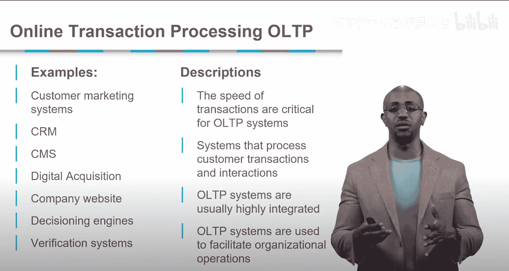
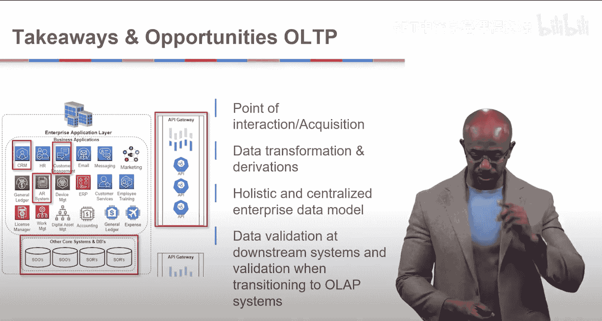
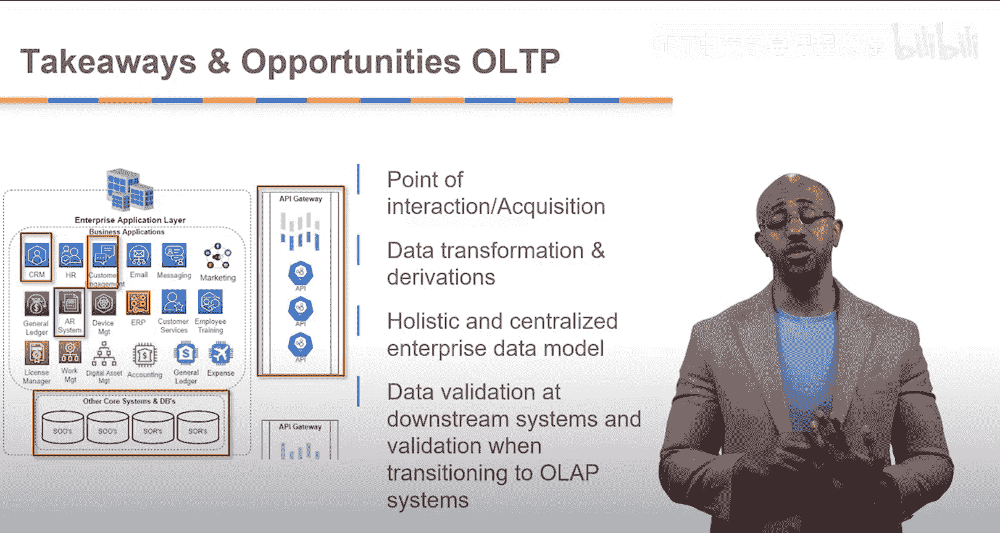
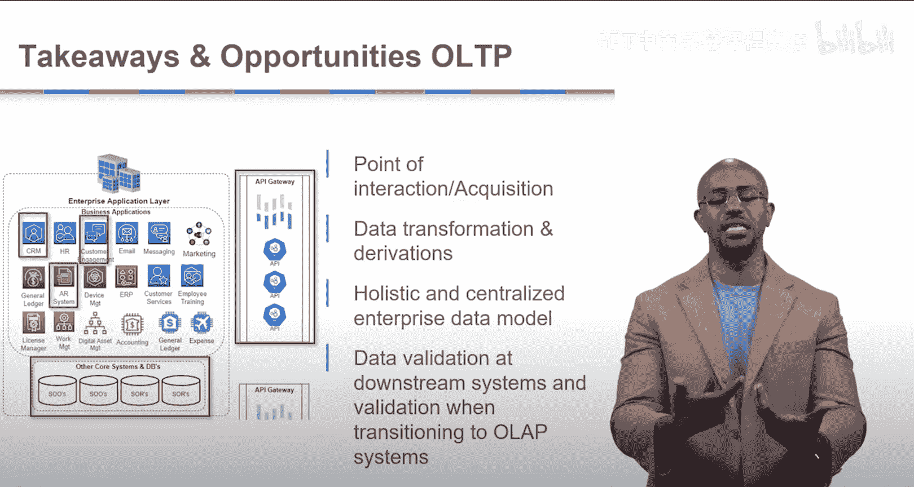
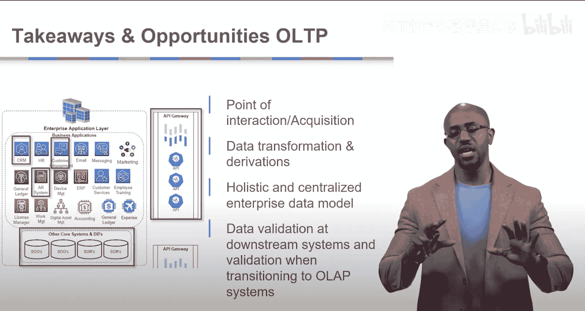
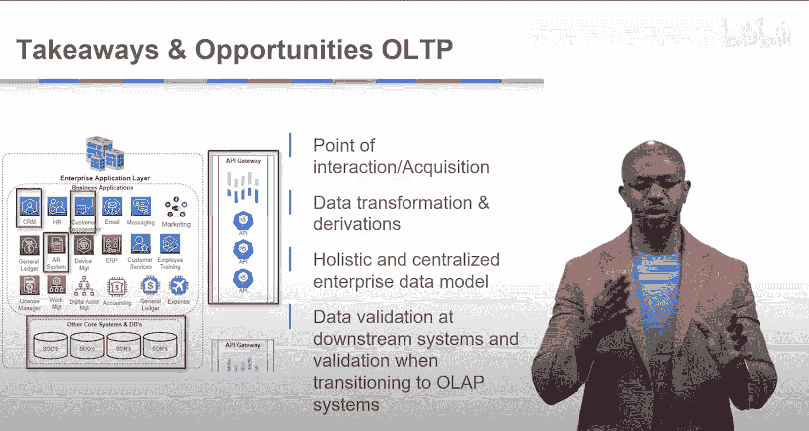
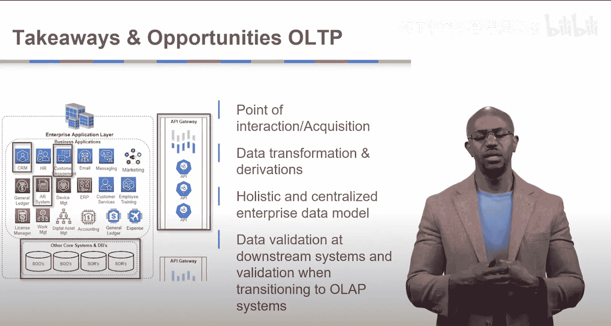

# 黑暗数据迁移与架构：13：联机事务处理系统 🔍

在本节课中，我们将深入探讨“受困数据”，并重点分析其产生的主要源头之一：联机事务处理系统。我们将了解这类系统的特点、它们如何运作，以及为何它们容易产生和隐藏“黑暗数据”。

---

## 概述

联机事务处理系统是处理日常业务交易和流程的核心系统。它们对速度和可靠性要求极高，但正是这种特性，使得数据在采集、传输和存储过程中容易出现问题，从而形成难以被有效利用的“黑暗数据”。本节我们将剖析OLTP系统的架构与数据流，识别黑暗数据的藏身之处。

---

## 什么是联机事务处理系统？💻

上一节我们介绍了黑暗数据的概念，本节中我们来看看它最常见的一个滋生环境——联机事务处理系统。

OLTP系统是用于处理业务交易或流程，并管理与外部实体或个人关系的系统。其核心特征是**高速度**和**高可用性**，这通常导致它们与用于分析的OLAP系统分离。

以下是常见的OLTP系统示例：
*   客户营销系统
*   客户关系管理系统
*   内容管理系统
*   数字获客系统
*   决策引擎
*   验证系统
*   公司官网

这些面向客户的系统必须满足严格的服务水平协议，例如“五个九”的高可用性，并确保响应迅速。

---

## OLTP系统的数据挑战 ⚠️

当我们关注黑暗数据与这些系统时，需要特别注意它们协同工作的方式。

首先，**交易速度对OLTP系统至关重要**。其次，在高度集成的系统中，集成接口必须具备同等性能，并且必须以**不丢失或意外更改数据**的方式连接。在实际工作中，经常出现数据在系统间传递时，其派生规则或默认值被工程师遗忘，导致数据被意外调整，最终引发混乱。

让我们回顾架构图，聚焦本节课的两个红色方框区域：混合云（公共与私有云镜像）和业务应用层。

我们需要审视业务应用层包含哪些内部系统，它们如何在云上交互，以及黑暗数据与受困数据的问题发生在何处。

---

## 数据采集层的黑暗数据

以下是数据在采集阶段就可能变为“黑暗数据”的几种情况：

**1. 设计不当的网页表单导致数据丢失**
如果网页表单设计不佳，例如未能捕获足够信息，或表单过长导致客户放弃填写，你就会丢失数据。这可能导致你获得失实的数据，并丧失评估客户对产品真实兴趣的能力。

**2. 有缺陷的企业数据模型引发问题**
一个有缺陷的企业数据模型会引发大量问题，尤其是在处理“名”、“姓”、“社保号”等基础字段时。例如：
*   系统A将“名”字段定义为 `F_name`
*   系统B将其定义为 `fN`
*   系统C将其定义为 `first_in`

当尝试同步这些数据时，就需要大量复杂的参照表来让所有数据“对话”，这源于最初未能建立一个统一的基础数据模型。地址信息（尤其是国际地址）是另一大挑战，因为地址行数、缩写（如“West” vs “W”）不统一，可能导致在中央数据库中存储同一人的两个不同副本。

在数据模型这个例子中，黑暗数据更多与**降低风险**相关。而在网页表单的例子中，则是通过**捕获更多数据**来创造价值。

---

## 系统集成层的黑暗数据

现在，让我们将视线下移到API网关部分，即三个边角相接的方框以及底部的SORs框。

这代表了系统源和系统记录的通用视图。在大型企业中，存在大量不同的系统源和系统记录，两者之间可能存在许多混淆。

例如，客户关系管理系统、客户互动数据源或应收账款系统。当这些系统彼此通信时，统一的数据模型就变得至关重要。从网页表单获取的数据、以及未能捕获的数据，共同构成了受困系统中的黑暗数据。如果处理得当，你可以借此**提升价值并降低风险**；反之，则会**增加风险并减少价值**。

---

## 关键要点与改进机会 🎯

基于以上分析，我们可以总结出几个减少黑暗数据、提升数据价值的关键机会点。

当考虑交互点、数据转换与派生、以及整体集中的企业系统和数据模型时，你应该开始思考以下问题：

**1. 优化数据采集与交互**
*   我们是否优化了网页表单，以尽可能收集用户环境信息？
*   我们是否让用户能轻松提交信息并完成购买？
*   我们的系统是否足够高可用？即使系统宕机，是否通过业务服务层设计，减少了用户看到错误页面的几率，并能稍后恢复捕获信息？

**2. 建立健壮的数据基础**
*   我们如何确保数据模型开发正确、灵活且易于理解？
*   我们是否拥有恰当的数据字典？
*   我们是否考虑了优雅降级、系统弹性？这些都影响着你的数据产品如何交付价值。

---

## 总结

本节课我们一起学习了联机事务处理系统作为黑暗数据主要来源的机制。我们了解到，设计不佳的网页表单、不统一的企业数据模型以及复杂的系统集成，都会在数据生命周期的早期阶段制造黑暗数据。处理这些问题的核心在于：从源头优化数据采集，建立统一灵活的数据模型，并确保系统集成的健壮性，从而将黑暗数据转化为可创造价值、降低风险的资产。