# 黑暗数据迁移与架构：14：联机分析处理系统 🔍

在本节课中，我们将深入探讨联机分析处理系统，并理解企业中发生的分析流程。

联机分析处理系统的一些例子包括数据仓库、数据湖、操作数据层、数据存储、数据集市和可视化应用程序等。我们还会将治理加入其中以展示其关系，尽管治理通常更多属于业务流程或数据管理流程。当我们谈论数据仓库和数据湖时，这些系统所体现的复杂性有时会被我们忽视，或者在大多数情况下，我们未能实现其内在价值或未能规避其固有的风险。

因此，审视联机分析处理系统的主要目的，我们考虑的是数据挖掘、分析、情报和机器学习这类事情。同时，它们也会间接地、有时是直接地帮助我们满足监管、审计和合规性需求，以确保我们走在正确的轨道上。

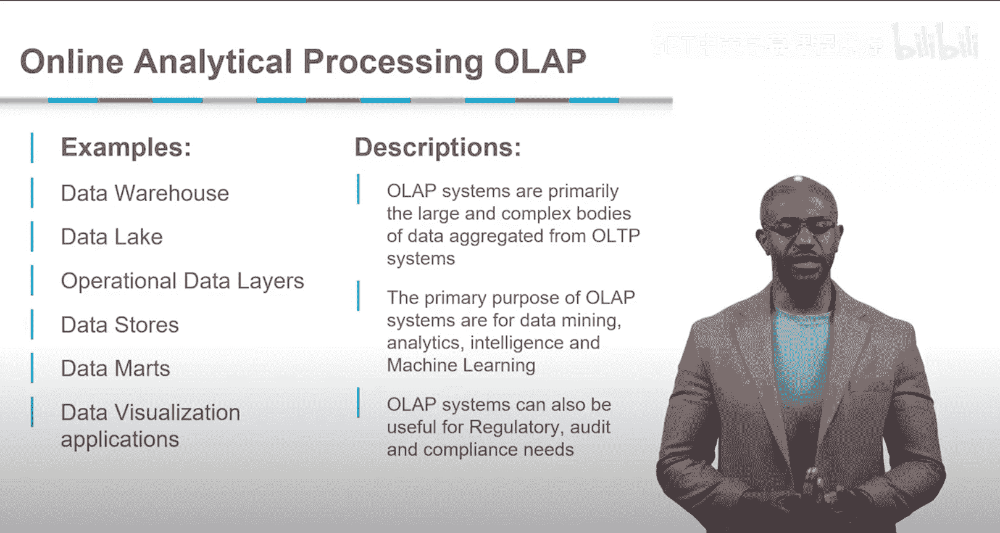

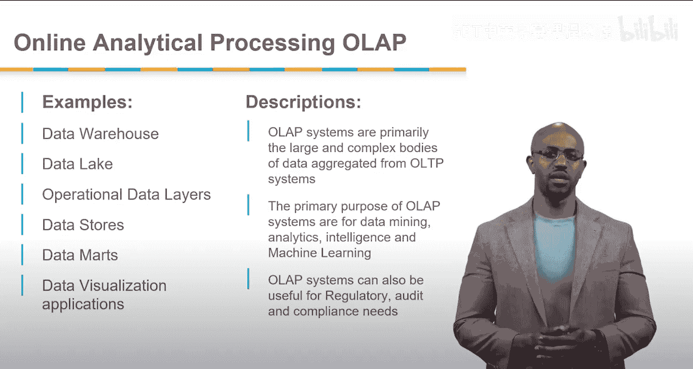

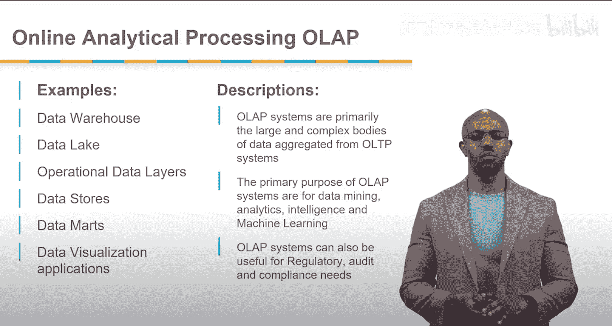

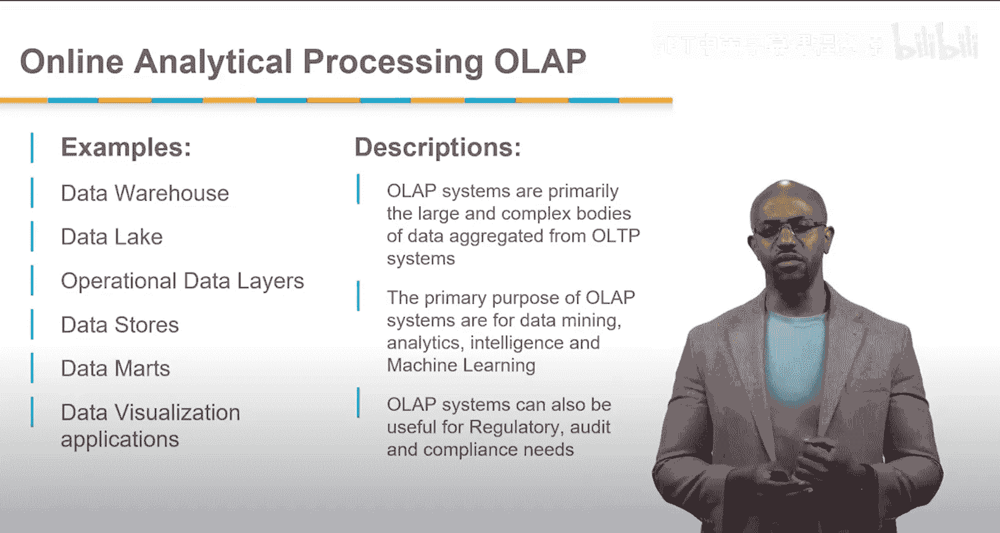

---

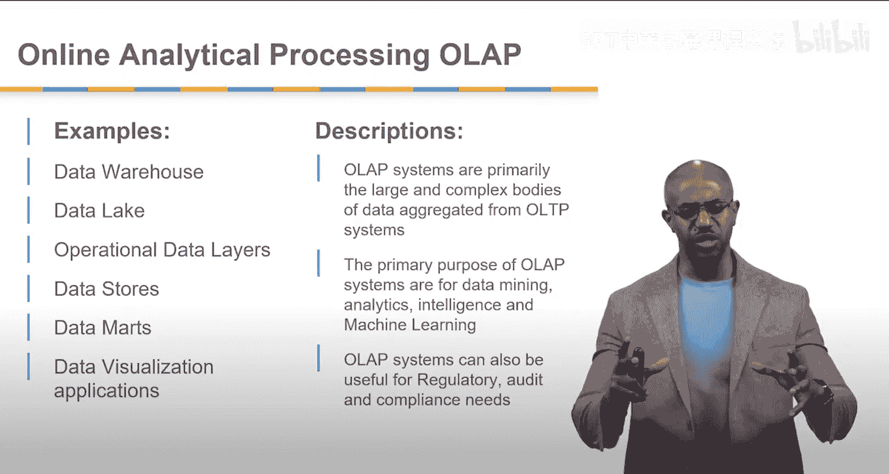

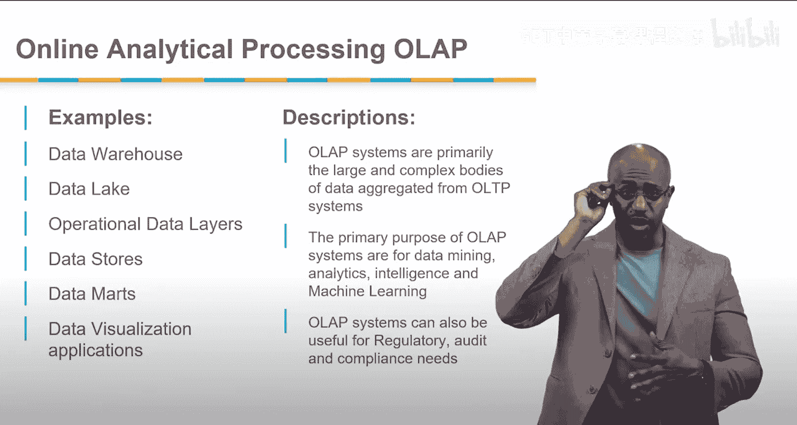

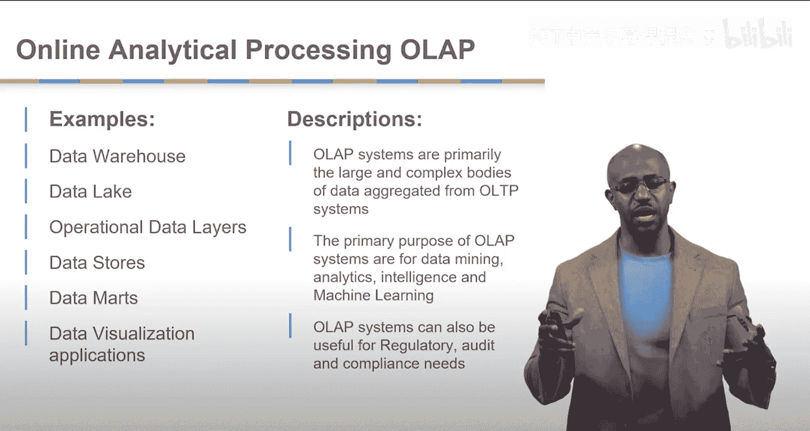

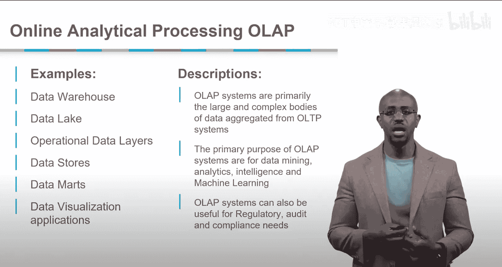

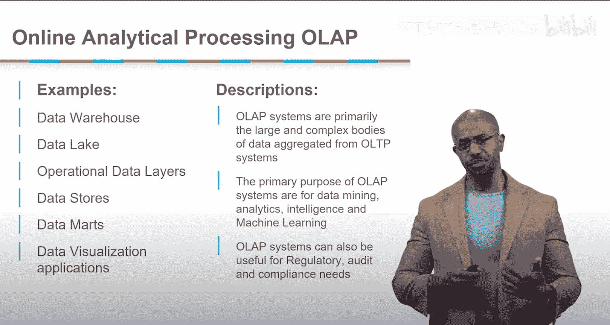

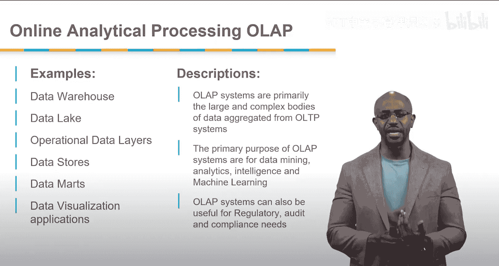

上一节我们概述了联机分析处理系统的范畴和目的，本节中我们来看看其架构图，以深入理解各层级的运作。

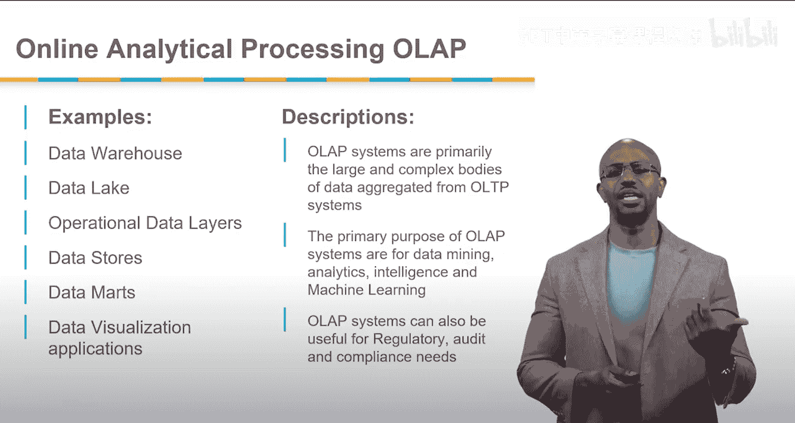

再次聚焦架构图，顶部我们已经讨论过，是可视化层。我们将重点关注左上角或右上角的方框，那是我们数据可视化的发生地。其下方是中间层，我们在那里创造新价值、衍生新值、丰富数据，并且从未知数据中创造数据。

谈到黑暗数据，并探索如何在该层构建更多价值和创造更多情报。再往下是数据存储层，通常位于大数据集群中，可以是结构化的或非结构化的，如仓库或湖。数据可以以JSON等非结构化格式存储，例如MongoDB、Cassandra等，也可以以PostgreSQL、MySQL、MSSQL等标准结构化格式存储。

---

现在，让我们更深入地研究架构图的顶部，即可视化部分。当我们试图从中获取价值或情报时，需要注意以下几点。

我们的分析是否给出了假阳性结果？分析本身的方向是否正确？它是否呈现了可能具有误导性的信息？很多这类问题可能源于糟糕的数据模型、数据质量或数据卫生问题。这里需要区分质量和卫生，因为卫生是质量的一个子集，它更多关注数据是否合理。质量涉及六个维度，而卫生更侧重于我们使用黑暗数据、创建新数据产品、丰富情报等所有方面所做的工作是否合理。我们将在后续课程中更深入地探讨这一点。

当我们考虑关键数据元素，即对企业功能和数据模型至关重要的元素时，糟糕的治理也会带来问题。在分析系统中，思考捕获和生成数据时，治理不善也会在此处引发挑战。

---

接下来，我们向下看数据层、衍生层、丰富数据层，所有这些都位于数据存储和数据集市中。

你可以这样看待：我们有数据集市，我们有数据存储。有时你只需要其中一层，而根据你自动化分析的复杂程度，可能需要两者兼备。但正是在这里，你真正提炼和开发出那些来自黑暗数据的数据产品。这是价值产生的地方，然后这些价值在用户界面层得以体现。

---

现在深入大数据层。这是所有数据的存储地，来自事务处理系统。在某些情况下，这里会有一些衍生数据，但主要的衍生将发生在我们已经讨论过的上一层。这里是JSON对象、文本文件和其他文档等非结构化数据存储的地方，它们可以以键值对等形式存储在数据湖中。

再看左侧的SQL部分，我们再次聚焦于：我们是否遗漏了来自联机事务处理系统的数据？我们是否正确存储了它们？我们的数据模型是否导致了冲突和命名问题？因此，在数据进入我们之前讨论的那些上层之前，这个基础部分的数据模型是否正确？命名约定是否在整个过程中保持一致？这些都是你需要思考的问题。

此外，当我们审视层次化数据结构和分类时，其准确性如何？是否不准确？是否具有误导性？这些问题会向上传递到可视化层，并可能导致我们之前讨论的那些问题。

---

最后，考虑机器学习能力。很多时候，衍生或丰富数据可能来自参考表。但在某些情况下，这些参考表本身就有衍生、调整和丰富。因此，当我们开始谈论机器学习和训练机器学习模型，以及创造向数据集添加新数据、将未知数据纳入体系的新方法时，机器学习为我们提供了助力。在这一层，可以使用机器学习策略和训练数据、神经网络等添加大量数据。

---

回顾整个技术栈，我们有以下几点要点和机会。

我们拥有可视化层、数据存储层、数据集市层（所有这些都属于数据产品层），以及底层的大数据层。

以下是几个要点：
*   **确保数据集市层的数据粒度**：很多时候，很容易立即汇总和合并数据。虽然我们确实需要基于关键字段进行合并，但仍需确保粒度，以便在序列末尾需要更改和添加内容时能够进行操作。
*   **透彻理解业务用例**：从业务角度透彻理解用例，将使你能够创建数据产品层，并以一种可以扩展、可以从中提取价值的方式创建它。
*   **测试你的假设**：确保数据模型得到遵循。这一点再怎么强调都不为过。数据模型、关键数据元素和元数据都至关重要。

因为所有这些都将累积起来，使你能够真正从黑暗数据中获取价值。它将帮助你识别差距所在，引入相关信息，并制造出可用于获取价值和降低风险的数据产品。

---

本节课中，我们一起学习了联机分析处理系统的架构、各层级的功能以及需要注意的关键问题，特别是如何通过良好的数据模型、治理和流程从黑暗数据中创造价值。