# 19：生成式数据概述 🧠

在本节课中，我们将对生成式数据进行概述。我们将了解什么是生成式数据，它如何通过结合内部数据、参考数据和洞察力来创造新的数据产品，从而提升企业能力。课程将重点介绍其核心方法、关键原则以及数据丰富化的重要性。

---

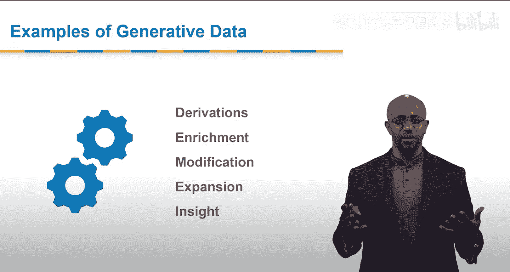

上一节我们介绍了数据的不同类别，本节中我们来看看生成式数据。生成式数据属于A类第2层级。它通常结合**捕获数据**、**部分捕获数据**，以及一些**洞察力**、**智能理解**，甚至**内部经验知识**来创造价值。其核心流程是：利用内部数据，通过参考数据进行扩展，从而创造出新的数据片段和数据产品，以增强公司或企业的能力。显然，这些数据在被创造出来之前是未知的。

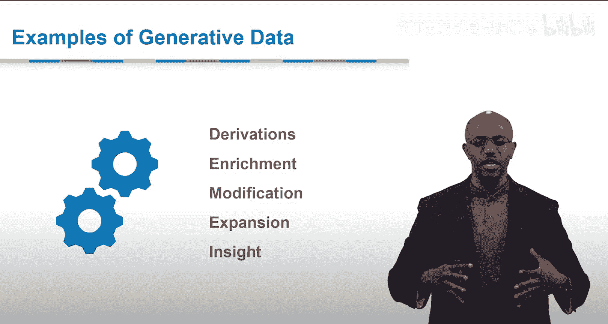

许多同学可能通过以下方法进行过类似的操作：

以下是生成式数据的常见方法：
*   **数据混合**：将不同来源的数据集合并。
*   **数据推导**：从现有数据中计算出新的数据。
*   **数据丰富化**：为现有数据添加更多相关信息。
*   **数据修改**：调整或转换现有数据。
*   **数据扩展**：基于现有数据创建更广泛的数据集。
*   **洞察生成**：从数据中提取有意义的结论。

然而，这一切的核心关键是**负责任地扩展**。当你丰富数据，尤其是创建数据产品时，数据集很自然地会变得更宽。但必须确保采取战略性的架构方法，以实现**负责任的扩展**。我们使用大量捕获数据及其元素，目的通常就是为了创造生成式数据中所见的这种价值。

---

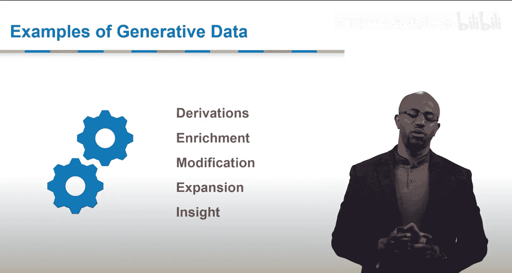

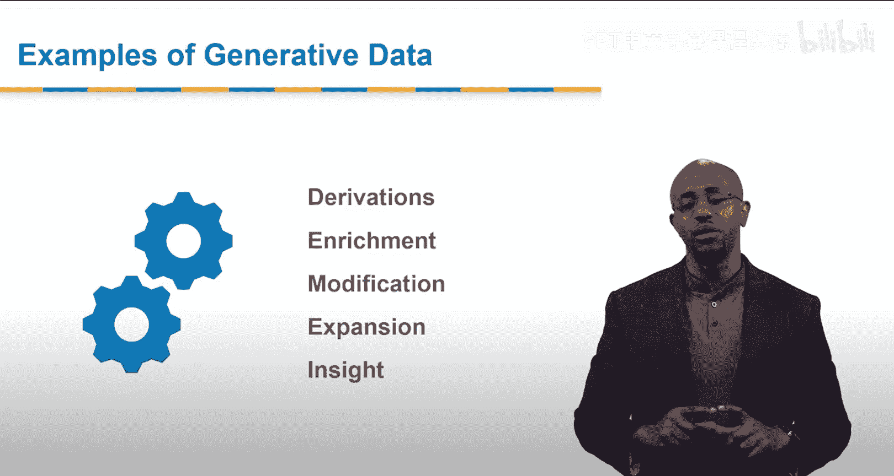

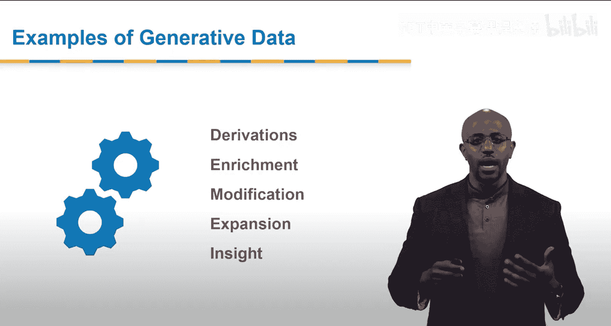

接下来，我们将聚焦于源自公司内部的数据，因为本节重点讨论捕获数据。后续课程会探讨如何更广泛地扩展。

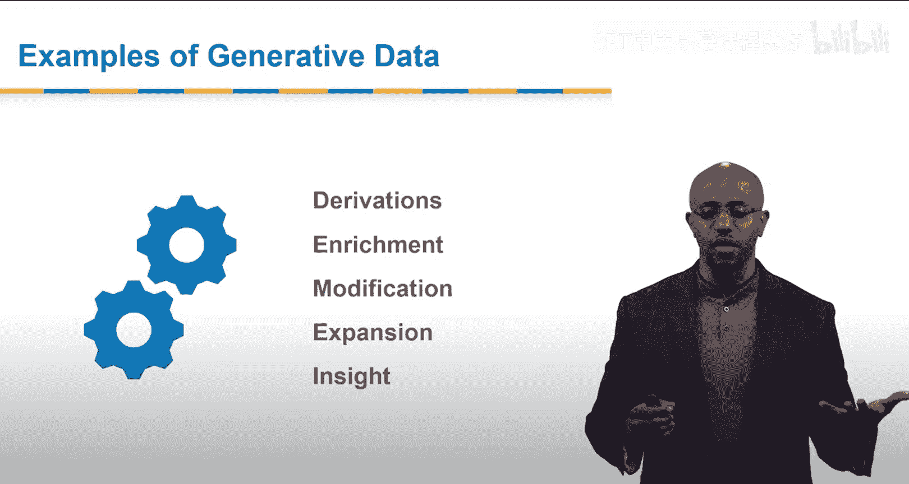

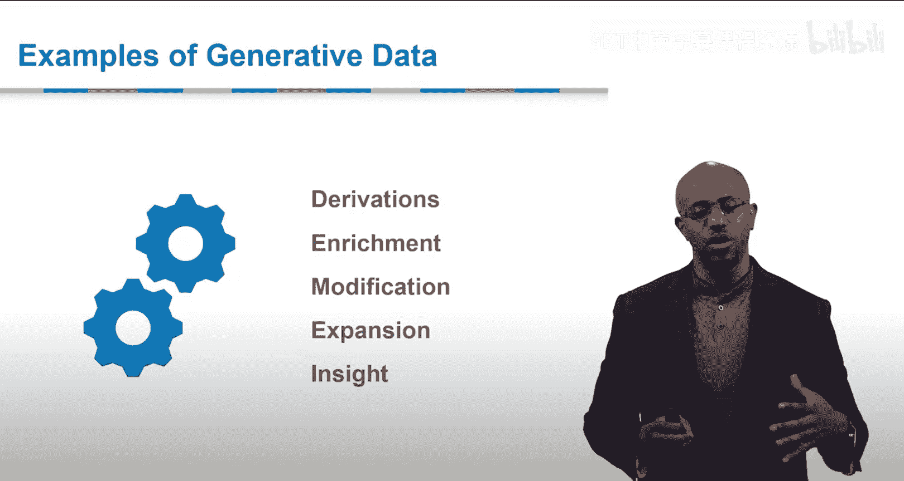

在生成式数据中，**推导**通常是丰富化的子集，混合、修改等其他因素也是如此。而**洞察**和**扩展**，很多时候源于理解如何围绕你已有的数据、元数据来构建参考数据，或者直接利用元数据本身。

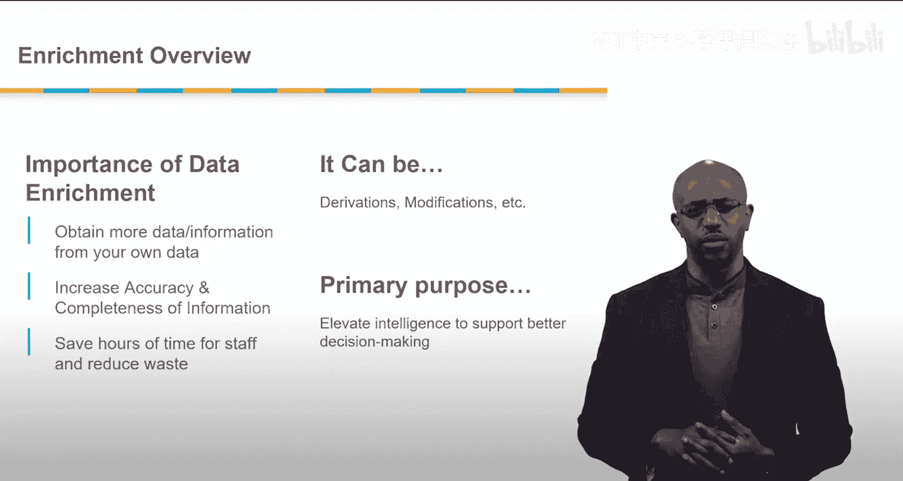

---

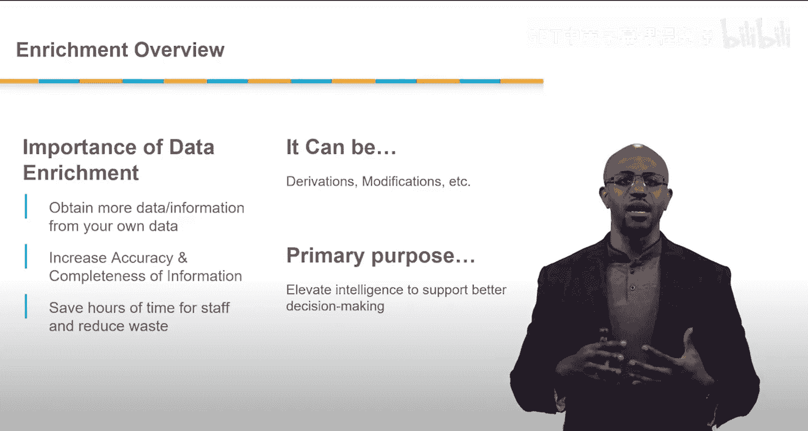

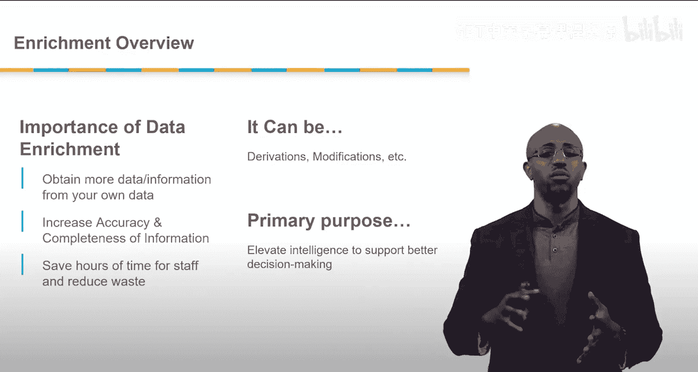

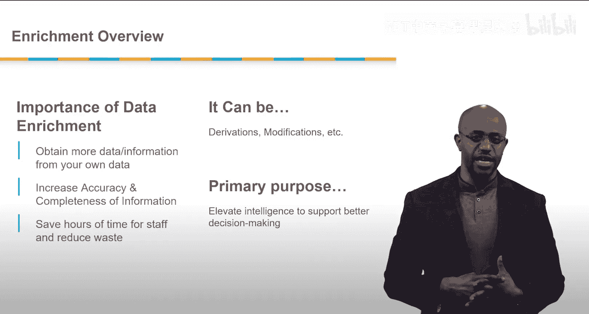

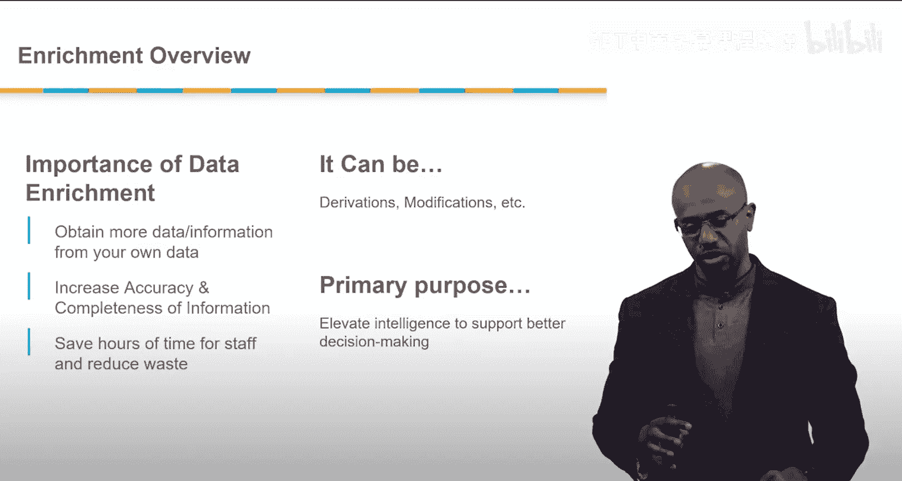

最后，在本次概述中，我们需要强调**数据丰富化**的重要性。以下是数据丰富化的三个核心能力：

1.  **从自有数据中获取更多信息和数据**（本节重点，后续也会涉及外部数据）。
2.  **提高所持信息的准确性和完整性**。有时，你可能错过了捕获某些数据的机会，但通过已有的元素，你可以推导出这些值，这非常关键。
3.  **节省员工时间，减少浪费**。避免人们创建冗余的产物、电子表格甚至部分自动化的视图。如果操作得当，数据丰富化可以实现自动分析，自动化许多手动任务。

数据丰富化允许你扩展业务视野。它可以是推导，也可以是修改，但其主要目的是**提升智能水平，以支持更好的决策制定**。

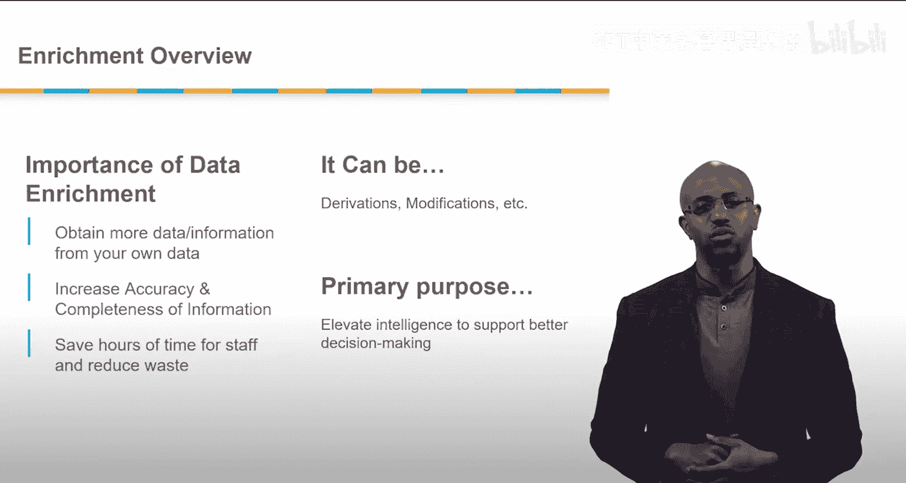

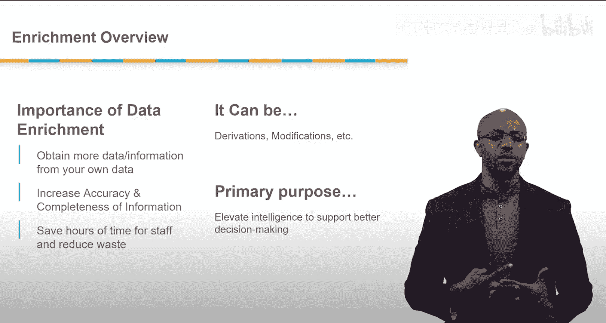

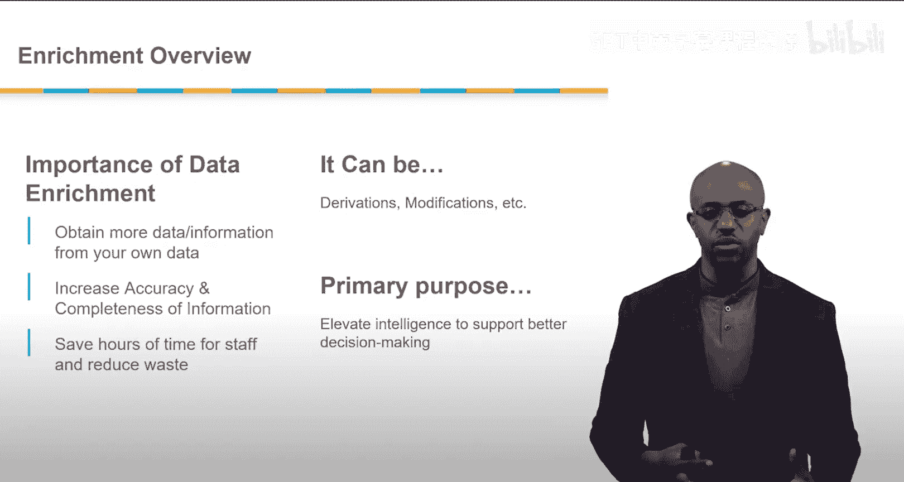

---

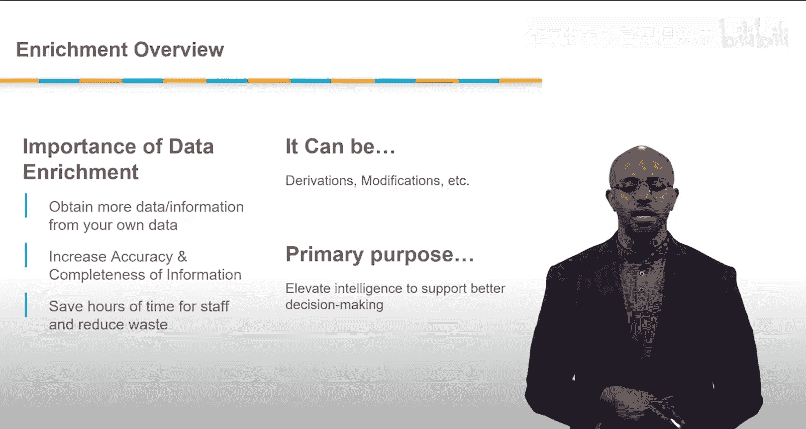

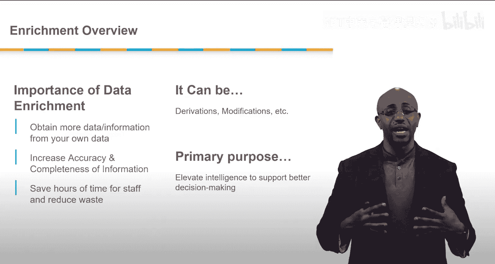

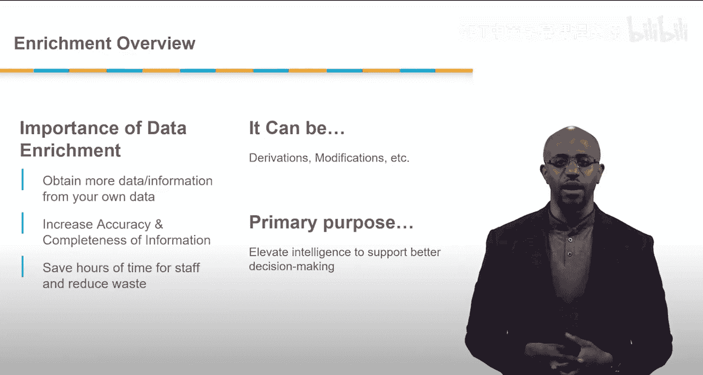

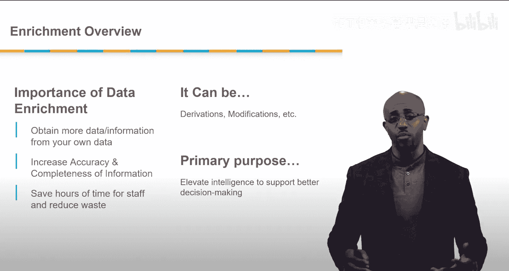

本节课中，我们一起学习了生成式数据的概念。我们了解到，生成式数据是通过结合内部数据、智能洞察和参考数据，来创造新数据产品的方法。其核心方法包括数据混合、推导、丰富化、修改、扩展和洞察生成。关键在于负责任地进行数据扩展，并采用战略性架构。数据丰富化作为核心环节，能够提升数据价值、节省资源并支持更优决策。