# 23：弥合暗数据认知差距的策略 🧭

在本节课中，我们将聚焦于价值流映射和客户旅程映射，目的是理解当我们想要去捕获那些未被捕获的数据时，需要关注什么。

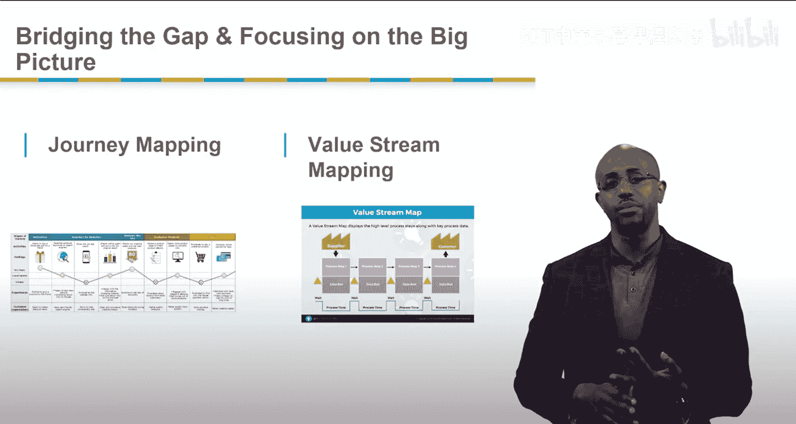

上一节我们介绍了暗数据的概念，本节中我们来看看如何通过映射工具来发现数据缺口。价值流映射和旅程映射至关重要，因为价值流映射识别公司如何为客户创造价值，而旅程映射则识别客户如何接收这种价值，以及客户如何经历从公司获取价值的旅程。

理解这一点对于接下来的示例至关重要。需要说明的是，在本课中，我们并非要深入探讨这两者的创建细节，而是旨在更好地理解它们，确保我们能从高层面上理解如何创建旅程映射及其核心，进而明确我们需要做什么来搜寻那些未被捕获的数据，以便更好地为客户提供价值。

## 如何创建客户旅程映射

首先，我们来关注如何创建旅程映射。

以下是创建旅程映射的关键步骤：
*   **创建买家角色**：我们之前略有提及。需要选择目标客户。这需要一些数据产品的帮助，但初始阶段数据较少，因此目标定位可能不够精准，但应随时间推移而增强。
*   **列出客户接触点**：识别客户行为。了解你在与谁打交道，他们如何与你互动，以及他们希望如何被服务或获得价值。
*   **评估可用资源**：这一点非常关键，因为资源（尤其是人力资源）是你最宝贵的资产，他们是执行和创造价值的主体。理解你的资源以及他们如何与客户互动至关重要。
*   **分析客户旅程并采取商业行动**：在需要的地方采取商业行动。这些是创建旅程映射时需要考虑的事项。

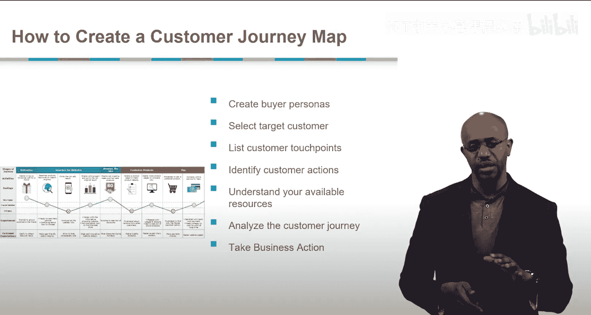

接下来，当我们构建这个旅程映射时，我们会贯穿客户的动机和不同步骤：从动机产生、搜索、浏览网站、客户教育、产品评估到支付环节。

从左到右看，一个人从产生动机开始（例如想买礼物），进入一般的购物旅程。他们会上网或使用移动设备，开始查看不同产品，浏览网站，思考是否能省钱或买到更好的产品。当客户通过网站或任何你提供的渠道进行互动时，他们自己在收集信息并决定：应该把钱花在哪里？应该把价值给你还是别人？

更深入地理解这一点，能让我们明确：我们需要从客户那里收集什么数据？以及如何随着时间的推移改进这些流程？

例如，看到“搜索网页并点击第一个广告结果”时，我们需要理解：我们在这些搜索排名中的位置有多高？我们是否处于能被客户看到、听到并与之交易的位置？我们是否收集了足够的数据，以确保我们做了正确的事情，比如选择了正确的关键词？我们的搜索引擎管理如何？我们是专注于小众市场还是广泛撒网？这些都是我们在构建客户旅程映射、理解客户与我们互动过程中的缺口时需要理解的问题。

进入产品评估阶段，客户会打开产品页面、查看产品详情、打开更多页面进行比较。我们是否允许客户快速、轻松地比较信息？然后，当他们采取行动时，我们是否使用了标签和其他工具来抓取数据？我们是否理解客户如何使用页面（无论是网页还是移动设备），以便改进页面？我们如何利用这些数据来开始创建能基于客户使用情况交付价值的数据产品？

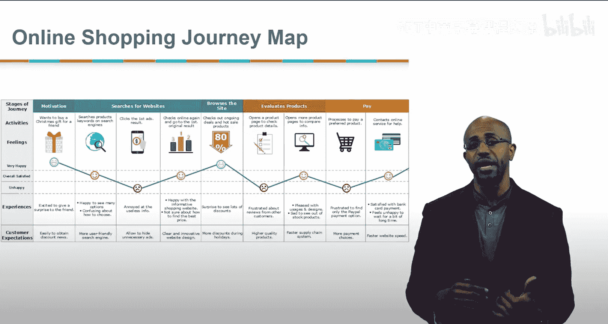

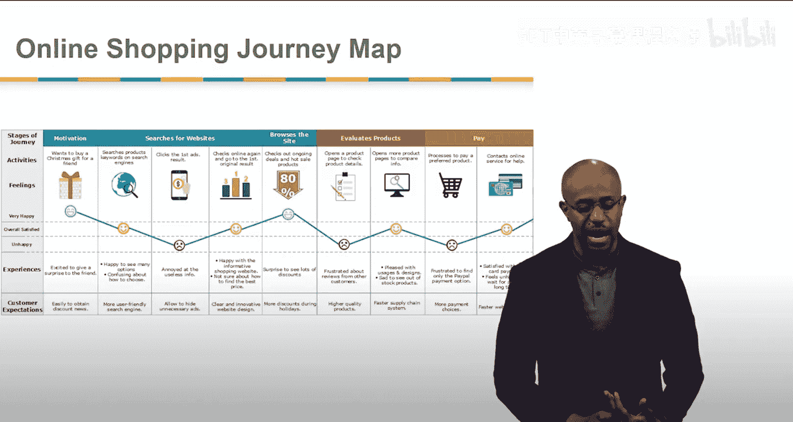

之前我们有一个关于产品表现的问题，其中一个问题就是：我们的网络产品或平台在客户使用方面的表现如何？客户如何消费和使用这些媒介？然后，我们必须围绕此创建一个数据产品，以便更好地利用它，这也有助于我们在价值链上下游应用价值。

现在来看支付环节。支付流程、首选产品、联系在线服务寻求支持。理想情况下，最好的方式是客户完成购买后无需联系你。但有时他们需要与你沟通，可能对产品有疑问，可能需要使用页面底部的聊天小窗口。我们必须确保也从这些渠道收集数据。如果客户与客服代表交谈，客服代表是否在收集正确的数据？他们是否接受了足够的培训来做到这一点并获取正确的数据？

我们需要考虑的是：如果我们在页面上没有设置标签来识别人们如何使用页面、点击哪里、如何吸收我们的信息，并且无法将其关联回客户账户，那可能是个问题。我们没有收集能让我们表现更好的情报。

购物车也是如此。如果有人加满了购物车却放弃购买，这是个问题。如果他们放弃后又回来减少了购物车商品，有多少人这样做？为什么？有时人们加满购物车是因为无法在页面上轻松比较。理解这些行为至关重要。

再回溯到上游的“第一个广告”环节：如果我们选择了错误的关键词，我们甚至永远不会出现在客户面前，他们根本看不到我们。在企业环境中，我多次经历过这样的对话，无论是涉及广告还是客户接触点（如获客）。常有的想法是：“我们基于X认为自己做对了，但结果并不支持，搜索结果显示我们选错了关键词，我们在错误的关键词上花钱，却没有获得所需的流量。”这些是你在深入探索未被捕获数据时需要思考的问题。

## 不同类型的客户旅程映射示例

这里展示另一种类型的客户旅程映射，它来自Bright Vessel，相当复杂。从顶层看，它从认知开始，贯穿了考虑、获取、服务和忠诚度阶段。

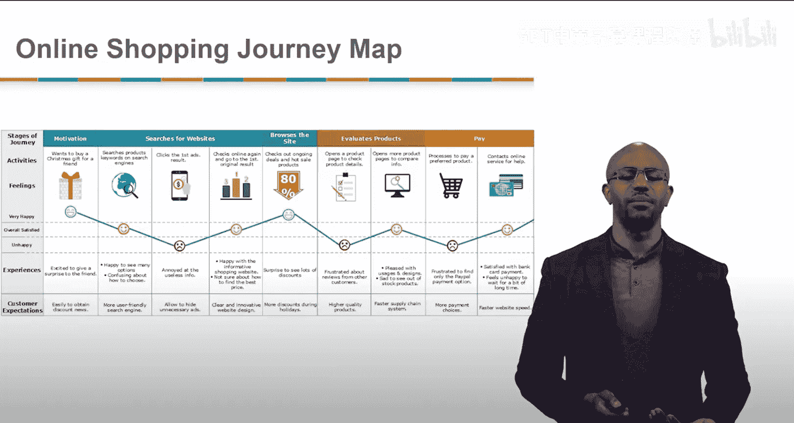

当你思考这一点，并思考公司或企业如何设置时：认知是起点，然后是考虑阶段。认知阶段大致是你的营销和广告投放的地方；考虑阶段是你如何管理客户的兴趣，无论是提供优惠还是客户来电咨询等。接着是获取流程，一旦客户开始结账、填写表格等，就进入了电商环节。这里有上漏斗（更偏向营销）和下漏斗（获取流程，即客户进入系统、成为会员）。之后是服务和忠诚度阶段：我们如何为你服务？以及进一步，我们如何创建那个忠诚度循环？现在你已经是客户了，我们希望继续深化与你的关系，为你提供其他产品，希望你使用我们的产品并从我们所做的事情中获得价值。

所有这些环节都整合得很好，这个视图很好地展示了当你查看旅程映射时，不同部门在不同环节接触客户。这虽然比较通用和高层，但我认为这是Bright Vessel一个非常好的视图，希望在本课中展示给大家。

现在，我们再来看另一种不同类型的客户旅程映射。这个例子更多是关于音乐分享的，我想用它是因为它更非传统，更侧重于分享而非销售。

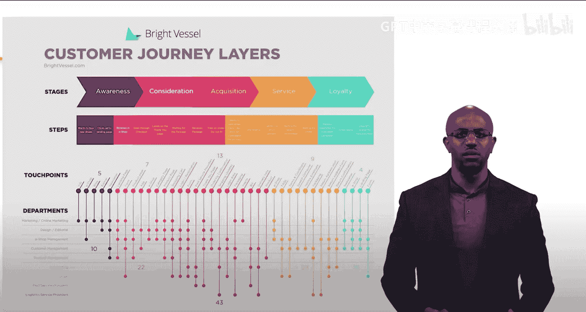

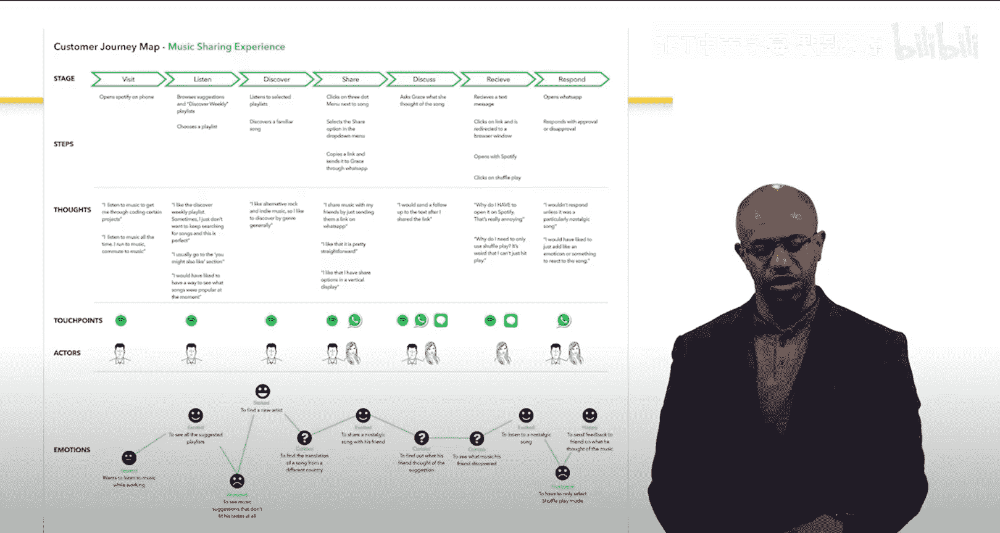

这个映射展示了访问、聆听、发现、分享、讨论、接收和回应的价值流。它不是关于销售或公司盈利，而是关于像Spotify或WhatsApp（或任何进行分享的公司，如Pandora）如何让人们相互互动，因为他们为客户提供价值，而客户也在为他们的朋友和生活中的人提供价值。

从高层看，当你浏览这些步骤并查看底部时，你会发现他们更关注客户情绪和感受，并努力让客户尽可能达到兴奋和激动的水平，这就是他们寻找价值的地方。在底部，他们不希望客户感到厌烦。例如，其中一个悲伤表情旁写着“看到完全不符合他口味的音乐推荐”。这是你需要考虑的事情。我以前用过音乐应用，有时会随机出现一首歌，我会想：这怎么会出现在我的歌单里？因为它与我正在听或感兴趣的内容毫无关系。这些都是可能发生的情况，需要你考虑。

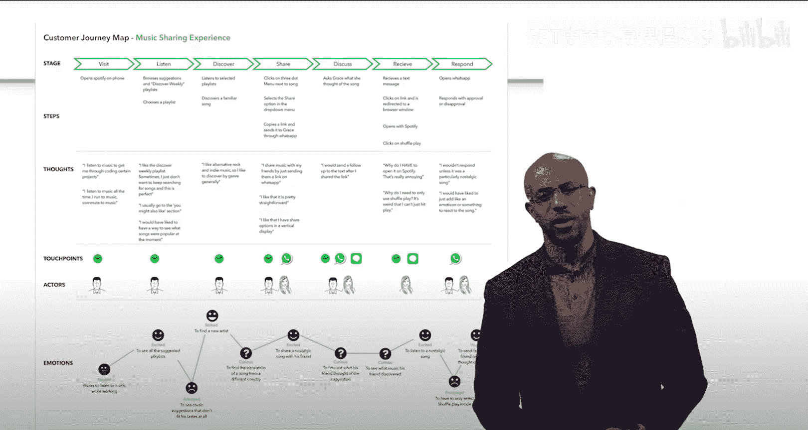

## 创建价值流映射与识别数据缺口

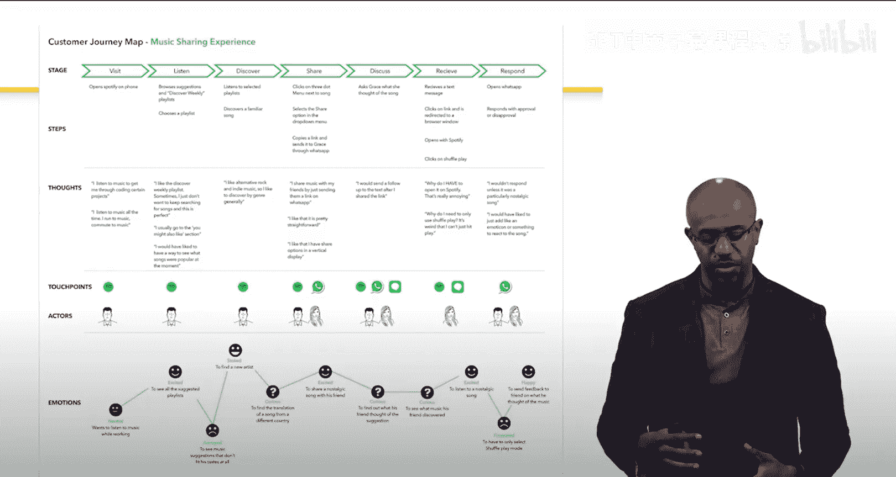

现在，转向创建价值流映射，并再次审视那些难以获取或未获取数据的缺口。

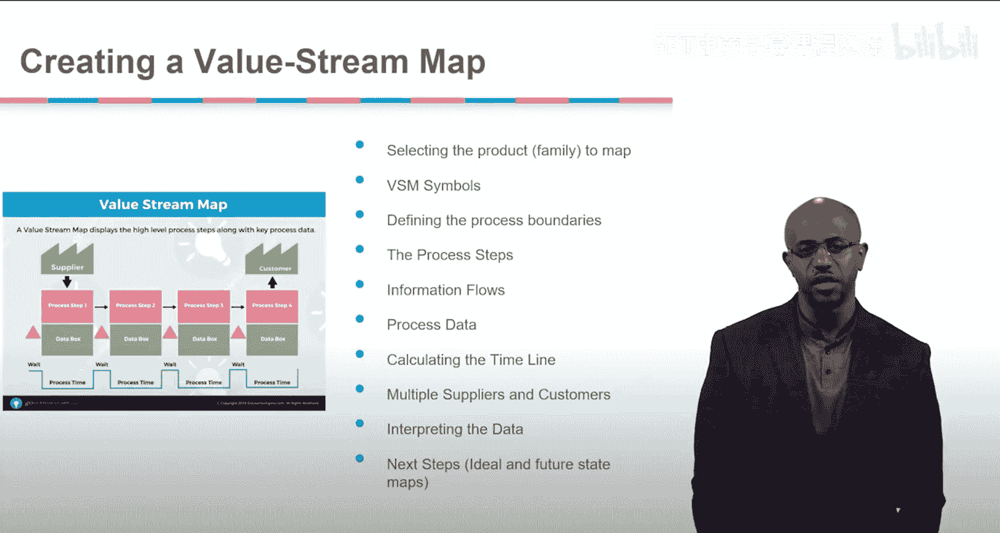

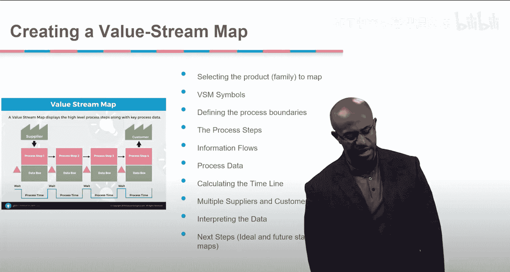

价值流映射始于供应商和客户。你和你的企业有一个供应商，然后你有一个客户。这是一个非常高层的视图，它只显示了流程步骤1、2、3、4。这个示例来自Go Lean Six Sigma网站。

在右侧，你可以看到创建价值流映射时需要关注的事项：选择产品系列、选择要映射的产品（即系列）、价值流符号（确保理解在哪里使用什么符号）、定义流程边界、流程步骤、信息流、流程数据、计算时间线（时间线中会有闲置时间等）、处理多个供应商和客户，以及解读数据。最后，下一步是理想的未来状态。你也希望能够说：这是当前的价值流，这是未来的价值流。客户旅程映射也是如此。

深入探讨这一点，以便我们能谈谈可能的暗数据。从高层看，你只需识别“等待、等待、再等待”。你需要识别此类闲置时间。如果你处于实时环境，比如在工厂或存在流程的公司，你需要思考：我们在哪里损失了价值？有时你需要一个质量检查点，但有时质量检查点可以沿流程线向下移动，这是你需要思考的地方：我们可以在哪里精简流程？我们如何赢得减少浪费的权利？

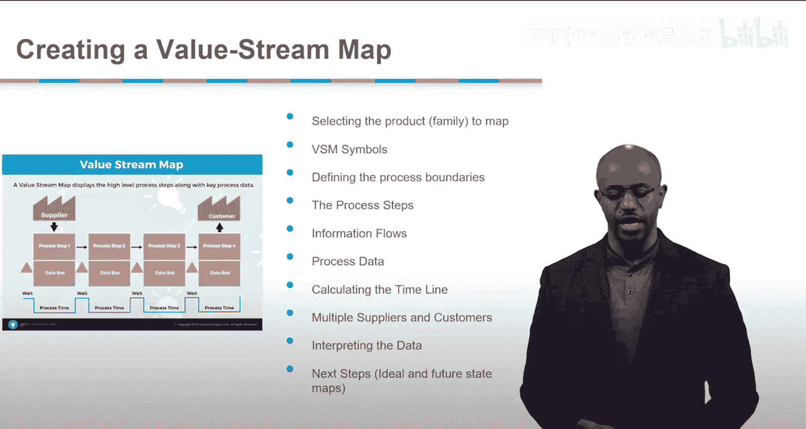

如果你上过精益六西格玛课程，你会真正理解你希望在这些流程中的哪些地方减少浪费。有时技术可以升级以减少流程，在某些情况下甚至可以完全移除流程。例如，在过去，如果你想进行客户关系管理，你需要文件柜，人们主要通过翻阅文件柜来了解与特定客户的往来情况。现在我们有了CRM系统，你只需在系统中查找，就能看到客户的完整历史，这减少了许多你必须执行的手动流程。这些都是你想要捕获的数据点，以帮助你的公司在可能的地方做得更好。

**自动化原则**：只要有可能，就以负责任的方式实现自动化。自动化有助于减少浪费、创造价值并捕获数据。相反，在文件柜的例子中，你的数据就是纸上的内容和中间的人工操作流程，没有人能捕获这些信息。这些正是我们需要关注的重点。

这也正是我们在此聚焦价值流映射的原因。关注客户旅程映射、价值流映射，并理解我们如何能获取数据或为这两者精简流程，以聚焦于我们如何看待难以获取的数据，这是至关重要的事情。

## 总结

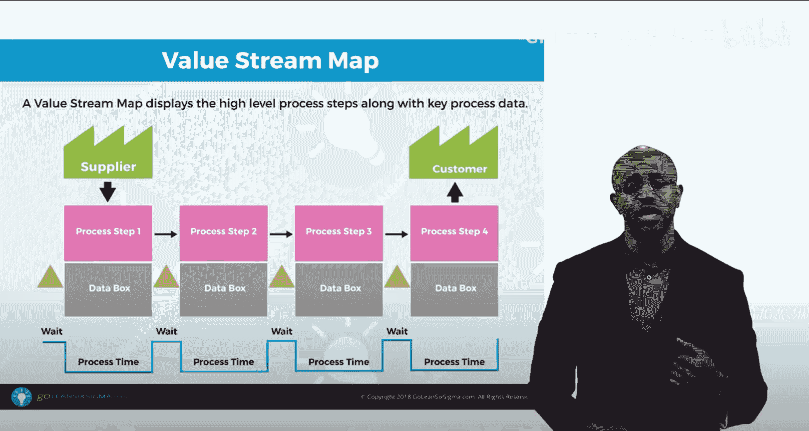

本节课中，我们一起学习了如何运用客户旅程映射和价值流映射这两种关键工具来弥合暗数据认知差距。我们探讨了创建旅程映射的步骤，分析了从客户动机到支付的全过程，并审视了不同行业背景下的映射示例。同时，我们了解了价值流映射如何帮助识别流程中的浪费和数据捕获机会。核心在于，通过系统地映射价值创造和交付过程，我们可以更清晰地发现那些未被记录或利用的数据点，从而为优化流程、提升客户价值和实现数据驱动决策奠定基础。