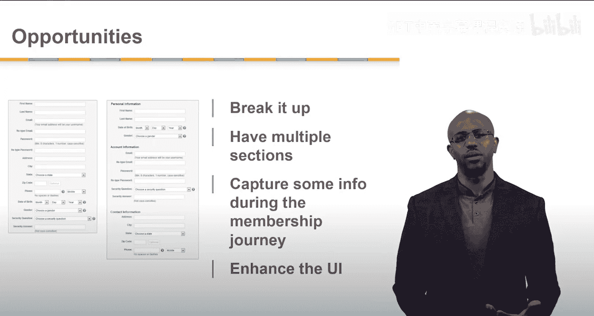
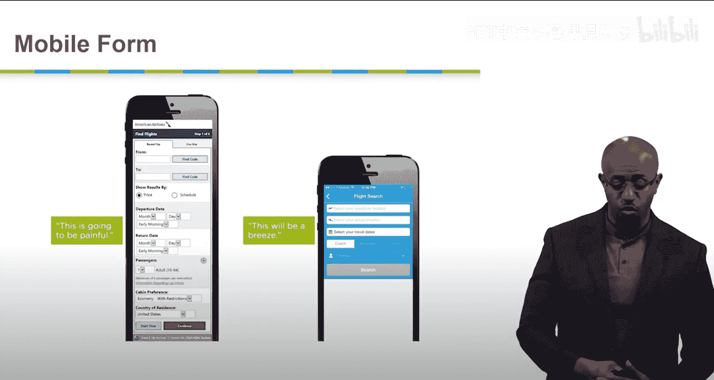
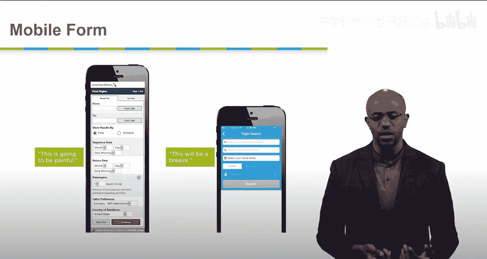
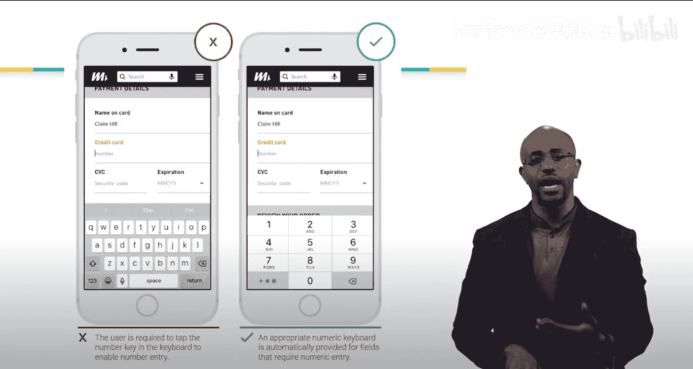
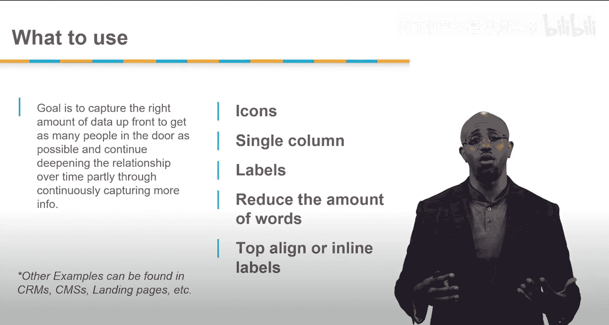

# 24：数据捕获示例 🎯

在本节课中，我们将通过具体示例来探讨数据捕获的设计原则。我们将分析网页表单和移动端表单的设计，理解如何通过优化用户界面来提升数据捕获的效率与质量，从而减少“黑暗数据”的产生。

## 概述：数据捕获的重要性

上一节我们介绍了数据捕获的基本概念，本节中我们来看看实际的设计示例。数据捕获是数据进入系统的起点，糟糕的设计会导致用户流失、数据不完整，进而产生大量无法利用的“黑暗数据”。优化捕获点对业务成功和数据质量至关重要。

## 网页表单设计示例

首先，我们来看一个经典的网页表单示例。网页表单是用户填写信息的主要界面，无论是旅行预订还是在线购物。

以下是一个来自Smashing Magazine的长表单示例。作者详细阐述了如何设计更好的网页表单。

这个表单虽然通过分类（个人信息、账户信息、联系方式）进行了内容组织，使其结构更清晰，但它仍然非常冗长。在现代设计中，更优的做法不仅是将表单分块，而且是分页显示。这可以减轻用户在单页上需要做出的决策负担，提升填写体验。

观察这个表单，其布局是“Z”字形：用户需要先向下填写，再向上移动，然后又向下。这种布局并不理想。同时，表单中大量使用了下拉菜单等元素，显得过时且繁琐。

这个表单有很大的改进空间。特别是在用户首次访问网站时，不应在初始阶段就要求填写所有详细信息（如姓名、邮箱）。更好的策略是，在用户已经确定要购买的商品或服务后，在结账流程的最后一步再收集这些信息。这样可以让用户专注于核心的购买决策。

## 移动端表单设计示例

接下来，我们看看移动设备上的表单设计。移动屏幕空间有限，设计需要更加简洁高效。

以下是移动表单的两个对比示例：

左侧是一个传统的长表单。在狭小的手机屏幕上，用户需要长时间滚动，并使用拇指频繁点击、下拉，体验非常不友好。

右侧是一个优秀的航班搜索表单示例。它设计简洁，巧妙地运用了图标和内联标签。整个表单几乎占满屏幕，清晰地展示需要填写的项目：出发地、到达地、旅行日期。用户点击搜索后，系统才会根据初步结果进一步询问更详细的信息（如舱位偏好）。这种设计符合用户决策流程——大多数人首先根据价格、直飞航班等因素进行筛选。

## 交互细节优化

表单设计不仅关乎布局，还涉及交互细节。输入框的键盘类型适配是提升体验的关键。

观察这个信用卡输入示例。在左侧设计中，点击“信用卡号”输入框会弹出字母键盘，用户需要手动切换到数字键盘，过程繁琐。而在右侧优秀的设计中，点击该输入框会直接弹出数字键盘，并配有绿色对勾提示，让用户可以快速、准确地输入。这种细微的优化能显著提升用户体验，让用户更顺畅地完成流程。

## 设计不佳的后果与优化原则

如果在数据捕获点设计不佳，会导致严重后果。你不仅会失去用户的兴趣，更会丢失大量数据。这直接关联到之前的课程内容：错误的设计会增加跳出率，降低用户留存率。

**公式：糟糕的数据捕获设计 → 高跳出率 + 低留存率 → 业务受损 + 数据仓库/数据湖数据不完整**

如果降低留存率，业务将受损。如果增加跳出率，业务和数据都会受损。数据仓库或信息库中数据量的减少和数据完整性的降低，会削弱你构建数据产品的能力，而这些产品本可以帮助你持续改进业务。

因此，在数据进入数据库之前，捕获点的设计就至关重要。大量“黑暗数据”正源于此——我们甚至没有到达能够正确捕获信息的阶段。

为了增强数据捕获能力，你需要思考数据的用途以及如何布局界面。

以下是优化数据捕获设计的一些核心原则：

*   **使用图标**：图标能直观地传达信息，减少认知负担。
*   **单列布局（尤其在移动设备上）**：单列布局符合自然的上下滚动阅读习惯。
*   **标签位置**：标签可以放在输入框上方或作为内联提示。内联标签通常更节省空间，但有时上方标签更合适，特别是在避免形成多列布局导致用户视线左右移动时。

这些原则同样适用于CRM系统、内容管理系统和落地页设计。核心目标是：**在初始阶段捕获适量的数据**。

你需要专注于吸引尽可能多的用户进入流程，并在此基础上持续改善用户关系，逐步捕获更多信息。如果一开始要求的信息过多，你会吓跑用户；如果要求的信息过少，你将无法有效地为用户提供服务。

## 总结

本节课中，我们一起学习了数据捕获的实际设计示例。我们分析了网页和移动端表单的优劣，理解了优化交互细节（如键盘适配）的重要性。我们认识到，糟糕的捕获设计会直接导致用户流失、数据不完整，从而滋生“黑暗数据”，并最终影响基于数据构建的产品和业务决策。因此，精心设计数据捕获点是构建高质量数据资产、减少“黑暗数据”的第一步。

