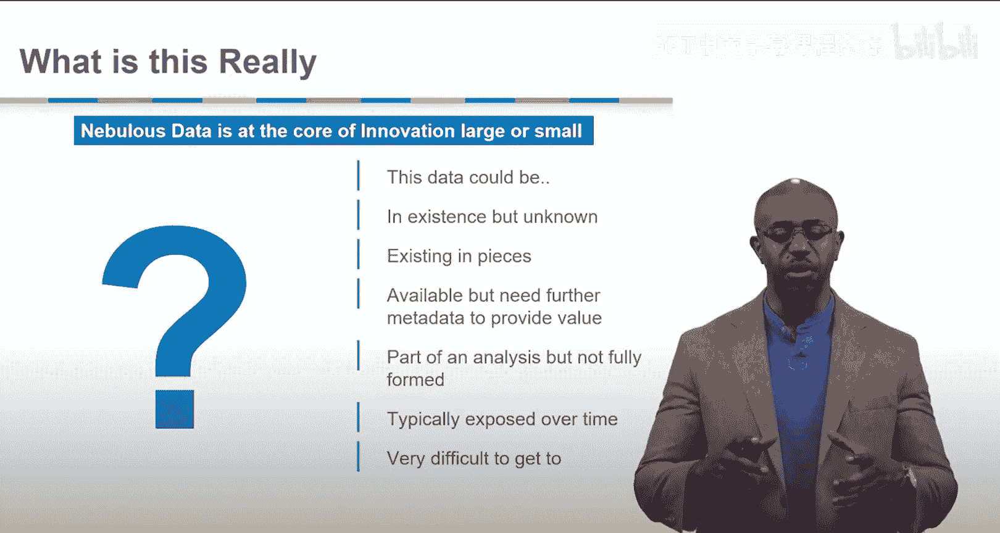
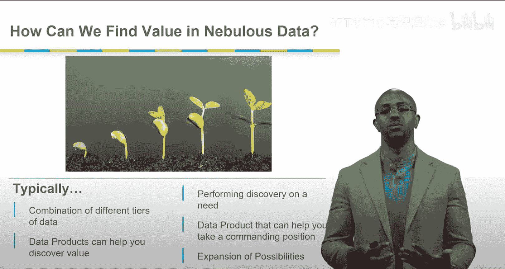

# 28：模糊数据概览 🔮

在本节课中，我们将聚焦于**模糊数据**。这是暗数据分类中的第五级，也是最后一级。这类数据通常最为抽象和难以捉摸，但它往往是创新的核心源泉。

上一节我们介绍了难以获取的数据，本节中我们来看看数据光谱中最末端的模糊数据。

## 什么是模糊数据？

模糊数据是指我们**完全未知**且**未意识到其需求**的数据。它可能以多种形态存在：
*   它可能存在于网络上，也可能并非电子形式。
*   它可能仅存在于我们的脑海中。
*   它可能需要在未来，当我们拥有更先进的技术或更深的理解时，才被创造或认知。

这类数据通常在一个解决方案被创建后，我们从中学习并开始理解时，才会被识别和发现。它需要好奇心、创造力和想象力才能触及。

## 模糊数据的价值与定位

模糊数据通常是创新的核心。为了从中发现价值，我们需要遵循一个过程。

以下是发现模糊数据价值的典型路径：
1.  **利用已知数据**：首先，你需要处理和使用已被捕获的数据、生成的数据。
2.  **探索未知领域**：然后，探索那些未被捕获和难以获取的数据。
3.  **触及模糊数据**：完成前两步后，你才能开始触及模糊数据领域，从而获得更具增益性的创新和更有用的数据产品。

这个过程能帮助你在市场或环境中取得领先地位。然而，在项目初始阶段，你并不需要急于获取模糊数据，而应将其纳入规划。

## 视角转换：从障碍到矿藏

让我们回顾之前讨论过的幻灯片内容，以更好地理解模糊数据。

不要将暗数据和模糊数据单纯视为难以获取的、隐藏在地下的障碍。相反，请将其视作一座**钻石矿**。

考虑到大约65%的暗数据隐藏在网络内部，你需要理解的是，其中某些组成部分需要你去主动获取、创造，或者认识到它们可能是人们完全未曾意识到的事物。

---

**本节课总结**

本节课中，我们一起学习了暗数据分类的第五级——**模糊数据**。我们了解了它的抽象特性、作为创新核心的潜力，以及通过系统性的数据利用过程来发掘其价值的路径。关键在于转变视角，将模糊数据视为待开发的宝贵矿藏，而非不可逾越的障碍。