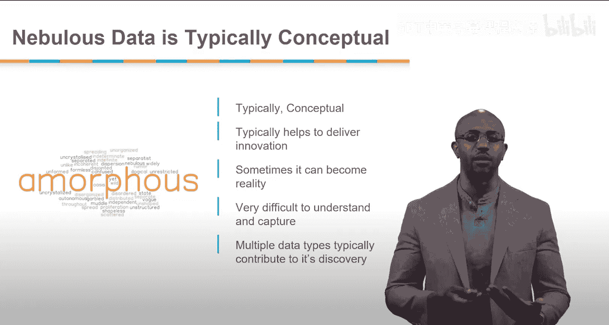
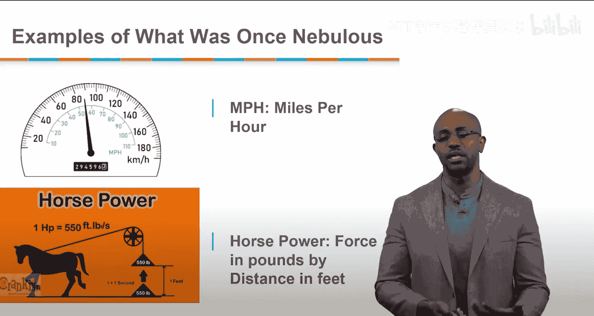
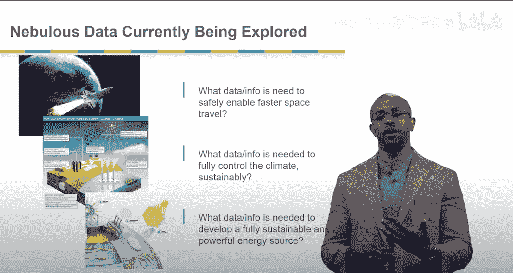

# 黑暗数据迁移与架构：第29课：模糊暗数据示例 🌀

在本节课中，我们将通过具体示例来探讨“模糊暗数据”的概念。模糊暗数据通常指那些形态不定、难以捉摸的信息，只有当你深入探究并展现出足够的好奇心时，才能将其从“不存在”、“未被发现”或“需要被揭示”的状态中挖掘出来。这类数据通常是概念性的，有助于推动创新，有时甚至能转化为现实。我们将在示例中看到，正是暗数据催生了过去不存在、但如今我们日常生活不可或缺的产品。

## 从历史中汲取灵感：速度与动力的概念 🐎

上一节我们介绍了模糊暗数据的基本概念，本节中我们来看看一些历史上的具体例子。其中一个核心例子是“英里每小时”这个概念。在汽车出现之前的马车时代，人们用“马力”来衡量发动机的扭矩功率，其基准正是一匹马所能产生的力量。因此，当我们今天说汽车引擎有“多少匹马力”时，其背后是基于一度完全模糊、未被量化的暗数据构建的。

`马力 (Horsepower) = (扭矩 × 转速) / 常数`

## 正在探索中的当代模糊暗数据 🚀

了解了历史范例后，我们转向当前正在被积极探索的一些模糊暗数据领域。这些领域代表了人类面临的前沿挑战，其解决方案依赖于挖掘和转化大量尚未明晰的数据。

以下是几个关键领域：

*   **更快的太空旅行**：例如“曲速引擎”或扭曲时空的概念。目前尚无人实现，因为研究者们正在收集更多信息，以探索其可行性。
*   **完全可控且可持续的气候变化管理**：全球正在探索以更自然的方式（如植树）来缓解全球变暖，但实现精确、全面的气候控制仍是一个充满未知数据的领域。
*   **完全可持续的强大能源**：风能、太阳能等依赖环境条件，存在间歇性。核能依赖铀矿，资源有限。寻找一种独立、强大且可持续的能源，是当前研究的焦点，其中包含大量待解的模糊数据。

## 创新如何照亮黑暗：从蒸汽机到摩天大楼 🏗️

最后，让我们回顾一些已经成功从模糊暗数据转化为现实的“经典”与“现代”案例。我们之前讨论过飞行和汽车，其中包含了海量的暗数据。

在此之前，**蒸汽机**的发明带来了社会巨变，提高了工厂生产力，并催生了火车等交通工具。另一个关键创新是**钢铁在建筑中的整合**。基于铁和其他矿物的钢材应用，使我们能够建造摩天大楼和极其坚固的大型建筑结构。

以下是两个现代工程的典范：

*   **中国南昌的“绿地中心”**：这座建筑拥有人工瀑布从侧面倾泻而下，是此类建筑中的杰作。
*   **迪拜的哈利法塔**：作为工程奇迹和全球最高建筑之一，它代表了建筑技术的巅峰。

这些成就表明，在某个阶段，它们背后也曾是大量的模糊数据。正是人们探索新方法、追求更好更大的事物的好奇心，驱使他们深入挖掘这些数据，最终将其从“模糊”变为“清晰”，从“概念”变为“现实”。

## 课程总结 📝

本节课中，我们一起学习了模糊暗数据的实际示例。我们从历史概念（如马力）出发，观察了当前正在探索的前沿领域（如太空旅行和可持续能源），最后回顾了已成功实现的创新（如蒸汽机和摩天大楼）。这些例子共同阐明了一个过程：通过对未知领域的好奇与探索，模糊的暗数据能够被捕获、生成并最终转化为驱动社会进步的切实创新。