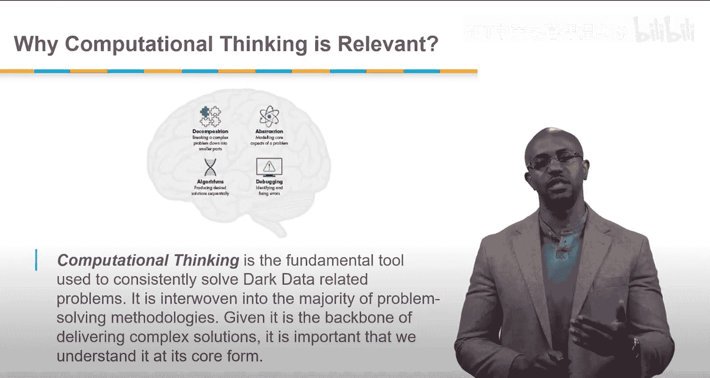
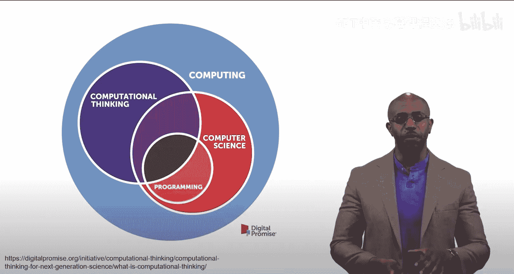

# 30：计算思维综述 🧠

在本节课中，我们将聚焦于计算思维，并对其概念进行简要概述。

计算思维是一种解决问题的工具，几乎可以应用于任何领域，旨在以高效且有效的方式完成目标。计算思维已存在很长时间，但卡内基梅隆大学Jeannette Wing在2006年发表的文章使其焕发新生，并成为本课程阅读材料的一部分。然而，计算思维本身对于几乎所有问题解决、项目管理方法论、数据科学、计算机科学等各类STEM学科乃至管理学科都至关重要。它是所有这些学科内部共有的根本性基础。

## 计算思维与黑暗数据的关系

上一节我们介绍了计算思维的基本概念，本节中我们来看看它与黑暗数据的关系。当我们思考之前讨论的所有五个类别和层级时，所有五个层级都需要运用计算思维，才能从任何一个层级中获取价值。这不仅仅是算法、公式和代码的问题，你必须能够系统地思考问题，并以一种能帮助你获取价值的方式应用它。因此，将计算思维视为基础工具，如果我们要开发利用黑暗数据，就必须理解如何通过一个逐步的过程来解决这些问题并向前推进。

## 计算思维在更广泛领域中的位置

如前所述，计算思维广义上属于“计算”范畴。计算就是达成解决问题或执行任务下一步的过程。当我们审视计算思维时，它包含了计算机科学的一部分、编程的一部分，并内嵌于计算之中。你可以将数据科学、生物学、建筑施工等任何领域置于此范畴，它们都涉及计算思维。

## 计算思维与战略交付框架

现在，我们进入如何战略性地交付成果的领域。计算思维也能很好地融入敏捷和精益框架中，例如敏捷宣言，以及六西格玛的DMAIC（定义、测量、分析、改进、控制）等流程。计算思维包含以下四个核心支柱：

以下是计算思维的四个核心组成部分：
*   **分解**
*   **模式识别**
*   **抽象**
*   **算法**

我们将在下一课中对这些组成部分进行详细讨论。

本节课中，我们一起学习了计算思维的定义、其作为跨学科基础工具的重要性，以及它如何与黑暗数据的开发利用和各类战略交付框架紧密结合。理解计算思维是系统化解决复杂问题、从数据中提取价值的关键第一步。