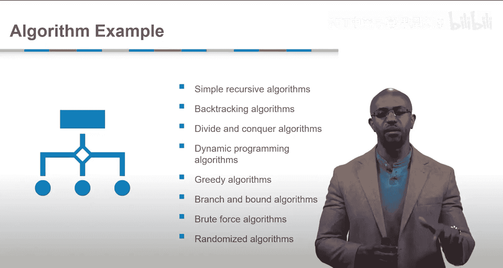
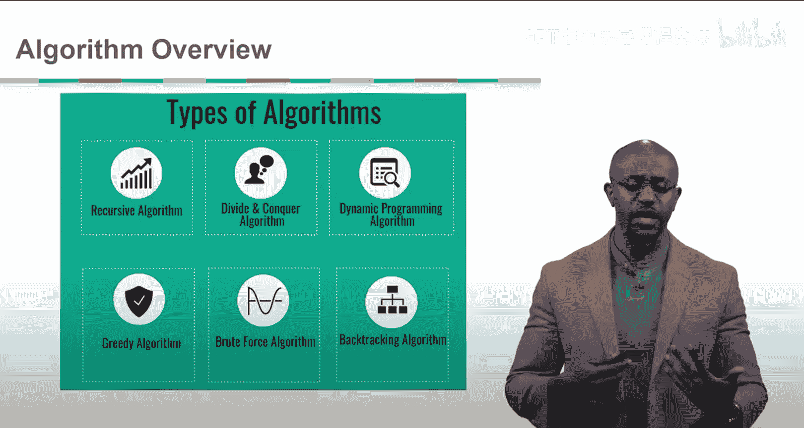

# 计算思维应用实例：P32：四大要素实例解析

在本节课中，我们将聚焦于计算思维四大要素的具体应用实例。我们将通过分解、模式识别、抽象和算法这四个方面，结合实例来理解它们在实际问题解决中的运用。

## 分解实例

上一节我们介绍了计算思维的整体概念，本节中我们来看看分解的具体例子。分解是将复杂问题拆解为更小、更易管理的部分的过程。

以下是分解的一些常见实例：
*   **迭代交付**：以迭代的方式逐步交付产品功能。
*   **开发迭代**：在开发过程中进行多次循环改进。
*   **迭代冲刺**：例如在敏捷开发中，通过短周期的冲刺来完成部分工作。
*   **概念验证**：在开始全面构建产品或交付完整产品之前，先构建并交付一个可工作的概念验证模型。
*   **最小可行产品**：构建一个功能最小但可用的产品版本。一个常见的比喻是“边造飞机边开飞机”。更现实的做法是，先构建一个可以后续扩展的小型飞机。

构建最小可行产品的正确且负责任的方式，是为可扩展性而设计，但首个产品本身必须是可用的。

## 模式识别实例

理解了如何分解问题后，我们来看看如何在这些部分中发现规律，即模式识别。模式识别涉及在数据或问题中观察趋势、规律或相似性。

以下是模式识别的一些实例：
*   **数据排序**
*   **数据分类**
*   **观测结果的对称性**
*   **可比较的日期、元素、集合与类别**
*   **数据分组**

这些都是通过观察和收集数据来进行模式识别的方法。

## 抽象实例

当我们识别出模式后，下一步是进行抽象，即过滤掉不重要的细节，聚焦于问题的核心。这使我们能够从模式识别过渡到更通用的解决方案。

抽象始终是计算思维的支柱之一，因为它要求我们明确“我们在做什么”以及“方向是什么”。评估、分析等都属于这一过程。

以下是抽象的一些关键实例：
*   **数据分析**：检查大型样本集。
*   **趋势测试**：验证观察到的模式是否构成趋势。
*   **数据可视化**：将数据转化为视觉形式，以便更好地理解和使用。

## 算法实例

最后，在完成抽象并确定了核心问题后，我们需要设计一步步的解决方案，即算法。算法是最终可交付的解决方案步骤。

以下是一些核心算法实例：
*   **简单递归算法**
*   **回溯算法**
*   **分治算法**
*   **动态规划算法**
*   **贪心算法**
*   **分支定界算法**

此外，像**斐波那契数列**这样的数学概念本身也体现了一种算法，因为数列中的每个数字都是基于前两个数字计算得出的。

为了更深入地理解算法，我们将在下一课中对这六种算法进行更详细的探讨。

## 总结

本节课中，我们一起学习了计算思维四大要素——分解、模式识别、抽象和算法的具体应用实例。我们看到了如何通过迭代和MVP进行分解，如何通过排序和分类识别模式，如何通过数据分析和可视化进行抽象，以及介绍了几种核心算法类型。这些实例为我们接下来深入探讨具体算法奠定了基础。