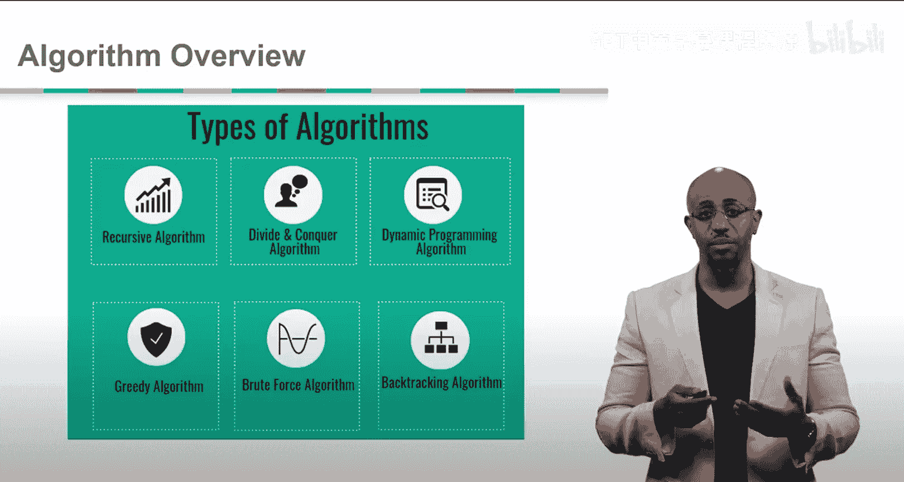
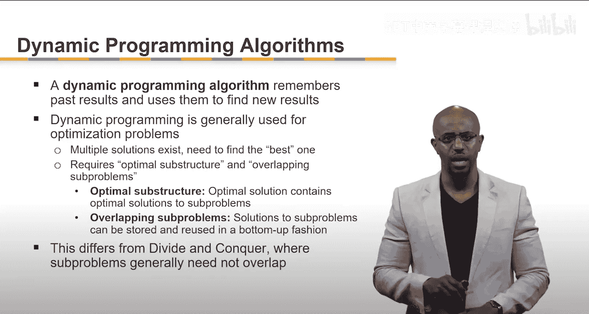
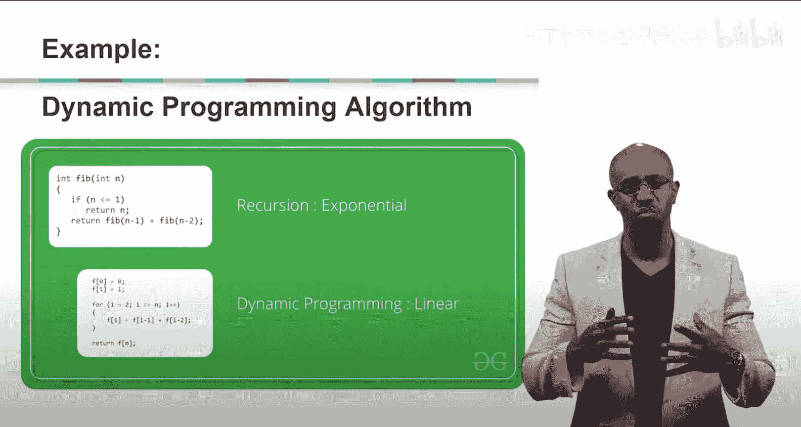
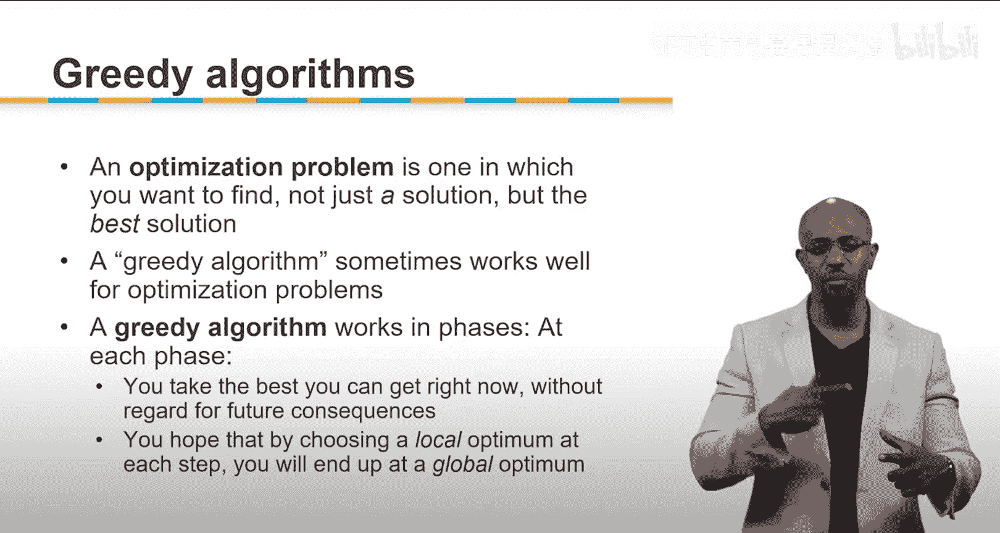
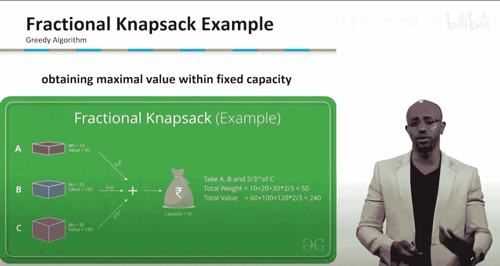
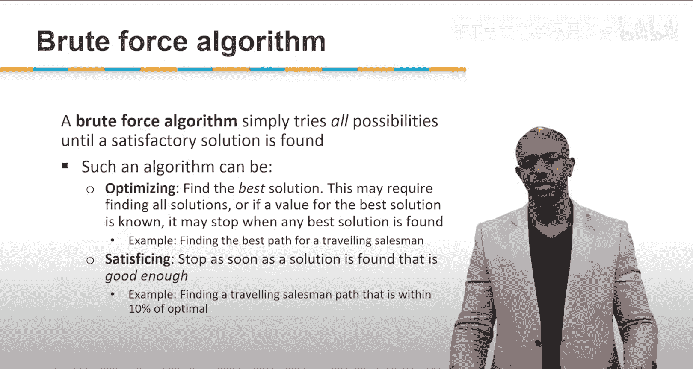
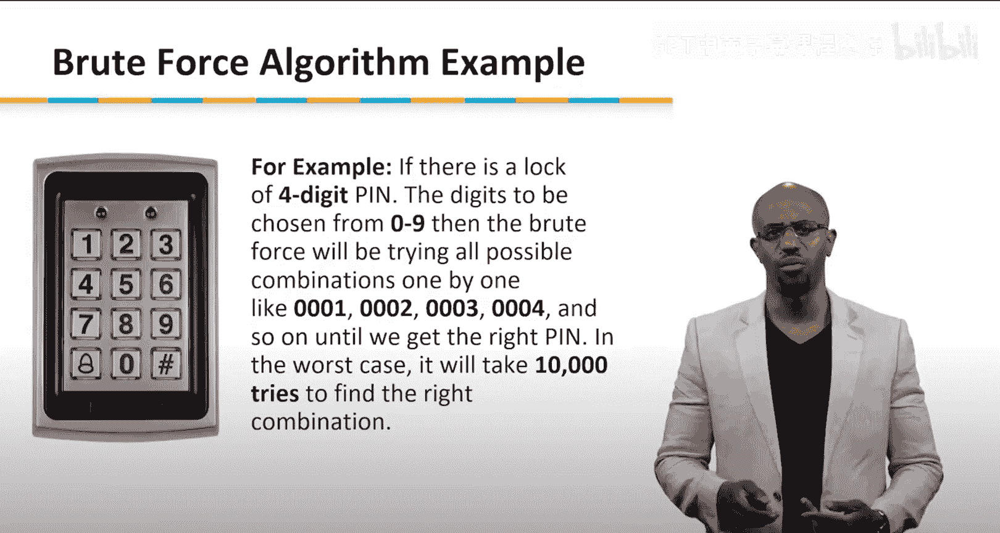
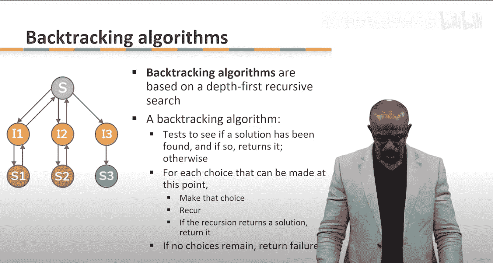

# 33：六种核心算法类型解析

在本节课中，我们将通过审视几种标准算法，来学习算法思维的一些实例。我们将重点介绍六种算法类型，它们对于从暗数据中获取价值、进行计算思维练习以及利用技术解决暗数据相关问题都很有帮助。

## 递归算法 🔄



上一节我们介绍了课程概述，本节中我们来看看第一种算法：递归算法。这是一种相对简单基础的算法，其核心在于一个过程会反复执行，直到达到某个条件、遇到问题或得到输出为止。它通常需要将问题分解为更简单的子问题。

一个典型的例子是检查列表中某个值是否出现。其基本思想是使用条件判断，并递归地调用自身来处理列表中的元素。

以下是递归算法的一个基础代码结构示例：

```python
def recursive_function(n):
    if n <= 1:          # 基线条件
        return 1
    else:               # 递归条件
        return n * recursive_function(n-1)
```

在这个例子中，如果输入值 `n` 小于或等于1，函数直接返回1。否则，它会调用自身处理 `n-1`，从而实现递归计算。这种方法可用于遍历列表或执行需要重复步骤的计算。

## 分治算法 ✂️

接下来，我们进入分治算法。这种算法包含两个明确步骤：首先将问题“分”解为更小的子问题，然后“治”理这些子问题以找到解决方案或识别失败点。

分治思想在排序算法中应用广泛。

以下是几种经典的分治排序算法：
*   **快速排序**：选择一个基准值，将数组分为两个子数组（小于基准和大于基准），然后递归地对子数组排序。
*   **归并排序**：将数组持续对半分割，直到成为单个元素，然后逐步合并相邻的子数组，并在合并过程中排序。
*   **冒泡排序**：反复交换相邻的无序元素，虽然效率不高，但体现了通过局部操作（“治”）最终解决整体问题（“分”治完成）的思想。

在处理需要重组或转换数据的问题时，可以运用这种“分而治之”的计算思维。

## 动态规划算法 🧩

现在，让我们探讨动态规划算法。现实世界中的问题往往很复杂且具有多义性，动态规划正是处理这类问题的强大工具。当需要解读数值、遍历列表、创建新值并存储以备后用，或者用某个值来决定其他值时，就可能用到它。

动态规划算法通常包含两个关键特性：
1.  **最优子结构**：一个问题的最优解包含其子问题的最优解。
2.  **重叠子问题**：在递归求解过程中，相同的子问题会被多次计算。



这与分治算法不同，分治的子问题通常是独立的。动态规划通过存储（记忆化）子问题的解来避免重复计算，从而高效解决问题。

考虑斐波那契数列的计算：
*   **指数递归法（低效）**：`F(n) = F(n-1) + F(n-2)`，其中 `F(0)=0`, `F(1)=1`。这会重复计算大量子问题。
*   **线性动态规划法（高效）**：使用数组或变量从 `F(0)` 和 `F(1)` 开始迭代计算并保存中间结果。

动态规划非常灵活，可以融入递归、暴力搜索等其它算法思想，是解决复杂优化问题的核心方法。

## 贪心算法 🎯



我们将要讨论的第四种算法是贪心算法。它在动态规划中也可能用到。贪心算法的优点在于，它能在约束条件下，通过每一步做出局部最优选择来试图找到全局最优解。

这对于项目规划或从未知数据源提取信息非常有用，因为你可能只清楚下一步（“滚动波”）的最佳选择。

一个经典例子是**分数背包问题**：在固定容量内选择物品（可分割），使总价值最大。



**问题设定**：容量为50。物品A（重10，值60）、B（重20，值100）、C（重30，值120）。
**贪心策略**：按单位重量价值（价值/重量）降序选择。计算过程如下：
1.  物品A：价值/重量 = 6
2.  物品B：价值/重量 = 5
3.  物品C：价值/重量 = 4
**选择**：先拿全部A（重10，值60），再拿全部B（重20，值100），此时总重30。剩余容量20，可以拿2/3的C（重20，值120*(2/3)=80）。
**总价值**：60 + 100 + 80 = 240。

贪心算法在这里直接给出了最优解。它对于快速构建解决方案和从暗数据中创造初始价值非常有效。

## 暴力搜索算法 💥



下面介绍暴力搜索算法。这是一种非常基础的算法，本质上是尝试所有可能性，直到找到解决方案或确认无解。

其核心是**遍历所有可能的解空间**，并通过比较找到最优或满足条件的解。例如，解决旅行商问题（寻找最短路径）时，可以尝试所有可能的路线排列。

暴力搜索的主要问题是**时间复杂度极高**。对于大规模或复杂数据集，它可能带来巨大的系统负载和极慢的处理速度。



一个简单的例子是破解一个4位数字密码（每位0-9）。最坏情况下需要尝试 `10^4 = 10000` 次。在实际应用中，可以通过上下文信息（如排除全相同数字）来减少尝试次数，从而优化性能。因此，它适用于小规模问题或作为快速原型验证的工具，但在处理复杂数据时需要谨慎使用。

## 回溯算法 🧭



最后，我们来看回溯算法。它基于深度优先搜索，并融入了递归思想。

算法沿着一条路径深度探索，如果发现当前路径不能得到有效解，就“回溯”到上一个决策点，选择另一条路径继续尝试，直到找到解或穷尽所有可能。



回溯算法通常使用递归和条件判断（if-else）来实现。一个著名的例子是**骑士巡游问题**：在8x8棋盘上，按照国际象棋骑士的走法（L形），要求访问每一个方格恰好一次。

算法会从起点开始，尝试所有可能的移动路径。如果某条路径走到死胡同（无合法移动且未遍历完所有格子），则回溯到上一步，尝试另一种走法。这个过程持续进行，直到找到一条成功的巡游路径或尝试完所有可能性。

---

本节课中我们一起学习了六种核心算法类型：通过自我调用来解决问题的**递归算法**；先分解后合并的**分治算法**；存储子问题解以避免重复计算的**动态规划算法**；每一步追求局部最优的**贪心算法**；尝试所有可能性的**暴力搜索算法**；以及深度探索并适时折返的**回溯算法**。理解这些基础原理，是运用算法思维从暗数据中提取和创造价值的关键第一步。