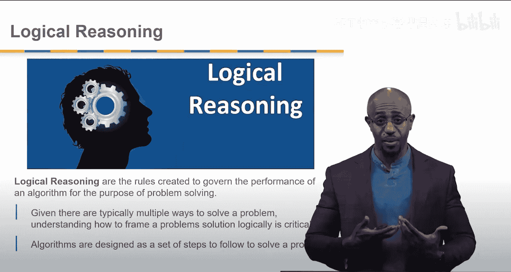
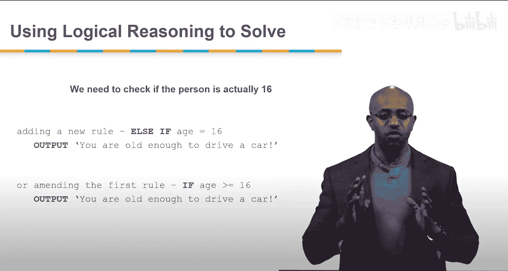

# 黑暗数据迁移与架构：第34课：暗数据逻辑推理 🧠

在本节课中，我们将通过一个基础示例，学习逻辑推理及其在算法中的应用。我们将探讨如何识别和优化算法中的逻辑问题，确保其正确性和高效性。

当我们思考逻辑推理时，它指的是遵循一套明确的规则来得出结论或执行任务。在算法和计算思维中，逻辑推理是指导我们从起点（A）到达终点（Z）的核心。通常，一个问题有多种解决方案，每种方案可能产生不同的结果，并在性能和设计上有所差异。因此，理解并应用逻辑推理对于设计高效、可靠的算法至关重要。

上一节我们介绍了逻辑推理的基本概念，本节中我们来看看一个具体的算法示例及其潜在问题。

## 一个驾驶年龄验证算法 🚗

假设你16岁，开始学习驾驶汽车。我们可以设计一个简单的算法来验证用户是否达到驾驶年龄。该算法的基本流程如下：
1.  用户在一个表单中输入年龄。
2.  算法接收输入。
3.  算法根据条件判断并输出结果。

这个判断过程可以用一个 `if-else` 条件语句来描述：

```python
# 伪代码示例
age = 用户输入的年龄
if age > 16:
    print("你已足够年长，可以驾驶汽车。")
else:
    print("你太年轻，不能驾驶汽车。")
```

## 识别算法中的逻辑缺陷 🔍



观察上述算法，你会发现其中存在一个问题。算法只检查了年龄是否大于16岁或小于16岁，但遗漏了**恰好等于16岁**的情况。根据最初的描述，16岁是允许驾驶的起始年龄，因此这个算法对于16岁的用户会错误地输出“你太年轻，不能驾驶汽车”。

以下是该算法可能失败的情况：
*   当用户输入年龄为16时，算法会错误地判定为“太年轻”。
*   这导致算法逻辑不完整，未能完全满足业务规则（16岁可驾驶）。

## 应用逻辑推理进行优化 ⚙️

为了解决这个问题，我们需要修正算法的逻辑。这里有两种主要的优化思路：

第一种方法是增加一个专门检查年龄是否等于16的条件分支：

```python
age = 用户输入的年龄
if age > 16:
    print("你已足够年长，可以驾驶汽车。")
elif age == 16: # 新增的检查
    print("你已足够年长，可以驾驶汽车。")
else:
    print("你太年轻，不能驾驶汽车。")
```

第二种方法是修改原始条件，使用“大于或等于”运算符，这样就能在单个条件中涵盖16岁及以上的所有情况：

```python
age = 用户输入的年龄
if age >= 16: # 优化后的条件
    print("你已足够年长，可以驾驶汽车。")
else:
    print("你太年轻，不能驾驶汽车。")
```

从逻辑推理和算法性能的角度来看，**第二种方法更优**。虽然在这个简单例子中差异不大，但设想一下需要处理海量数据或复杂条件的算法。第二种方案通过一个条件同时检查两种情况，没有增加算法的长度和判断分支。这遵循了优化算法的核心原则：寻找最高效、最简洁的路径，专注于最具价值的解决方案，尤其是在处理可能涉及数十亿种配置的大型算法时尤为重要。



本节课中我们一起学习了逻辑推理在算法设计中的应用。我们从一个驾驶年龄验证的示例出发，识别了原始算法中遗漏边界条件（年龄等于16岁）的逻辑缺陷。接着，我们探讨了两种修正方案，并分析了为何使用 `>=`（大于或等于）运算符的方案在逻辑正确性和算法性能上更优。关键在于，良好的逻辑推理能力能帮助我们设计出更健壮、更高效的算法。