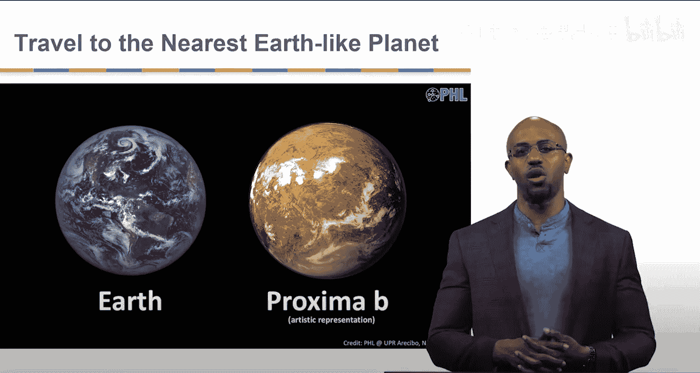
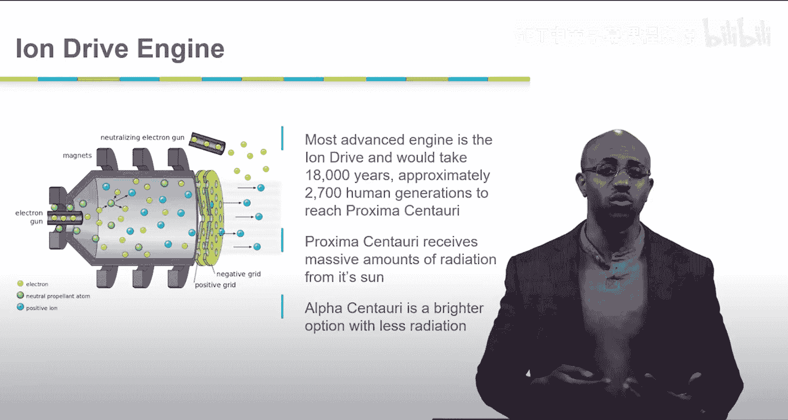

# 35：太空旅行技术难题 🚀

在本节课中，我们将深入探讨“比邻星B太空旅行”的问题陈述。我们将面临一项独特任务：设计从地球前往比邻星B的星际航行任务。

## 概述

我们目前是虚构公司“拉蒂摩尔工业”的员工或领导者。公司今年的目标是建造一艘能够以接近光速（如果可能则更快）飞行的航天器，并在五年或更短时间内抵达比邻星B。分析这个问题陈述时，我们会发现存在大量**黑暗数据**，需要进行大量探索、理解和学习，以获取所需信息。

## 核心任务目标

在抵达比邻星B时，拉蒂摩尔工业公司希望确保完成以下五项核心任务：

1.  **安全抵达**。
2.  **建立一个自给自足的定居点**。
3.  **船员在航行途中能在航天器上实现自给自足**。
4.  **在整个旅程中保持通信能力**。
5.  **能够将数据和发现传回地球**。
6.  **航天器和船员需要能够防御威胁**。

防御威胁和抵达后的可持续性是关键，因为船员抵达后可能不会返回地球，而是选择在那里开启全新的文明。这是你在思考这个问题时可能需要提出的疑问之一。

## 探索与设计的关键考量

为了帮助你进行探索并构思设计，或制定创建此类航天器所需的逐步计算流程，以下是一些你可能需要理解和学习的方面。

### 目标星球：比邻星B

比邻星B围绕一颗红矮星运行。该星系实际上有三颗恒星，其中红矮星是最小的一颗。比邻星B位于宜居带内。然而，其主星比邻星是一颗耀星，会释放强烈的电磁辐射。星球表面温度持续低于零度。它与地球的距离是**4.2光年**，相当于**四万亿公里**。这些是你在探索黑暗数据并制定计划时需要思考的因素。

### 推进系统：如何抵达

我们需要思考使用何种引擎才能抵达目的地。关于推进方式，有多种可能性。

*   **现有技术**：例如燃烧发动机。目前已经开发并部署了**离子推进器**，这是近代最强大、最先进的引擎之一。
*   **概念与开发中的技术**：还有其他一些概念性或正在开发中的引擎可以助力我们的旅行。

以下是几种可能的动力来源或推进方案：

1.  **太阳能电池**。
2.  **磁帆**。
3.  **M驱动**（正在开发中）。
4.  **通过磁重联达到近光速**（基于爱因斯坦相对论的理论，理论上可达**99.9%** 光速）。
5.  **虫洞**（是否存在？）。
6.  **暗物质火箭**（理论性质，但利用暗物质应能提供足够动力）。
7.  **核聚变反应堆**。

就抵达比邻星而言，核聚变反应堆的概念可能使我们在大约**50年**内抵达，这虽然未达到我们的五年目标，但已优于现有引擎。我们现有的引擎仍需约**27,000年**，显然超出了可接受范围。

因此，在思考我们需要做什么、如何建造、需要整合哪些要素，甚至需要完成哪些步骤时，你必须审视未知领域，理解黑暗数据，并感知现有的可能性。

## 其他需要考虑的因素

如果你在线查找信息，会发现诸如电磁推进、暗物质或黑洞、虫洞、离子驱动、核裂变等方法。你需要思考哪种方式最佳。此外，还有一些其他需要考虑的事项：航天器必须离开地面，因此火箭是必要的。但如果使用火箭，其背负的重量将非常巨大。有人提出过类似在月球上建立**太空船工厂**的想法，这类设想都值得思考，因为月球能提供低重力环境。

## 总结

本节课中，我们一起学习了“比邻星B太空旅行”这一复杂问题陈述。我们明确了从地球安全抵达比邻星B并建立可持续定居点的五项核心任务目标。同时，我们探讨了在实现这一目标过程中需要面对的关键技术挑战，特别是推进系统的选择，从现有技术到各种前沿理论概念。最后，我们还提及了发射方式、建造环境等其他需要考虑的复杂因素。解决这个问题需要系统地探索大量未知的“黑暗数据”，并在此基础上进行创新设计。

请仔细阅读提供的文档，我们期待看到你的设计方案。感谢你的时间。