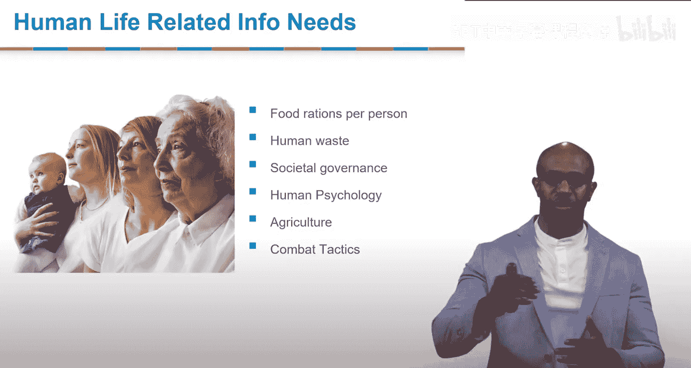

# 36：通用信息与实用技巧 🚀

在本节课中，我们将学习一些实用的技巧和通用信息，帮助你解决数据迁移与架构中的问题。本视频的重点是指导你如何利用公开可用的信息，通过查找、推导并将其添加到现有数据集中，从而生成第一层级的“黑暗数据”。我们将从与人类生活相关的信息需求开始，然后探讨空间与物理相关的概念。

## 人类生活相关信息需求

上一节我们介绍了利用公开信息构建数据集的基本思路。本节中，我们来看看在星际旅行场景下，需要考虑哪些与人类生存相关的核心信息需求。以下是一个帮助你开始思考的列表，并非详尽无遗：

*   **人均食物配给**：你可以在生存主义者网站或其他地方找到关于人类生物学和基本需求的信息。
*   **人类排泄物处理**：这是维持生命系统的重要环节。
*   **社会与治理**：考虑到旅程可能长达数年，船上人员需要在与地球控制中心协调的同时进行自我管理。例如，如何处理冲突、偷窃甚至更严重的攻击行为，都需要明确的治理规则。
*   **人类心理学**：长途太空旅行会带来独特的心理挑战。例如，如果旅程长达80-90年，船上将诞生“太空婴儿”，这些新生命并未自愿参与旅行，其心理适应是一大问题。即使是2年往返的旅程，也需要应对太空环境可能引发的精神错乱等问题。
*   **登陆后农业**：为在目标星球建立殖民地，必须规划农业系统。
*   **登陆后战斗策略**：需要制定应对未知、可能具有攻击性的外星生物的预案。
*   **星球探索**：如果一个星球能维持生命，那么其上存在某种生命形式的概率很高。我们需要充分理解这些概念，并计划如何通过计算步骤来规划和准备，最终将这些信息添加到我们的数据集中。

## 空间与物理相关信息

在考虑了人类自身需求后，我们还需要关注外部环境。本节中，我们来看看与太空旅行直接相关的物理和空间概念。以下是一些关键领域：

*   **量子力学**
*   **星际介质**：这对实际航行至关重要。
*   **防护与偏转**
*   **虫洞**
*   **粒子加速器**
*   **电磁学**
*   **引力**：引力影响巨大。它影响航行路径，过于接近大质量天体可能导致飞船被吸入。目标星球的引力过强可能压碎人体。引力还会影响**时间膨胀**。我们移动的速度以及引力本身都会影响时间流逝的速度。如果前往一个引力巨大的星球，那里的时间会比地球流逝得慢。这会影响我们对整个任务时间跨度的估算。
*   **宇宙射线**
*   **电磁驱动与曲速驱动**：这些是利用空间扭曲而非线性移动的潜在旅行方式。

接下来，我们简要了解一下星际介质，理解它为何重要以及如何将其数据化。

## 星际介质概览

以上我们列举了多种空间物理概念，现在让我们聚焦于星际介质，这是一个航行中必须面对的实际环境。下图提供了一个高级视图：

星际介质是指天体（如恒星）之间的空间。虽然它主要是空的，但并非绝对真空，其中存在物质，其主要成分是**氢**，占90%。此外，还有少量其他元素，**氦**占9%，**尘埃**占1%。这些尘埃是尺寸小于1微米的微量元素。想象一下，如果你的飞船以光速航行，即使撞上一个微米级的颗粒，也可能是灾难性的。因此，飞船必须具备适当的防护措施，这不仅是为了抵御星际介质，也是为了减少宇宙射线带来的辐射。

## 总结

本节课中，我们一起学习了如何通过整合公开信息来丰富数据集。我们首先探讨了星际旅行背景下人类生存所需的信息，如食物、治理、心理等。接着，我们转向外部环境，分析了空间与物理相关的关键概念，特别是引力和星际介质的影响。掌握这些信息并将其转化为结构化数据，是构建有效“黑暗数据”层、进行周密任务规划的基础。