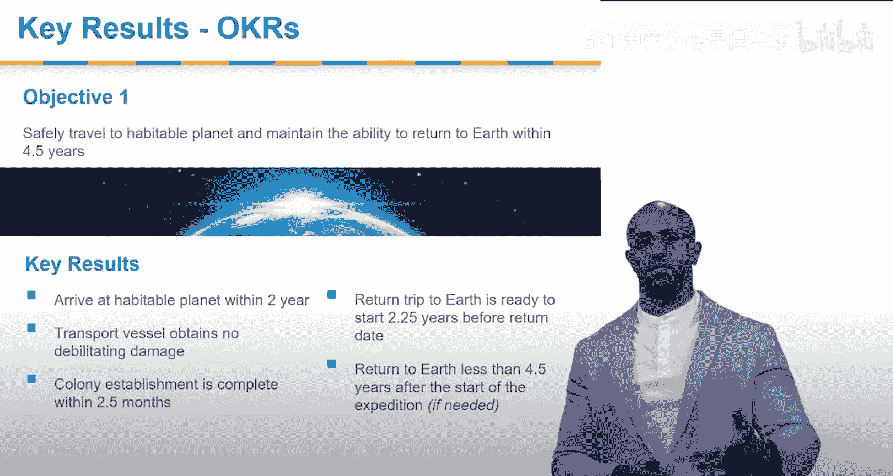
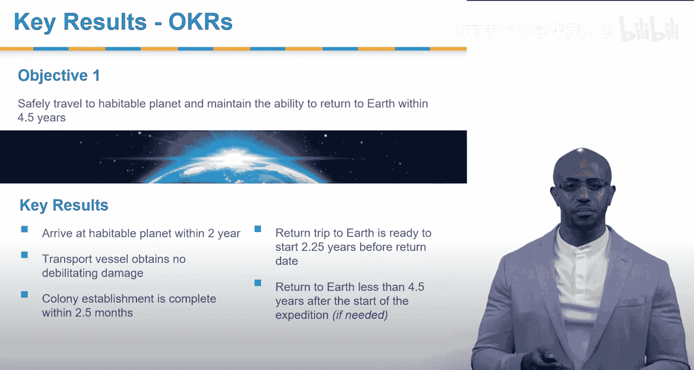
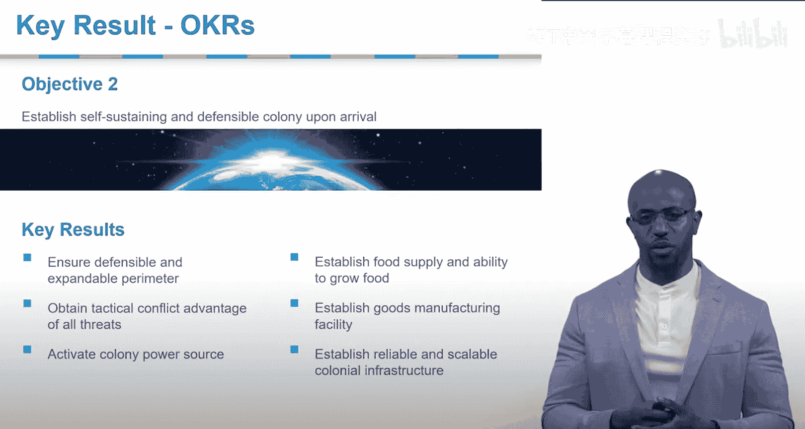
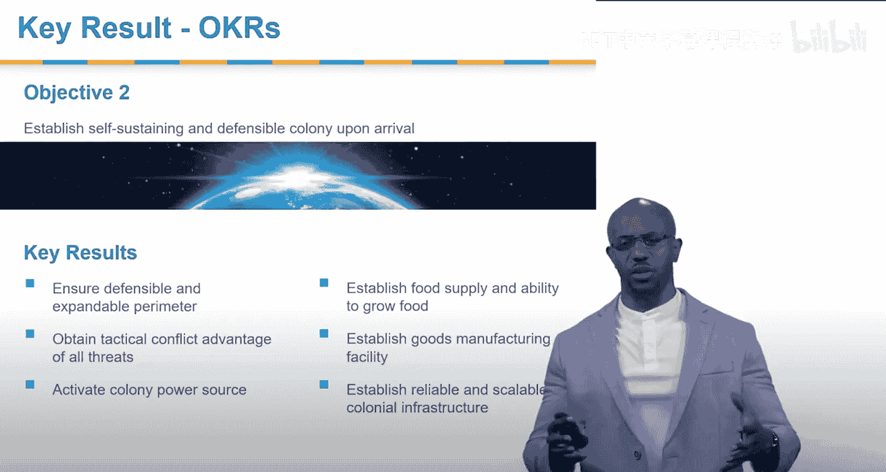
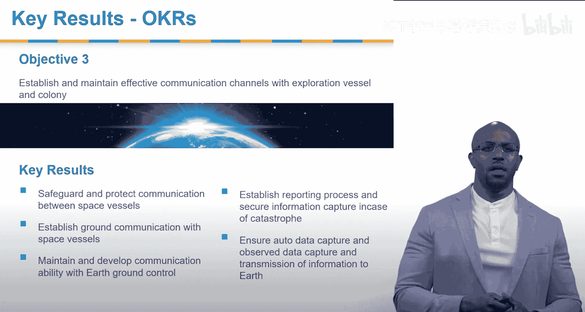
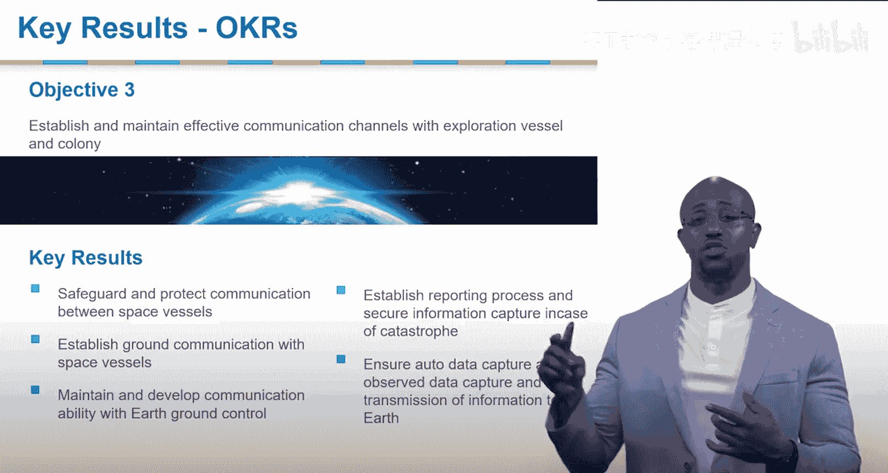
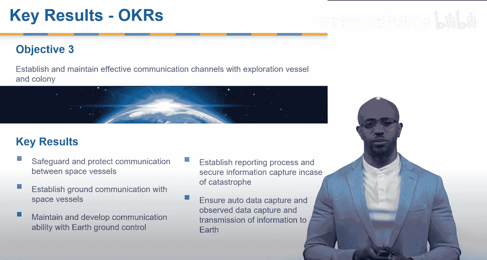

# 37：太空旅行目标与关键成果 🚀

在本节课中，我们将运用之前学到的计算思维知识，并将其应用于星际太空旅行这一复杂问题。我们将首先审视太空旅行的目标与关键成果，明确我们期望通过计算思维解决哪些核心问题。

## 概述

我们面临的核心问题是：到2050年，地球资源将不足以维持人类生存。专家预测，从2050年起再过20年，地球将变得无法居住。我们已尝试过火星和木星卫星的探索，但均告失败。目前已知最近的宜居候选行星是比邻星b，此外还有其他潜在目标。因此，我们需要制定一个星际移民计划。关键决策包括：选择哪些行星作为主要目的地、派遣何种类型的飞船、飞船应具备何种防护机制，以及船上人员的构成。

## 核心目标

基于上述问题，我们确立了三个主要目标。

### 目标一：安全抵达并建立往返能力

首要目标是安全抵达宜居行星，并能在4.5年内返回地球，以便接回更多人员。

以下是实现此目标的关键成果：
*   **抵达时间**：在两年内抵达目标行星。
*   **飞船状态**：运输飞船在旅途中未遭受使其丧失功能的损坏。
*   **返航准备**：在抵达后2.5年内准备好返航。这要求我们快速建立殖民地，理想情况下在2.5个月内完成初步建设、稳定运行并确保防御系统就绪。
*   **后续任务**：在4到5年内返回地球，以启动下一次远征任务（如果需要）。

### 目标二：建立自给自足且可防御的殖民地

成功抵达后，我们需要建立一个能够长期生存的据点。

以下是实现此目标的关键成果：
*   **防御与扩张**：确保殖民地拥有可防御且可扩展的边界，并对所有潜在威胁取得战术优势。
*   **能源与食物**：激活殖民地的能源供应。建立食物供应链，包括种植、制造或捕获本地食物。
*   **制造能力**：建立物资制造设施，以实现持续建设和自给自足，能够制造适应新行星环境的新工具。
*   **基础设施**：建立可靠、可扩展的殖民地基础设施，包括污水处理系统、供水系统等。

### 目标三：建立并维持有效的通信网络

在整个任务过程中，保持畅通的通信至关重要。

以下是实现此目标的关键成果：
*   **太空通信**：保障并保护飞船、殖民地以及其他任何船只之间的通信安全。
*   **地面对接**：建立并维持殖民地与地球地面控制中心之间的通信能力。
*   **信息管理**：建立报告流程和安全的信息捕获机制，以防灾难发生。这包括捕获、存储和利用数据，特别是识别和报告我们在新行星上将遇到的大量“黑暗数据”。
*   **数据自动化**：确保数据的自动捕获，同时也进行人工观察记录。自动化捕获并传输数据将极大地帮助未来的行星探索任务。

## 总结

本节课中，我们一起学习了如何为星际太空旅行任务设定清晰的目标与关键成果。我们明确了三个核心目标：**安全旅行与往返**、**建立自给自足的殖民地**以及**维持有效通信**。通过分解每个目标下的关键成果，我们为运用计算思维进一步解决飞船设计、路线规划、人员配置等具体问题奠定了基础。下一节，我们将开始利用这些OKR来指导具体的技术与策略设计。