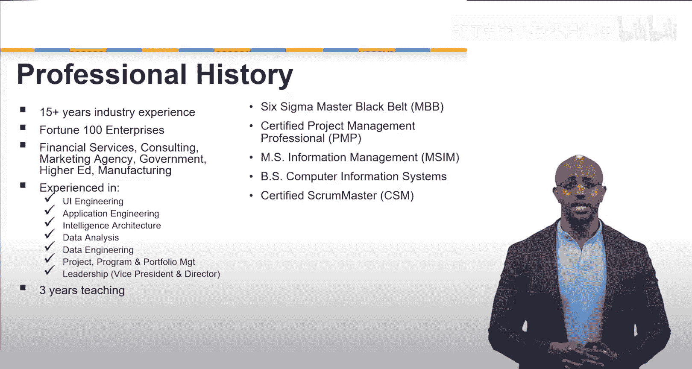
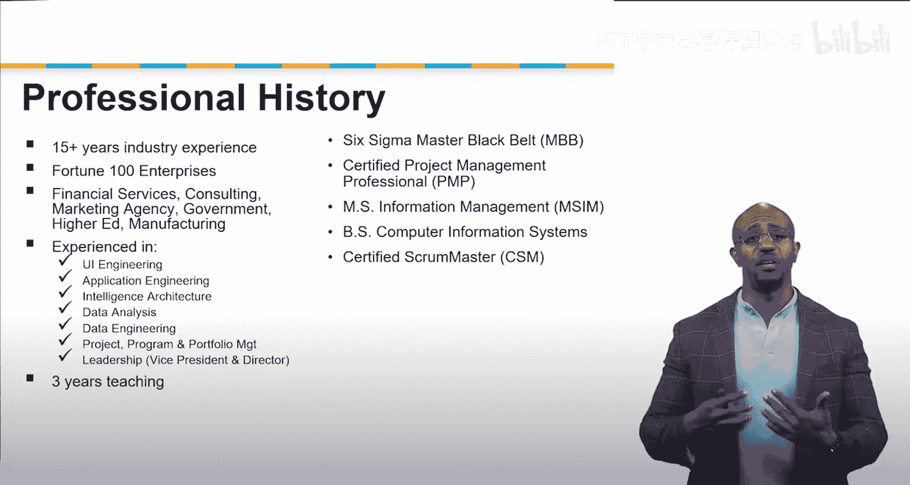
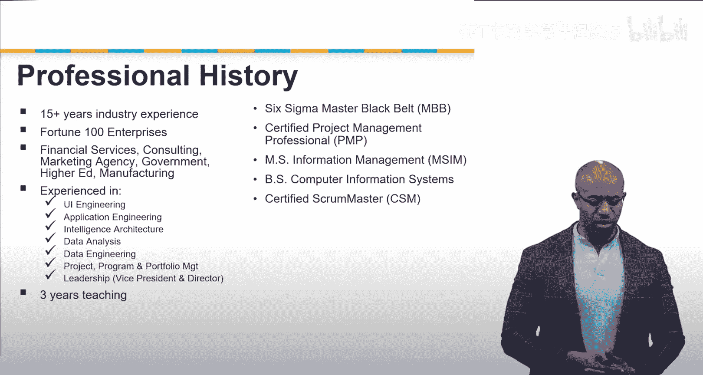
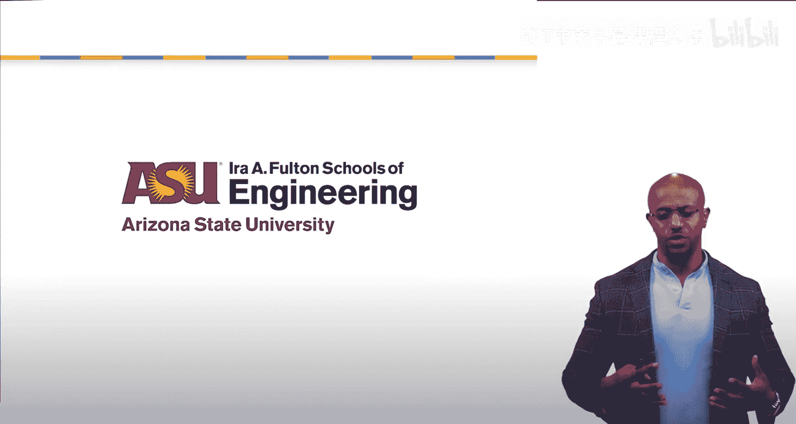
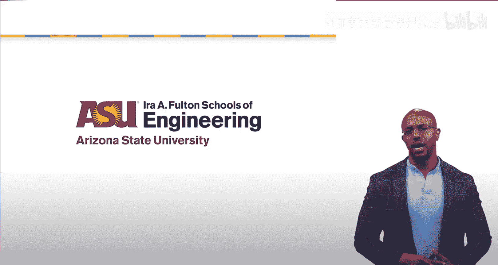
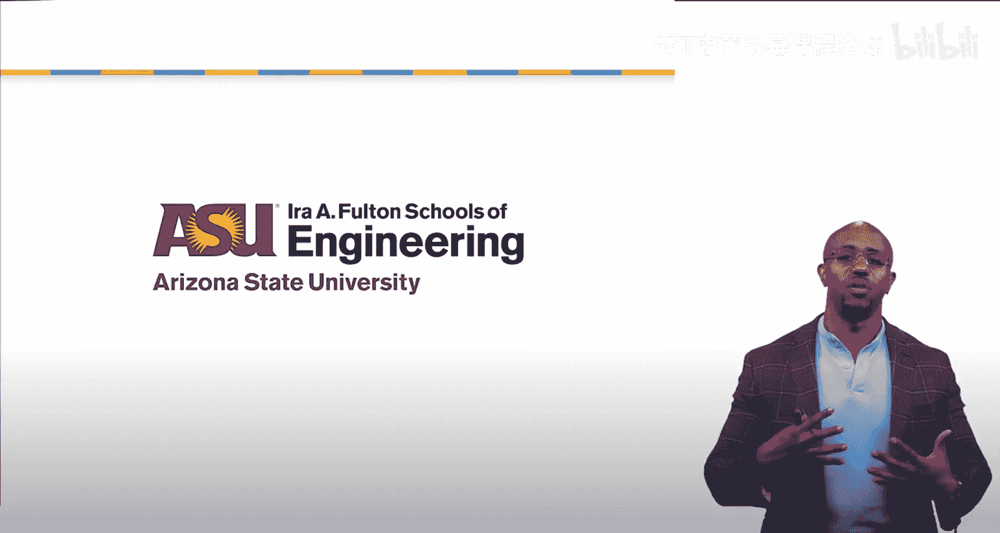
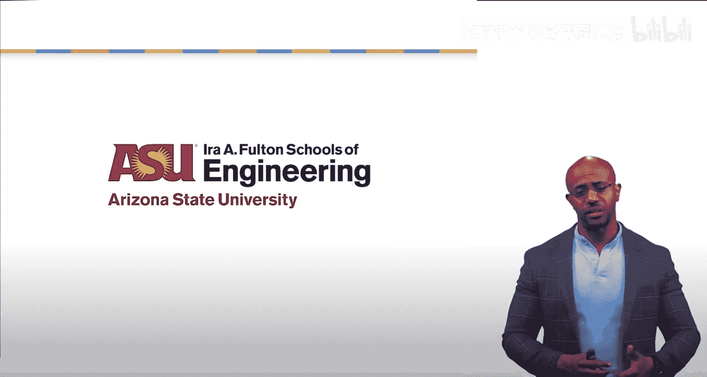

# 黑暗数据迁移与架构：0：讲师介绍 👨‍🏫

在本节课中，我们将了解本课程讲师的背景，包括他的专业经历、个人兴趣，以及这些因素如何塑造了他对黑暗数据的理解与应用。

## 专业背景

上一节我们了解了课程主题，本节中我们来看看讲师的职业发展路径。讲师拥有超过15年的行业经验，涉足领域广泛。

以下是其职业经历的关键点：
*   在企业界（包括多家《财富》500强和100强公司）以及其他多个领域工作，如咨询、市场营销、政府和高等教育。
*   担任过多种职位，涵盖多个学科，包括：**UI工程**、**应用工程**、**智能架构**、**数据分析**、**数据工程**、**项目/项目集/项目组合管理**。
*   目前担任领导职务（副总裁），曾在美国及全球一些大型公司担任总监。

近年来，讲师更多地投入到教学中。他认为，从某种程度上说，每个人都是老师；当我们做得更好时，我们就在学习，当我们分享知识帮助他人做得更好时，我们就在教学。

## 教育与持续成长

讲师的教育背景同样多元，涉及计算机信息系统和信息管理等多个学科。

以下是其教育及认证情况：
*   本科毕业于阿拉巴马州立大学。
*   硕士毕业于亚利桑那州立大学。
*   持有多项专业认证：**认证Scrum大师（CSM）**、**项目管理专业人士（PMP）** 以及 **六西格玛黑带大师**。这些认证工作均在亚利桑那州立大学完成。

讲师在其职业生涯中始终坚持多方向成长。在执行项目时，总会发现需要改进的地方，无论是更好的项目管理、UI工程还是应用工程。团队和项目总会带来新的挑战和成长机会。只要专注于发现问题、解决问题并帮助他人成长，就能积累更多经验，并在原本不熟悉的领域变得更有能力。

## 个人兴趣

从职业经历转向个人生活，讲师曾是一名大学田径运动员，在阿拉巴马州立大学时期是一名短跑运动员，主攻100米、200米和400米项目。

他享受全球旅行，去过许多地方。

以下是其旅行足迹的部分列举：
*   欧洲：葡萄牙里斯本、法国巴黎、西班牙马德里、阿利坎特、梅里达。
*   南美洲：巴西多个城市、秘鲁、巴拿马。
*   亚洲：巴厘岛等地。

旅行对他而言，关键在于体验人文、文化，理解人们不同的思维和行事方式，从而跳出固有的思维框架。

近年来，他对NFT和加密货币产生了浓厚兴趣。他创作过一些NFT作品，目前更偏向艺术性而非实用性，但未来几年计划涉足更多实用性NFT。在加密货币方面，他投资过多种货币，包括一些新兴项目如Solana、Cardano，以及主要的以太坊和比特币。

讲师始终倡导健康与 wellness，遵循“健康的身体造就健康的心智，让人更敏锐”这一古老智慧。他也花时间深入研究了NFT和加密货币。

幻灯片顶部的图片是他在旅行中拍摄的照片：左上角是哥伦比亚瓜塔佩；其右侧是西班牙阿利坎特港的圣巴巴拉城堡，可俯瞰海湾，景色绝美，这座由摩尔人建造的城堡坐落于山顶；旁边是巴西里约热内卢的日落，在夏季，日落恰好穿过糖面包山，从任何角度观赏都极为壮观；最后一张是葡萄牙里斯本一个著名公园里的大型商场。这些都是他非常喜爱的地方。

## 核心驱动力

深入本课程后，你会发现探索是讲师的核心特质。他对探索、创新和创造力充满热情。这三者是推动世界前进、解决问题的关键，也是提升个人、职业、所在企业及周围人群水平的基石，它们共同构建了我们所处的世界。

感谢你的时间，祝你在本课程中学习顺利。