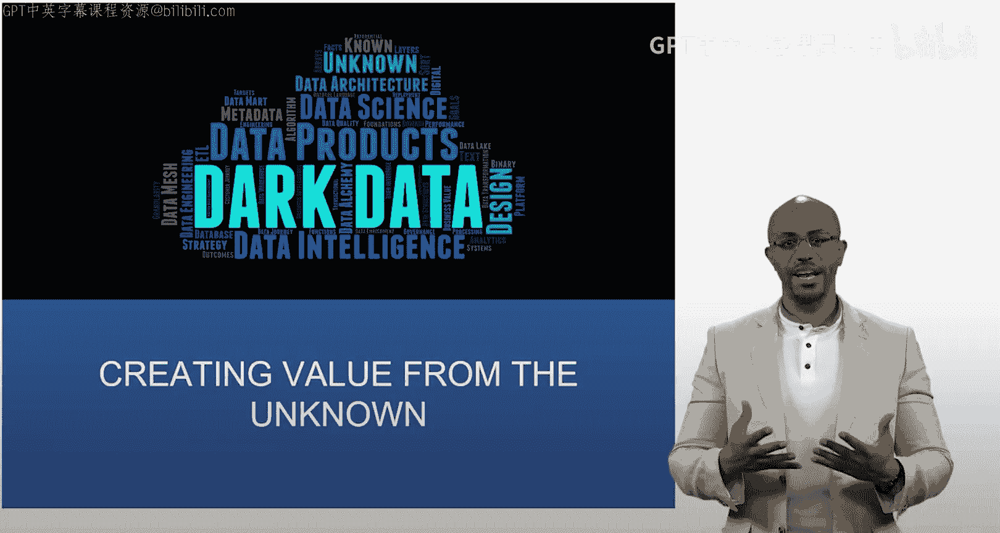
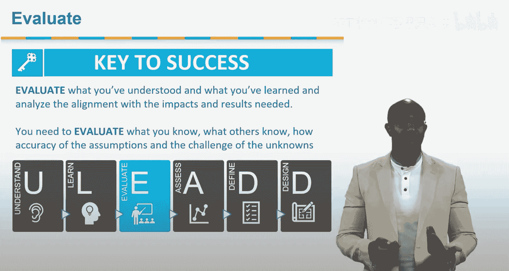

# 黑暗数据迁移与架构：2：ULEADD框架解析第一部分 🧭

在本节课中，我们将学习一个从黑暗数据中创造价值的系统性方法——ULEADD框架。我们将重点探讨该框架的前两个阶段：“理解”与“学习”，并了解如何通过正确的思维模式来避免项目初期的常见失败。

---

## 概述

过去十五年间，我在美国企业界的多种环境中工作，并交付了众多技术解决方案。最初，我是一名用户界面工程师，而现在则更专注于数据解决方案、大型系统集成以及如何从黑暗数据中获取价值。基于这些经验，我总结出一套六步框架，用于指导从黑暗数据中提取价值的项目。本节课，我们将深入探讨这个框架的前两个核心步骤。

## 理解阶段：明确期望与愿景

上一节我们介绍了ULEADD框架的整体结构，本节中我们来看看第一个关键阶段：“理解”。

这是深入探究的阶段。数据科学家、工程师或项目负责人，作为引领团队穿越复杂数据领域的核心人物，必须投入时间真正理解项目的期望和愿景，并能将其转化为清晰的目标。同时，还需要引导团队明确如何利用黑暗数据，以及如何将其与已知数据和组织的核心使命相结合。

“理解”是必须完成的第一层工作。在此阶段，业务方需要发挥主导作用，指明方向；而技术团队则负责翻译这些需求，并共同规划后续路径。

## 学习阶段：内化需求与洞察本质

在理解了基本需求后，我们进入“学习”阶段。此时，你需要将所理解的内容内化，并洞察其背后的真实诉求。

客户可能要求一个带有四个字段的小部件来从数据库提取数据，但根据其用户的实际使用习惯，他们真正需要的可能只是两个字段，并且数据来源或形式也可能不同（例如，来自黑暗数据）。关键在于深入理解业务背景、学习用户的真实意图、了解相关人员的过往经验与挑战，并评估这些因素对当前及未来解决方案的影响。

以下是未能充分理解用户需求可能带来问题的一个简单示例：

> 我在里约热内卢旅行时拍下了这张电梯按钮的照片。如果你观察，每个楼层对应两个不同的按钮值。例如，八楼可能对应按钮“8”或“9”。大多数人的直觉是按标识牌上显示楼层的那个按钮，而非按钮旁边小数字指示的楼层。顶部的红色标识（在葡萄牙语中意为“出口”）其实提示你应该按红色的按钮。这个设计缺陷源于最初设计时，人们按照常规方式放置了按钮，却未考虑到清晰的用户指引，导致了理解与执行之间的脱节，最终未能解决本意要解决的问题。

## 评估与审视阶段：验证假设与获取反馈

当我们完成了“理解”和“学习”后，便进入下一对紧密相关的阶段：“评估”与“审视”。

在此阶段，你需要基于之前的理解与学习进行评估：我的假设正确吗？我的思路对吗？我理解业务或组织期望达成的成果、目标和关键结果吗？

这个阶段至关重要，因为它要求你主动征求反馈和意见，并与他人交流。我们天生会从自己的视角看问题，这必然会导致盲点和遗漏。因此，我们必须保持开放和广阔的视野，从团队成员那里获取反馈，确保团队具备协作和共融的思维模式。

如果前两个步骤没有做好或没有提出正确的问题，评估阶段就是关键的纠正点，否则你将不得不回溯到上游阶段进行调整。

---

## 总结

本节课我们一起学习了ULEADD框架的前四个阶段：**理解**、**学习**、**评估**和**审视**。我们认识到，项目前期的失败往往源于未能充分理解和学习真实需求。通过结合务实与理想主义的思维，明确“理想状态”，并快速交付具有核心价值的MVP（最小可行产品），我们可以有效地从黑暗数据中开启价值创造之旅。下一节，我们将继续探讨框架的最后两个阶段：“定义”与“设计”。