# 3：ULEADD解析第二部分 🔍

在本节课中，我们将继续深入解析ULEADD框架，重点探讨“评估”、“定义”与“设计”这三个阶段。我们将通过一个市场营销分析平台的实际案例，理解如何从模糊需求中提炼出具有竞争优势的解决方案，并确保每个阶段都经过有效验证。

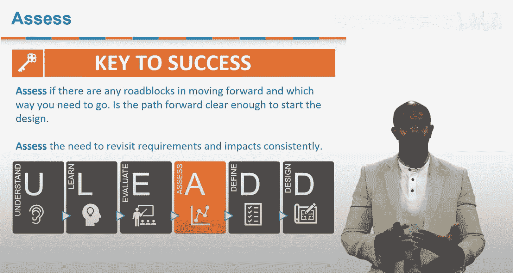

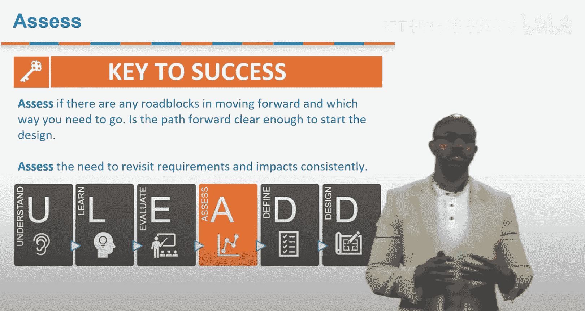

---

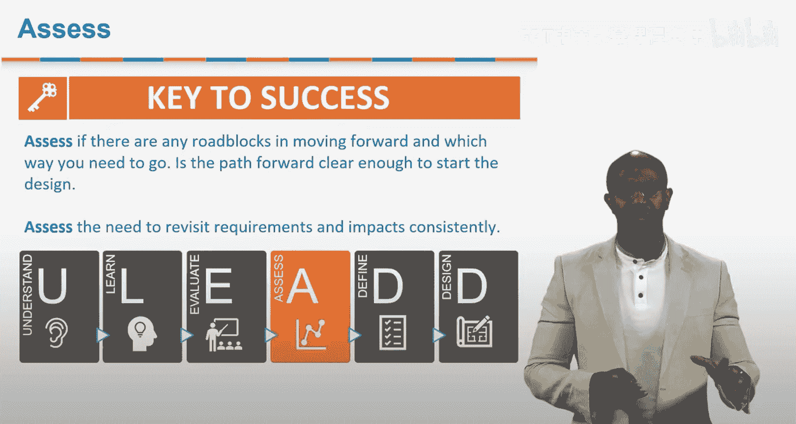

上一节我们介绍了ULEADD框架中的“理解”与“学习”阶段。本节中，我们来看看后续的“评估”、“定义”与“设计”阶段。

## 评估阶段：分析与验证可能性

评估阶段包括数据分析，以及对数字和数据集进行微调与调整，以探索各种可能性。此时，你开始验证前期所理解的可行性。

现实世界中有许多此类例子。以下是一个市场营销团队中的典型场景：

一个市场营销分析团队与技术部门合作，希望构建一个平台，以更好地进行营销分析和客户细分分析，从而更精准地定位客户。

与大多数高层讨论一样，需求最初保持在非常高的层面。当需求传递到工程师层面并尝试构建时，愿景有时会非常模糊。特别是当人们只是基于过往经验，想要一个类似但更好的东西时。

我们经常遇到这类对话：人们将技术、黑暗数据或数据视为——输入一些信息，就能得到一个不同的输出结果，这个结果应该能帮助你更好地决策、定位和表现。

因此，这里基本上是首席营销官（CMO）要求为营销人员提供一个用户界面（UI），以帮助他们在特定市场中更好地定位潜在客户。

而对于工程师或技术部门等更以数据为中心的人员来说，当有人需要一个UI来查看信息时，他们通常会想：这里有一些数据，让我们构建一个允许他们查询的UI。

于是，你会得到这样的用户界面：显示潜在客户总数、客户总数、年度趋势线或趋势分析，以及与上一年的对比。这些是典型的标准分析内容，也是首席信息官（CIO）审视需求后给出的反馈。

但问题是，在当今的技术环境中，这些功能已属常态。当你想到一个仪表板时，每个人都会有趋势分析，都会有今年与去年、本月与上月的客户总数对比。这些是标准分析，并非真正能让你在竞争中取得优势的数据。

因此，在这段对话的最后，首席信息官（CIO）指出：你需要更具体。我们没有潜在客户数据，这需要我们去获取并构建一个全新的数据层。因此，构建工作会不同，涉及更多努力。真正能提供竞争优势的方案可能需要一年或更长时间。

此时你需要思考的一个关键问题是：**我们是否在寻求竞争优势？** 这个问题应该在“理解”和“学习”阶段，当有人提出需求时就提出。然后，需要了解竞争对手拥有什么。

这样，你才能判断：他们只是想要最基本的功能，还是想要一些能带来真正价值的东西？即，利用未知数据转化数据，创造出前所未有的新数据。

例如，分析标准客户与潜在客户，了解哪些潜在客户未获批准，我们如何对他们进行交叉销售，哪些客户有更高的交叉销售概率，以及我们使用哪些属性来确定任何潜在客户的概率性质？

以下是能带来竞争优势的指标类型：

*   **转化分析**：分析潜在客户的转化路径与障碍。
*   **交叉销售概率**：识别高概率的交叉销售机会。
*   **属性建模**：确定用于评估潜在客户的关键属性。

这些类型的指标能为你带来竞争优势。因为从你所在组织的视角来看，在考虑潜在客户转化时，根据你的具体应用，可能存在与公司相关的特定因素，能让你获得竞争优势，并在该领域更好地前进。

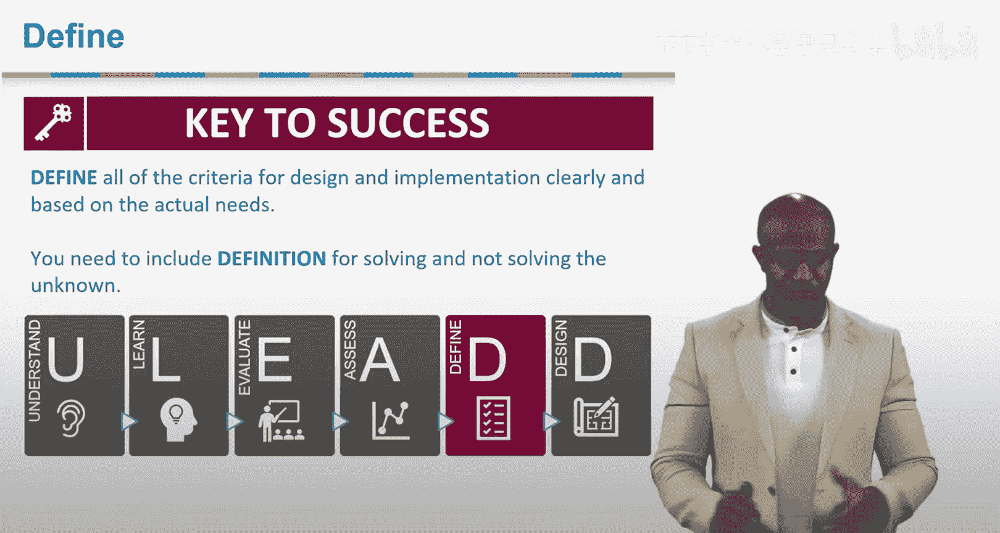

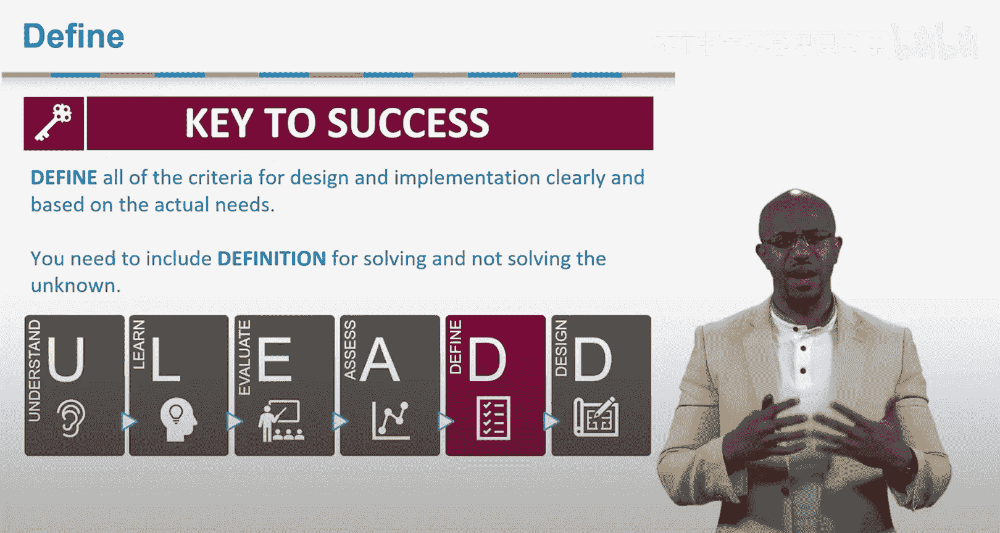

---

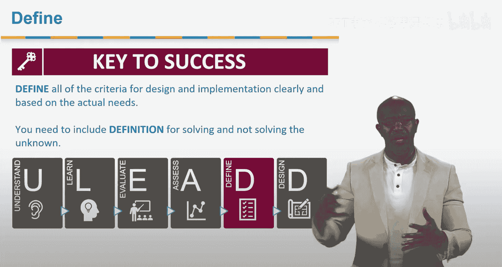

在深入探讨了“评估”阶段后，我们接下来进入最后两个更为人熟知的阶段：“定义”与“设计”。

## 定义与设计阶段：明确方案与构建蓝图

很多人知道如何定义问题或定义解决方案，进行解决方案管理，然后设计解决方案。因此，对这两个阶段的定义或讲解会相对简单一些。

然而，我需要指出一些区别。

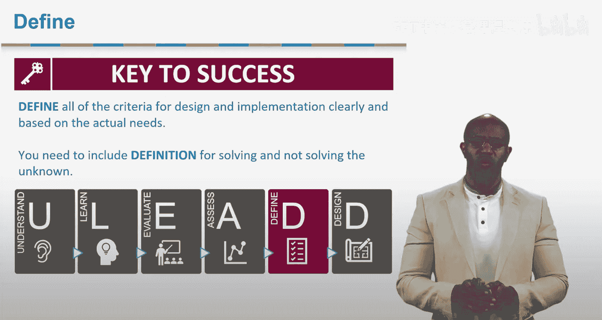

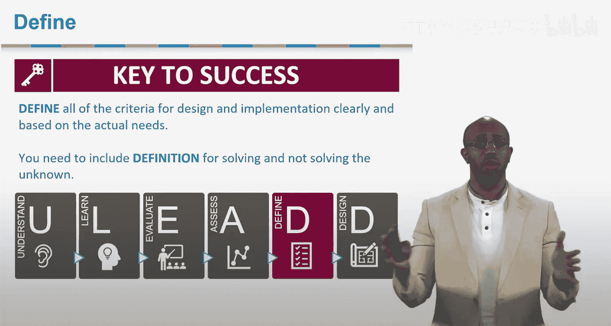

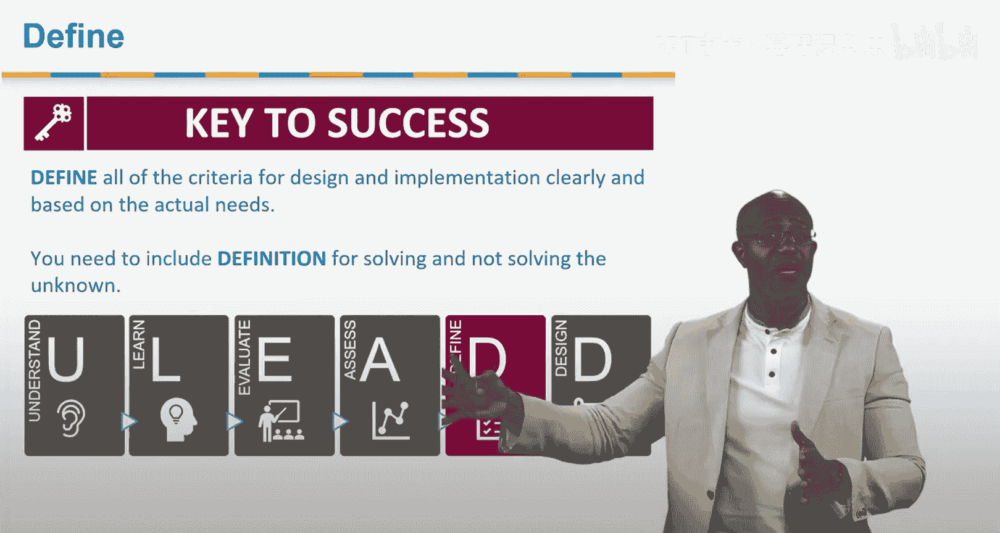

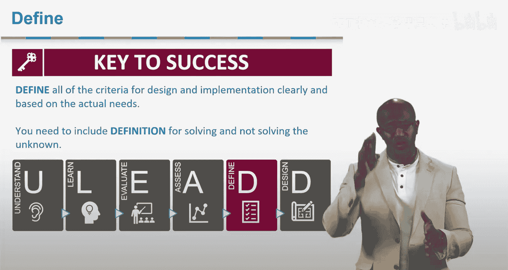

当我们思考“定义”时，我们再次回顾，以确保我们理解了真正的需求。我们是在寻求竞争优势吗？我们是在寻找最小可行产品（MVP）吗？是扩展型MVP还是功能狭窄的集合？我们是在“边飞边造飞机”吗？大多数组织都在这样做。

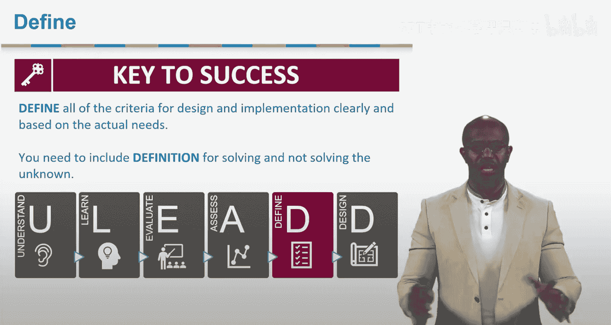

因此，当我们定义时，一旦完成定义，我们仍然需要持续验证。在这两个阶段中，内置了迭代验证的过程。

随着定义的进行，我会定义一个完整的解决方案视图，从开始到结束，全景图是什么样的。

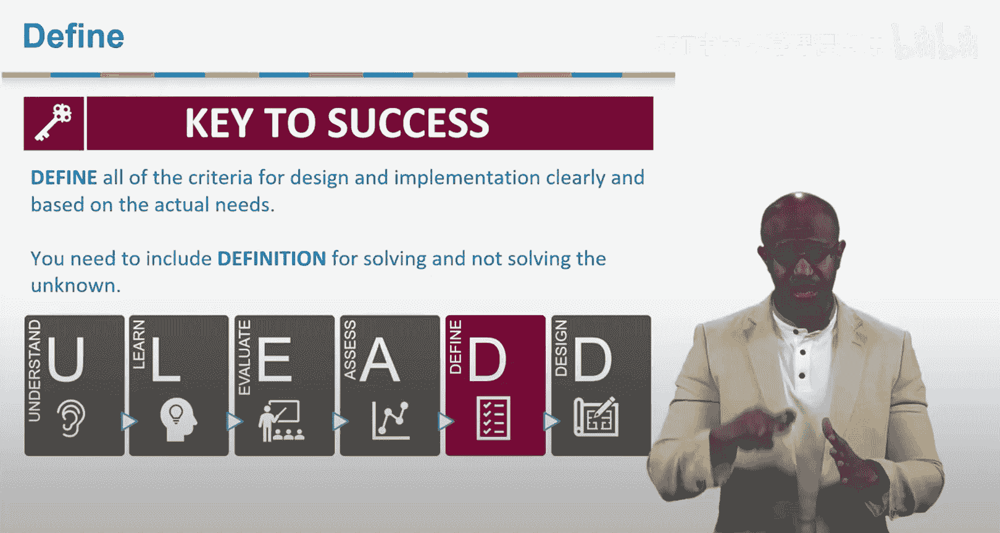

然后，基于我们在开始阶段“理解”和“学习”中确定的成果，以及“分析”阶段确定的目标与关键成果（OKRs），我们来定义不同的阶段。

我们预计会发生什么？我们是否计划实际增加销售额？是否计划增长会员数量？是否计划产生更大影响？

当我们定义要做什么并列出这些事项时，它们是否符合我们的预期？

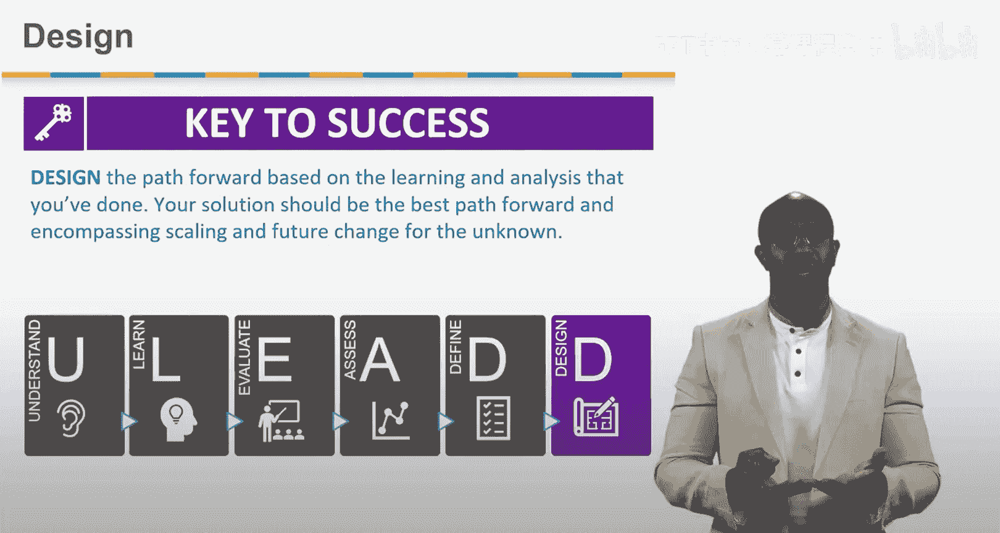

最后，当我们进入“设计”阶段，一旦开始构建解决方案，这个设计是否符合之前的定义、那些OKRs、成果、预期以及我们想要产生的影响？是否符合我们试图在此建立的总体文化？

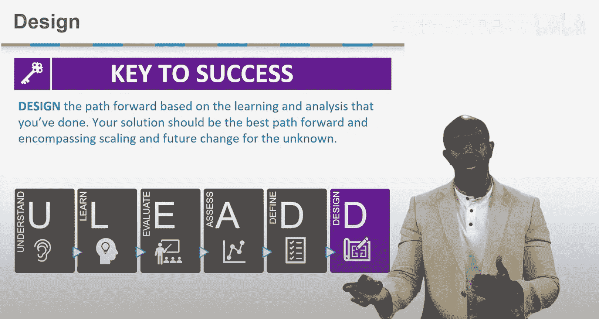

设计能做到吗？它是一个系统还是多个系统？是分层架构吗？如何运作？在组织内部使用时，性能是否达标？是否足够快？我们能否依赖系统更稳定地工作？正常运行时间是多少？因为所有这些都会影响系统面向外部真实世界时的表现。

它是否能解决现实世界存在的问题？它的表现是否符合或超出用户的期望？我们对此的期望是什么？

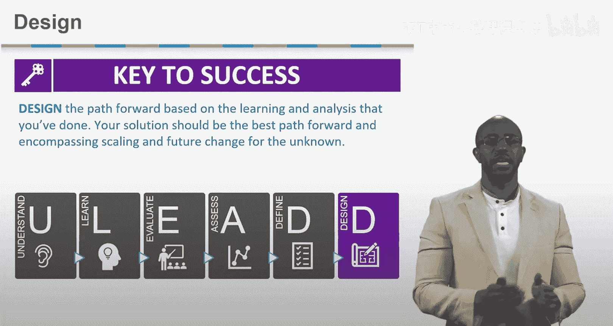

“理解”、“学习”、“评估”、“定义”和“设计”都是迭代的。每个步骤都需要验证，特别是“定义”和“设计”。你不希望进入设计阶段后，才意识到必须一路回溯到“理解”阶段。

一旦离开了“理解”和“学习”阶段，如果你前期工作做得很好，那么最好在需要时及时回头重新评估。当我们到达最后的“定义”和“设计”阶段，并获得对设计和设计路线图的签字认可后，我们要确保能够直接进入开发阶段。

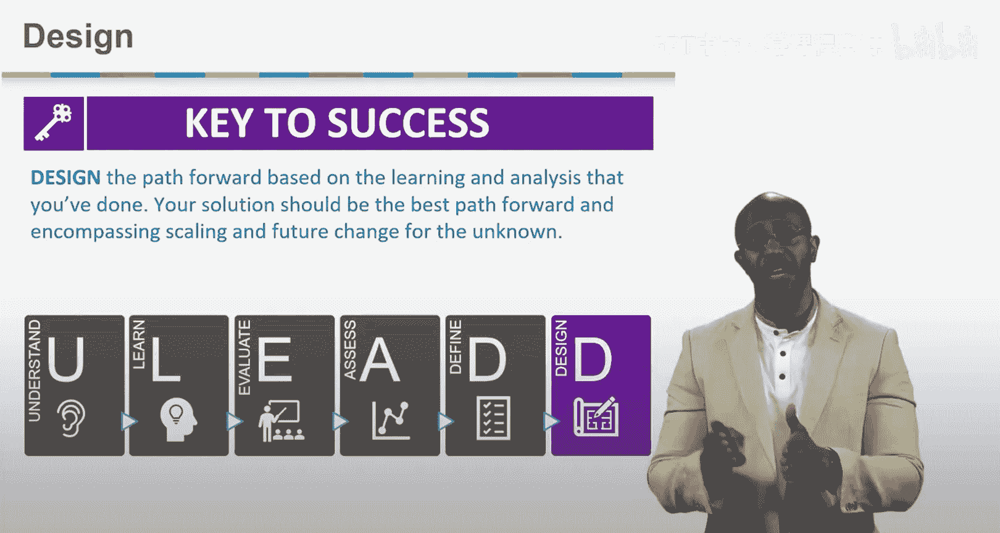

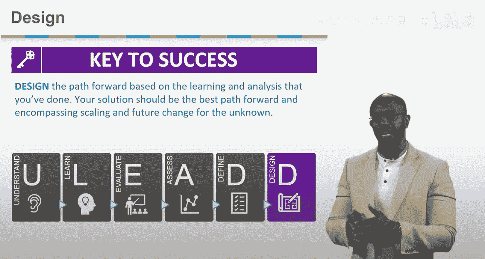

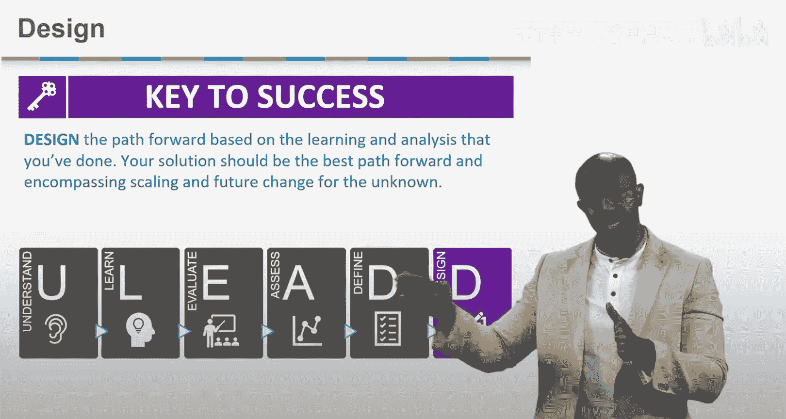

我们可以使用多种不同的理论或框架来交付解决方案，例如瀑布模型、SAFe、六西格玛、规模化敏捷等。我们将在其他课程中更详细地讨论这些。

---

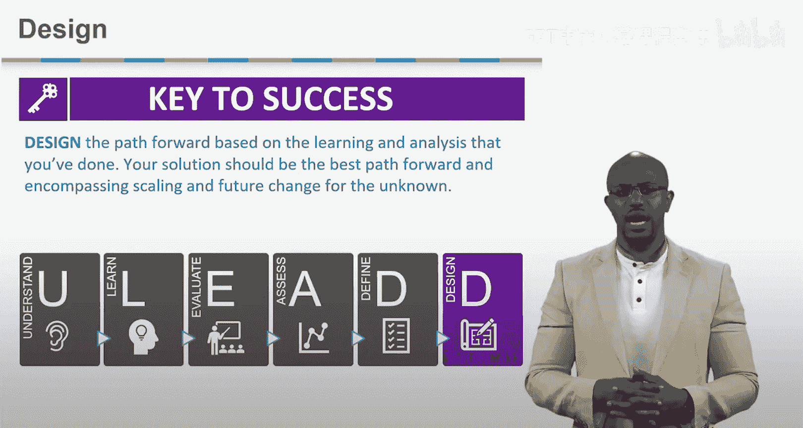

本节课中我们一起学习了ULEADD框架的“评估”、“定义”与“设计”阶段。我们通过案例看到，从模糊需求到具体方案，关键在于持续验证并明确是否追求竞争优势。定义阶段需确保方案与业务目标对齐，设计阶段则要将方案转化为可行的技术蓝图。整个过程是迭代的，各阶段紧密相连，为后续开发奠定坚实基础。