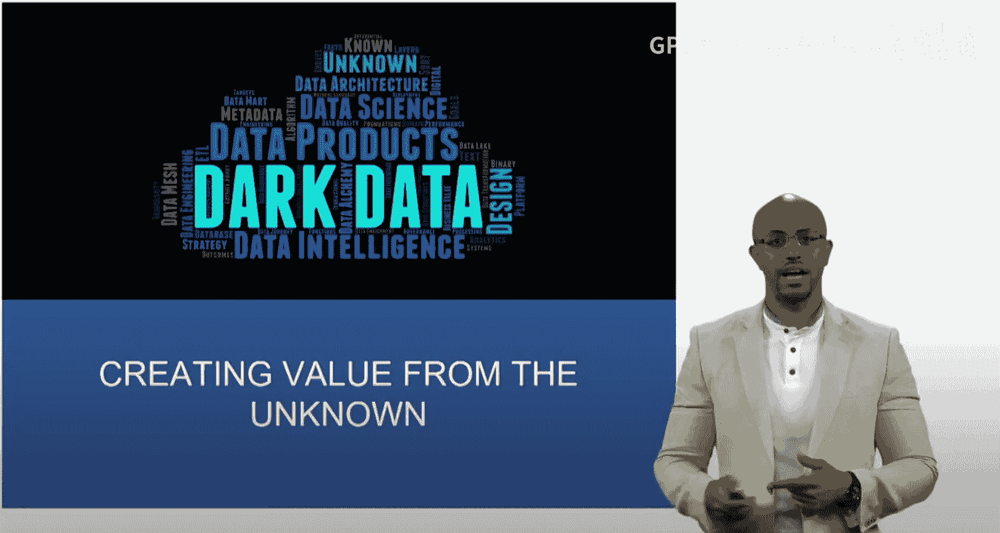
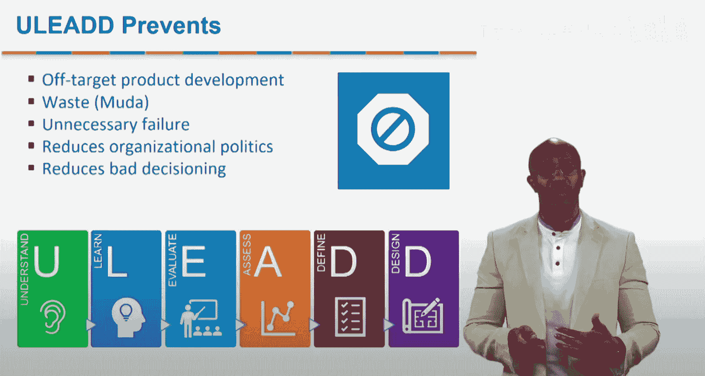
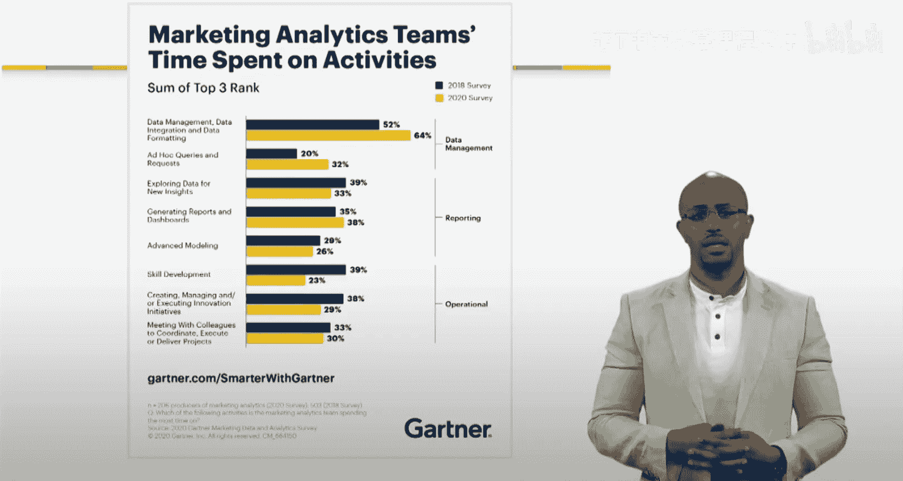

# 4：ULEADD对企业的重要性 🎯

在本节课中，我们将探讨ULEADD框架为何重要，以及如何利用它从黑暗数据中提取价值。

## 概述：理解未知与竞争优势

我们通常认为自己知道已知的事物，也知道自己不知道什么。然而，我们也常常误以为自己知道某些实际上未知的事情。同时，我们也承认存在“未知的未知”。企业的竞争优势，恰恰在于快速学习未知事物并从中创造价值的能力。这构成了我们处理黑暗数据、理解其重要性以及探讨如何通过利用黑暗数据和未知领域来获取竞争优势的基础。

## ULEADD框架的核心价值

以下是使用ULEADD框架创造价值的一些主要好处，可以归纳为四个不同的方面：

*   **清晰的发现框架**：它提供了一个结构化的方法来探索未知。
*   **标准化的问题解决方法**：它建立了一套统一的流程来应对挑战。
*   **应对文化挑战的有效策略**：它有助于在不同团队文化间进行导航和协调。
*   **灵活且个性化的处理方式**：它允许你结合个人风格进行调整，并与他人协作，共同寻找解决问题、深入未知领域、驾驭文化差异以及利用黑暗数据创造价值的途径。

## 黑暗数据与常见问题预防

上一节我们介绍了ULEADD的价值，本节中我们来看看它能帮助企业预防哪些常见问题。黑暗数据有助于预防以下（及更多）问题：

*   **产品开发浪费**
*   **交付浪费**
*   **不必要的失败**
*   **普遍的失败**

ULEADD框架促使团队采用一种标准化的方法，让成员能够围绕共同目标团结一致。它通过倾听不同观点、相互学习、并在前期投入时间进行评估和分析来增强团队凝聚力。这样，我们就能从现有数据中学习，然后进入设计和定义解决方案的阶段，真正开始思考如何创造商业价值，并为他人和组织推动解决方案。

## 分析未被采纳的原因与黑暗数据的作用

现在，让我们基于一些行业数据，探讨大型企业等组织在决策中未充分利用分析结果的原因。

以下是主要原因中的前三项：
1.  数据发现与既定行动方针冲突。
2.  数据质量差。
3.  分析未能提供清晰的建议。

除了数据质量问题，如果你能有效地从黑暗数据中提取价值，它对前两项原因有巨大的影响。此外，在某些边缘情况下，黑暗数据甚至能以创造性的方式帮助改善数据质量。

**当分析结果与既定行动方针不符时**，很多问题可以在项目初期应用ULEADD方法时得到解决。因为在大多数组织中，人们通常对可能性有所了解，也对显性数据（而非隐藏数据）的普遍含义有所认知。但如果能恰当利用黑暗数据，就能进一步提取价值。采用ULEADD方法，在决策层面审视所有可能性、倾听各方意见、理解现状、学习并进行分析，就更可能制定出能让团队对齐并支持的行动方针，因为目标明确，且多角度已被分析，最终定义的是有益于整个企业的解决方案。

**关于缺乏清晰建议的问题**，这在数据不清晰或普遍未知的情况下经常发生。当前进路径模糊不清时，我们常常需要创造性地寻找数据来源和理解前进方向。

以下是其他一些阻碍分析应用的因素：
*   分析耗时过长。
*   存在多个相互冲突的数据源。
*   解决方案和时间表受传统瀑布式开发方法驱动，导致日程安排与解决方案的实际维护需求不匹配。

日程安排本身也是一种数据形式。当企业表示“难以将其纳入日程”时，我的第一个问题是：在考虑从其他未知数据创造价值之前，我们是否拥有关于这个日程安排问题的数据？我们是否真正理解了为何无法纳入日程，或者如何能够纳入？是否存在任何主动措施可以将解决方案融入推广日程？这些都是通常不会在前期被提出的问题类型。

## 组织视角差异与统一理解的重要性

进一步深入到营销分析领域，当我们谈论商业智能、可操作情报、决策数据质量和组织增长时，思考“未知”如何能提供帮助，可以很好地揭示组织内部理解的缺乏或视角的不统一。

例如，**高级管理层**可能认为营销分析“未达到预期影响力”，而**中层管理者**则更倾向于认为其“达到了预期影响力”。这种差异源于角色定位：高级管理者更关注价值增长和愿景驱动，若分析未达愿景，其看法可能更偏向公司战略方向；而中层管理者更深入具体执行，更关注成功交付能驱动价值的解决方案，因此对分析的影响力持更积极的看法。

这印证了我们的观点：在项目启动时，我们需要投入更多时间去理解和学习，以便高级管理层、中层管理者以及工程、数据科学、数据工程等团队的成员都能更好地理解目标，从而使不同层级的看法能够更加平衡。

## 时间分配趋势与竞争优势的关联

最后，当我们审视分析工作的时间分配趋势时，数据非常能说明问题。对比2018年（蓝色）和2020年（黄色）的数据：

在**数据管理与集成**活动上花费的时间持续增长。随着监管环境日益严格，这类活动在众多公司（尤其是金融科技公司）中变得越来越重要。虽然合规工作至关重要，但它们通常不属于增长性项目，而是合规性项目。然而，每年都有越来越多的精力和活动投入到这方面。

与此同时，像**报告、高级建模、技能发展、创建/管理/执行计划**等直接促进业务增长的活动，所占用的时间却在减少。这意味着更多资源用于“维持业务运行”和“确保业务合规”，而非“推动业务增长”。

这不仅是一个价值陈述，也表明了企业和组织对获取**竞争优势**的日益增长的需求。如果不专注于创造性工作、高级建模、人工智能或员工技能发展，就无法获得竞争优势，也就难以深入探索黑暗数据。反之，那些有机会探索黑暗数据、进行高级建模和创造性工作的公司，正在赢得竞争优势。

因此，在思考什么是重要且有影响力的事情时，我们需要考虑如何做出改变。显然，我们必须完成合规和日常运营工作，这对保持企业生存至关重要。但是，当我们失去竞争优势时，又该转向何方？在某个时刻，我们必须审视如何运用这些新的策略和方法来提升组织的价值。

## 总结

本节课中，我们一起学习了ULEADD框架对企业处理黑暗数据的重要性。我们了解到，该框架通过提供清晰的发现路径和标准化方法，能有效预防资源浪费和失败。通过分析数据未被采纳的原因，我们认识到黑暗数据在解决分析结果与行动冲突、提供清晰建议方面的潜力。同时，组织内部视角的差异强调了统一理解目标的必要性。最后，从时间分配趋势我们看到，在合规压力增大的背景下，企业必须主动投入资源进行创新和高级分析，才能从黑暗数据中提取价值，从而建立和维持关键的竞争优势。