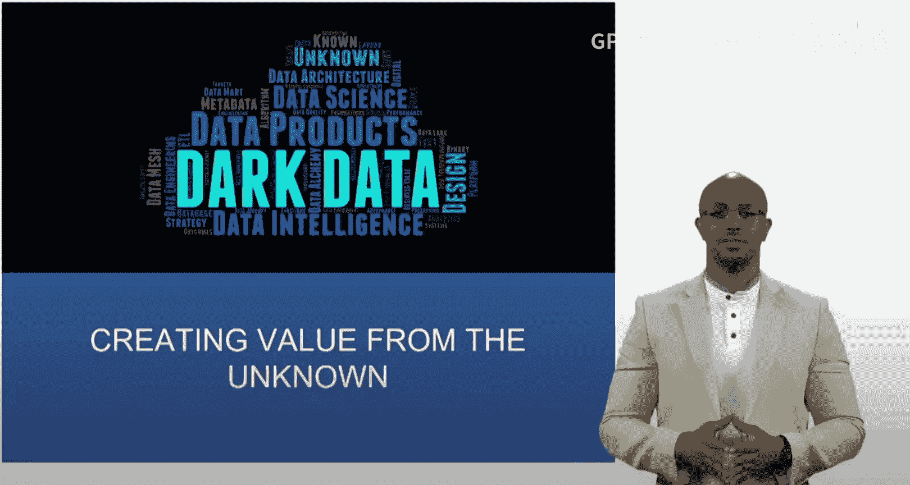
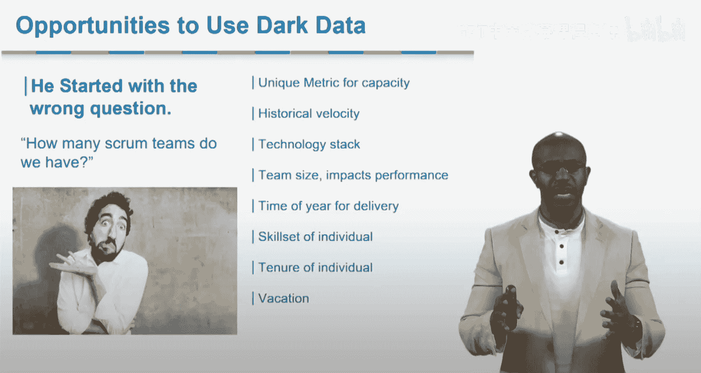

# 黑暗数据迁移与架构：5：ULEADD的个人效用 🧠

在本节课中，我们将探讨ULEADD框架如何帮助你个人和你的组织。我们将从识别挑战开始，进而发现机遇，并最终找到一条清晰的前进路径。

---

## 识别挑战与机遇

上一节我们介绍了ULEADD框架，本节中我们来看看它如何帮助我们应对挑战。首先，我们需要识别那些可能阻碍我们前进的常见问题。

以下是项目或交付工作中，由人员因素引发的典型挑战列表：
*   人员之间沟通不畅、产生困惑或目标不一致。
*   团队协同效应丧失。
*   决策过程不理想。
*   对业务背景或“B游戏”缺乏了解。

当我们思考ULEADD如何提供帮助时，会发现它本质上鼓励团队合作。它促使我们从根本上理解彼此，理解我们试图达成的目标，以及我们期望的成果。在这些不同的领域之间，总是存在着大量的**黑暗数据**。而利用这些黑暗数据来获取**竞争优势**，正是一个巨大的机遇。

当我们面对工作负荷过重、缺乏单一事实来源等问题时，很多都可以通过将ULEADD作为一个连接渠道来解决。它帮助我们建立联系，从未知中提取价值，将未知注入已知，从而创造一个更具凝聚力的视图。

---

## ULEADD的六大助力步骤

了解了挑战和机遇后，我们来看看ULEADD具体如何提供帮助。我通常从以下六个步骤来审视其效用，它们构成了一个核心模型。

以下是ULEADD提供帮助的六个主要方面：
1.  **产生影响**：无论是社会、文化、情感还是财务方面，我们都希望创造价值并产生影响。
2.  **减少失败**：降低失败率是我们希望使用此框架并从中获益的关键原因之一。
3.  **支持效率**：在合理的地方实现自动化至关重要。节省的时间越多，就越能专注于思考如何解决问题。
4.  **方向性思维**：帮助我们识别想要前进的方向。
5.  **计算性思维**：关注逻辑步骤、顺序和可能性分析。
6.  **设计思维**：帮助我们打开思路，探索各种可能性。

在这三种思维（方向性、计算性、设计性）之下，都贯穿着**批判性思维**。你的思考、理解和认知共同推动着前进的道路，因为组织的集体思维实际上决定了组织的发展方向。

---

## 与交付策略的互补

上一节我们探讨了ULEADD在发现和设计阶段的思维助力，本节中我们来看看它如何与具体的交付策略相结合。这些策略更侧重于执行端。

以下是几种常见的项目交付方法论：
*   SAFe
*   瀑布模型
*   滚动波估算
*   三点估算
*   六西格玛

如果你需要进行六西格玛设计，DMAIC（定义、测量、分析、改进、控制）是众所周知的方法。所有这些方法都在我们完成“定义和设计”阶段后开始发挥作用，帮助我们进行交付。因此，理解、学习、评估、分析、定义和设计这些步骤，更多地属于发现和思维框架的范畴，它们让我们进入正确的思维状态，走上正确的道路。当我们进入交付阶段时，我们已经准备得更加充分，能够更快、更有效、更高效地完成任务。

---

## 案例分析：典型产能对话

现在，我想通过一个例子来说明。这是许多公司典型的产能对话场景。

假设在一次会议上，副总裁首先提问：“我们有多少个Scrum团队？”或者“我们每个Scrum团队有多少人？”随后，各位总监便开始汇报各自的数字、百分比和团队分配情况。

例如，应用工程总监说他们有5个Scrum团队，服务于3个产品，有些人员是专职的，有些只投入50%的时间。云工程总监同样汇报了他的2个团队在不同应用间的分配。而架构团队通常横跨多个项目，可能同时参与多达10个项目。

如果对话始于“Scrum团队”或“人员数量”，你如何识别投入到每个产品上的工作量？从“我需要了解我们的产能去向，因为当我们审视工作优先级时，我们需要将大部分产能投入到最高优先级的项目上”这个立场出发，这里存在一个重大缺陷。

这个例子的缺陷在于，副总裁没有首先声明：“我们需要将产能集中在最高优先级的项目上，以确保我们朝着公司的愿景交付。”结果，对话变成了纯粹关于人员数量的争论，大家开始辩论人员分配的比例，而不是退一步思考：如果我们的目标是理解如何将产能分配到最高优先级的项目，我们需要知道什么？我们如何衡量？我们应该用什么作为衡量产能的单位？

---

## 利用黑暗数据的机会

在这个例子中，利用黑暗数据的机会首先在于提出了错误的问题。“我们有多少个Scrum团队”绝对不是正确的问题起点。正确的问题应该是：**结果是什么？我们需要做什么来确认我们是否在致力于最高优先级的项目？我们如何知道这是真的？**

如果我们对此一无所知，我们使用什么，或者我们打算如何思考这个问题？以下是一些机会点：

以下是围绕产能对话可以提出的关键问题列表：
*   我们是否需要为产能创建一个独特的指标？如果需要，这个指标应该包含什么？
*   什么因素贡献于这个指标？数据在哪里？我们如何消化、转换和可视化这些数据？
*   我们是否需要创建一个新系统来测量产能，还是可以依托现有工具（如敏捷管理或项目管理工具）的数据？
*   历史速率是多少？团队规模不同，我们如何量化？技术栈是什么？有什么影响和性能表现？
*   个人资历是否计算在内？通常，高级工程师的产出应高于初级工程师，但这并非总是如此。
*   休假时间、个人技能组合、技术栈如何影响速率？
*   最关键的是，在大多数这类对话中，他们从未提及：“我们实际在做的工作是什么？”因为那才是我们要交付的东西。我们如何评估投入到实际交付、能力、功能以及支持任何计划或公司愿景的大型工作项上的努力？

剖析产能对话的方法有很多。其核心依赖于设计思维、计算思维、方向性思维，以及最根本的批判性思维。这种思维会问：结果、目标、关键成果、期望、可交付成果是什么？我们如何看待这个问题？什么最重要？我们愿意花多少时间在这上面？因为归根结底，在年底我们必须实现目标。因此，我们只需投入足够的时间，从中获得足够的价值，以便更好地实现目标。

当开始讨论黑暗数据时，这些都是你想要提出的问题，而不是直接陷入“我们在讨论产能对话”的思维定式。否则，就像那个例子一样，两周后，你可能带着同样的画面、更糟的画面回来，或者是一个我们需要花更多时间辩论的画面。

---

## 总结

在本节课中，我们一起学习了ULEADD框架如何通过促进团队合作和系统性思维来应对挑战、发现机遇。我们探讨了它的六大助力步骤，以及如何与交付策略互补。通过一个典型的公司产能对话案例，我们看到了错误提问的弊端，并学习了如何利用黑暗数据提出正确的问题，从而创建独特的指标，使决策变得流畅，团队速度加快，组织能够灵活调整，最终更快速、更有效地交付成果，产生更大影响。这就是我们真正追求的目标。