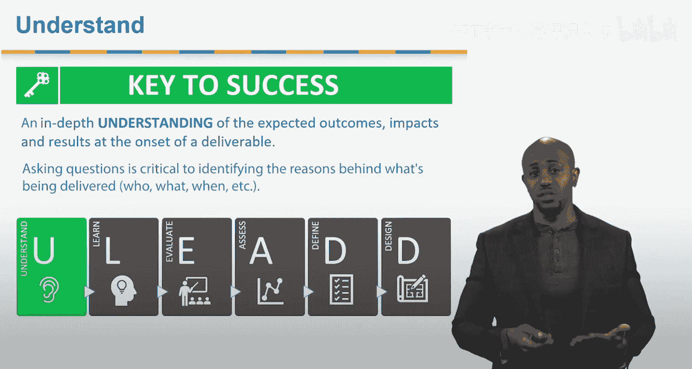
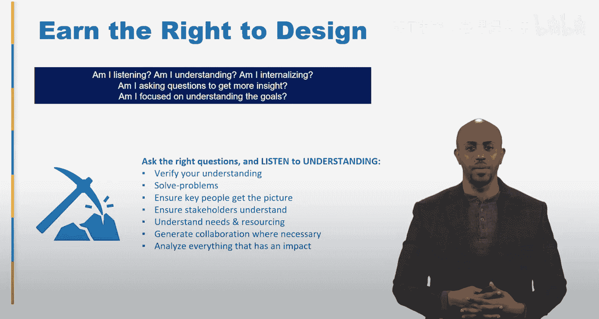
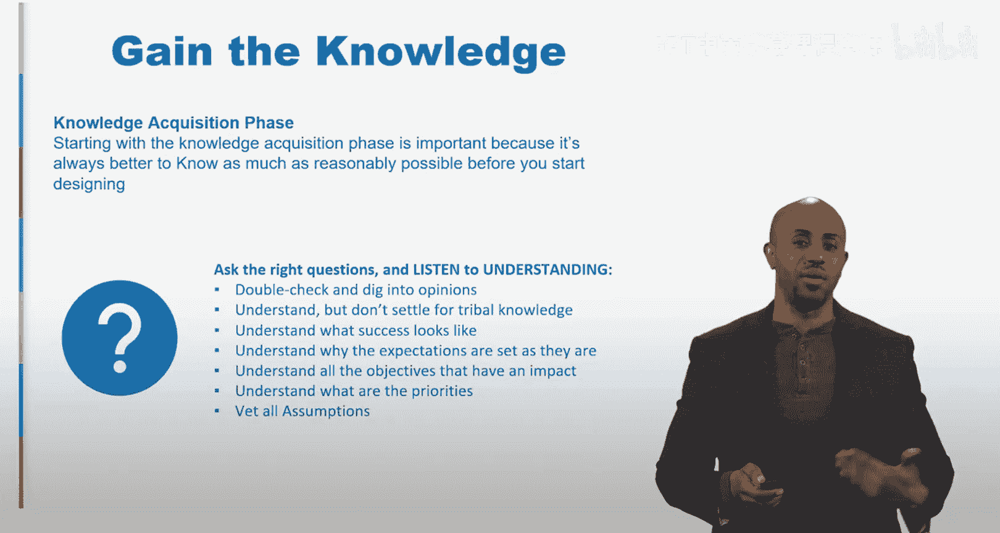

# 6：理解阶段框架 🧠

在本节课中，我们将要学习ULEADD方法论的第一个阶段——“理解”。这个阶段是处理未知数据（黑暗数据）的起点，其核心在于为后续所有工作奠定基础、设定基调，以确保项目能够尽早且持续地走向成功。

当我们面对充满未知的项目时，首要任务是花时间构建清晰的商业案例或问题陈述。这能确保团队中的每个人都理解现状，共同发现缺失的信息，并协作完成后续的评估阶段，从而准确定义问题、构思解决方案、明确期望，并最终通过设计思维、计算思维或批判性思维会议，交付一个能够服务最终用户的设计方案。

## 设定正确的心态

上一节我们介绍了理解阶段的目标，本节中我们来看看如何设定正确的心态来应对问题。启动新项目时，面对大量未知，我们首先要做的是构建一种开放的心态来接触问题，避免过早做出决策。

其中一个关键理念是“赢得设计的权利”。这要求我们从自省开始，问自己几个核心问题：
*   我是否在倾听？
*   我是否在理解？
*   我是否内化了作为问题陈述所传达给我的信息？
*   我是否提出了问题以获得更深入的见解？
*   我是否专注于理解最终用户和产品使用者的目标？

思考未知要求我们更好地理解自身思维中的差距，以及我们受众思维中的差距。

## 理解阶段的关键行动

以下是理解阶段需要采取的关键行动，这些行动有助于团队为后续的分析过程做好准备。

*   **尽早且持续地倾听**：花时间去理解和内化你正在处理的事情。
*   **审视解决问题的方法**：不仅要关注“如何构建解决方案”，也要关注“如何理解和解决问题”。
*   **确保关键人员参与**：确保正确、关键的人员参与进来，共同构建问题陈述和明确任务。
*   **尽早且持续地协作**：我们需要尽快进入准备开始分析过程的状态。

## 获取必要的知识

理解过程的另一部分是获取你所需的知识。在团队中协作时，房间里的每个人都不可能知晓处理这类过程所需的一切。因此，你需要思考如何从外部或非显而易见的来源获取知识来帮助解决问题。

无论你是在企业、项目团队中工作，还是从事科学研究，你和你的团队始终在有限的知识下运作。你需要思考：
*   我们忽略了哪些事情？
*   期望是什么？
*   我们如何引入新的理解来提升运作效率？
*   成功是什么样子的？
*   我们如何达到满足期望、产生影响并取得超乎他人想象的成功？

表现出色固然很好，但达到更高水平和标准则是另一回事。

## 超越期望

世界上有些人通常会打破常规。当谈到期望时，人们通常不会预料到像汤姆·布雷迪这样的运动员出现并成为史上最伟大的球员之一。他并不以身体素质出众著称，但他无疑证明了自己的价值。在体育领域，人们不期望有人能在40多岁时仍表现出色，但有些人超越了外界对他们的期望，从不找借口。

因此，作为团队，你需要思考：
*   你是否与正确的人为伍？
*   你是否主动走出去，获取能为团队增加价值所需的信息、知识和理解？
*   在你增加了价值之后，你们将如何向前推进、满足期望、克服困难，达到一个能够从未知中收集信息、进入更有能力的状态，从而从理解阶段顺利过渡到学习阶段？

本节课中我们一起学习了ULEADD方法论的“理解”阶段。我们了解到，这个阶段的核心是设定开放的心态、通过倾听和协作构建清晰的问题框架，并主动从广泛来源获取知识。它为处理黑暗数据项目奠定了成功的基础，并引导团队从理解现状走向积极的学习与探索。