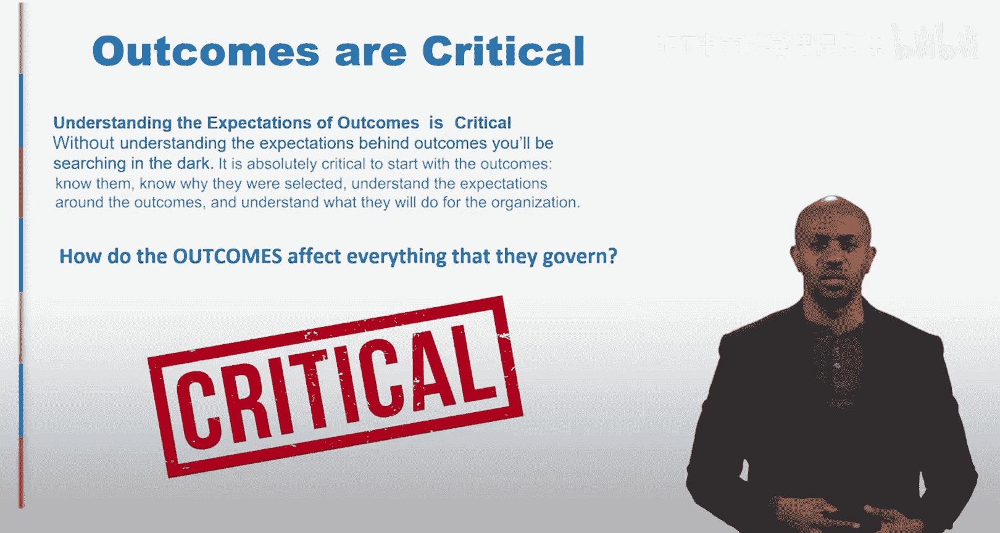
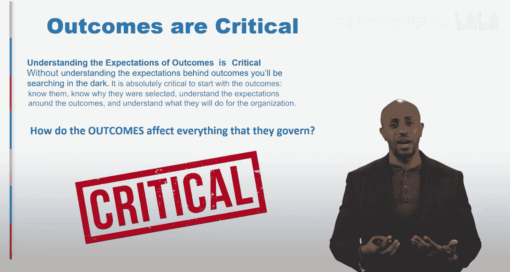
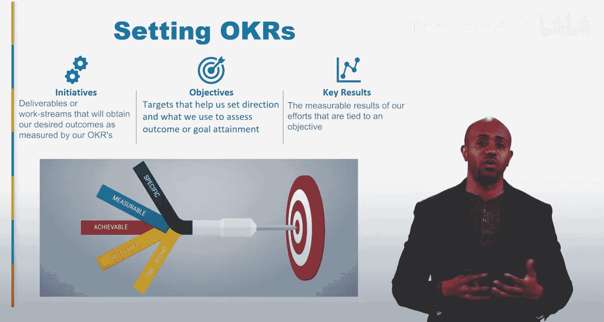
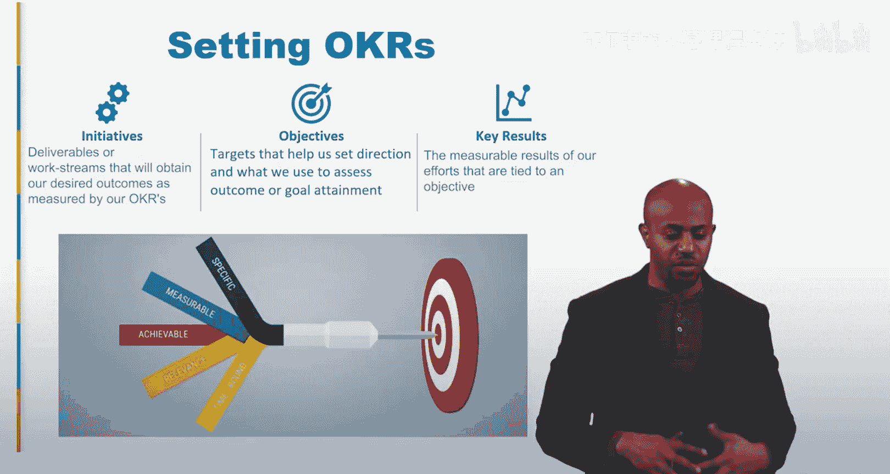
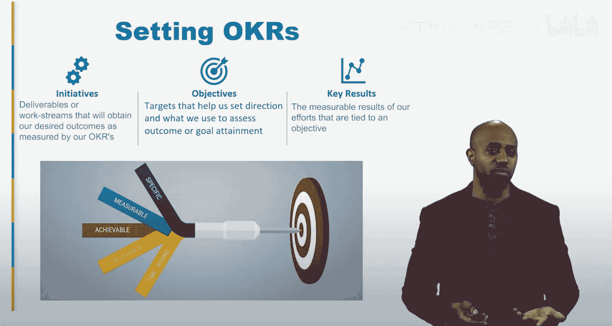
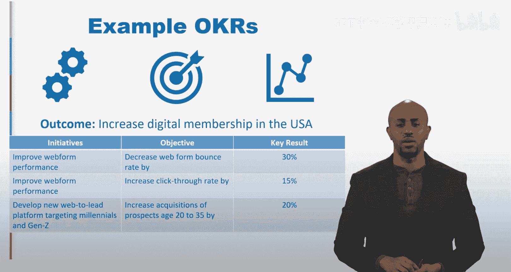
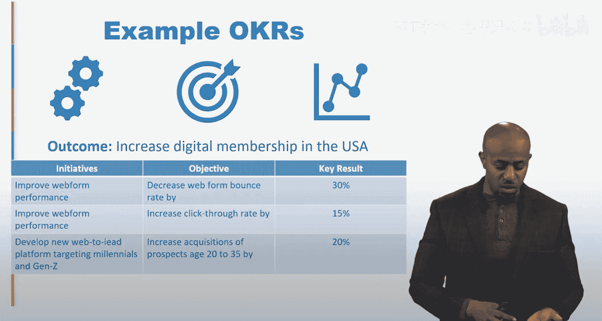
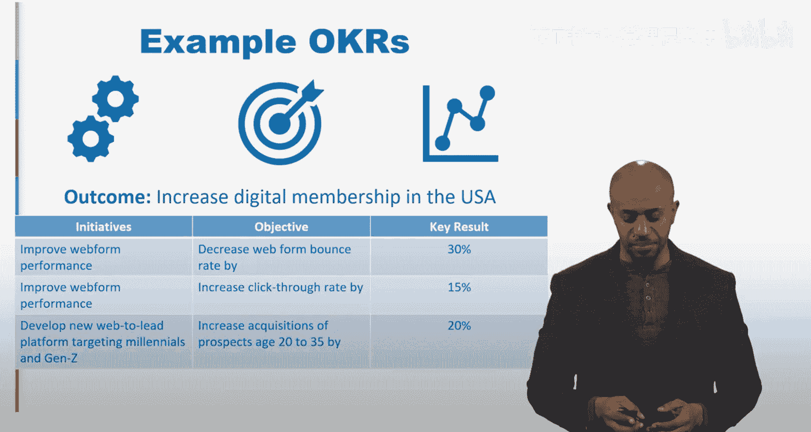

# 7：暗数据价值目标设定 🎯

在本节课中，我们将要学习如何理解成果背后的期望，以及它们如何与目标与关键成果（OKR）相关联。当我们处理暗数据、应对未知问题并寻求解决方案时，设定清晰的目标至关重要。我们将探讨如何分解任务，以便持续交付价值，并利用暗数据放大我们所能提供的价值。

## 理解成果与OKR

上一节我们介绍了成果的重要性，本节中我们来看看如何设定支撑这些成果的目标与关键成果。

成果与目标及关键成果之间存在细微差别。成果是一个更宏观、更定性、更高层次的集合。例如，提高上市速度、从根本上改善运营和业务绩效，或在特定行业或市场中获得竞争优势，这些都是高层次的成果。我们需要理解这些成果背后的具体期望。

## 从高层目标到具体工作

从这些OKR开始，如果我们审视各项举措、目标以及支撑它们的关键成果，就需要明确我们谈论的是哪个工作流。

一个CEO可能设定的高层成果可能是：“目前我们在财富500强中排名第100，但五年内我想排到第50名。”这是一个非常有抱负且难以实现的目标。为了实现这样的抱负，你需要开始设定能够帮助你达成目标的具体指标和度量标准。

以下是可能带来这种变革性成果的产品类型：
*   一个全新的产品。
*   一个创造全新市场或生态系统的产品。

## 暗数据思维与目标设定

如果我们不进行更具创造性的思考，或者不理解暗数据的领域，我们可能会无意中将OKR设定得过低。

我们可能认为，在常规业务基础上进行小幅改进就能有所帮助。这或许能带来一些成果，但可能无法满足我们在那些高层成果中设定的期望。

## OKR设定实例与分析

从标准视角来看，这里有一个包含三个OKR的示例。目标是定性的，关键成果是定量的，二者共同构成了一个可量化的OKR。

以下是示例OKR列表：
*   **目标**：提升网站性能。
    *   **关键成果1**：将网站表单跳出率降低30%。
    *   **关键成果2**：将点击率提高15%。
*   **目标**：增加特定目标人群的获取。
    *   **关键成果**：将该人群的获取量提高20%。

在思考如何实现以及这些OKR是否可达成、是否合理时，有几点需要注意。

首先，这个示例缺少基线。如果我们不知道起点在哪里，就不知道该如何实现这个OKR。因此，默认情况下，我们看到的这个例子是有缺陷的，我们应该有一个基线。

其次，当我看到“提升网站性能”这样的举措，以及“将网站表单跳出率降低30%”这样的目标时，我的第一个问题是：这是最重要的事情吗？它是否具有高度优先级？为什么？

如果CEO的目标是从财富500强第100名升至第50名，那么我的疑问是：提升网站性能是正确的举措吗？通过这个目标和关键成果，我们真的能实质性帮助实现那个成果吗？理想情况下，答案是否定的。

## 提出正确的问题

因此，如果我在网站团队工作，我的问题应该是：我们应该做什么来帮助实现财富500强排名上升50位的成果？

当你经历这个阶段时，你会希望思考这些问题，因为一旦你开始提出这些问题，暗数据就会开始浮现。例如，如果我问这个问题，人们可能会说：“我们没有那个数据，我们没有基线。”那么我们就需要去获取它，我们需要找到它。我们是否知道未来几年的行业预测？我们需要去获取那些数据。我们需要寻找大量数据，以便更好地围绕正确的OKR、正确的成果进行调整，进而达到我们想要实现的期望。

本节课中，我们一起学习了成果与OKR的区别，理解了从高层抱负目标分解到具体工作流和指标的重要性。我们通过实例分析了OKR设定中常见的缺陷，如缺乏基线和与顶层目标脱节。关键在于，在处理暗数据时，必须提出正确的问题来挑战现有假设，这能帮助我们发现未知的数据需求，从而设定更精准、更具雄心的目标，最终利用暗数据创造超额价值。