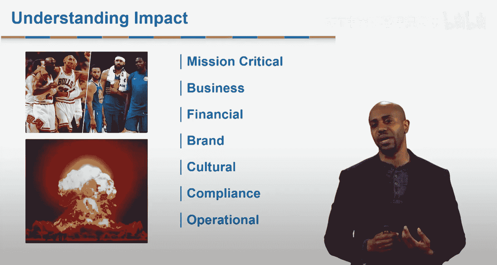
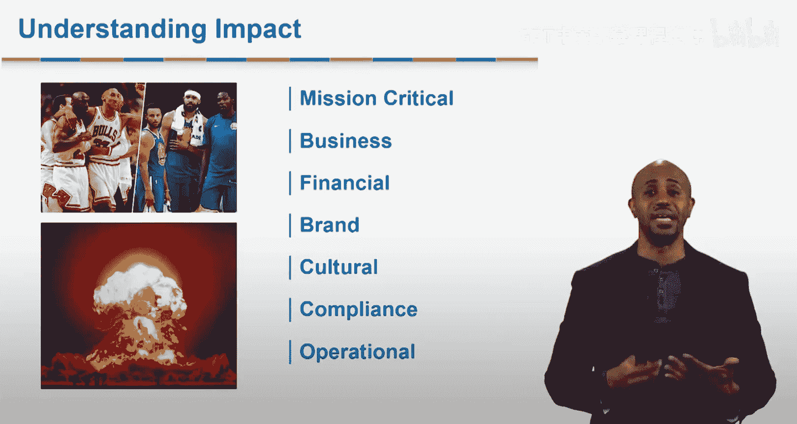
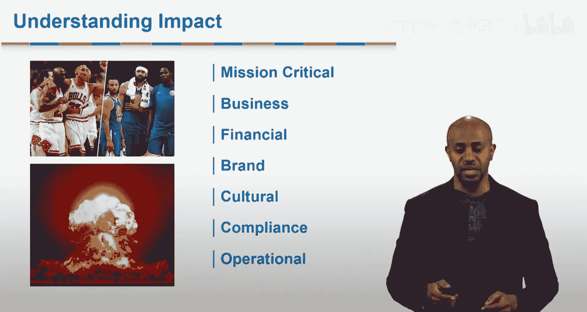
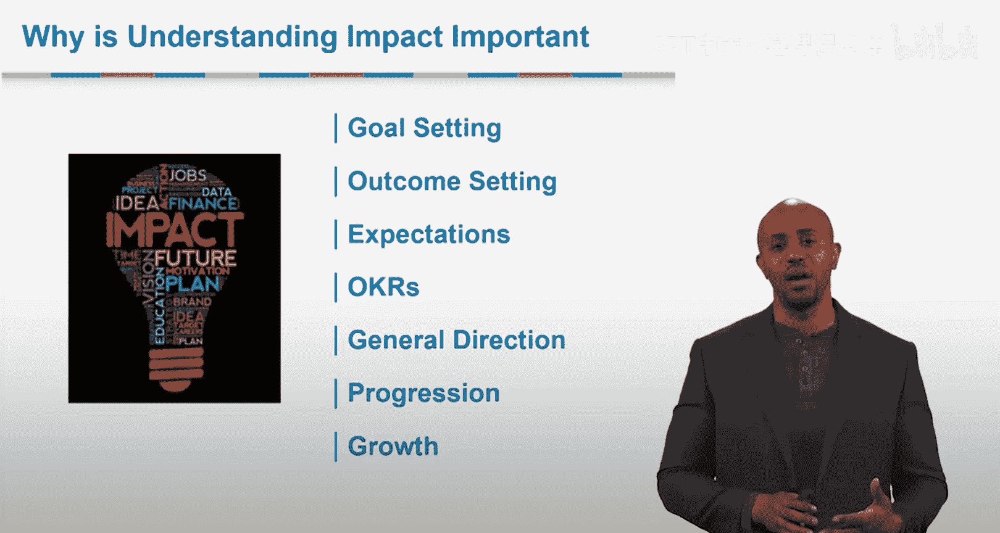
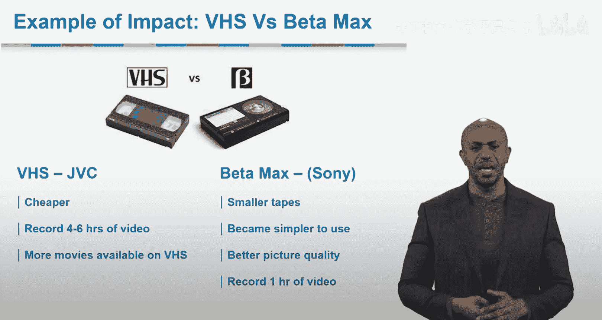
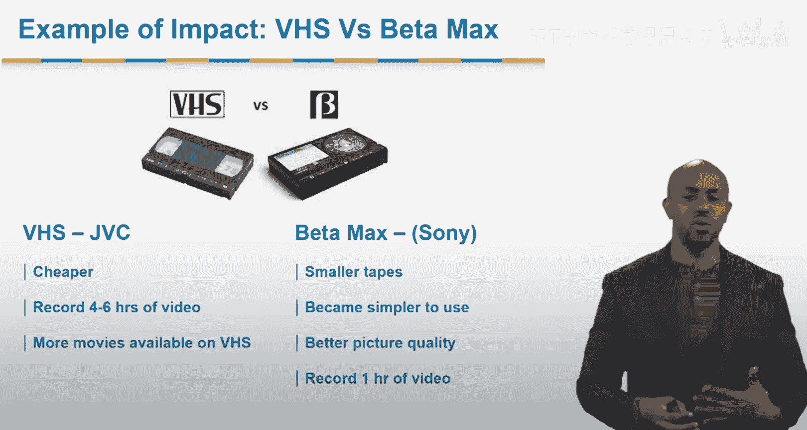
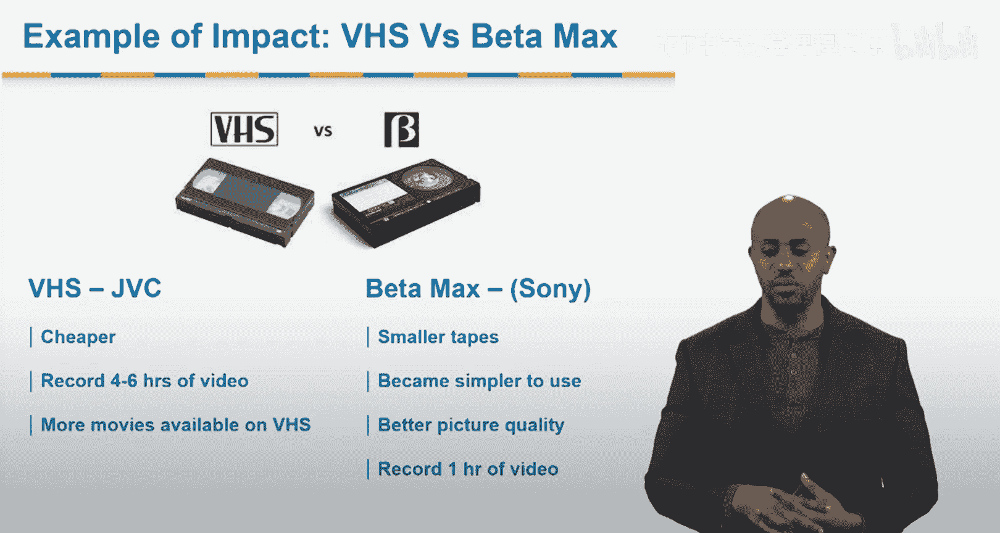

# 8：影响认知分析 📊

在本节课中，我们将探讨黑暗数据的影响，以及在项目伊始如何理解并获取有用黑暗数据所带来的影响。

上一节我们讨论了黑暗数据的识别，本节中我们来看看如何评估和管理其影响。

## 项目影响类型

在审视项目可能产生的影响时，存在几种不同的类型。

你可以成为迈克尔·乔丹和斯科蒂·皮蓬那样的强力组合，也可以成为斯蒂芬·库里、凯文·杜兰特以及整个金州勇士队那样的“射手”团队。你绝对不希望成为一颗“原子弹”。

在项目和团队中，经常由于彼此不理解、规划不当或期望不明确，导致整个局面陷入“原子弹”式的灾难场景。因此，有些方面需要你密切关注。

以下是需要关注的核心方面：

*   **任务关键性**：你正在处理的工作是否属于关键任务？如果不是，那么什么是关键任务？你如何引导周围人的思维，让他们聚焦于关键任务并思考如何达成目标？
*   **关注焦点**：你的关注点是否更偏向业务、财务、品牌、文化、合规还是运营？我们应该聚焦于哪个方面？如何确保每个人都扮演好自己的角色，理解我们共同未知的事物，并将所有因素整合在一起？

## 理解影响的重要性

理解影响的重要性至关重要。

这涉及到目标设定、成果预期设定、OKR（目标与关键成果）以及整体方向规划。这些都是确保我们长期成功的重要方法。

当我们思考黑暗数据和未知领域时，前期需要进行大量的分析和研究，以理解基线情况，明确可实现的目标，并制定出能够随时间推移而成功实现的分解计划。

## 案例分析：VHS 与 Betamax

一个关于影响的典型案例是 VHS 与 Betamax 的竞争。

Betamax 首先进入市场，一度引领行业。它主要由索尼制造，本身是一种更简单易用的磁带，对用户更友好，体积更小、更紧凑。坦率地说，从表面价值看，Betamax 整体上是一个更好的产品。

但真正让 VHS 登上顶峰的原因，不仅仅是它更便宜（虽然它们在成本上竞争），关键在于**VHS 可以录制更长时间**。

你可以进行长达四到六小时的家庭录像。在80年代，包括我的家人在内，很多人都有这种长长的VHS录像带，记录家庭野餐、生日、光明节等活动。此外，VHS 拥有更大的影片目录，有更多的电影可供选择。

而对于 Betamax，你只能获得一小时的录像。画面质量更好这一点变得无关紧要，事实是 VHS 比 Betamax 具有更多的**实用性**，尽管 Betamax 产品本身可能更优。此外，VHS 上可用的内容也更丰富。

因此，当你考虑产品的**实用性**时，VHS 遥遥领先。而 Betamax 除了实用性和价格之外，在其他所有方面都击败了 VHS。但当时消费者想要的就是这些，所以 VHS 赢得了与 Betamax 的战争。

当然还有其他例子，这里不一一列举。但当你观察产品随时间的演变时，VHS 后来输给了 DVD、蓝光等。如今，对于电影等内容，你都在手机上录制，并通过流媒体服务在线观看。随着时间的推移，还发生了其他格式战争，类似于 VHS 和 Betamax 的竞争。但 VHS 和 Betamax 的商业竞争，已成为失败与成功、以及影响类型的代名词——影响可以是毁灭性的“原子弹”，也可以是乔丹与皮蓬、库里与杜兰特那样的协同效应。

本节课中我们一起学习了项目影响的类型、理解影响的重要性，并通过 VHS 与 Betamax 的经典案例，分析了实用性等核心因素如何决定产品的市场成败。理解这些，有助于我们在处理黑暗数据项目时，更好地规划和聚焦，避免灾难，追求协同成功。