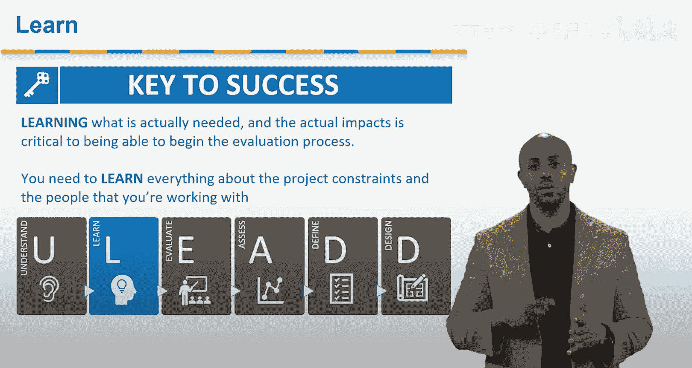
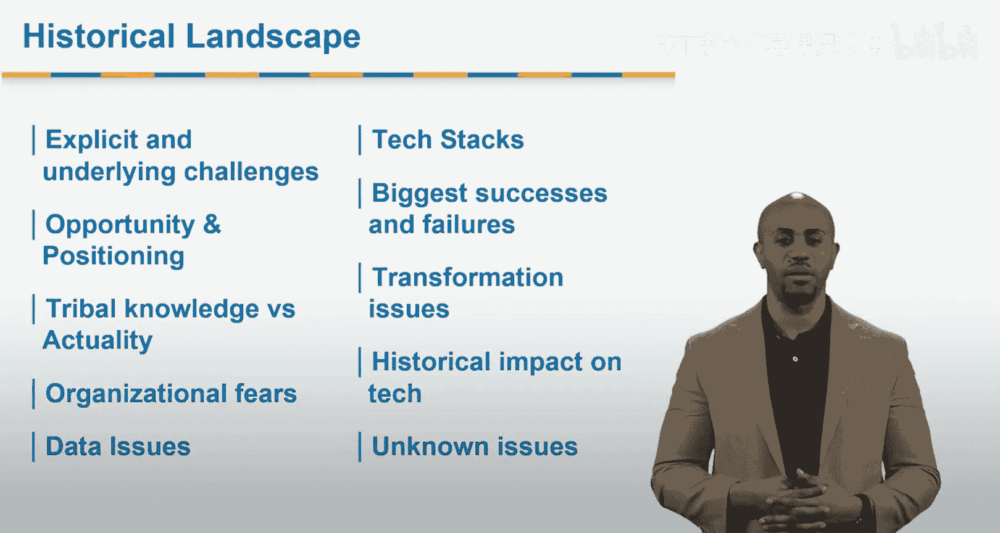
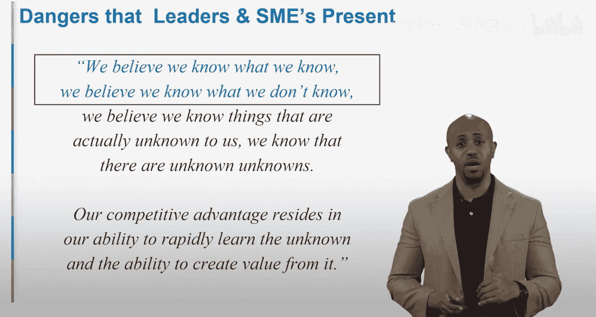

# 9：ULEADD学习阶段总览 🎯

在本节课中，我们将聚焦于ULEADD方法论中的“学习”环节。我们将深入探讨如何在学习阶段，首先对项目环境进行全面审视，这是进入该阶段后需要完成的首要任务。

## 概述

学习阶段至关重要，因为这是你开始筛选“部落知识”的起点。人们所说的内容可能完全正确，也可能部分正确。通过此阶段，你将能够理解在后续的评估、评定、定义和设计阶段中，可以在何处引入黑暗数据。

## 审视全局

首先，我们需要退一步，全面审视项目环境。具体而言，如果从技术角度讨论，我们需要关注技术栈。其中总是存在显性和潜在的挑战。这些信息部分可能来自团队成员，部分将从数据中浮现，还有部分可以从你先前收集到的材料中获得。

以下是学习阶段需要思考的几个关键方面：
*   团队在利用黑暗数据推动项目成功方面，存在哪些机遇和定位？
*   你如何能够穿透那些“部落知识”的迷雾？
*   当你接手一个新项目或任务时，需要重点思考的是：前人曾尝试过什么、做过什么，其历史影响如何，以及人们对这些过往经历的看法和描述是怎样的？因为如果过去有过负面经历，即使你提出不同的方案，但若使用了让他们联想到失败的表述，也可能引起对方的犹豫和迟疑。

## 聚焦已知与未知

接下来，我们想重温一句引言，并说明在本节课中，我们将主要关注前两行：“我们相信我们知道”和“我们相信我们知道我们不知道什么”。

在学习阶段，这种情况经常发生。你会与许多领域专家、领导者、副总裁、总监乃至高管合作。他们可能在行业工作多年，其当前的知识库可能有效，也可能过时。但很多时候，总有一些专家和领导者会固步自封，阻碍进步，忽视存在的黑暗数据，因为他们过去的成功如今反而成了进步的绊脚石。

## 案例分析：CIO与CMO

让我们重温CIO与CMO的那个案例，他们曾合作开发了一个无用的产品。

CMO提出了一个需求，CIO满足了该需求。CIO的团队花了三到四个月时间，构建了一个产品，但这个产品基本上只是告诉他们一些他们已经知道的信息，并未提供任何额外价值。因此，组织并未释放出成长、壮大、加速的能力，反而在浪费资源做一些不产生价值的事情。

在我们早前视频讨论的这个例子中，两位领导者都没有花时间去了解对方真正想要什么，以及对方试图构建什么。

审视这个案例，这正是CIO退一步思考的机会。他可以提出几个问题，审视黑暗数据可能产生影响的领域，然后仅基于几个问题，在识别存在哪些认知差距并理解需要做什么之后，向CMO提出建议。

## 对话解析

如果我们看这段对话，它始于CMO请求一个简单的用户界面。CIO可以这样回应：“好的，这是您所要求的。那么，您想用它来做什么？您希望它为您实现什么？”通常，当你提出这个问题时，人们会停顿一下进行思考。

于是CMO回应道，他们需要让分析师更专注于数字产品，以便看清他们在市场中的影响力。“影响力”是一个宽泛的类别，可以是财务影响、社会影响、竞争格局、产品表现、不同的市场细分、行业影响，甚至包括因缺乏市场所需解决方案而带来的竞争影响——这是许多公司甚至未曾关注的重要方面。

随着对话推进，CMO基本上表示，他们需要理解工程如何影响成本、效率、效能，以及与产品团队的关联。

接着，CIO可以简单地说：“听着，我们有一部分数据，但有些数据尚未为您的用途进行产品化。因此，有些数据需要被创造出来，有些数据需要被找到。”此时，我们开始触及黑暗数据，这正是价值所在，因为这是大多数人未曾探索的领域。

当你去寻找所需的黑暗数据，当你通过建立不显而易见的关系创造了新数据并丰富了现有数据时，这些都是让黑暗数据显现价值的方法。最后，总会有一些数据是无法直接获取的。

## 规划与思考

因此，在规划过程中，你需要开始思考：我们如何为此设计解决方案？我们是简单地将其标注出来，并使用情感分析之类的方法，还是能找到基于推测来创建视图的方法？这种推测至少应更接近准确或更贴近现实。

这些是我们在思考如何利用黑暗数据、如何仅凭对话中的信息和“学习”环节的收获来创造价值时，需要考虑的事情。一旦你确定了需要做什么，就更容易去往需要寻找的地方，找到现有可用的数据，并将这些数据添加到你想构建的产品、解决方案或试图从中创造的智能中去。

## 总结

本节课中，我们一起学习了ULEADD方法论中“学习”阶段的核心。我们明确了首要任务是全面审视项目环境，以识别和筛选“部落知识”。通过CIO与CMO的案例，我们深入分析了如何通过有效提问来揭示真实需求，并定位黑暗数据可能发挥价值的领域。关键在于，要从对话中识别已知与未知，并规划如何发现、创造或丰富数据，从而为后续阶段奠定坚实基础。