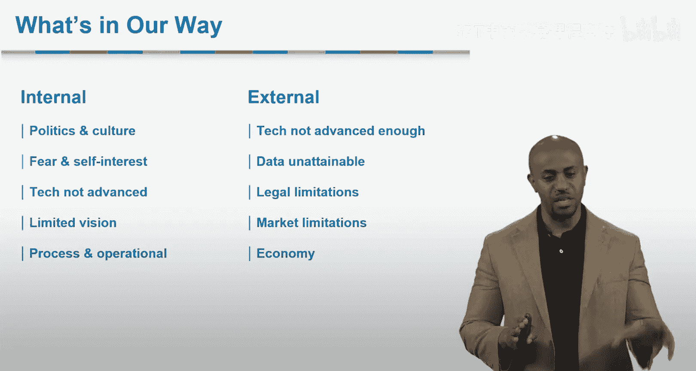

# 黑暗数据迁移与架构：10：学习障碍识别 🧠

在本节课中，我们将要学习在利用黑暗数据创造价值的过程中可能遇到的各种障碍。这些障碍分为内部和外部两大类，它们会阻碍组织创新、高效利用数据并实现增长。

## 概述

识别并理解利用黑暗数据的障碍是成功解锁其价值的关键一步。本节将详细探讨内部障碍（如恐惧、文化）和外部障碍（如技术限制、市场环境），并提供应对策略。

---

## 内部挑战：恐惧与文化

上一节我们介绍了障碍的分类，本节中我们来看看内部挑战。内部挑战主要源于组织内部的人为因素和结构性问题。

我认为，首要的内部挑战与**恐惧**有关。虽然部落主义和文化各有不同，但恐惧普遍存在，并同时影响着文化和部落主义。在一个高度依赖人际关系的组织中，人员的晋升和流动更多基于人脉而非能力，这种组织往往非常保守，其行为动机很大程度上源于恐惧。

例如，某公司的首席数据官（CDO）在之前的项目发布中犯过错误，表现不佳。但由于他与其他领导者关系良好，其职位依然稳固。为了避免他人发现自己的过失，这类管理者可能会封锁存在问题的数据或系统，阻止其他团队深入了解情况。对于一个像CDO这样的关键职位，**共享数据的透明度**和创建**联邦数据模型**（`federated data models`）至关重要，这能让公司内部人员自由地与数据交互，从而推动公司成功与增长。这种因恐惧而封锁数据的行为，会阻止那些有创造力、有能力揭示黑暗数据价值的人才将其应用于公司产品和增长中。

因此，在处理黑暗数据问题时，必须认真考虑恐惧因素。由恐惧驱动的部落主义和文化是一个不利的环境，需要警惕并设法规避，同时仍要达成所需的影响力。

## 内部挑战：人员与协作

人员是组织最宝贵的资产，也是推动技术前进的最大动力。考虑到大数据团队、分析团队以及各领域专家，人们通常会害怕自己的错误被他人看到。

当你提出利用黑暗数据的好想法时，必须在方法上保持策略性。你需要巧妙地团结人员，理解并避开那些令人畏惧的触发点。在协作方式上要富有创造力，确保让相关人员参与进来，但同时要避免触发他们的防御机制，导致他们拒绝新的、有创意的黑暗数据使用方案。

以下是应对内部人员挑战的几个要点：
*   **策略性沟通**：以建设性、非威胁性的方式提出想法。
*   **建立信任**：通过小规模成功案例逐步建立信任，展示价值。
*   **包容性参与**：让数据所有者和相关团队早期参与，使其成为解决方案的一部分。

---

## 外部挑战：技术与市场限制

在探讨了内部障碍后，我们转向外部挑战。外部挑战涉及市场环境以及从外部获取并利用黑暗数据的技术能力。

以从视频中提取数据为例。市场上有一些软件可以进行**情感分析**（`sentiment analysis`），以更自动化的方式浏览视频，识别出你可能寻找的特定内容，然后将这些数据提取出来并存入数据库，以便进行后续分析和算法建模。

这类新技术并非完全崭新，但其应用方式正在不断演进。然而，许多此类软件仍需改进，仍然存在错误。例如，一些用于机场等场所人脸识别的软件可能存在一定错误率，导致对个人的误判。

面对此类挑战，不应让软件或应用程序的数据生成质量问题阻止你前进。相反，应该思考如何绕过这些问题。以下是一些应对高级技术外部挑战的策略：
*   **保持技术前沿**：密切关注这类技术的发展曲线。
*   **实施数据质量检查**：建立流程来识别数据中的错误与正确部分。
*   **自动化填补缺口**：设法自动化解决方案，以填补数据中的空白。

---

## 总结

本节课中我们一起学习了利用黑暗数据时面临的主要障碍。我们深入分析了**内部挑战**，如由人际关系和保守文化引发的**恐惧**，以及其对数据透明度和协作的阻碍。同时，我们也探讨了**外部挑战**，包括从市场获取数据时遇到的**技术限制**和**数据质量问题**。

关键在于识别这些障碍，并采取策略性方法（如建立信任、实施质量检查）来规避或克服它们，从而成功释放黑暗数据的潜在价值，推动组织创新与发展。