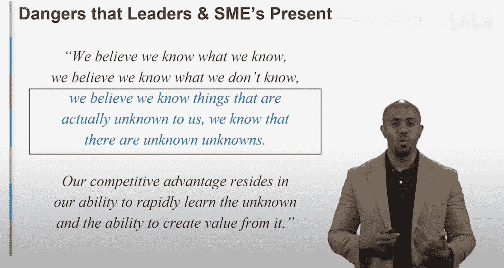
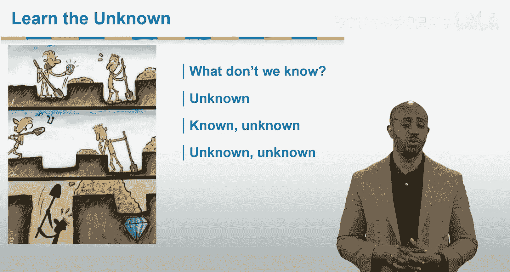
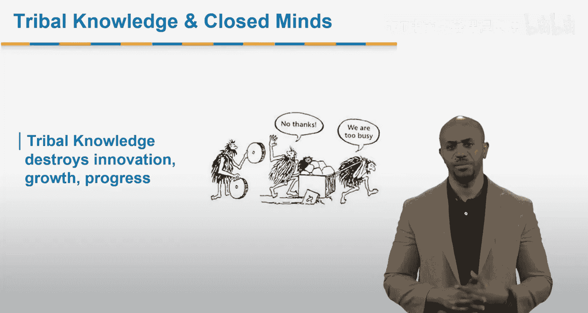

# 黑暗数据迁移与架构：第11章：探索暗数据的潜在价值 🕵️

在本节课中，我们将探讨暗数据的可能性，并分析在探索其价值时可能遇到的思维陷阱和挑战。我们将通过几个关键概念和比喻，帮助你理解如何更有效地处理未知数据。

---

上一节我们讨论了暗数据的定义与挑战，本节中我们来看看在探索其价值时，领导者、专家和团队可能面临的认知误区。

我们首先回顾一句引言，重点关注领导者与领域专家的观点，以及他们在处理涉及大量数据、暗数据、未知和“未知的未知”的项目时可能带来的危险。

当我们审视这句引言时，其部分内容谈到：**我们相信自己知道一些实际上对我们而言是未知的事情**。同时，我们也知道存在“未知的未知”。

很多时候，当你加入一个新团队或组建一个新团队时，有些人会自然地承担特定角色，例如领导角色或知识权威的角色。有时，他们过去的成功反而会导致失败，因为他们可能相信自己知道某些他们实际上并不知道的事情。如果团队在没有进行适当调查的情况下就跟随他们，就可能遇到挑战。对于“未知的未知”也是如此。

即使在那些我们都知道自己不知道的情况下，我们通常也倾向于跟随在该主题上知识更丰富的人，而最佳做法往往是退一步，真正进行调查，并尝试学习推进所需的知识。

---

为了更形象地理解，我们来看一个常见的比喻。

以下是关于探索路径选择的经典图示，它揭示了在寻找价值时可能犯的关键错误。

这张图你可能见过。它描绘了两个人挖钻石的情景：一个人很快挖到一颗小钻石，另一个人看到后心想：“哦，那我也去那边挖吧，因为我还没找到我想要的价值。”但实际上，如果他留在自己的坑里继续挖，他会发现比第一个人更大的宝藏。

这个比喻与暗数据主题相关的原因是：当他们开始挖掘时，两人都不知道宝藏的确切位置。如果知道，他们就会在同一个地点挖掘。图中人物的关键错误在于，看到别人的成功就立刻改变自己的路径。

有时跟随他人是好的，有时则不然。通常，最好的做法是退一步思考，**找到能发现自身价值的路径**。这条路径可能是跟随他人，也可能是走自己的路。

当我看到这张图时，我会思考几件事：如果我在这个人旁边挖掘，而他找到了价值，我会问自己：**我有哪些不知道的？有哪些未知数？我需要知道什么？以及，我知道哪些其实是未知的？** 通过思考这些问题，结合暗数据的特性，尝试理解最佳路线。

我的首要想法可能是：我能否找来更多人帮忙并分享成果？因为有些价值总比没有好。如果我们能通过合作获得它，我们可能会得到更大的收获，否则我可能一无所获。处理方式有很多种，也许你可以在一侧挖到一定深度再回到另一侧，方法多种多样。但除非你退一步尝试评估最佳路径，否则没有确定的方法。

---

上一部分我们通过挖钻石的比喻探讨了路径选择，接下来我们深入探讨“可能性”的思维模式。

我将深入探讨“可能性”。在企业环境中，我经常遇到这种思维定式：我们需要知道该问什么、该理解什么，以及我们不知道什么可能性。

**“可能性”通常比你目前掌握或设想的情况更好**。因此，获取尽可能多的信息，能让你理解整体的视野和格局。

而这种思维定式会摧毁每个人：**理解你是在选择容易的路径，还是最佳的路径**。大多数人默认选择容易的路径，如果能按下那个“简单按钮”，他们就会直接进入下一步。

在两幅图中，你看到一幅是一碗粥，另一幅是海鲜、薯条、汉堡、蔬菜等组成的盛宴。两者都能满足你的饥饿感。

但如果你必须在两餐之间选择，大多数人会选择屏幕右下角那丰盛的自助餐。

因此，当我们在寻找最佳路径和简单路径时，你要避免默认选择简单，除非它确实是正确的方式。

在我交付技术和数据产品时，我的思路总是先花时间理解**什么是可能的**，什么是最佳路径，然后思考如何分解这条最佳路径，以便在过程中获得快速的胜利。这通常是你的工作方式。当你看重价值创造，并分解那条最佳路径时，你必须找到所有的价值增值点，深入挖掘非显而易见的关系，并将暗数据融入其中。

---

最后，我想再谈谈部落知识和封闭思维。

第一个发明轮子的人，不得不面对那些不理解轮子是什么的人。

我们都忙于日常生活，努力在职业生涯中进步，创造新的、创新的事物，试图将产品完全投入市场并持续运行，并不断改进。**不要因为你过去的成功和工作，就对更好的想法、更大的可能性和更优的交付方式封闭思想**。

你绝对不想成为右边那两个人，推着装有方形轮子的推车，这只会让你自己更困难。

因此，要明白部落知识会破坏创新、增长、进步、能力、你能做的事情，以及整个企业、个人和团队的发展。这些都是需要牢记的事情，也是引入暗数据和新方法来交付成果的途径。

感谢你的时间。

---

**本节课总结**

在本节课中，我们一起学习了探索暗数据潜在价值时的关键思维。我们分析了“已知的未知”和“未知的未知”带来的认知陷阱，并通过“挖钻石”的比喻理解了坚持调查与评估最佳路径的重要性。我们还探讨了追求“可能性”而非默认“容易路径”的思维模式，并最终警示了封闭思维和部落知识对创新的阻碍。处理暗数据时，保持开放心态，积极调查未知，是解锁其巨大价值的关键。