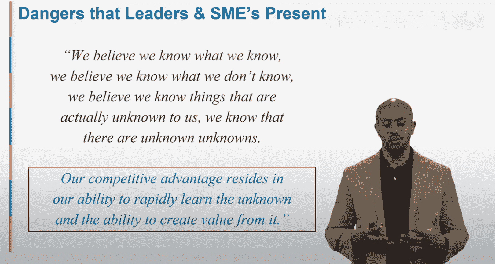
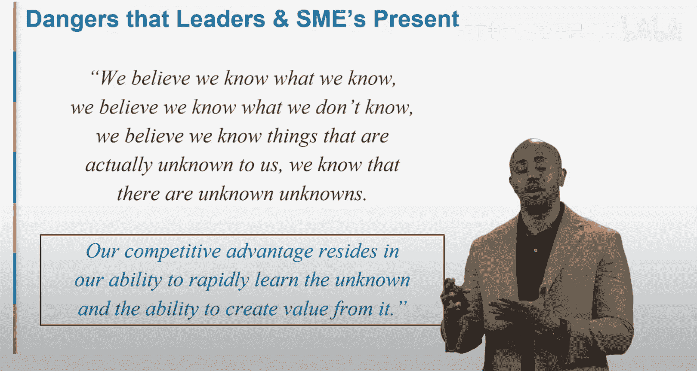
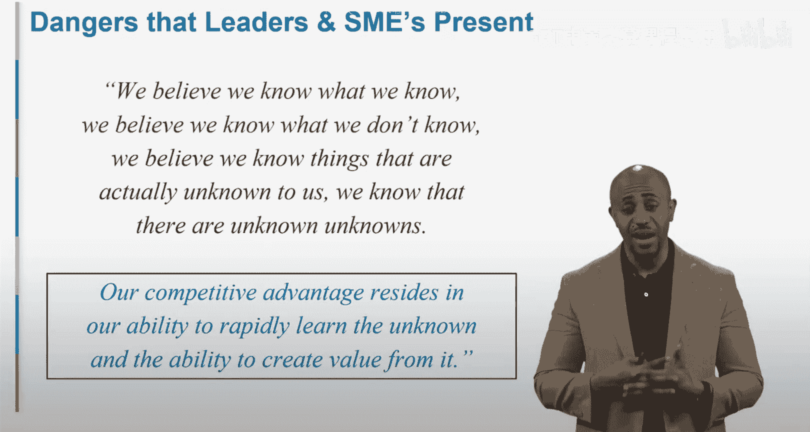
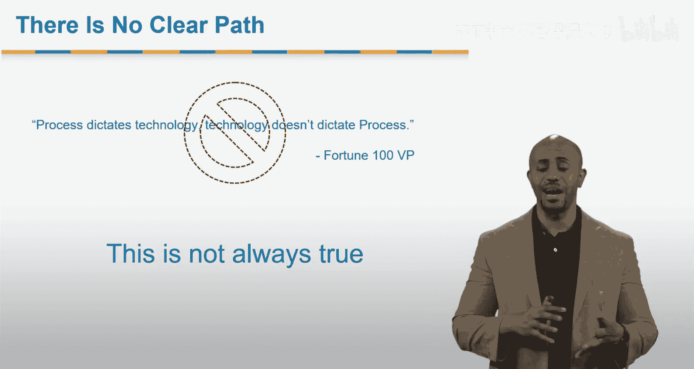

# 12：如何学习未知领域 🧠

在本节课中，我们将探讨如何学习并理解那些我们可能不熟悉或未知的事物。我们的竞争优势在于快速学习未知领域并从中创造价值的能力。然而，人们常常习惯于停留在已知和舒适的领域。处理黑暗数据时，我们必须经常走出舒适区，探索不熟悉的数据、流程和变化。这通常是一个艰难的过程，但在数字时代，价值往往就隐藏在这些未知之中。

## 从失败案例中学习

上一节我们提到了走出舒适区的重要性，本节中我们来看看一个因忽视黑暗数据而导致项目偏离轨道的真实案例。这是一个典型的产品会议对话，涉及工程副总裁和移动产品副总裁，他们本有机会纠正方向，但由于惰性、舒适感或恐惧，未能提出关键问题并深入挖掘。

以下是会议对话的核心要点：

*   **项目目标**：确定产品的投资回报率，考虑产品交付所涉及的一系列因素。
*   **已知成本**：软件成本、员工薪资、外部合作伙伴费用。
*   **未知的黑暗数据（被忽视的成本）**：
    *   高度协同团队的隐形成本。
    *   时间成本，包括拖慢产品生产速度的因素。
    *   产品发布对并行项目造成的协同影响或系统问题。
    *   是否构建了不必要的技术债务。
*   **对话失误**：当被问及如何计算成本时，回答只是简单汇总三项主要开支，无人追问上述未知细节。当被问及为何数据未按所需结构存储时，责任被推诿，而非共同探索解决方案。

这个案例展示了灾难如何发生：当合作双方未能保持开放心态，深入探究可能性与未知数据时，项目目标便难以达成。

## 挑战固有观念：“流程决定技术”

处理未知领域没有清晰路径，你必须懂得如何深入挖掘答案。这里引述一位财富100强金融科技公司副总裁的观点：“流程决定技术，技术不决定流程，而且永远如此。”

我们需要思考这个观点的局限性。虽然商业教学中常听到此说法，但它并非永远成立。特别是在工程领域，你可以通过新技术或新流程来革新旧有模式。**公式：`新流程 = f(新技术, 旧流程约束)`**，即新流程是新技术与旧流程约束的函数，技术可以成为流程变革的驱动者。

## 历史启示：技术驱动流程变革

为了理解技术如何驱动变革，让我们回顾历史。以旅行流程为例：

*   **1805年**：从纽约到佐治亚的旅行方式与今天截然不同。
*   **如果“流程决定技术”**：那么我们可能仍在乘坐马车。

亨利·福特的故事极具启发性。当被问及如何发明T型车时，他说：“如果我问人们想要什么，他们会说要更快的马。” 这说明，仅仅满足显性需求（“更快的马”）无法带来突破。福特整合了当时已有的不同制造工艺（黑暗数据），建立了非显而易见的联系，创造了**装配线**这一新流程，从而实现了汽车的大规模生产，彻底改变了交通。

*   **之前**：汽车是奢侈品。
*   **之后**：汽车走入大众家庭。

此后，飞机进一步革新了长途旅行，将从香港到纽约的旅程从漫长的海陆联运缩短至一天之内。这些进步都源于理解人们的需求、探索技术的可能性，并将看似不相关的黑暗数据（现有工艺、技术潜力）通过非显而易见的联系组合起来，创造出新的流程和解决方案。

## 核心方法论

综上所述，学习未知领域并利用黑暗数据创造价值，可以遵循以下方法：

1.  **保持开放与好奇**：主动走出舒适区，质疑固有假设（如“流程永远决定技术”）。
2.  **深入挖掘**：不满足于表面答案，像侦探一样追问隐藏的成本、数据和关联。
3.  **建立非显而易见联系**：像亨利·福特一样，观察不同领域的现有流程或数据片段，尝试将它们以新的方式组合。
4.  **聚焦价值创造**：始终思考如何将发现的未知信息转化为实际价值，无论是提升ROI、优化流程还是创造新产品。

本节课中，我们一起学习了如何通过学习未知领域来获取竞争优势。我们分析了一个因忽视黑暗数据而失败的对话案例，挑战了“流程决定技术”的固有观念，并从亨利·福特革新汽车工业的历史中获得了启示。关键在于保持开放心态，深入挖掘隐藏信息，并勇于建立新的、非显而易见的联系，从而从黑暗数据中发掘巨大价值。