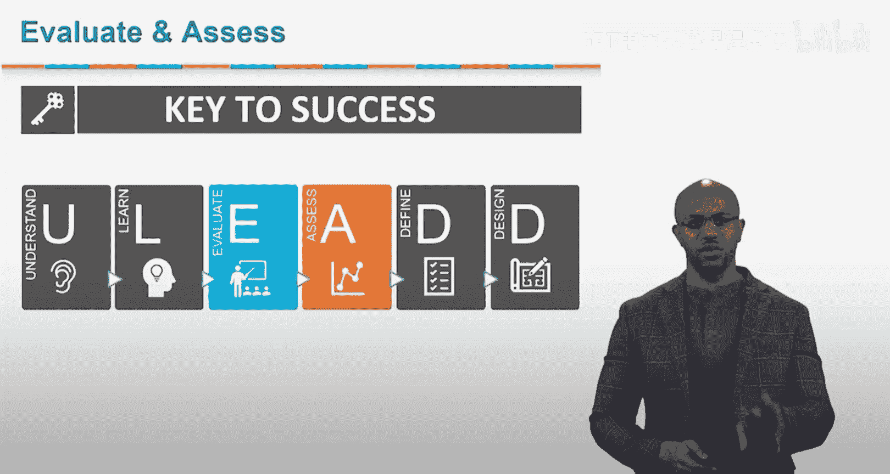
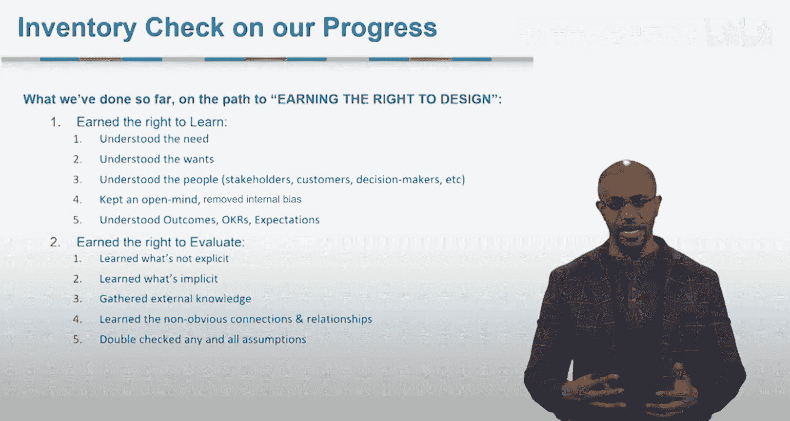
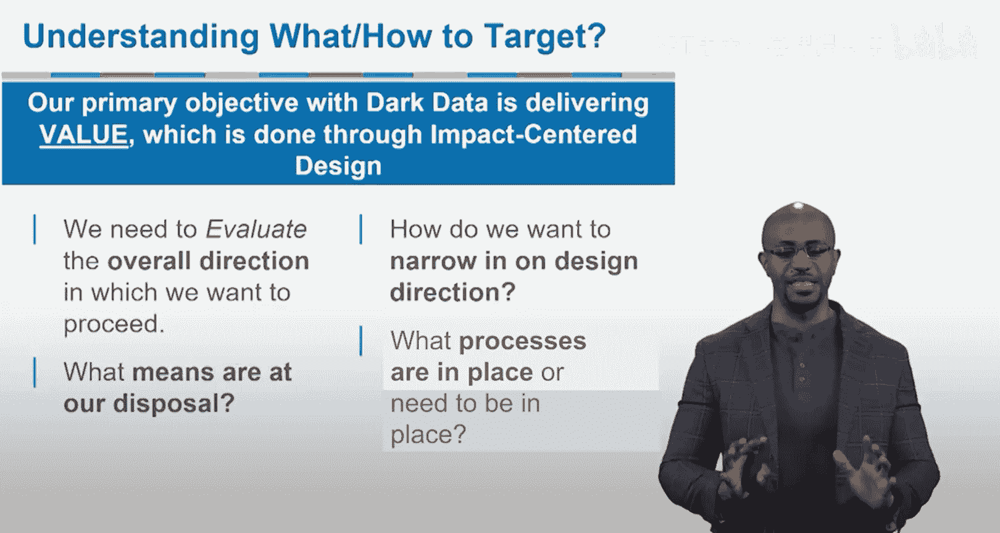
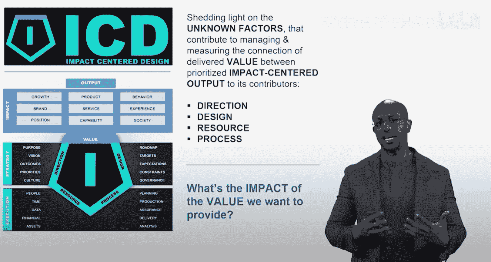
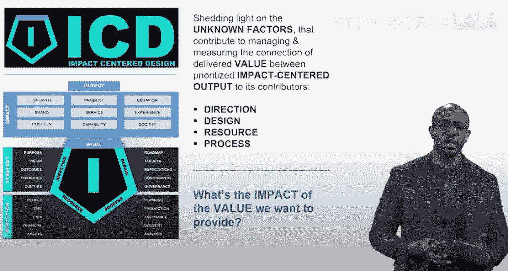
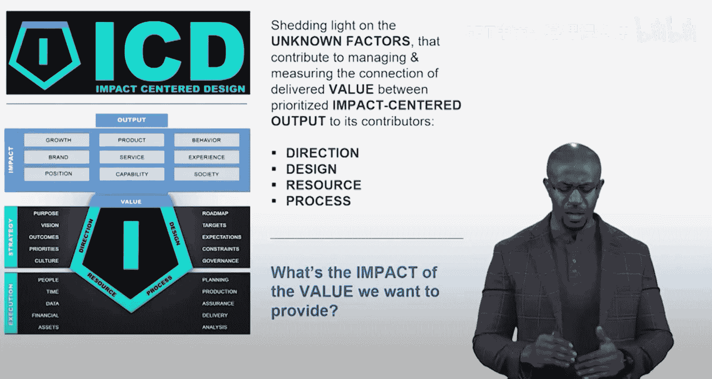

# 暗数据迁移与架构：13：影响中心设计与暗数据目标定位策略 🎯

在本节课中，我们将学习如何通过“评估与评定”阶段，引导出“影响中心设计”，从而为最终客户和企业交付价值。

上一节我们探讨了“理解”与“学习”阶段。现在，我们已经获得了进入“评估与评定”阶段的资格。简单回顾一下，我们理解了需求、期望、相关人员、障碍以及期望的成果（如OKRs）。我们从中学到了知识，并提前为流程增加了价值。

当我们从“学习”阶段进入“评估”阶段时，我们明确了哪些信息是显性的，哪些是隐性的。我们收集了外部知识，旨在为整个流程增值，特别是当我们想要引入暗数据并利用其创造价值时。

现在，通过“影响中心设计”，我们将理解如何有效地定位我们想要使用的暗数据。需要记住的一点是，暗数据通常不易于使用和创造价值。很多时候，如果需要捕获新数据，会涉及大量的设置工作。即使我们已经拥有这些数据，也需要专业知识来使用它、创建必要的参考信息，进而推导出价值。

在评估阶段，我们开始探讨如何评估整体方向、缩小设计方向、我们拥有哪些手段，以及哪些流程已经就位或需要调整、编辑、更改甚至移除，以交付我们所需的价值。

以下是“影响中心设计”的基本框架，它帮助我们思考如何将暗数据纳入体系。

在图表顶部，您可以看到“输出”。任何企业通常都会试图向市场推出产品、服务或能力。这个产品、服务或能力将产生影响，可能是增长、品牌认知、市场定位、行为体验或社会影响。它是否会改变、补充或增强消费者的行为？客户如何体验它？我们提供的产品、服务或能力对社会信息、规范和变革有何整体影响？

在图表下方，您会看到“战略”和“执行”，这是实现价值的两个主要部分。

我们将战略分为“方向”和“设计”两部分。“方向”通常由领导层驱动，“设计”通常由领导层及其下一到两级的专家、架构师等交付。当我们审视“执行”空间时，我们有“资源”和“流程”。

“资源”通常包括：
*   **人员与时间**：时间是常量，人员始终是您最重要的资源或最大的障碍，应将其定位为最重要的资源。
*   **数据**：数据是放大您价值和交付能力的资源。
*   **财务资产**：包括原材料、供应品等。

“流程”同样重要。正如上一模块亨利·福特的例子所示，他能够减少整个运输流程环节。流程与技术可以相互定义：有时技术决定流程，有时流程定义技术。

最后，我们需要问的核心问题是：我们想要提供的价值有何影响？以及我们如何照亮那些未知因素，从而交付专注于特定成果的输出？

下图是该框架的扩展视图。

我们的目标清单是：**提升企业或个人成长得更大、更好、更快的能力**。

在右侧，我们列出了可用于“战略”和“执行”空间的工具与策略。这些并非全部，但绝对是您在向前推进、交付输出、整合暗数据以创造价值时会采用和使用的。

本节课中，我们一起学习了“影响中心设计”框架。我们了解了如何从评估阶段过渡，通过审视输出、战略（方向与设计）、执行（资源与流程）以及核心影响问题，来系统地定位和利用暗数据，从而为企业创造明确的价值。