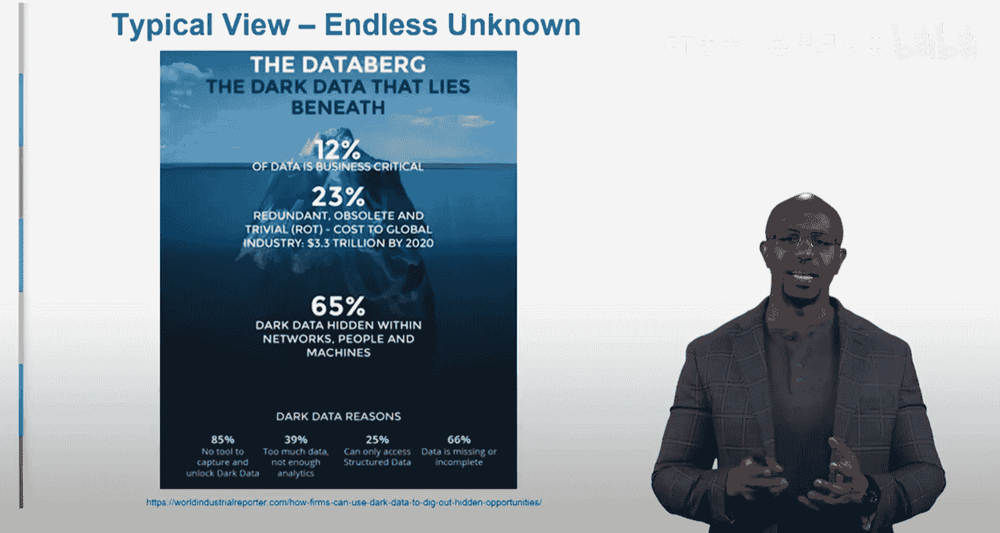
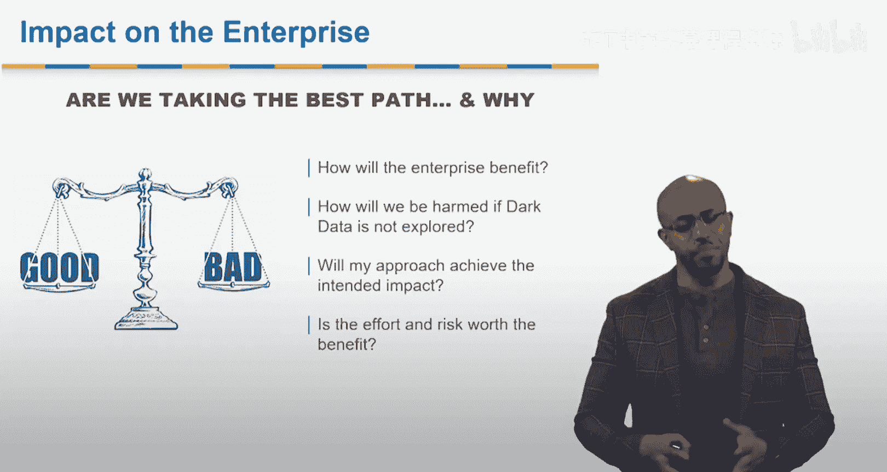

# 暗数据迁移与架构：14：暗数据范围界定方法论 🧭

在本节课中，我们将学习如何为特定目标界定暗数据的范围，从而从中获取价值。由于暗数据可能无穷无尽，一个系统化的界定方法至关重要。

## 概述：从“半空”到“半满”的视角转变

网络上常见的暗数据描述，通常使用冰山图像来比喻。这个经典比喻将数据分为三层：水面之上是显性数据，水面之下则是隐性数据。

根据这个模型，仅有 **12%** 的数据被用于业务关键用途，如法规遵从或驱动软件产品。其下是占 **23%** 的“腐坏数据”，即冗余、过时、琐碎的数据。这部分数据通常给行业带来巨大成本，但其中一些可能仍有价值。最底层是占 **65%** 的暗数据，它们隐藏在系统、网络、邮件和未记录的对话中，蕴含着大量潜在的信息和洞察。

然而，这种“冰山视角”容易让人产生畏难情绪，认为暗数据难以触及和处理。

## 范式转变：将暗数据视为“钻石矿” 💎

我们需要彻底转变范式，将暗数据视为一座充满价值的“钻石矿”。从新的视角看，大多数公司仅仅触及了价值矿脉的边缘。

*   **12%** 是关键数据。
*   **23%** 是价值最低的数据。
*   **65%** 是暗数据。

那些勇于探索“矿脉”之外、深入“群山”并设法开采“钻石”的公司，将能够逐步减少数据变“暗”的原因。这些原因通常包括：

以下是数据变“暗”的常见原因：
1.  **缺乏所需能力**：这是主要原因之一。提升团队技能可以更高效地处理暗数据。
2.  **数据量超出处理能力**：如何构建数据结构以实现自动化处理是关键。
3.  **数据缺失或不完整**：这是关键挑战。缺失的数据可能在任何地方，通常需要结合现有数据进行推断和测试。
4.  **只能访问结构化数据**：非结构化数据中的价值未被挖掘。

为了以这种“半满”的积极视角开展工作，我们可以借助一些标准的方法论和工具。

以下是可用于指导暗数据价值挖掘的常见方法：
*   **设计思维与计算思维**：这两种思维模式有助于在任何从未知中获取价值的规划活动中提供指导。
*   **SWOT分析**：这至关重要，它能帮助你识别机会与弱点，从而有针对性地获取信息并创造价值。
*   **原型设计、用例分析、解决方案设计等**：这些是具体的实践方法。
*   **以影响为中心的设计**：确保所有努力都围绕产生实际影响展开。

## 界定范围的三步法 🎯

上一节我们介绍了积极看待暗数据的视角，本节中我们来看看如何具体地界定其范围。这个过程可以分为三个步骤。

### 第一步：评估可能性

首先，你需要思考什么是可能的。目标是获得最广阔的视野，理解整体的数据格局。虽然我们常说“不要试图煮沸整个海洋”，但至少需要先“加热海洋”——即全面了解可能性。我们不会一次性处理所有问题，但必须清楚整个视野，以便确定应该优先“加热”海洋中的哪些特定区域。

在评估可能性时，需要考虑以下几点：
1.  **可交付成果是否与业务成果对齐？**
2.  **目标与关键成果是否与可能性匹配？**
3.  **如何逐步缩小这些OKR的聚焦范围？**

### 第二步：进行评估

在获得整体视野后，需要确保关键的目标与关键成果与此处的可能性相匹配，并且具有意义。然后，我们将学习如何随着时间的推移逐步缩小关注范围。评估与第一步的“评估可能性”有时可以并行或迭代进行，但为了讲解清晰，我们将其视为先后步骤。

### 第三步：选择最佳路径

我们之前在课程中讨论过不应选择轻松的道路，而应选择最佳路径。现在，我们具体从影响的角度来探讨：审视全局，缩小焦点，并判断我们选择的是否是最佳路径。“轻松路径”的讨论已经过去，现在我们要理解“为什么”要选择某条路径。

在选择路径时，需要思考以下四个问题：
1.  **企业将如何受益？** 这与OKR和业务成果紧密相连，需要确保它们全部对齐且合理。
2.  **如果不探索暗数据，我们将受到何种损害？**
3.  **如果探索暗数据，我们可能受到何种损害？**（例如成本、风险）
4.  **我的方法能否实现预期的影响？** 这一点非常关键。你不希望花费大量时间提取、转换、丰富、清理暗数据并将其推入生产环境后，却无法实现目标。
5.  **努力与风险是否值得所带来的收益？** 这是核心问题：我们投入的回报率是多少？任何有价值的事情通常都伴随风险。在将暗数据应用于任何解决方案时，都需要衡量：努力是否值得？风险是否可接受？我们能否从根本上改变做事的方式或产生的影响？

## 总结

本节课中，我们一起学习了暗数据的范围界定方法论。我们从转变视角开始，将暗数据从令人望而生畏的“冰山”重新定义为充满机遇的“钻石矿”。接着，我们介绍了一个三步走的界定流程：首先是**评估可能性**以获取全局视野；然后是**进行评估**，确保目标与可能性对齐并逐步聚焦；最后是**选择最佳路径**，从企业受益、潜在损害、影响达成度和投资回报率等多个维度进行综合考量，确保我们的努力能产生真正的价值。掌握这套方法，将帮助你有条不紊地从暗数据中发掘洞察，驱动业务发展。