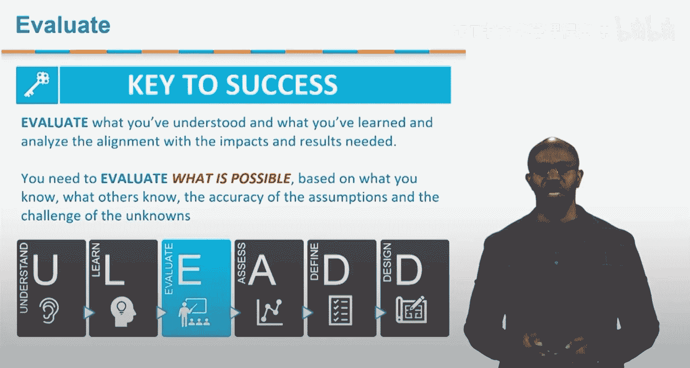
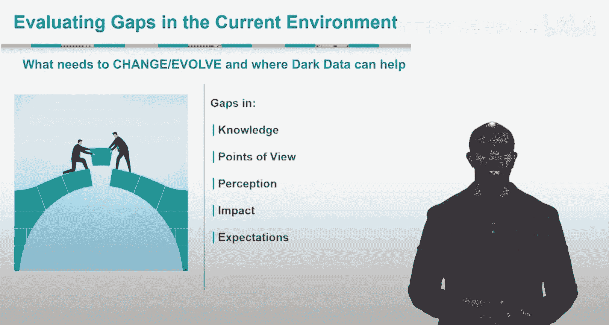
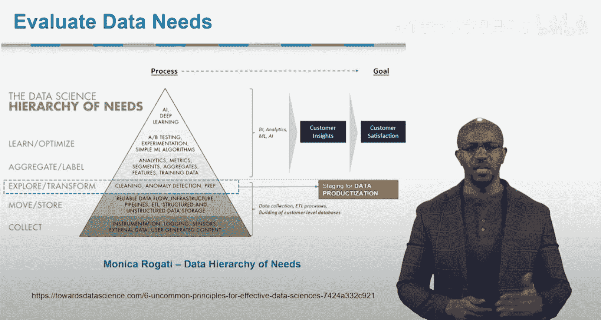

# 黑暗数据迁移与架构：15：差距评估框架 📊

在本节课中，我们将学习如何评估差距，以构建对可能性的全面视图。我们将探讨如何确定可能性、评估差距，并转向评估阶段，以决定前进方向、选择策略与工具，并最终交付成果。

---

上一节我们介绍了评估差距的重要性，本节中我们来看看一个高层次的评估框架。

在审视差距和可能性时，有几个关键方面需要考虑。以下列表并非穷尽，但根据经验，这五个方面在项目启动阶段对创造超出预期的价值具有重大影响。

以下是五个常见的差距领域：
1.  **知识差距**：团队或组织对特定领域缺乏了解。
2.  **观点差距**：不同利益相关者对同一问题持有不同看法。
3.  **认知差距**：对现状或问题的理解存在偏差。
4.  **影响差距**：对行动或决策可能产生的结果预估不足。
5.  **期望差距**：对项目目标、范围或成果的预期不一致。尤其是在深入探讨具体目标时，例如“减少投诉”，需要明确是针对特定渠道、特定产品还是所有投诉类型，这种期望的澄清至关重要。

---

了解了常见的差距类型后，我们来看一个标准的差距分析框架。

这是一个标准的差距分析示例视图。它从几个重点领域开始，审视期望的未来状态和当前状态，从而识别出差距。

许多公司将其视为“出发点 vs. 到达点”，或采用六西格玛思维中的“现状-应然-将然”状态。无论哪种方式，其核心都是：我们在哪里？我们想去哪里？未来状态是什么？如何到达那里？以及是什么阻碍了我们？

---

为了更具体地理解数据领域的差距，我们需要一个结构化的模型。接下来，我们将借助“数据科学需求层次”模型来进行分析。

这个模型的核心三角最初由莫妮卡·罗加蒂提出。我在此图中添加了一个虚线框，突出了中间的“探索与转换”阶段。我们将逐一讲解，并探讨虚线框的真正含义。

模型自下而上分为：
*   **收集与存储**：基础设施、系统和数据收集触点。关键在于如何以无偏见的最佳方式收集信息。
*   **移动与存储**：数据如何从事务系统、源系统流向记录系统、其他处理系统及履约系统。
*   **探索与转换**（虚线框内）：这是数据清洗、丰富、转换的阶段，通过引用数据集为下一层提供更多价值。**`数据产品化`** 主要发生在此阶段，它赋能数据分析师、科学家乃至普通业务人员。
*   **聚合与标签**：进入分析、商业智能、数据科学领域，开始使用训练数据和算法。
*   **A/B测试与实验**：进行前后测试、多变量测试，以理解不同策略或市场细分的效果。
*   **人工智能与深度学习**：让机器进行学习和智能决策，该领域仍在不断发展。

**探索与转换阶段至关重要**。如果数据在此阶段未能被恰当转换、清洗和丰富，没有建立一套关键指标来构建更稳健的视图，上层的分析工作就会受到限制。这个三角是数据科学分析流程及其如何实现最终目标的核心基础。

---

理论模型需要结合实际案例。现在，我们通过一个测量影响的例子来具体说明。

这个例子是关于测量投诉的影响。场景是首席财务官与企业体验副总裁的对话。

*   **CFO的诉求**：核心是想了解投诉的增长速度与业务量增长速度之间的关系。是呈指数级增长、慢于业务增长，还是同步增长？他需要理解问题的严重程度，但并未明确表达需要计算增长率或与业务增长挂钩。
*   **VP的回应**：她只是罗列了总数，例如投诉总量、特定渠道的投诉百分比，但没有提供智能化的视图，没有将数据与渠道影响、产品类别关联起来，无法解释为何某些类别或渠道的投诉更多或更少。
*   **真正的问题**：系统没有设置好来处理能够真正理解投诉情况的**黑暗数据**。这些投诉不仅关乎合规，更揭示了产品可能存在的问题。仅仅看销售总量或流量并不能判断产品核心性能的好坏。
*   **根本原因**：副总裁指出，系统设置不当，数据元素无法映射，数据模型未在企业内普及，需要大量参考数据才能整合信息点，同时他们也缺乏进行更高级分析所需的人员能力和专业知识。

---

基于上述案例，我们来思考如何将业务需求转化为具体的数据需求。

在思考业务需求、技术需求和用户（消费者、客户、潜在客户）需求时，我们需要在更细的粒度上思考，以推导出可执行的智能。

以下是我们需要知道的一些关键数据点：
*   客户和潜在客户的总数。
*   新客户与现有客户的比例。
*   客户流失总量和跳失率。
*   按产品、渠道、市场细分的新客户数量。
*   产品、广告、激励措施上市的速度（周期时间）。
*   年度对比、市场趋势对比。
*   与行业内其他公司注册投诉的对比，以及如何获取这些信息（例如，是否可以通过编写 `Python` 脚本抓取谷歌评论、Yelp 等平台的数据）。

认识到需要了解这些信息，也让你明白需要从**数据捕获点**开始设计，规划数据如何流经源系统和记录系统，以及如何在“数据科学需求层次”的转换层进行存储、编目、丰富和增长。

---

本节课中我们一起学习了差距评估的框架。我们从高层次的差距类型入手，介绍了标准的差距分析方法，并深入探讨了“数据科学需求层次”模型，特别是其中关键的“探索与转换”阶段。最后，通过一个具体的投诉分析案例，我们看到了如何将业务问题转化为具体的数据需求，并识别出系统、数据和能力上的根本差距。理解这些是制定有效数据策略、释放黑暗数据价值的第一步。